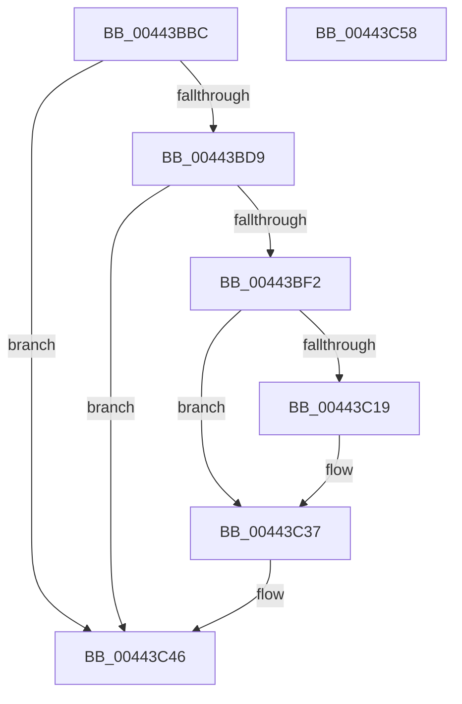

# MiAttachWorkingSet

- RVA: `0x00443BBC`–`0x00443C59` (길이 `157` bytes)
- VA: `0x0000000140443BBC`
- 실행 섹션: `.text`
- PDB 이름 있음: `예`; PDB Function 태그: `아니요`
- unwind 정보 RVA: `0x000A02F8`
- 디코드: `35`개 명령, `157/157` bytes 표시
- 미해석 바이트: `0` (있으면 어셈블리에 `.byte`로 보존)

> 이 문서는 커널 이미지의 기계어와 PDB 기호를 분석해 생성했습니다. 4번과 5번은 함수 원형과 자료형을 바이너리 사용 방식에서 추정한 C 해석이며 원본 소스 복구 결과는 아닙니다.

## 1. Dependencies

- 직접 호출 지점: **3**; 고유 호출 대상: **3**
- 직접 호출자로 확인된 함수: **1**
- RIP 상대 이미지 참조: **1**

### Outgoing calls
- `0x00443C31` → [KeBugCheckEx](../4F/KeBugCheckEx_function_004FD660.md) (function, `0x004FD660`)
- `0x00443C41` → [KiStackAttachProcess](../21/KiStackAttachProcess_function_00216820.md) (function, `0x00216820`)
- `0x00443C4E` → [_security_check_cookie](../6A/_security_check_cookie_function_006AC640.md) (function, `0x006AC640`)

### Direct callers
- [MiTrimOrAgeWorkingSet](../34/MiTrimOrAgeWorkingSet_function_0034EFC0.md) at `0x0034F059`

### Static image references
- `0x00443BC0` → RVA `0x00E0A740` (`.data`; read)

## 2. Other-region calls and transfers

- 다른 실행 섹션으로 향하는 call: **0**
- 별도 외부 분기/꼬리 이동을 확인하지 못했습니다.

## 3. Assembly (complete function range)

```asm
00443BBC  48 83 EC 78                     sub rsp, 0x78
00443BC0  48 8B 05 79 6B 9C 00            mov rax, qword ptr [rip + 0x9c6b79]
00443BC7  48 33 C4                        xor rax, rsp
00443BCA  48 89 44 24 60                  mov qword ptr [rsp + 0x60], rax
00443BCF  8B 81 B8 00 00 00               mov eax, dword ptr [rcx + 0xb8]
00443BD5  A8 0F                           test al, 0xf
00443BD7  75 6D                           jne 0x140443c46
00443BD9  65 48 8B 04 25 88 01 00 00      mov rax, qword ptr gs:[0x188]
00443BE2  48 81 C1 00 FC FF FF            add rcx, -0x400
00443BE9  48 39 88 20 02 00 00            cmp qword ptr [rax + 0x220], rcx
00443BF0  74 54                           je 0x140443c46
00443BF2  0F 57 C0                        xorps xmm0, xmm0
00443BF5  0F 11 44 24 30                  movups xmmword ptr [rsp + 0x30], xmm0
00443BFA  0F 11 44 24 40                  movups xmmword ptr [rsp + 0x40], xmm0
00443BFF  0F 11 44 24 50                  movups xmmword ptr [rsp + 0x50], xmm0
00443C04  65 4C 8B 04 25 88 01 00 00      mov r8, qword ptr gs:[0x188]
00443C0D  41 0F B6 80 4A 02 00 00         movzx eax, byte ptr [r8 + 0x24a]
00443C15  84 C0                           test al, al
00443C17  74 1E                           je 0x140443c37
00443C19  48 83 64 24 20 00               and qword ptr [rsp + 0x20], 0
00443C1F  48 8B D1                        mov rdx, rcx
00443C22  4D 8B 80 B8 00 00 00            mov r8, qword ptr [r8 + 0xb8]
00443C29  B9 05 00 00 00                  mov ecx, 5
00443C2E  44 8B C8                        mov r9d, eax
00443C31  E8 2A 9A 0B 00                  call 0x1404fd660
00443C36  CC                              int3
00443C37  4C 8D 44 24 30                  lea r8, [rsp + 0x30]
00443C3C  BA 01 00 00 00                  mov edx, 1
00443C41  E8 DA 2B DD FF                  call 0x140216820
00443C46  48 8B 4C 24 60                  mov rcx, qword ptr [rsp + 0x60]
00443C4B  48 33 CC                        xor rcx, rsp
00443C4E  E8 ED 89 26 00                  call 0x1406ac640
00443C53  48 83 C4 78                     add rsp, 0x78
00443C57  C3                              ret
00443C58  CC                              int3
```

## 4. C-style interpretation (structured pseudocode)

```c
__int64 __fastcall MiAttachWorkingSet(__int64 a1)
{
    __int64 result;
    __int64 v_rsp;
    unsigned __int64 v_stack_m18;
    unsigned __int64 v_stack_m28;
    unsigned __int64 v_stack_m38;
    unsigned __int64 v_stack_m48;
    unsigned __int64 v_stack_m58;

    v_rsp = (v_rsp) - (120);
    result = (*(unsigned __int64 *)(v_rip + 10251129)) ^ (v_rsp);
    v_stack_m18 = result;
    if ((((unsigned __int8)((unsigned int)(*(unsigned int *)(a1 + 184)))) & (15)) != 0) goto loc_00443C46;
    a1 = (a1) + (0xFFFFFFFFFFFFFC00ULL);
    if ((*(unsigned __int64 *)(*(unsigned __int64 *)(gs_base + (0 + 392)) + 544)) == a1) goto loc_00443C46;
    v_stack_m48 = v_xmm0;
    v_stack_m38 = v_xmm0;
    v_stack_m28 = v_xmm0;
    result = *(unsigned __int8 *)(*(unsigned __int64 *)(gs_base + (0 + 392)) + 586);
    if ((unsigned __int8)(*(unsigned __int8 *)(*(unsigned __int64 *)(gs_base + (0 + 392)) + 586)) != 0) {
        a2 = a1;
        a3 = *(unsigned __int64 *)(*(unsigned __int64 *)(gs_base + (0 + 392)) + 184);
        a1 = 5;
        a4 = (unsigned int)(*(unsigned __int8 *)(*(unsigned __int64 *)(gs_base + (0 + 392)) + 586));
        result = KeBugCheckEx(a1, a2, a3, a4);
    }
    result = KiStackAttachProcess(a1, 1, v_stack_m48, a4);
loc_00443C46:
    a1 = (v_stack_m18) ^ (v_rsp);
    result = _security_check_cookie(a1, 1, v_stack_m48, a4);
    v_rsp = (v_rsp) + (120);
    return result;
}
```

## 5. (Beta) C Style

```c
int64_t MiAttachWorkingSet(void *Arg1)
{
    uint8_t *arg1 = (uint8_t *)Arg1;

    int64_t result;
    int64_t local_rsp;
    uint64_t v_stack_m18;
    uint64_t v_stack_m28;
    uint64_t v_stack_m38;
    uint64_t v_stack_m48;
    uint64_t v_stack_m58;

    local_rsp = (local_rsp) - (120);
    result = (*(uint64_t *)(v_rip + 0x9C6B79)) ^ (local_rsp);
    v_stack_m18 = result;
    if ((((uint8_t)((uint32_t)(*(uint32_t *)(arg1 + 0xB8)))) & (15)) != 0) goto loc_00443C46;
    Arg1 = (Arg1) + (0xFFFFFFFFFFFFFC00ULL);
    if ((*(uint64_t *)(*(uint64_t *)(gs_base + (0 + 0x188)) + 0x220)) == Arg1) goto loc_00443C46;
    v_stack_m48 = v_xmm0;
    v_stack_m38 = v_xmm0;
    v_stack_m28 = v_xmm0;
    result = *(uint8_t *)(*(uint64_t *)(gs_base + (0 + 0x188)) + 0x24A);
    if ((uint8_t)(*(uint8_t *)(*(uint64_t *)(gs_base + (0 + 0x188)) + 0x24A)) != 0) {
        a2 = Arg1;
        a3 = *(uint64_t *)(*(uint64_t *)(gs_base + (0 + 0x188)) + 0xB8);
        Arg1 = 5;
        a4 = (uint32_t)(*(uint8_t *)(*(uint64_t *)(gs_base + (0 + 0x188)) + 0x24A));
        result = KeBugCheckEx(Arg1, a2, a3, a4);
    }
    result = KiStackAttachProcess(Arg1, 1, v_stack_m48, a4);
loc_00443C46:
    Arg1 = (v_stack_m18) ^ (local_rsp);
    result = _security_check_cookie(Arg1, 1, v_stack_m48, a4);
    local_rsp = (local_rsp) + (120);
    return result;
}
```

### 관측된 메모리 오프셋

구조체 형식이 확인되지 않은 접근은 인자 기준의 오프셋으로만 기록했습니다.

| 기준 인자 | 오프셋 표현 | 폭 (bit) | 접근 |
|---|---:|---:|---|
| `Arg1` | `+ 0xB8` | `32` | `R` |

## 6. Execution-region graph

[열기: 2D/3D 그래프와 함수 탐색 컨트롤 패널](../../../control-panel.html?section=text&rva=0x00443BBC&view=graph)

- 2D 그래프는 위에서 아래로 흐르고, 3D 그래프는 빈 공간을 드래그해 회전합니다. Shift+드래그는 이동, 휠은 확대·축소, 함수 노드 선택은 대상 보고서 이동입니다.

### Static fallback


