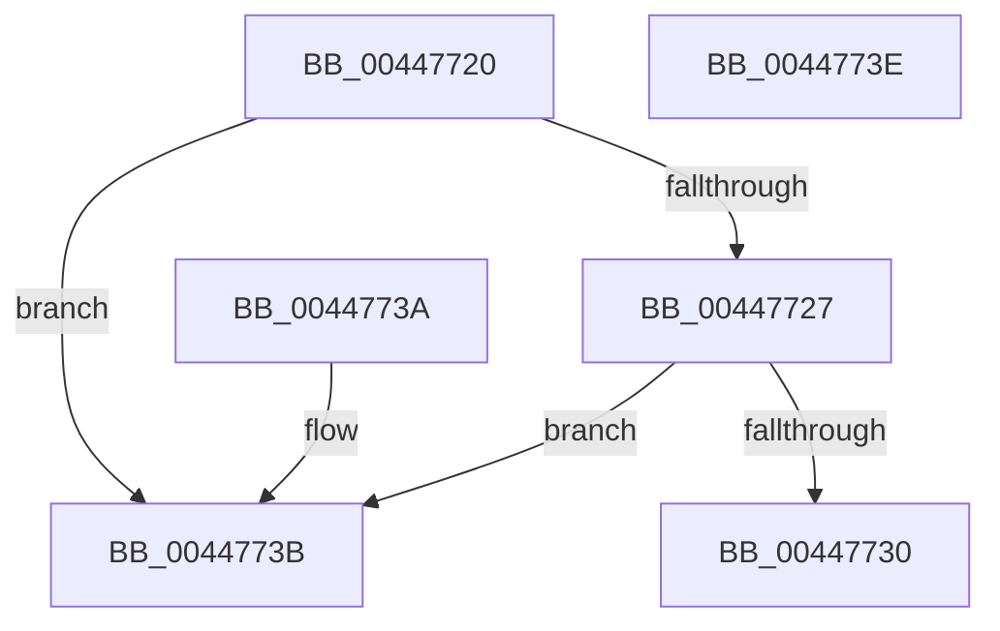

# MiAweControlArea

- RVA: `0x00447720`–`0x0044773F` (길이 `31` bytes)
- VA: `0x0000000140447720`
- 실행 섹션: `.text`
- PDB 이름 있음: `예`; PDB Function 태그: `아니요`
- unwind 정보 RVA: `0x000DB714`
- 디코드: `12`개 명령, `31/31` bytes 표시
- 미해석 바이트: `0` (있으면 어셈블리에 `.byte`로 보존)

> 이 문서는 커널 이미지의 기계어와 PDB 기호를 분석해 생성했습니다. 4번과 5번은 함수 원형과 자료형을 바이너리 사용 방식에서 추정한 C 해석이며 원본 소스 복구 결과는 아닙니다.

## 1. Dependencies

- 직접 호출 지점: **0**; 고유 호출 대상: **0**
- 직접 호출자로 확인된 함수: **5**
- RIP 상대 이미지 참조: **0**

### Outgoing calls
- 직접 디코드된 call 명령이 없습니다.

### Direct callers
- [MiReferenceAweHandle](../4E/MiReferenceAweHandle_function_004E00A4.md) at `0x004E0120`
- [MiMapViewOfDataSection](../../page/88/MiMapViewOfDataSection_function_00884E20.md) at `0x00884E60`
- [MmGetSectionInformation](../../page/92/MmGetSectionInformation_function_00921910.md) at `0x0092195B`
- [MiDeletePageFileSectionNodes](../../page/A1/MiDeletePageFileSectionNodes_function_00A1FD50.md) at `0x00A1FD91`
- [MiDereferenceFailedControlArea](../../page/A9/MiDereferenceFailedControlArea_function_00A99228.md) at `0x00A9923A`

### Static image references
- 디코드된 RIP-relative 메모리 참조가 없습니다.

## 2. Other-region calls and transfers

- 다른 실행 섹션으로 향하는 call: **0**
- 별도 외부 분기/꼬리 이동을 확인하지 못했습니다.

## 3. Assembly (complete function range)

```asm
00447720  48 83 79 40 00                  cmp qword ptr [rcx + 0x40], 0
00447725  75 14                           jne 0x14044773b
00447727  F7 41 38 00 04 00 00            test dword ptr [rcx + 0x38], 0x400
0044772E  75 0B                           jne 0x14044773b
00447730  8B 41 5C                        mov eax, dword ptr [rcx + 0x5c]
00447733  C1 E8 11                        shr eax, 0x11
00447736  83 E0 01                        and eax, 1
00447739  C3                              ret
0044773A  CC                              int3
0044773B  33 C0                           xor eax, eax
0044773D  C3                              ret
0044773E  CC                              int3
```

## 4. C-style interpretation (structured pseudocode)

```c
__int64 __fastcall MiAweControlArea(__int64 a1)
{
    __int64 result;

    if ((*(unsigned __int64 *)(a1 + 64)) != 0) goto loc_0044773B;
    if (((*(unsigned int *)(a1 + 56)) & (0x400ULL)) != 0) goto loc_0044773B;
    result = (unsigned int)(((unsigned int)(*(unsigned int *)(a1 + 92))) >> (17));
    result = (unsigned int)((result) & (1));
    return result;
loc_0044773B:
    result = 0;
    return result;
}
```

## 5. (Beta) C Style

```c
int64_t MiAweControlArea(void *Arg1)
{
    uint8_t *arg1 = (uint8_t *)Arg1;

    int64_t result;

    if ((*(uint64_t *)(arg1 + 0x40)) != 0) goto loc_0044773B;
    if (((*(uint32_t *)(arg1 + 0x38)) & (0x400ULL)) != 0) goto loc_0044773B;
    result = (uint32_t)(((uint32_t)(*(uint32_t *)(arg1 + 0x5C))) >> (17));
    result = (uint32_t)((result) & (1));
    return result;
loc_0044773B:
    result = 0;
    return result;
}
```

### 관측된 메모리 오프셋

구조체 형식이 확인되지 않은 접근은 인자 기준의 오프셋으로만 기록했습니다.

| 기준 인자 | 오프셋 표현 | 폭 (bit) | 접근 |
|---|---:|---:|---|
| `Arg1` | `+ 0x38` | `32` | `R` |
| `Arg1` | `+ 0x40` | `64` | `R` |
| `Arg1` | `+ 0x5C` | `32` | `R` |

## 6. Execution-region graph

[열기: 2D/3D 그래프와 함수 탐색 컨트롤 패널](../../../control-panel.html?section=text&rva=0x00447720&view=graph)

- 2D 그래프는 위에서 아래로 흐르고, 3D 그래프는 빈 공간을 드래그해 회전합니다. Shift+드래그는 이동, 휠은 확대·축소, 함수 노드 선택은 대상 보고서 이동입니다.

### Static fallback


