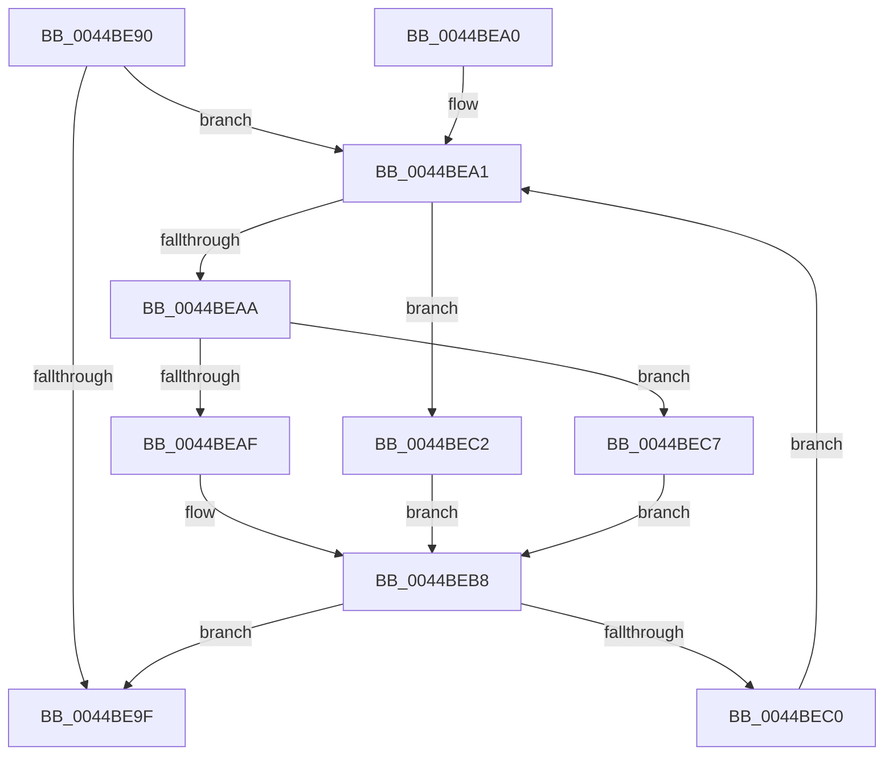

# MiBuildWakeList

- RVA: `0x0044BE90`–`0x0044BED1` (길이 `65` bytes)
- VA: `0x000000014044BE90`
- 실행 섹션: `.text`
- PDB 이름 있음: `예`; PDB Function 태그: `아니요`
- unwind 정보 RVA: `0x000DB714`
- 디코드: `23`개 명령, `65/65` bytes 표시
- 미해석 바이트: `0` (있으면 어셈블리에 `.byte`로 보존)

> 이 문서는 커널 이미지의 기계어와 PDB 기호를 분석해 생성했습니다. 4번과 5번은 함수 원형과 자료형을 바이너리 사용 방식에서 추정한 C 해석이며 원본 소스 복구 결과는 아닙니다.

## 1. Dependencies

- 직접 호출 지점: **0**; 고유 호출 대상: **0**
- 직접 호출자로 확인된 함수: **3**
- RIP 상대 이미지 참조: **0**

### Outgoing calls
- 직접 디코드된 call 명령이 없습니다.

### Direct callers
- [MiUnlockControlAreaSectionExtend](MiUnlockControlAreaSectionExtend_function_0044BDC4.md) at `0x0044BE00`
- [MiDecrementLargeSubsections](../4D/MiDecrementLargeSubsections_function_004D2BE0.md) at `0x004D2CE7`
- [MiIncrementLargeSubsections](../4D/MiIncrementLargeSubsections_function_004D3410.md) at `0x004D34F9`

### Static image references
- 디코드된 RIP-relative 메모리 참조가 없습니다.

## 2. Other-region calls and transfers

- 다른 실행 섹션으로 향하는 call: **0**
- 별도 외부 분기/꼬리 이동을 확인하지 못했습니다.

## 3. Assembly (complete function range)

```asm
0044BE90  4C 8B 41 50                     mov r8, qword ptr [rcx + 0x50]
0044BE94  4C 8D 49 50                     lea r9, [rcx + 0x50]
0044BE98  33 C0                           xor eax, eax
0044BE9A  4D 85 C0                        test r8, r8
0044BE9D  75 02                           jne 0x14044bea1
0044BE9F  C3                              ret
0044BEA0  CC                              int3
0044BEA1  4D 8B 10                        mov r10, qword ptr [r8]
0044BEA4  41 85 50 08                     test dword ptr [r8 + 8], edx
0044BEA8  74 18                           je 0x14044bec2
0044BEAA  F6 C2 04                        test dl, 4
0044BEAD  75 18                           jne 0x14044bec7
0044BEAF  49 89 00                        mov qword ptr [r8], rax
0044BEB2  49 8B C0                        mov rax, r8
0044BEB5  4D 89 11                        mov qword ptr [r9], r10
0044BEB8  4D 8B C2                        mov r8, r10
0044BEBB  4D 85 D2                        test r10, r10
0044BEBE  74 DF                           je 0x14044be9f
0044BEC0  EB DF                           jmp 0x14044bea1
0044BEC2  4D 8B C8                        mov r9, r8
0044BEC5  EB F1                           jmp 0x14044beb8
0044BEC7  41 C7 40 0C 01 00 00 00         mov dword ptr [r8 + 0xc], 1
0044BECF  EB E7                           jmp 0x14044beb8
```

## 4. C-style interpretation (structured pseudocode)

```c
__int64 __fastcall MiBuildWakeList(__int64 a1, unsigned __int8 a2)
{
    __int64 result;

    result = 0;
    if (*(unsigned __int64 *)(a1 + 80) != 0) goto loc_0044BEA1;
loc_0044BE9F:
    return result;
loc_0044BEA1:
    if (((*(unsigned int *)(*(unsigned __int64 *)(a1 + 80) + 8)) & (a2)) == 0) goto loc_0044BEC2;
    if (((a2) & (4)) != 0) goto loc_0044BEC7;
    *(unsigned __int64 *)(*(unsigned __int64 *)(a1 + 80)) = 0;
    *(unsigned __int64 *)(a1 + 80) = *(unsigned __int64 *)(*(unsigned __int64 *)(a1 + 80));
loc_0044BEB8:
    if (*(unsigned __int64 *)(*(unsigned __int64 *)(a1 + 80)) == 0) goto loc_0044BE9F;
    goto loc_0044BEA1;
loc_0044BEC2:
    goto loc_0044BEB8;
loc_0044BEC7:
    *(unsigned int *)(*(unsigned __int64 *)(*(unsigned __int64 *)(a1 + 80)) + 12) = 1;
    goto loc_0044BEB8;
}
```

## 5. (Beta) C Style

```c
int64_t MiBuildWakeList(void *Arg1, uint8_t Arg2)
{
    uint8_t *arg1 = (uint8_t *)Arg1;

    int64_t result;

    result = 0;
    if (*(uint64_t *)(arg1 + 0x50) != 0) goto loc_0044BEA1;
loc_0044BE9F:
    return result;
loc_0044BEA1:
    if (((*(uint32_t *)(*(uint64_t *)(arg1 + 0x50) + 0x8)) & (Arg2)) == 0) goto loc_0044BEC2;
    if (((Arg2) & (4)) != 0) goto loc_0044BEC7;
    *(uint64_t *)(*(uint64_t *)(arg1 + 0x50)) = 0;
    *(uint64_t *)(arg1 + 0x50) = *(uint64_t *)(*(uint64_t *)(arg1 + 0x50));
loc_0044BEB8:
    if (*(uint64_t *)(*(uint64_t *)(arg1 + 0x50)) == 0) goto loc_0044BE9F;
    goto loc_0044BEA1;
loc_0044BEC2:
    goto loc_0044BEB8;
loc_0044BEC7:
    *(uint32_t *)(*(uint64_t *)(*(uint64_t *)(arg1 + 0x50)) + 0xC) = 1;
    goto loc_0044BEB8;
}
```

### 관측된 메모리 오프셋

구조체 형식이 확인되지 않은 접근은 인자 기준의 오프셋으로만 기록했습니다.

| 기준 인자 | 오프셋 표현 | 폭 (bit) | 접근 |
|---|---:|---:|---|
| `Arg1` | `+ 0x50` | `64` | `R` |

## 6. Execution-region graph

[열기: 2D/3D 그래프와 함수 탐색 컨트롤 패널](../../../control-panel.html?section=text&rva=0x0044BE90&view=graph)

- 2D 그래프는 위에서 아래로 흐르고, 3D 그래프는 빈 공간을 드래그해 회전합니다. Shift+드래그는 이동, 휠은 확대·축소, 함수 노드 선택은 대상 보고서 이동입니다.

### Static fallback


