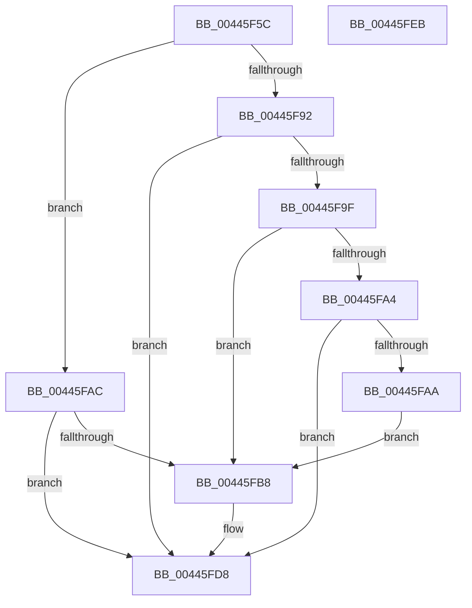

# MiChangePageHeatImmediate

- RVA: `0x00445F5C`–`0x00445FEC` (길이 `144` bytes)
- VA: `0x0000000140445F5C`
- 실행 섹션: `.text`
- PDB 이름 있음: `예`; PDB Function 태그: `아니요`
- unwind 정보 RVA: `0x000A5A24`
- 디코드: `40`개 명령, `144/144` bytes 표시
- 미해석 바이트: `0` (있으면 어셈블리에 `.byte`로 보존)

> 이 문서는 커널 이미지의 기계어와 PDB 기호를 분석해 생성했습니다. 4번과 5번은 함수 원형과 자료형을 바이너리 사용 방식에서 추정한 C 해석이며 원본 소스 복구 결과는 아닙니다.

## 1. Dependencies

- 직접 호출 지점: **3**; 고유 호출 대상: **3**
- 직접 호출자로 확인된 함수: **4**
- RIP 상대 이미지 참조: **2**

### Outgoing calls
- `0x00445FC3` → [MiInitializePageHeatList](MiInitializePageHeatList_function_00446000.md) (function, `0x00446000`)
- `0x00445FD3` → [MiAddPageToHeatList](MiAddPageToHeatList_function_0044603C.md) (function, `0x0044603C`)
- `0x00445FE0` → [_security_check_cookie](../6A/_security_check_cookie_function_006AC640.md) (function, `0x006AC640`)

### Direct callers
- [MiDemoteLocalLargePage](../28/MiDemoteLocalLargePage_function_0028A4F0.md) at `0x0028A923`
- [MiCoalesceFreeSmallPages](../33/MiCoalesceFreeSmallPages_function_00336340.md) at `0x00336BFF`
- [MiFreeLargePageMemory](../37/MiFreeLargePageMemory_function_00377938.md) at `0x00377A57`
- [MiLargeFreePageToMdl](../42/MiLargeFreePageToMdl_function_00420880.md) at `0x00420950`

### Static image references
- `0x00445F62` → RVA `0x00E0A740` (`.data`; read)
- `0x00445F92` → RVA `0x00FC6AB8` (`ALMOSTRO`; read)

## 2. Other-region calls and transfers

- 다른 실행 섹션으로 향하는 call: **0**
- 별도 외부 분기/꼬리 이동을 확인하지 못했습니다.

## 3. Assembly (complete function range)

```asm
00445F5C  40 53                           push rbx
00445F5E  48 83 EC 40                     sub rsp, 0x40
00445F62  48 8B 05 D7 47 9C 00            mov rax, qword ptr [rip + 0x9c47d7]
00445F69  48 33 C4                        xor rax, rsp
00445F6C  48 89 44 24 38                  mov qword ptr [rsp + 0x38], rax
00445F71  33 C0                           xor eax, eax
00445F73  0F 57 C0                        xorps xmm0, xmm0
00445F76  48 89 44 24 30                  mov qword ptr [rsp + 0x30], rax
00445F7B  45 8B D0                        mov r10d, r8d
00445F7E  44 8B DA                        mov r11d, edx
00445F81  48 8B D9                        mov rbx, rcx
00445F84  0F 11 44 24 20                  movups xmmword ptr [rsp + 0x20], xmm0
00445F89  44 8D 48 01                     lea r9d, [rax + 1]
00445F8D  45 85 C0                        test r8d, r8d
00445F90  75 1A                           jne 0x140445fac
00445F92  8B 05 20 0B B8 00               mov eax, dword ptr [rip + 0xb80b20]
00445F98  A9 00 00 40 08                  test eax, 0x8400000
00445F9D  74 39                           je 0x140445fd8
00445F9F  41 3B D1                        cmp edx, r9d
00445FA2  76 14                           jbe 0x140445fb8
00445FA4  0F BA E0 1B                     bt eax, 0x1b
00445FA8  72 2E                           jb 0x140445fd8
00445FAA  EB 0C                           jmp 0x140445fb8
00445FAC  F7 05 02 0B B8 00 00 00 20 00   test dword ptr [rip + 0xb80b02], 0x200000
00445FB6  74 20                           je 0x140445fd8
00445FB8  45 33 C0                        xor r8d, r8d
00445FBB  48 8D 4C 24 20                  lea rcx, [rsp + 0x20]
00445FC0  41 8B D2                        mov edx, r10d
00445FC3  E8 38 00 00 00                  call 0x140446000
00445FC8  48 8B D3                        mov rdx, rbx
00445FCB  48 8D 4C 24 20                  lea rcx, [rsp + 0x20]
00445FD0  45 8B C3                        mov r8d, r11d
00445FD3  E8 64 00 00 00                  call 0x14044603c
00445FD8  48 8B 4C 24 38                  mov rcx, qword ptr [rsp + 0x38]
00445FDD  48 33 CC                        xor rcx, rsp
00445FE0  E8 5B 66 26 00                  call 0x1406ac640
00445FE5  48 83 C4 40                     add rsp, 0x40
00445FE9  5B                              pop rbx
00445FEA  C3                              ret
00445FEB  CC                              int3
```

## 4. C-style interpretation (structured pseudocode)

```c
__int64 __fastcall MiChangePageHeatImmediate(__int64 a1, int a2, int a3)
{
    __int64 result;
    __int64 v_rsp;
    unsigned __int64 v_stack_m10;
    unsigned __int64 v_stack_m18;
    unsigned __int64 v_stack_m28;

    v_rsp = (v_rsp) - (64);
    result = (*(unsigned __int64 *)(v_rip + 10242007)) ^ (v_rsp);
    v_stack_m10 = result;
    result = 0;
    v_stack_m18 = 0;
    v_stack_m28 = v_xmm0;
    if (a3 != 0) goto loc_00445FAC;
    if ((((unsigned int)((unsigned int)(*(unsigned int *)(v_rip + 12061472)))) & (0x8400000ULL)) == 0) goto loc_00445FD8;
    if (a2 <= ((unsigned int)(result + 1))) goto loc_00445FB8;
    if (a2 < ((unsigned int)(result + 1))) goto loc_00445FD8;
    goto loc_00445FB8;
loc_00445FAC:
    result = (unsigned int)(*(unsigned int *)(v_rip + 12061472));
    if (((*(unsigned int *)(v_rip + 12061442)) & (0x200000ULL)) != 0) {
        a3 = 0;
        a1 = v_stack_m28;
        a2 = (unsigned int)((unsigned int)(a3));
        result = MiInitializePageHeatList(a1, a2, a3, result + 1);
        a2 = a1;
        a1 = v_stack_m28;
        a3 = (unsigned int)((unsigned int)(a2));
        result = MiAddPageToHeatList(a1, a2, a3, result + 1);
    }
    a1 = (v_stack_m10) ^ (v_rsp);
    result = _security_check_cookie(a1, a2, a3, result + 1);
    v_rsp = (v_rsp) + (64);
    return result;
}
```

## 5. (Beta) C Style

```c
int64_t MiChangePageHeatImmediate(int64_t Arg1, int32_t Arg2, int32_t Arg3)
{
    int64_t result;
    int64_t local_rsp;
    uint64_t v_stack_m10;
    uint64_t v_stack_m18;
    uint64_t v_stack_m28;

    local_rsp = (local_rsp) - (64);
    result = (*(uint64_t *)(v_rip + 0x9C47D7)) ^ (local_rsp);
    v_stack_m10 = result;
    result = 0;
    v_stack_m18 = 0;
    v_stack_m28 = v_xmm0;
    if (Arg3 != 0) goto loc_00445FAC;
    if ((((uint32_t)((uint32_t)(*(uint32_t *)(v_rip + 0xB80B20)))) & (0x8400000ULL)) == 0) goto loc_00445FD8;
    if (Arg2 <= ((uint32_t)(result + 1))) goto loc_00445FB8;
    if (Arg2 < ((uint32_t)(result + 1))) goto loc_00445FD8;
    goto loc_00445FB8;
loc_00445FAC:
    result = (uint32_t)(*(uint32_t *)(v_rip + 0xB80B20));
    if (((*(uint32_t *)(v_rip + 0xB80B02)) & (0x200000ULL)) != 0) {
        Arg3 = 0;
        Arg1 = v_stack_m28;
        Arg2 = (uint32_t)((uint32_t)(Arg3));
        result = MiInitializePageHeatList(Arg1, Arg2, Arg3, result + 1);
        Arg2 = Arg1;
        Arg1 = v_stack_m28;
        Arg3 = (uint32_t)((uint32_t)(Arg2));
        result = MiAddPageToHeatList(Arg1, Arg2, Arg3, result + 1);
    }
    Arg1 = (v_stack_m10) ^ (local_rsp);
    result = _security_check_cookie(Arg1, Arg2, Arg3, result + 1);
    local_rsp = (local_rsp) + (64);
    return result;
}
```

## 6. Execution-region graph

[열기: 2D/3D 그래프와 함수 탐색 컨트롤 패널](../../../control-panel.html?section=text&rva=0x00445F5C&view=graph)

- 2D 그래프는 위에서 아래로 흐르고, 3D 그래프는 빈 공간을 드래그해 회전합니다. Shift+드래그는 이동, 휠은 확대·축소, 함수 노드 선택은 대상 보고서 이동입니다.

### Static fallback


