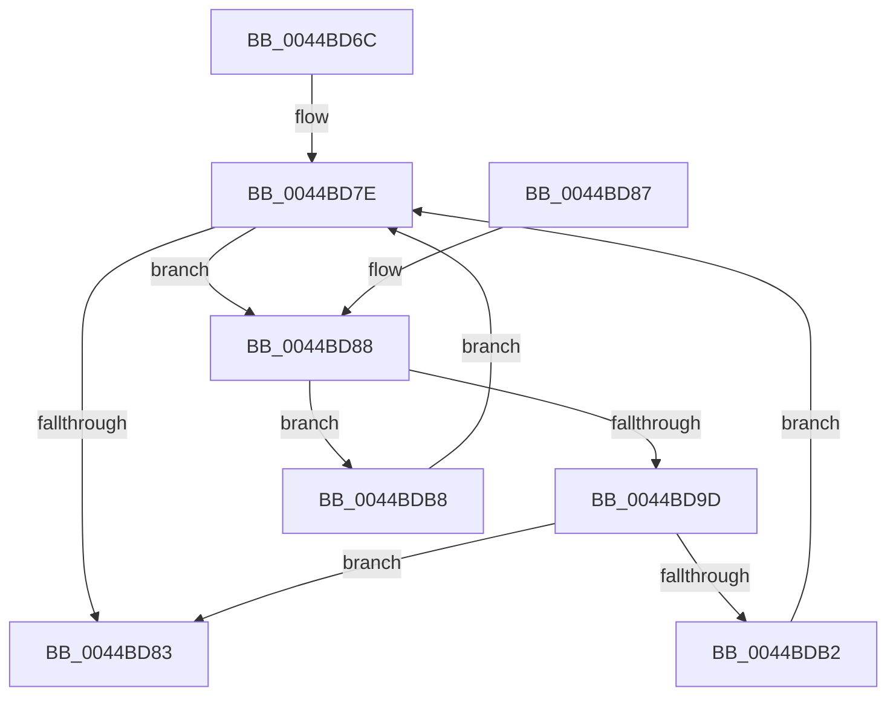

# MiCheckForConflictingVad

- RVA: `0x0044BD6C`–`0x0044BDBD` (길이 `81` bytes)
- VA: `0x000000014044BD6C`
- 실행 섹션: `.text`
- PDB 이름 있음: `예`; PDB Function 태그: `아니요`
- unwind 정보 RVA: `0x000DB714`
- 디코드: `25`개 명령, `81/81` bytes 표시
- 미해석 바이트: `0` (있으면 어셈블리에 `.byte`로 보존)

> 이 문서는 커널 이미지의 기계어와 PDB 기호를 분석해 생성했습니다. 4번과 5번은 함수 원형과 자료형을 바이너리 사용 방식에서 추정한 C 해석이며 원본 소스 복구 결과는 아닙니다.

## 1. Dependencies

- 직접 호출 지점: **0**; 고유 호출 대상: **0**
- 직접 호출자로 확인된 함수: **1**
- RIP 상대 이미지 참조: **0**

### Outgoing calls
- 직접 디코드된 call 명령이 없습니다.

### Direct callers
- [MiLocateLowestConflictingVad](MiLocateLowestConflictingVad_function_0044BD14.md) at `0x0044BD1D`

### Static image references
- 디코드된 RIP-relative 메모리 참조가 없습니다.

## 2. Other-region calls and transfers

- 다른 실행 섹션으로 향하는 call: **0**
- 별도 외부 분기/꼬리 이동을 확인하지 못했습니다.

## 3. Assembly (complete function range)

```asm
0044BD6C  4C 8B 89 58 05 00 00            mov r9, qword ptr [rcx + 0x558]
0044BD73  4C 8B D2                        mov r10, rdx
0044BD76  49 C1 EA 0C                     shr r10, 0xc
0044BD7A  49 C1 E8 0C                     shr r8, 0xc
0044BD7E  4D 85 C9                        test r9, r9
0044BD81  75 05                           jne 0x14044bd88
0044BD83  49 8B C1                        mov rax, r9
0044BD86  C3                              ret
0044BD87  CC                              int3
0044BD88  41 0F B6 49 20                  movzx ecx, byte ptr [r9 + 0x20]
0044BD8D  41 8B 41 18                     mov eax, dword ptr [r9 + 0x18]
0044BD91  48 C1 E1 20                     shl rcx, 0x20
0044BD95  48 0B C8                        or rcx, rax
0044BD98  4C 3B C1                        cmp r8, rcx
0044BD9B  72 1B                           jb 0x14044bdb8
0044BD9D  41 0F B6 51 21                  movzx edx, byte ptr [r9 + 0x21]
0044BDA2  41 8B 49 1C                     mov ecx, dword ptr [r9 + 0x1c]
0044BDA6  48 C1 E2 20                     shl rdx, 0x20
0044BDAA  48 0B D1                        or rdx, rcx
0044BDAD  4C 3B D2                        cmp r10, rdx
0044BDB0  76 D1                           jbe 0x14044bd83
0044BDB2  4D 8B 49 08                     mov r9, qword ptr [r9 + 8]
0044BDB6  EB C6                           jmp 0x14044bd7e
0044BDB8  4D 8B 09                        mov r9, qword ptr [r9]
0044BDBB  EB C1                           jmp 0x14044bd7e
```

## 4. C-style interpretation (structured pseudocode)

```c
__int64 __fastcall MiCheckForConflictingVad(__int64 a1, __int64 a2, __int64 a3)
{
    __int64 v_r10;

    v_r10 = (a2) >> (12);
    a3 = (a3) >> (12);
loc_0044BD7E:
    if (*(unsigned __int64 *)(a1 + 1368) != 0) goto loc_0044BD88;
loc_0044BD83:
    return *(unsigned __int64 *)(a1 + 1368);
loc_0044BD88:
    a1 = (*(unsigned __int8 *)(*(unsigned __int64 *)(a1 + 1368) + 32)) << (32);
    a1 = (a1) | ((unsigned int)(*(unsigned int *)(*(unsigned __int64 *)(a1 + 1368) + 24)));
    if (a3 < a1) goto loc_0044BDB8;
    a2 = (*(unsigned __int8 *)(*(unsigned __int64 *)(a1 + 1368) + 33)) << (32);
    a2 = (a2) | ((unsigned int)(*(unsigned int *)(*(unsigned __int64 *)(a1 + 1368) + 28)));
    if (v_r10 <= a2) goto loc_0044BD83;
    goto loc_0044BD7E;
loc_0044BDB8:
    goto loc_0044BD7E;
}
```

## 5. (Beta) C Style

```c
int64_t MiCheckForConflictingVad(void *Arg1, int64_t Arg2, int64_t Arg3)
{
    uint8_t *arg1 = (uint8_t *)Arg1;

    int64_t local_r10;

    local_r10 = (Arg2) >> (12);
    Arg3 = (Arg3) >> (12);
loc_0044BD7E:
    if (*(uint64_t *)(arg1 + 0x558) != 0) goto loc_0044BD88;
loc_0044BD83:
    return *(uint64_t *)(arg1 + 0x558);
loc_0044BD88:
    Arg1 = (*(uint8_t *)(*(uint64_t *)(arg1 + 0x558) + 0x20)) << (32);
    Arg1 = (Arg1) | ((uint32_t)(*(uint32_t *)(*(uint64_t *)(arg1 + 0x558) + 0x18)));
    if (Arg3 < Arg1) goto loc_0044BDB8;
    Arg2 = (*(uint8_t *)(*(uint64_t *)(arg1 + 0x558) + 0x21)) << (32);
    Arg2 = (Arg2) | ((uint32_t)(*(uint32_t *)(*(uint64_t *)(arg1 + 0x558) + 0x1C)));
    if (local_r10 <= Arg2) goto loc_0044BD83;
    goto loc_0044BD7E;
loc_0044BDB8:
    goto loc_0044BD7E;
}
```

### 관측된 메모리 오프셋

구조체 형식이 확인되지 않은 접근은 인자 기준의 오프셋으로만 기록했습니다.

| 기준 인자 | 오프셋 표현 | 폭 (bit) | 접근 |
|---|---:|---:|---|
| `Arg1` | `+ 0x558` | `64` | `R` |

## 6. Execution-region graph

[열기: 2D/3D 그래프와 함수 탐색 컨트롤 패널](../../../control-panel.html?section=text&rva=0x0044BD6C&view=graph)

- 2D 그래프는 위에서 아래로 흐르고, 3D 그래프는 빈 공간을 드래그해 회전합니다. Shift+드래그는 이동, 휠은 확대·축소, 함수 노드 선택은 대상 보고서 이동입니다.

### Static fallback


