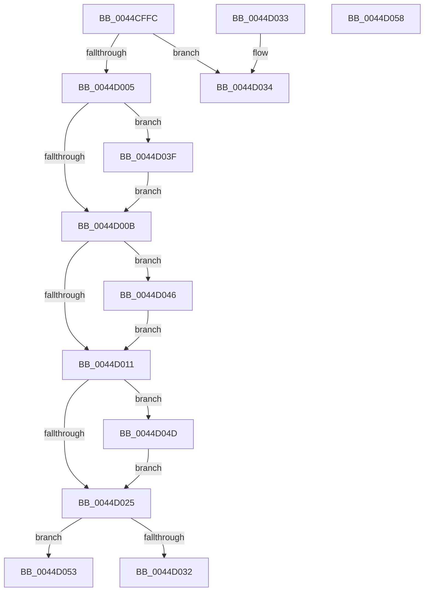

# MiClearHintSlabEntry

- RVA: `0x0044CFFC`–`0x0044D059` (길이 `93` bytes)
- VA: `0x000000014044CFFC`
- 실행 섹션: `.text`
- PDB 이름 있음: `예`; PDB Function 태그: `예`
- unwind 정보 RVA: `0x000DB714`
- 디코드: `30`개 명령, `93/93` bytes 표시
- 미해석 바이트: `0` (있으면 어셈블리에 `.byte`로 보존)

> 이 문서는 커널 이미지의 기계어와 PDB 기호를 분석해 생성했습니다. 4번과 5번은 함수 원형과 자료형을 바이너리 사용 방식에서 추정한 C 해석이며 원본 소스 복구 결과는 아닙니다.

## 1. Dependencies

- 직접 호출 지점: **0**; 고유 호출 대상: **0**
- 직접 호출자로 확인된 함수: **3**
- RIP 상대 이미지 참조: **0**

### Outgoing calls
- 직접 디코드된 call 명령이 없습니다.

### Direct callers
- [MiRemoveSlabEntry](MiRemoveSlabEntry_function_0044CF08.md) at `0x0044CF57`
- [MiChangeSlabEntryIdentity](../68/MiChangeSlabEntryIdentity_function_0068CE30.md) at `0x0068CE6C`
- [MiEstablishDefragSlabEntries](../68/MiEstablishDefragSlabEntries_function_0068E0EC.md) at `0x0068E2C1`

### Static image references
- 디코드된 RIP-relative 메모리 참조가 없습니다.

## 2. Other-region calls and transfers

- 다른 실행 섹션으로 향하는 call: **0**
- call이 아닌 외부 분기/꼬리 이동: **1**
  - `0x0044D03A` → `0x006F0EA8` (`tail-transfer`)

## 3. Assembly (complete function range)

```asm
0044CFFC  83 B9 80 00 00 00 08            cmp dword ptr [rcx + 0x80], 8
0044D003  74 2F                           je 0x14044d034
0044D005  48 39 51 20                     cmp qword ptr [rcx + 0x20], rdx
0044D009  74 34                           je 0x14044d03f
0044D00B  48 39 51 28                     cmp qword ptr [rcx + 0x28], rdx
0044D00F  74 35                           je 0x14044d046
0044D011  48 8B 41 30                     mov rax, qword ptr [rcx + 0x30]
0044D015  4C 8B C2                        mov r8, rdx
0044D018  49 83 C8 01                     or r8, 1
0044D01C  48 83 E0 FC                     and rax, 0xfffffffffffffffc
0044D020  48 3B C2                        cmp rax, rdx
0044D023  74 28                           je 0x14044d04d
0044D025  48 8B 41 38                     mov rax, qword ptr [rcx + 0x38]
0044D029  48 83 E0 FC                     and rax, 0xfffffffffffffffc
0044D02D  48 3B C2                        cmp rax, rdx
0044D030  74 21                           je 0x14044d053
0044D032  C3                              ret
0044D033  CC                              int3
0044D034  33 C0                           xor eax, eax
0044D036  44 8D 48 40                     lea r9d, [rax + 0x40]
0044D03A  E9 69 3E 2A 00                  jmp 0x1406f0ea8
0044D03F  48 83 61 20 00                  and qword ptr [rcx + 0x20], 0
0044D044  EB C5                           jmp 0x14044d00b
0044D046  48 83 61 28 00                  and qword ptr [rcx + 0x28], 0
0044D04B  EB C4                           jmp 0x14044d011
0044D04D  4C 89 41 30                     mov qword ptr [rcx + 0x30], r8
0044D051  EB D2                           jmp 0x14044d025
0044D053  4C 89 41 38                     mov qword ptr [rcx + 0x38], r8
0044D057  C3                              ret
0044D058  CC                              int3
```

## 4. C-style interpretation (structured pseudocode)

```c
__int64 __fastcall MiClearHintSlabEntry(__int64 a1, __int64 a2)
{
    __int64 result;

    if ((*(unsigned int *)(a1 + 128)) == 8) goto loc_0044D034;
    if ((*(unsigned __int64 *)(a1 + 32)) == a2) goto loc_0044D03F;
loc_0044D00B:
    if ((*(unsigned __int64 *)(a1 + 40)) == a2) goto loc_0044D046;
loc_0044D011:
    a3 = (a2) | (1);
    result = (*(unsigned __int64 *)(a1 + 48)) & (-4);
    if (result == a2) goto loc_0044D04D;
loc_0044D025:
    result = (*(unsigned __int64 *)(a1 + 56)) & (-4);
    if (result == a2) goto loc_0044D053;
    return result;
loc_0044D034:
    result = 0;
loc_0044D03F:
    goto loc_0044D00B;
loc_0044D046:
    goto loc_0044D011;
loc_0044D04D:
    *(unsigned __int64 *)(a1 + 48) = a3;
    goto loc_0044D025;
loc_0044D053:
    *(unsigned __int64 *)(a1 + 56) = a3;
    return result;
}
```

## 5. (Beta) C Style

```c
int64_t MiClearHintSlabEntry(void *Arg1, int64_t Arg2)
{
    uint8_t *arg1 = (uint8_t *)Arg1;

    int64_t result;

    if ((*(uint32_t *)(arg1 + 0x80)) == 8) goto loc_0044D034;
    if ((*(uint64_t *)(arg1 + 0x20)) == Arg2) goto loc_0044D03F;
loc_0044D00B:
    if ((*(uint64_t *)(arg1 + 0x28)) == Arg2) goto loc_0044D046;
loc_0044D011:
    a3 = (Arg2) | (1);
    result = (*(uint64_t *)(arg1 + 0x30)) & (-4);
    if (result == Arg2) goto loc_0044D04D;
loc_0044D025:
    result = (*(uint64_t *)(arg1 + 0x38)) & (-4);
    if (result == Arg2) goto loc_0044D053;
    return result;
loc_0044D034:
    result = 0;
loc_0044D03F:
    goto loc_0044D00B;
loc_0044D046:
    goto loc_0044D011;
loc_0044D04D:
    *(uint64_t *)(arg1 + 0x30) = a3;
    goto loc_0044D025;
loc_0044D053:
    *(uint64_t *)(arg1 + 0x38) = a3;
    return result;
}
```

### 관측된 메모리 오프셋

구조체 형식이 확인되지 않은 접근은 인자 기준의 오프셋으로만 기록했습니다.

| 기준 인자 | 오프셋 표현 | 폭 (bit) | 접근 |
|---|---:|---:|---|
| `Arg1` | `+ 0x20` | `64` | `R` |
| `Arg1` | `+ 0x20` | `64` | `R/W` |
| `Arg1` | `+ 0x28` | `64` | `R` |
| `Arg1` | `+ 0x28` | `64` | `R/W` |
| `Arg1` | `+ 0x30` | `64` | `R` |
| `Arg1` | `+ 0x30` | `64` | `W` |
| `Arg1` | `+ 0x38` | `64` | `R` |
| `Arg1` | `+ 0x38` | `64` | `W` |
| `Arg1` | `+ 0x80` | `32` | `R` |

## 6. Execution-region graph

[열기: 2D/3D 그래프와 함수 탐색 컨트롤 패널](../../../control-panel.html?section=text&rva=0x0044CFFC&view=graph)

- 2D 그래프는 위에서 아래로 흐르고, 3D 그래프는 빈 공간을 드래그해 회전합니다. Shift+드래그는 이동, 휠은 확대·축소, 함수 노드 선택은 대상 보고서 이동입니다.

### Static fallback


