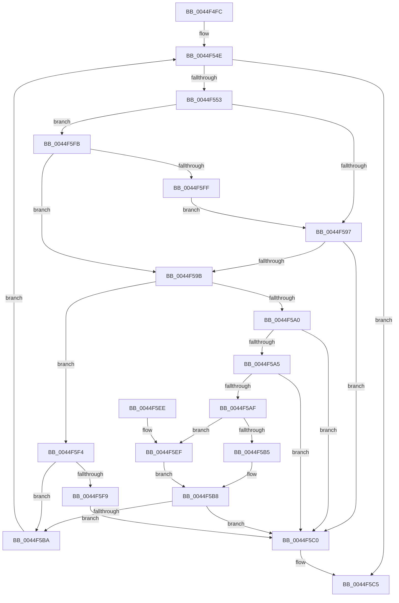

# MiComparePteProtections

- RVA: `0x0044F4FC`–`0x0044F60E` (길이 `274` bytes)
- VA: `0x000000014044F4FC`
- 실행 섹션: `.text`
- PDB 이름 있음: `예`; PDB Function 태그: `아니요`
- unwind 정보 RVA: `0x000A6C70`
- 디코드: `87`개 명령, `274/274` bytes 표시
- 미해석 바이트: `0` (있으면 어셈블리에 `.byte`로 보존)

> 이 문서는 커널 이미지의 기계어와 PDB 기호를 분석해 생성했습니다. 4번과 5번은 함수 원형과 자료형을 바이너리 사용 방식에서 추정한 C 해석이며 원본 소스 복구 결과는 아닙니다.

## 1. Dependencies

- 직접 호출 지점: **3**; 고유 호출 대상: **3**
- 직접 호출자로 확인된 함수: **2**
- RIP 상대 이미지 참조: **0**

### Outgoing calls
- `0x0044F546` → [MiLockWorkingSetShared](../27/MiLockWorkingSetShared_function_0027CBF0.md) (function, `0x0027CBF0`)
- `0x0044F588` → [MiQueryAddressState](../32/MiQueryAddressState_function_0032C380.md) (function, `0x0032C380`)
- `0x0044F5CF` → [MiUnlockWorkingSetShared](../27/MiUnlockWorkingSetShared_function_0027D690.md) (function, `0x0027D690`)

### Direct callers
- [MiCheckSecuredVad](../../page/88/MiCheckSecuredVad_function_00881FB4.md) at `0x00882115`
- [MiSecureVad](../../page/9F/MiSecureVad_function_009F5788.md) at `0x009F57EC`

### Static image references
- 디코드된 RIP-relative 메모리 참조가 없습니다.

## 2. Other-region calls and transfers

- 다른 실행 섹션으로 향하는 call: **0**
- 별도 외부 분기/꼬리 이동을 확인하지 못했습니다.

## 3. Assembly (complete function range)

```asm
0044F4FC  48 89 5C 24 08                  mov qword ptr [rsp + 8], rbx
0044F501  55                              push rbp
0044F502  56                              push rsi
0044F503  57                              push rdi
0044F504  41 54                           push r12
0044F506  41 55                           push r13
0044F508  41 56                           push r14
0044F50A  41 57                           push r15
0044F50C  48 8B EC                        mov rbp, rsp
0044F50F  48 83 EC 60                     sub rsp, 0x60
0044F513  33 DB                           xor ebx, ebx
0044F515  4C 8B E9                        mov r13, rcx
0044F518  48 89 5D F8                     mov qword ptr [rbp - 8], rbx
0044F51C  45 8B F1                        mov r14d, r9d
0044F51F  89 5D 50                        mov dword ptr [rbp + 0x50], ebx
0044F522  4D 8B E0                        mov r12, r8
0044F525  89 5D F0                        mov dword ptr [rbp - 0x10], ebx
0044F528  48 8B FA                        mov rdi, rdx
0044F52B  66 89 5D 48                     mov word ptr [rbp + 0x48], bx
0044F52F  65 48 8B 04 25 88 01 00 00      mov rax, qword ptr gs:[0x188]
0044F538  48 8B B0 B8 00 00 00            mov rsi, qword ptr [rax + 0xb8]
0044F53F  48 8D 8E 00 04 00 00            lea rcx, [rsi + 0x400]
0044F546  E8 A5 D6 E2 FF                  call 0x14027cbf0
0044F54B  44 8A F8                        mov r15b, al
0044F54E  49 3B FC                        cmp rdi, r12
0044F551  77 72                           ja 0x14044f5c5
0044F553  48 8D 45 F8                     lea rax, [rbp - 8]
0044F557  4D 8B CD                        mov r9, r13
0044F55A  48 89 44 24 40                  mov qword ptr [rsp + 0x40], rax
0044F55F  45 8A C7                        mov r8b, r15b
0044F562  48 8D 45 48                     lea rax, [rbp + 0x48]
0044F566  49 8B D4                        mov rdx, r12
0044F569  48 89 44 24 38                  mov qword ptr [rsp + 0x38], rax
0044F56E  48 8B CF                        mov rcx, rdi
0044F571  48 8D 45 F0                     lea rax, [rbp - 0x10]
0044F575  48 89 44 24 30                  mov qword ptr [rsp + 0x30], rax
0044F57A  48 8D 45 50                     lea rax, [rbp + 0x50]
0044F57E  48 89 44 24 28                  mov qword ptr [rsp + 0x28], rax
0044F583  48 89 5C 24 20                  mov qword ptr [rsp + 0x20], rbx
0044F588  E8 F3 CD ED FF                  call 0x14032c380
0044F58D  8B 4D 50                        mov ecx, dword ptr [rbp + 0x50]
0044F590  3D 00 20 00 00                  cmp eax, 0x2000
0044F595  74 64                           je 0x14044f5fb
0044F597  85 C9                           test ecx, ecx
0044F599  74 25                           je 0x14044f5c0
0044F59B  39 5D 60                        cmp dword ptr [rbp + 0x60], ebx
0044F59E  75 54                           jne 0x14044f5f4
0044F5A0  83 F9 FF                        cmp ecx, -1
0044F5A3  74 1B                           je 0x14044f5c0
0044F5A5  8B C1                           mov eax, ecx
0044F5A7  83 E0 F8                        and eax, 0xfffffff8
0044F5AA  83 F8 10                        cmp eax, 0x10
0044F5AD  74 11                           je 0x14044f5c0
0044F5AF  41 83 FE 01                     cmp r14d, 1
0044F5B3  75 3A                           jne 0x14044f5ef
0044F5B5  F6 C1 07                        test cl, 7
0044F5B8  74 06                           je 0x14044f5c0
0044F5BA  48 8B 7D F8                     mov rdi, qword ptr [rbp - 8]
0044F5BE  EB 8E                           jmp 0x14044f54e
0044F5C0  BB 45 00 00 C0                  mov ebx, 0xc0000045
0044F5C5  41 8A D7                        mov dl, r15b
0044F5C8  48 8D 8E 00 04 00 00            lea rcx, [rsi + 0x400]
0044F5CF  E8 BC E0 E2 FF                  call 0x14027d690
0044F5D4  8B C3                           mov eax, ebx
0044F5D6  48 8B 9C 24 A0 00 00 00         mov rbx, qword ptr [rsp + 0xa0]
0044F5DE  48 83 C4 60                     add rsp, 0x60
0044F5E2  41 5F                           pop r15
0044F5E4  41 5E                           pop r14
0044F5E6  41 5D                           pop r13
0044F5E8  41 5C                           pop r12
0044F5EA  5F                              pop rdi
0044F5EB  5E                              pop rsi
0044F5EC  5D                              pop rbp
0044F5ED  C3                              ret
0044F5EE  CC                              int3
0044F5EF  F6 C1 04                        test cl, 4
0044F5F2  EB C4                           jmp 0x14044f5b8
0044F5F4  41 3B CE                        cmp ecx, r14d
0044F5F7  74 C1                           je 0x14044f5ba
0044F5F9  EB C5                           jmp 0x14044f5c0
0044F5FB  85 C9                           test ecx, ecx
0044F5FD  75 9C                           jne 0x14044f59b
0044F5FF  41 8B 4D 30                     mov ecx, dword ptr [r13 + 0x30]
0044F603  C1 E9 07                        shr ecx, 7
0044F606  83 E1 1F                        and ecx, 0x1f
0044F609  89 4D 50                        mov dword ptr [rbp + 0x50], ecx
0044F60C  EB 89                           jmp 0x14044f597
```

## 4. C-style interpretation (structured pseudocode)

```c
__int64 __fastcall MiComparePteProtections(__int64 a1, __int64 a2, __int64 a3, int a4, unsigned int a5)
{
    __int64 result;
    __int64 v_rbx;
    __int64 v_rsp;
    unsigned __int64 v_stack_m40;
    unsigned int v_stack_m48;
    unsigned __int64 v_stack_m58;
    unsigned __int64 v_stack_m60;
    unsigned __int64 v_stack_m68;
    unsigned __int64 v_stack_m70;
    unsigned __int64 v_stack_m78;
    unsigned __int16 v_stack_p10;
    unsigned int v_stack_p18;
    unsigned __int64 v_stack_p8;

    v_stack_p8 = v_rbx;
    v_rsp = (v_rsp) - (96);
    v_rbx = 0;
    v_stack_m40 = 0;
    v_stack_p18 = 0;
    v_stack_m48 = 0;
    v_stack_p10 = 0;
    result = MiLockWorkingSetShared(*(unsigned __int64 *)(*(unsigned __int64 *)(gs_base + (0 + 392)) + 184) + 1024, a2, a3, a4);
loc_0044F54E:
    if (a2 > a3) goto loc_0044F5C5;
    v_stack_m58 = v_stack_m40;
    v_stack_m60 = v_stack_p10;
    v_stack_m68 = v_stack_m48;
    v_stack_m70 = v_stack_p18;
    v_stack_m78 = 0;
    result = MiQueryAddressState(a2, a3, (unsigned __int8)((unsigned __int8)(result)), a1);
    if (((unsigned int)(result)) == 0x2000ULL) goto loc_0044F5FB;
loc_0044F597:
    if ((unsigned int)((unsigned int)(v_stack_p18)) == 0) goto loc_0044F5C0;
loc_0044F59B:
    if (a5 != 0) goto loc_0044F5F4;
    if (((unsigned int)((unsigned int)(v_stack_p18))) == -1) goto loc_0044F5C0;
    result = (unsigned int)(((unsigned int)((unsigned int)((unsigned int)(v_stack_p18)))) & (0xFFFFFFF8ULL));
    if (((unsigned int)(result)) == 16) goto loc_0044F5C0;
    if (((unsigned int)((unsigned int)(a4))) != 1) goto loc_0044F5EF;
loc_0044F5B8:
    if ((((unsigned __int8)((unsigned int)(v_stack_p18))) & (7)) == 0) goto loc_0044F5C0;
loc_0044F5BA:
    goto loc_0044F54E;
loc_0044F5C0:
loc_0044F5C5:
    result = MiUnlockWorkingSetShared(*(unsigned __int64 *)(*(unsigned __int64 *)(gs_base + (0 + 392)) + 184) + 1024, (unsigned __int8)((unsigned __int8)(result)), (unsigned __int8)((unsigned __int8)(result)), a1);
    v_rsp = (v_rsp) + (96);
    return (unsigned int)((unsigned int)((unsigned int)(0xC0000045ULL)));
loc_0044F5EF:
    goto loc_0044F5B8;
loc_0044F5F4:
    if (((unsigned int)(*(unsigned __int64 *)(*(unsigned __int64 *)(gs_base + (0 + 392)) + 184) + 1024)) == ((unsigned int)((unsigned int)(a4)))) goto loc_0044F5BA;
    goto loc_0044F5C0;
loc_0044F5FB:
    if ((unsigned int)(*(unsigned __int64 *)(*(unsigned __int64 *)(gs_base + (0 + 392)) + 184) + 1024) != 0) goto loc_0044F59B;
    a1 = (unsigned int)(((unsigned int)(*(unsigned int *)(a1 + 48))) >> (7));
    a1 = (unsigned int)((a1) & (31));
    v_stack_p18 = (unsigned int)(a1);
    goto loc_0044F597;
}
```

## 5. (Beta) C Style

```c
int64_t MiComparePteProtections(void *Arg1, int64_t Arg2, int64_t Arg3, int32_t Arg4, uint32_t Arg5)
{
    uint8_t *arg1 = (uint8_t *)Arg1;

    int64_t result;
    int64_t local_rbx;
    int64_t local_rsp;
    uint64_t v_stack_m40;
    uint32_t v_stack_m48;
    uint64_t v_stack_m58;
    uint64_t v_stack_m60;
    uint64_t v_stack_m68;
    uint64_t v_stack_m70;
    uint64_t v_stack_m78;
    uint16_t v_stack_p10;
    uint32_t v_stack_p18;
    uint64_t v_stack_p8;

    v_stack_p8 = local_rbx;
    local_rsp = (local_rsp) - (96);
    local_rbx = 0;
    v_stack_m40 = 0;
    v_stack_p18 = 0;
    v_stack_m48 = 0;
    v_stack_p10 = 0;
    result = MiLockWorkingSetShared(*(uint64_t *)(*(uint64_t *)(gs_base + (0 + 0x188)) + 0xB8) + 1024, Arg2, Arg3, Arg4);
loc_0044F54E:
    if (Arg2 > Arg3) goto loc_0044F5C5;
    v_stack_m58 = v_stack_m40;
    v_stack_m60 = v_stack_p10;
    v_stack_m68 = v_stack_m48;
    v_stack_m70 = v_stack_p18;
    v_stack_m78 = 0;
    result = MiQueryAddressState(Arg2, Arg3, (uint8_t)((uint8_t)(result)), Arg1);
    if (((uint32_t)(result)) == 0x2000ULL) goto loc_0044F5FB;
loc_0044F597:
    if ((uint32_t)((uint32_t)(v_stack_p18)) == 0) goto loc_0044F5C0;
loc_0044F59B:
    if (Arg5 != 0) goto loc_0044F5F4;
    if (((uint32_t)((uint32_t)(v_stack_p18))) == -1) goto loc_0044F5C0;
    result = (uint32_t)(((uint32_t)((uint32_t)((uint32_t)(v_stack_p18)))) & (0xFFFFFFF8ULL));
    if (((uint32_t)(result)) == 16) goto loc_0044F5C0;
    if (((uint32_t)((uint32_t)(Arg4))) != 1) goto loc_0044F5EF;
loc_0044F5B8:
    if ((((uint8_t)((uint32_t)(v_stack_p18))) & (7)) == 0) goto loc_0044F5C0;
loc_0044F5BA:
    goto loc_0044F54E;
loc_0044F5C0:
loc_0044F5C5:
    result = MiUnlockWorkingSetShared(*(uint64_t *)(*(uint64_t *)(gs_base + (0 + 0x188)) + 0xB8) + 1024, (uint8_t)((uint8_t)(result)), (uint8_t)((uint8_t)(result)), Arg1);
    local_rsp = (local_rsp) + (96);
    return (uint32_t)((uint32_t)((uint32_t)(0xC0000045ULL)));
loc_0044F5EF:
    goto loc_0044F5B8;
loc_0044F5F4:
    if (((uint32_t)(*(uint64_t *)(*(uint64_t *)(gs_base + (0 + 0x188)) + 0xB8) + 1024)) == ((uint32_t)((uint32_t)(Arg4)))) goto loc_0044F5BA;
    goto loc_0044F5C0;
loc_0044F5FB:
    if ((uint32_t)(*(uint64_t *)(*(uint64_t *)(gs_base + (0 + 0x188)) + 0xB8) + 1024) != 0) goto loc_0044F59B;
    Arg1 = (uint32_t)(((uint32_t)(*(uint32_t *)(arg1 + 0x30))) >> (7));
    Arg1 = (uint32_t)((Arg1) & (31));
    v_stack_p18 = (uint32_t)(Arg1);
    goto loc_0044F597;
}
```

### 관측된 메모리 오프셋

구조체 형식이 확인되지 않은 접근은 인자 기준의 오프셋으로만 기록했습니다.

| 기준 인자 | 오프셋 표현 | 폭 (bit) | 접근 |
|---|---:|---:|---|
| `Arg1` | `+ 0x30` | `32` | `R` |

## 6. Execution-region graph

[열기: 2D/3D 그래프와 함수 탐색 컨트롤 패널](../../../control-panel.html?section=text&rva=0x0044F4FC&view=graph)

- 2D 그래프는 위에서 아래로 흐르고, 3D 그래프는 빈 공간을 드래그해 회전합니다. Shift+드래그는 이동, 휠은 확대·축소, 함수 노드 선택은 대상 보고서 이동입니다.

### Static fallback


