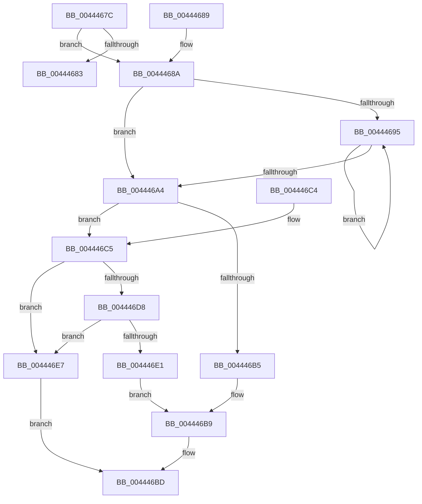

# MiComputePagedPoolSegmentBytes

- RVA: `0x0044467C`–`0x004446F6` (길이 `122` bytes)
- VA: `0x000000014044467C`
- 실행 섹션: `.text`
- PDB 이름 있음: `예`; PDB Function 태그: `아니요`
- unwind 정보 RVA: `0x000DB714`
- 디코드: `33`개 명령, `122/122` bytes 표시
- 미해석 바이트: `0` (있으면 어셈블리에 `.byte`로 보존)

> 이 문서는 커널 이미지의 기계어와 PDB 기호를 분석해 생성했습니다. 4번과 5번은 함수 원형과 자료형을 바이너리 사용 방식에서 추정한 C 해석이며 원본 소스 복구 결과는 아닙니다.

## 1. Dependencies

- 직접 호출 지점: **0**; 고유 호출 대상: **0**
- 직접 호출자로 확인된 함수: **2**
- RIP 상대 이미지 참조: **0**

### Outgoing calls
- 직접 디코드된 call 명령이 없습니다.

### Direct callers
- [MiInsertUnusedSegment](MiInsertUnusedSegment_function_004443DC.md) at `0x0044447D`
- [MiUnlinkUnusedControlArea](../4E/MiUnlinkUnusedControlArea_function_004ED9F8.md) at `0x004EDA30`

### Static image references
- 디코드된 RIP-relative 메모리 참조가 없습니다.

## 2. Other-region calls and transfers

- 다른 실행 섹션으로 향하는 call: **0**
- 별도 외부 분기/꼬리 이동을 확인하지 못했습니다.

## 3. Assembly (complete function range)

```asm
0044467C  8B 41 38                        mov eax, dword ptr [rcx + 0x38]
0044467F  A8 20                           test al, 0x20
00444681  75 07                           jne 0x14044468a
00444683  B8 40 00 00 00                  mov eax, 0x40
00444688  C3                              ret
00444689  CC                              int3
0044468A  33 D2                           xor edx, edx
0044468C  48 81 C1 80 00 00 00            add rcx, 0x80
00444693  74 0F                           je 0x1404446a4
00444695  8B 41 2C                        mov eax, dword ptr [rcx + 0x2c]
00444698  48 8B 49 10                     mov rcx, qword ptr [rcx + 0x10]
0044469C  48 03 D0                        add rdx, rax
0044469F  48 85 C9                        test rcx, rcx
004446A2  75 F1                           jne 0x140444695
004446A4  48 8D 0C D5 00 00 00 00         lea rcx, [rdx*8]
004446AC  48 81 F9 E0 0F 00 00            cmp rcx, 0xfe0
004446B3  77 10                           ja 0x1404446c5
004446B5  48 8D 41 1F                     lea rax, [rcx + 0x1f]
004446B9  48 83 E0 F0                     and rax, 0xfffffffffffffff0
004446BD  48 05 B0 00 00 00               add rax, 0xb0
004446C3  C3                              ret
004446C4  CC                              int3
004446C5  8D 04 D5 00 00 00 00            lea eax, [rdx*8]
004446CC  25 FF 0F 00 00                  and eax, 0xfff
004446D1  3D C0 0F 00 00                  cmp eax, 0xfc0
004446D6  77 0F                           ja 0x1404446e7
004446D8  48 81 F9 00 00 01 00            cmp rcx, 0x10000
004446DF  73 06                           jae 0x1404446e7
004446E1  48 8D 41 0F                     lea rax, [rcx + 0xf]
004446E5  EB D2                           jmp 0x1404446b9
004446E7  48 8D 81 FF 0F 00 00            lea rax, [rcx + 0xfff]
004446EE  48 25 00 F0 FF FF               and rax, 0xfffffffffffff000
004446F4  EB C7                           jmp 0x1404446bd
```

## 4. C-style interpretation (structured pseudocode)

```c
__int64 __fastcall MiComputePagedPoolSegmentBytes(__int64 a1, int a2)
{
    __int64 result;

    if ((((unsigned __int8)((unsigned int)(*(unsigned int *)(a1 + 56)))) & (32)) != 0) goto loc_0044468A;
    return 64;
loc_0044468A:
    a2 = 0;
    a1 = (a1) + (128);
    if (condition_is_equal) goto loc_004446A4;
loc_00444695:
    a2 = (a2) + ((unsigned int)(*(unsigned int *)(a1 + 44)));
    if (*(unsigned __int64 *)(a1 + 16) != 0) goto loc_00444695;
loc_004446A4:
    if ((a2 * 8) > 0xFE0ULL) goto loc_004446C5;
loc_004446B9:
    result = (a2 * 8 + 31) & (-16);
loc_004446BD:
    result = (result) + (176);
    return result;
loc_004446C5:
    result = (unsigned int)((a2 * 8) & (0xFFFULL));
    if (((unsigned int)(result)) > 0xFC0ULL) goto loc_004446E7;
    if ((a2 * 8) >= 0x10000ULL) goto loc_004446E7;
    goto loc_004446B9;
loc_004446E7:
    result = (a2 * 8 + 4095) & (0xFFFFFFFFFFFFF000ULL);
    goto loc_004446BD;
}
```

## 5. (Beta) C Style

```c
int64_t MiComputePagedPoolSegmentBytes(void *Arg1, int32_t Arg2)
{
    uint8_t *arg1 = (uint8_t *)Arg1;

    int64_t result;

    if ((((uint8_t)((uint32_t)(*(uint32_t *)(arg1 + 0x38)))) & (32)) != 0) goto loc_0044468A;
    return 64;
loc_0044468A:
    Arg2 = 0;
    Arg1 = (Arg1) + (128);
    if (condition_is_equal) goto loc_004446A4;
loc_00444695:
    Arg2 = (Arg2) + ((uint32_t)(*(uint32_t *)(arg1 + 0x2C)));
    if (*(uint64_t *)(arg1 + 0x10) != 0) goto loc_00444695;
loc_004446A4:
    if ((Arg2 * 8) > 0xFE0ULL) goto loc_004446C5;
loc_004446B9:
    result = (Arg2 * 8 + 31) & (-16);
loc_004446BD:
    result = (result) + (176);
    return result;
loc_004446C5:
    result = (uint32_t)((Arg2 * 8) & (0xFFFULL));
    if (((uint32_t)(result)) > 0xFC0ULL) goto loc_004446E7;
    if ((Arg2 * 8) >= 0x10000ULL) goto loc_004446E7;
    goto loc_004446B9;
loc_004446E7:
    result = (Arg2 * 8 + 4095) & (0xFFFFFFFFFFFFF000ULL);
    goto loc_004446BD;
}
```

### 관측된 메모리 오프셋

구조체 형식이 확인되지 않은 접근은 인자 기준의 오프셋으로만 기록했습니다.

| 기준 인자 | 오프셋 표현 | 폭 (bit) | 접근 |
|---|---:|---:|---|
| `Arg1` | `+ 0x38` | `32` | `R` |

## 6. Execution-region graph

[열기: 2D/3D 그래프와 함수 탐색 컨트롤 패널](../../../control-panel.html?section=text&rva=0x0044467C&view=graph)

- 2D 그래프는 위에서 아래로 흐르고, 3D 그래프는 빈 공간을 드래그해 회전합니다. Shift+드래그는 이동, 휠은 확대·축소, 함수 노드 선택은 대상 보고서 이동입니다.

### Static fallback


