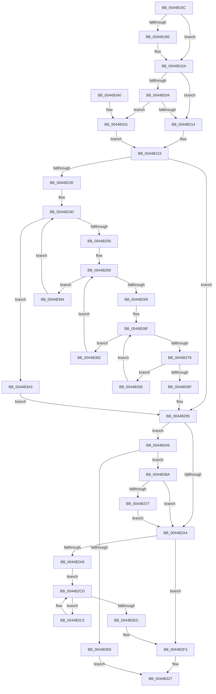

# MiComputeZeroClusterMaximum

- RVA: `0x0044B15C`–`0x0044B3AB` (길이 `591` bytes)
- VA: `0x000000014044B15C`
- 실행 섹션: `.text`
- PDB 이름 있음: `예`; PDB Function 태그: `아니요`
- unwind 정보 RVA: `0x000A6540`
- 디코드: `149`개 명령, `591/591` bytes 표시
- 미해석 바이트: `0` (있으면 어셈블리에 `.byte`로 보존)

> 이 문서는 커널 이미지의 기계어와 PDB 기호를 분석해 생성했습니다. 4번과 5번은 함수 원형과 자료형을 바이너리 사용 방식에서 추정한 C 해석이며 원본 소스 복구 결과는 아닙니다.

## 1. Dependencies

- 직접 호출 지점: **0**; 고유 호출 대상: **0**
- 직접 호출자로 확인된 함수: **4**
- RIP 상대 이미지 참조: **3**

### Outgoing calls
- 직접 디코드된 call 명령이 없습니다.

### Direct callers
- [sub_0032F7AB](../32/Unknown_function_0032F7AB.md) at `0x0032FA75`
- [sub_0032FE5C](../32/Unknown_function_0032FE5C.md) at `0x0032FEB2`
- [sub_0032FE5C](../32/Unknown_function_0032FE5C.md) at `0x0032FFA2`
- [MiExpandSharedZeroCluster](../36/MiExpandSharedZeroCluster_function_0036F20C.md) at `0x0036F31F`
- [MiGetClusterPage](../4D/MiGetClusterPage_function_004DC57C.md) at `0x004DC88E`

### Static image references
- `0x0044B1E1` → RVA `0x00E30088` (`.data`; read)
- `0x0044B22E` → RVA `0x00E2DCCC` (`.data`; read)
- `0x0044B238` → RVA `0x00FC5000` (`ALMOSTRO`; read)

## 2. Other-region calls and transfers

- 다른 실행 섹션으로 향하는 call: **0**
- 별도 외부 분기/꼬리 이동을 확인하지 못했습니다.

## 3. Assembly (complete function range)

```asm
0044B15C  48 89 5C 24 10                  mov qword ptr [rsp + 0x10], rbx
0044B161  48 89 6C 24 18                  mov qword ptr [rsp + 0x18], rbp
0044B166  48 89 74 24 20                  mov qword ptr [rsp + 0x20], rsi
0044B16B  57                              push rdi
0044B16C  41 54                           push r12
0044B16E  41 55                           push r13
0044B170  41 56                           push r14
0044B172  41 57                           push r15
0044B174  48 8B 59 20                     mov rbx, qword ptr [rcx + 0x20]
0044B178  48 8B FA                        mov rdi, rdx
0044B17B  4C 8B 51 18                     mov r10, qword ptr [rcx + 0x18]
0044B17F  4C 8B F9                        mov r15, rcx
0044B182  49 C1 E2 04                     shl r10, 4
0044B186  4C 03 51 08                     add r10, qword ptr [rcx + 8]
0044B18A  45 8B 0A                        mov r9d, dword ptr [r10]
0044B18D  4D 8B 5A 08                     mov r11, qword ptr [r10 + 8]
0044B191  41 81 E1 FF 0F 00 00            and r9d, 0xfff
0044B198  49 81 C3 FF 0F 00 00            add r11, 0xfff
0044B19F  4D 03 D9                        add r11, r9
0044B1A2  49 C1 EB 0C                     shr r11, 0xc
0044B1A6  4C 2B DB                        sub r11, rbx
0044B1A9  48 C1 E3 0C                     shl rbx, 0xc
0044B1AD  49 03 1A                        add rbx, qword ptr [r10]
0044B1B0  4D 85 C0                        test r8, r8
0044B1B3  74 25                           je 0x14044b1da
0044B1B5  41 8B 40 1C                     mov eax, dword ptr [r8 + 0x1c]
0044B1B9  41 0F B6 48 21                  movzx ecx, byte ptr [r8 + 0x21]
0044B1BE  48 C1 E1 20                     shl rcx, 0x20
0044B1C2  48 0B C8                        or rcx, rax
0044B1C5  48 8B C3                        mov rax, rbx
0044B1C8  48 C1 E8 0C                     shr rax, 0xc
0044B1CC  48 2B C8                        sub rcx, rax
0044B1CF  48 8D 41 01                     lea rax, [rcx + 1]
0044B1D3  4C 3B D8                        cmp r11, rax
0044B1D6  4C 0F 47 D8                     cmova r11, rax
0044B1DA  0F B7 8A AE 00 00 00            movzx ecx, word ptr [rdx + 0xae]
0044B1E1  48 8B 05 A0 4E 9E 00            mov rax, qword ptr [rip + 0x9e4ea0]
0044B1E8  4C 8B 04 C8                     mov r8, qword ptr [rax + rcx*8]
0044B1EC  B9 20 4E 00 00                  mov ecx, 0x4e20
0044B1F1  49 8B 80 C0 44 00 00            mov rax, qword ptr [r8 + 0x44c0]
0044B1F8  48 8B 90 38 01 00 00            mov rdx, qword ptr [rax + 0x138]
0044B1FF  48 3B D1                        cmp rdx, rcx
0044B202  76 10                           jbe 0x14044b214
0044B204  48 8B C2                        mov rax, rdx
0044B207  48 83 E0 FE                     and rax, 0xfffffffffffffffe
0044B20B  48 3B C1                        cmp rax, rcx
0044B20E  0F 87 2D 01 00 00               ja 0x14044b341
0044B214  BA 10 27 00 00                  mov edx, 0x2710
0044B219  4D 8B B0 00 49 00 00            mov r14, qword ptr [r8 + 0x4900]
0044B220  41 BC 01 00 00 00               mov r12d, 1
0044B226  48 D1 EA                        shr rdx, 1
0044B229  4C 3B F2                        cmp r14, rdx
0044B22C  73 67                           jae 0x14044b295
0044B22E  8B 05 98 2A 9E 00               mov eax, dword ptr [rip + 0x9e2a98]
0044B234  49 8B 68 10                     mov rbp, qword ptr [r8 + 0x10]
0044B238  44 0F B7 2D C0 9D B7 00         movzx r13d, word ptr [rip + 0xb79dc0]
0044B240  89 44 24 30                     mov dword ptr [rsp + 0x30], eax
0044B244  33 C0                           xor eax, eax
0044B246  48 81 C5 60 3A 00 00            add rbp, 0x3a60
0044B24D  41 3B C5                        cmp eax, r13d
0044B250  0F 83 4D 01 00 00               jae 0x14044b3a3
0044B256  8B 4C 24 30                     mov ecx, dword ptr [rsp + 0x30]
0044B25A  45 33 D2                        xor r10d, r10d
0044B25D  48 8B F5                        mov rsi, rbp
0044B260  4D 3B D4                        cmp r10, r12
0044B263  0F 8F 2B 01 00 00               jg 0x14044b394
0044B269  4C 8B 26                        mov r12, qword ptr [rsi]
0044B26C  45 33 C9                        xor r9d, r9d
0044B26F  44 3B C9                        cmp r9d, ecx
0044B272  0F 83 0A 01 00 00               jae 0x14044b382
0044B278  41 8B C9                        mov ecx, r9d
0044B27B  48 03 C9                        add rcx, rcx
0044B27E  41 0F B7 0C CC                  movzx ecx, word ptr [r12 + rcx*8]
0044B283  4C 03 F1                        add r14, rcx
0044B286  4C 3B F2                        cmp r14, rdx
0044B289  0F 82 CF 00 00 00               jb 0x14044b35e
0044B28F  41 BC 01 00 00 00               mov r12d, 1
0044B295  8B 8F B8 00 00 00               mov ecx, dword ptr [rdi + 0xb8]
0044B29B  F6 C1 40                        test cl, 0x40
0044B29E  0F 85 A5 00 00 00               jne 0x14044b349
0044B2A4  45 38 27                        cmp byte ptr [r15], r12b
0044B2A7  75 4A                           jne 0x14044b2f3
0044B2A9  49 8B 88 C0 0B 00 00            mov rcx, qword ptr [r8 + 0xbc0]
0044B2B0  4D 8D 88 C0 0C 00 00            lea r9, [r8 + 0xcc0]
0044B2B7  49 8B 90 40 0B 00 00            mov rdx, qword ptr [r8 + 0xb40]
0044B2BE  48 03 D1                        add rdx, rcx
0044B2C1  EB 0A                           jmp 0x14044b2cd
0044B2C3  49 8B 01                        mov rax, qword ptr [r9]
0044B2C6  48 03 D0                        add rdx, rax
0044B2C9  49 83 C1 58                     add r9, 0x58
0044B2CD  41 8B 47 50                     mov eax, dword ptr [r15 + 0x50]
0044B2D1  C1 E8 03                        shr eax, 3
0044B2D4  83 E0 07                        and eax, 7
0044B2D7  41 03 C4                        add eax, r12d
0044B2DA  48 6B C0 58                     imul rax, rax, 0x58
0044B2DE  48 05 C0 0C 00 00               add rax, 0xcc0
0044B2E4  49 03 C0                        add rax, r8
0044B2E7  4C 3B C8                        cmp r9, rax
0044B2EA  72 D7                           jb 0x14044b2c3
0044B2EC  4C 3B DA                        cmp r11, rdx
0044B2EF  4C 0F 47 DA                     cmova r11, rdx
0044B2F3  4D 85 DB                        test r11, r11
0044B2F6  4D 0F 44 DC                     cmove r11, r12
0044B2FA  48 C1 EB 09                     shr rbx, 9
0044B2FE  83 E3 F8                        and ebx, 0xfffffff8
0044B301  48 B8 00 00 00 00 80 F6 FF FF   movabs rax, 0xfffff68000000000
0044B30B  8D 0C 18                        lea ecx, [rax + rbx]
0044B30E  B8 00 02 00 00                  mov eax, 0x200
0044B313  48 C1 E9 03                     shr rcx, 3
0044B317  81 E1 FF 01 00 00               and ecx, 0x1ff
0044B31D  48 2B C1                        sub rax, rcx
0044B320  4C 3B D8                        cmp r11, rax
0044B323  49 0F 46 C3                     cmovbe rax, r11
0044B327  48 8B 5C 24 38                  mov rbx, qword ptr [rsp + 0x38]
0044B32C  48 8B 6C 24 40                  mov rbp, qword ptr [rsp + 0x40]
0044B331  48 8B 74 24 48                  mov rsi, qword ptr [rsp + 0x48]
0044B336  41 5F                           pop r15
0044B338  41 5E                           pop r14
0044B33A  41 5D                           pop r13
0044B33C  41 5C                           pop r12
0044B33E  5F                              pop rdi
0044B33F  C3                              ret
0044B340  CC                              int3
0044B341  48 D1 EA                        shr rdx, 1
0044B344  E9 D0 FE FF FF                  jmp 0x14044b219
0044B349  48 8B 8F 80 00 00 00            mov rcx, qword ptr [rdi + 0x80]
0044B350  48 8B 57 78                     mov rdx, qword ptr [rdi + 0x78]
0044B354  48 3B CA                        cmp rcx, rdx
0044B357  72 11                           jb 0x14044b36a
0044B359  49 8B C4                        mov rax, r12
0044B35C  EB C9                           jmp 0x14044b327
0044B35E  8B 4C 24 30                     mov ecx, dword ptr [rsp + 0x30]
0044B362  41 FF C1                        inc r9d
0044B365  E9 05 FF FF FF                  jmp 0x14044b26f
0044B36A  4A 8D 04 19                     lea rax, [rcx + r11]
0044B36E  48 3B C2                        cmp rax, rdx
0044B371  0F 86 2D FF FF FF               jbe 0x14044b2a4
0044B377  4C 8B DA                        mov r11, rdx
0044B37A  4C 2B D9                        sub r11, rcx
0044B37D  E9 22 FF FF FF                  jmp 0x14044b2a4
0044B382  41 BC 01 00 00 00               mov r12d, 1
0044B388  4D 03 D4                        add r10, r12
0044B38B  48 83 C6 08                     add rsi, 8
0044B38F  E9 CC FE FF FF                  jmp 0x14044b260
0044B394  48 81 C5 80 DF 00 00            add rbp, 0xdf80
0044B39B  41 03 C4                        add eax, r12d
0044B39E  E9 AA FE FF FF                  jmp 0x14044b24d
0044B3A3  4D 8B DC                        mov r11, r12
0044B3A6  E9 EA FE FF FF                  jmp 0x14044b295
```

## 4. C-style interpretation (structured pseudocode)

```c
__int64 __fastcall MiComputeZeroClusterMaximum(__int64 a1, __int64 a2, __int64 a3)
{
    __int64 result;
    __int64 v_r10;
    __int64 v_r11;
    __int64 v_r14;
    __int64 v_rbp;
    __int64 v_rbx;
    __int64 v_rsi;
    unsigned __int64 v_stack_p10;
    unsigned __int64 v_stack_p18;
    unsigned __int64 v_stack_p20;
    unsigned int v_stack_p30;
    unsigned int v_stack_p8;

    v_stack_p10 = v_rbx;
    v_stack_p18 = v_rbp;
    v_stack_p20 = v_rsi;
    v_r10 = (*(unsigned __int64 *)(a1 + 24)) << (4);
    v_r10 = (v_r10) + (*(unsigned __int64 *)(a1 + 8));
    a4 = (unsigned int)(((unsigned int)(*(unsigned int *)(v_r10))) & (0xFFFULL));
    v_r11 = (*(unsigned __int64 *)(v_r10 + 8)) + (0xFFFULL);
    v_r11 = (v_r11) + (a4);
    v_r11 = (v_r11) >> (12);
    v_r11 = (v_r11) - (*(unsigned __int64 *)(a1 + 32));
    v_rbx = (*(unsigned __int64 *)(a1 + 32)) << (12);
    v_rbx = (v_rbx) + (*(unsigned __int64 *)(v_r10));
    if (a3 != 0) {
        result = *(unsigned int *)(a3 + 28);
        a1 = *(unsigned __int8 *)(a3 + 33);
        a1 = (a1) << (32);
        a1 = (a1) | (result);
        result = v_rbx;
        result = (result) >> (12);
        a1 = (a1) - (result);
        result = a1 + 1;
        if (v_r11 > result) { v_r11 = result; }
    }
    if ((*(unsigned __int64 *)(*(unsigned __int64 *)(*(unsigned __int64 *)(*(unsigned __int64 *)(v_rip + 10374816) + *(unsigned __int16 *)(a2 + 174) * 8) + 17600) + 312)) <= ((unsigned int)(0x4E20ULL))) goto loc_0044B214;
    result = (*(unsigned __int64 *)(*(unsigned __int64 *)(*(unsigned __int64 *)(*(unsigned __int64 *)(v_rip + 10374816) + *(unsigned __int16 *)(a2 + 174) * 8) + 17600) + 312)) & (-2);
    if (result > ((unsigned int)(0x4E20ULL))) goto loc_0044B341;
loc_0044B214:
loc_0044B219:
    a2 = ((unsigned int)(0x2710ULL)) >> (1);
    if ((*(unsigned __int64 *)(*(unsigned __int64 *)(*(unsigned __int64 *)(v_rip + 10374816) + *(unsigned __int16 *)(a2 + 174) * 8) + 18688)) >= a2) goto loc_0044B295;
    v_stack_p8 = (unsigned int)((unsigned int)(*(unsigned int *)(v_rip + 10365592)));
    result = 0;
    v_rbp = (*(unsigned __int64 *)(*(unsigned __int64 *)(*(unsigned __int64 *)(v_rip + 10374816) + *(unsigned __int16 *)(a2 + 174) * 8) + 16)) + (0x3A60ULL);
loc_0044B24D:
    if (0 >= ((unsigned int)(*(unsigned __int16 *)(v_rip + 12033472)))) goto loc_0044B3A3;
    v_r10 = 0;
loc_0044B260:
    if (0 > 1) goto loc_0044B394;
    a4 = 0;
loc_0044B26F:
    if (0 >= ((unsigned int)((unsigned int)(v_stack_p8)))) goto loc_0044B382;
    a1 = (0) + (0);
    v_r14 = (*(unsigned __int64 *)(*(unsigned __int64 *)(*(unsigned __int64 *)(v_rip + 10374816) + *(unsigned __int16 *)(a2 + 174) * 8) + 18688)) + (*(unsigned __int16 *)(*(unsigned __int64 *)(v_rbp) + a1 * 8));
    if (v_r14 < a2) goto loc_0044B35E;
loc_0044B295:
    if ((((unsigned __int8)((unsigned int)(*(unsigned int *)(a2 + 184)))) & (64)) != 0) goto loc_0044B349;
loc_0044B2A4:
    if ((*(unsigned __int8 *)(a1)) != 1) goto loc_0044B2F3;
    a2 = (*(unsigned __int64 *)(*(unsigned __int64 *)(*(unsigned __int64 *)(v_rip + 10374816) + *(unsigned __int16 *)(a2 + 174) * 8) + 2880)) + (*(unsigned __int64 *)(*(unsigned __int64 *)(*(unsigned __int64 *)(v_rip + 10374816) + *(unsigned __int16 *)(a2 + 174) * 8) + 3008));
    goto loc_0044B2CD;
loc_0044B2C3:
    a2 = (a2) + (*(unsigned __int64 *)(*(unsigned __int64 *)(*(unsigned __int64 *)(v_rip + 10374816) + *(unsigned __int16 *)(a2 + 174) * 8) + 3264));
    a4 = (*(unsigned __int64 *)(*(unsigned __int64 *)(v_rip + 10374816) + *(unsigned __int16 *)(a2 + 174) * 8) + 3264) + (88);
loc_0044B2CD:
    result = (unsigned int)(((unsigned int)(*(unsigned int *)(a1 + 80))) >> (3));
    result = (unsigned int)((result) & (7));
    result = (unsigned int)((result) + (1));
    result = (result) * (result);
    result = (result) + (0xCC0ULL);
    result = (result) + (*(unsigned __int64 *)(*(unsigned __int64 *)(v_rip + 10374816) + *(unsigned __int16 *)(a2 + 174) * 8));
    if (a4 < result) goto loc_0044B2C3;
    if (v_r11 > a2) { v_r11 = a2; }
loc_0044B2F3:
    if (v_r11 == 0) { v_r11 = 1; }
    v_rbx = (v_rbx) >> (9);
    v_rbx = (unsigned int)((v_rbx) & (0xFFFFFFF8ULL));
    a1 = (result + v_rbx * 1) >> (3);
    a1 = (unsigned int)((a1) & (511));
    result = (512) - (a1);
    if (v_r11 <= result) { result = v_r11; }
loc_0044B327:
    return result;
loc_0044B341:
    a2 = (a2) >> (1);
    goto loc_0044B219;
loc_0044B349:
    if ((*(unsigned __int64 *)(a2 + 128)) < (*(unsigned __int64 *)(a2 + 120))) goto loc_0044B36A;
    goto loc_0044B327;
loc_0044B35E:
    a4 = (unsigned int)((a4) + 1);
    goto loc_0044B26F;
loc_0044B36A:
    if (((unsigned int)(v_stack_p30) + v_r11 * 1) <= (*(unsigned __int64 *)(a2 + 120))) goto loc_0044B2A4;
    v_r11 = (*(unsigned __int64 *)(a2 + 120)) - ((unsigned int)(v_stack_p30));
    goto loc_0044B2A4;
loc_0044B382:
    v_r10 = (v_r10) + (1);
    v_rsi = (v_stack_p20) + (8);
    goto loc_0044B260;
loc_0044B394:
    v_rbp = (v_stack_p18) + (0xDF80ULL);
    result = (unsigned int)(((unsigned int)(v_stack_p30) + v_r11 * 1) + (1));
    goto loc_0044B24D;
loc_0044B3A3:
    goto loc_0044B295;
}
```

## 5. (Beta) C Style

```c
int64_t MiComputeZeroClusterMaximum(void *Arg1, void *Arg2, int64_t Arg3)
{
    uint8_t *arg1 = (uint8_t *)Arg1;
    uint8_t *arg2 = (uint8_t *)Arg2;

    int64_t result;
    int64_t local_r10;
    int64_t local_r11;
    int64_t local_r14;
    int64_t local_rbp;
    int64_t local_rbx;
    int64_t local_rsi;
    uint64_t v_stack_p10;
    uint64_t v_stack_p18;
    uint64_t v_stack_p20;
    uint32_t v_stack_p30;
    uint32_t v_stack_p8;

    v_stack_p10 = local_rbx;
    v_stack_p18 = local_rbp;
    v_stack_p20 = local_rsi;
    local_r10 = (*(uint64_t *)(arg1 + 0x18)) << (4);
    local_r10 = (local_r10) + (*(uint64_t *)(arg1 + 0x8));
    a4 = (uint32_t)(((uint32_t)(*(uint32_t *)(local_r10))) & (0xFFFULL));
    local_r11 = (*(uint64_t *)(local_r10 + 0x8)) + (0xFFFULL);
    local_r11 = (local_r11) + (a4);
    local_r11 = (local_r11) >> (12);
    local_r11 = (local_r11) - (*(uint64_t *)(arg1 + 0x20));
    local_rbx = (*(uint64_t *)(arg1 + 0x20)) << (12);
    local_rbx = (local_rbx) + (*(uint64_t *)(local_r10));
    if (Arg3 != 0) {
        result = *(uint32_t *)(Arg3 + 0x1C);
        Arg1 = *(uint8_t *)(Arg3 + 0x21);
        Arg1 = (Arg1) << (32);
        Arg1 = (Arg1) | (result);
        result = local_rbx;
        result = (result) >> (12);
        Arg1 = (Arg1) - (result);
        result = Arg1 + 1;
        if (local_r11 > result) { local_r11 = result; }
    }
    if ((*(uint64_t *)(*(uint64_t *)(*(uint64_t *)(*(uint64_t *)(v_rip + 0x9E4EA0) + *(uint16_t *)(arg2 + 0xAE) * 8) + 0x44C0) + 0x138)) <= ((uint32_t)(0x4E20ULL))) goto loc_0044B214;
    result = (*(uint64_t *)(*(uint64_t *)(*(uint64_t *)(*(uint64_t *)(v_rip + 0x9E4EA0) + *(uint16_t *)(arg2 + 0xAE) * 8) + 0x44C0) + 0x138)) & (-2);
    if (result > ((uint32_t)(0x4E20ULL))) goto loc_0044B341;
loc_0044B214:
loc_0044B219:
    Arg2 = ((uint32_t)(0x2710ULL)) >> (1);
    if ((*(uint64_t *)(*(uint64_t *)(*(uint64_t *)(v_rip + 0x9E4EA0) + *(uint16_t *)(arg2 + 0xAE) * 8) + 0x4900)) >= Arg2) goto loc_0044B295;
    v_stack_p8 = (uint32_t)((uint32_t)(*(uint32_t *)(v_rip + 0x9E2A98)));
    result = 0;
    local_rbp = (*(uint64_t *)(*(uint64_t *)(*(uint64_t *)(v_rip + 0x9E4EA0) + *(uint16_t *)(arg2 + 0xAE) * 8) + 0x10)) + (0x3A60ULL);
loc_0044B24D:
    if (0 >= ((uint32_t)(*(uint16_t *)(v_rip + 0xB79DC0)))) goto loc_0044B3A3;
    local_r10 = 0;
loc_0044B260:
    if (0 > 1) goto loc_0044B394;
    a4 = 0;
loc_0044B26F:
    if (0 >= ((uint32_t)((uint32_t)(v_stack_p8)))) goto loc_0044B382;
    Arg1 = (0) + (0);
    local_r14 = (*(uint64_t *)(*(uint64_t *)(*(uint64_t *)(v_rip + 0x9E4EA0) + *(uint16_t *)(arg2 + 0xAE) * 8) + 0x4900)) + (*(uint16_t *)(*(uint64_t *)(local_rbp) + arg1 * 8));
    if (local_r14 < Arg2) goto loc_0044B35E;
loc_0044B295:
    if ((((uint8_t)((uint32_t)(*(uint32_t *)(arg2 + 0xB8)))) & (64)) != 0) goto loc_0044B349;
loc_0044B2A4:
    if ((*(uint8_t *)(arg1)) != 1) goto loc_0044B2F3;
    Arg2 = (*(uint64_t *)(*(uint64_t *)(*(uint64_t *)(v_rip + 0x9E4EA0) + *(uint16_t *)(arg2 + 0xAE) * 8) + 0xB40)) + (*(uint64_t *)(*(uint64_t *)(*(uint64_t *)(v_rip + 0x9E4EA0) + *(uint16_t *)(arg2 + 0xAE) * 8) + 0xBC0));
    goto loc_0044B2CD;
loc_0044B2C3:
    Arg2 = (Arg2) + (*(uint64_t *)(*(uint64_t *)(*(uint64_t *)(v_rip + 0x9E4EA0) + *(uint16_t *)(arg2 + 0xAE) * 8) + 0xCC0));
    a4 = (*(uint64_t *)(*(uint64_t *)(v_rip + 0x9E4EA0) + *(uint16_t *)(arg2 + 0xAE) * 8) + 3264) + (88);
loc_0044B2CD:
    result = (uint32_t)(((uint32_t)(*(uint32_t *)(arg1 + 0x50))) >> (3));
    result = (uint32_t)((result) & (7));
    result = (uint32_t)((result) + (1));
    result = (result) * (result);
    result = (result) + (0xCC0ULL);
    result = (result) + (*(uint64_t *)(*(uint64_t *)(v_rip + 0x9E4EA0) + *(uint16_t *)(arg2 + 0xAE) * 8));
    if (a4 < result) goto loc_0044B2C3;
    if (local_r11 > Arg2) { local_r11 = Arg2; }
loc_0044B2F3:
    if (local_r11 == 0) { local_r11 = 1; }
    local_rbx = (local_rbx) >> (9);
    local_rbx = (uint32_t)((local_rbx) & (0xFFFFFFF8ULL));
    Arg1 = (result + local_rbx * 1) >> (3);
    Arg1 = (uint32_t)((Arg1) & (511));
    result = (512) - (Arg1);
    if (local_r11 <= result) { result = local_r11; }
loc_0044B327:
    return result;
loc_0044B341:
    Arg2 = (Arg2) >> (1);
    goto loc_0044B219;
loc_0044B349:
    if ((*(uint64_t *)(arg2 + 0x80)) < (*(uint64_t *)(arg2 + 0x78))) goto loc_0044B36A;
    goto loc_0044B327;
loc_0044B35E:
    a4 = (uint32_t)((a4) + 1);
    goto loc_0044B26F;
loc_0044B36A:
    if (((uint32_t)(v_stack_p30) + local_r11 * 1) <= (*(uint64_t *)(arg2 + 0x78))) goto loc_0044B2A4;
    local_r11 = (*(uint64_t *)(arg2 + 0x78)) - ((uint32_t)(v_stack_p30));
    goto loc_0044B2A4;
loc_0044B382:
    local_r10 = (local_r10) + (1);
    local_rsi = (v_stack_p20) + (8);
    goto loc_0044B260;
loc_0044B394:
    local_rbp = (v_stack_p18) + (0xDF80ULL);
    result = (uint32_t)(((uint32_t)(v_stack_p30) + local_r11 * 1) + (1));
    goto loc_0044B24D;
loc_0044B3A3:
    goto loc_0044B295;
}
```

### 관측된 메모리 오프셋

구조체 형식이 확인되지 않은 접근은 인자 기준의 오프셋으로만 기록했습니다.

| 기준 인자 | 오프셋 표현 | 폭 (bit) | 접근 |
|---|---:|---:|---|
| `Arg1` | `+ 0x0` | `8` | `R` |
| `Arg1` | `+ 0x8` | `64` | `R` |
| `Arg1` | `+ 0x18` | `64` | `R` |
| `Arg1` | `+ 0x20` | `64` | `R` |
| `Arg1` | `+ 0x50` | `32` | `R` |
| `Arg2` | `+ 0x78` | `64` | `R` |
| `Arg2` | `+ 0x80` | `64` | `R` |
| `Arg2` | `+ 0xAE` | `16` | `R` |
| `Arg2` | `+ 0xB8` | `32` | `R` |

## 6. Execution-region graph

[열기: 2D/3D 그래프와 함수 탐색 컨트롤 패널](../../../control-panel.html?section=text&rva=0x0044B15C&view=graph)

- 2D 그래프는 위에서 아래로 흐르고, 3D 그래프는 빈 공간을 드래그해 회전합니다. Shift+드래그는 이동, 휠은 확대·축소, 함수 노드 선택은 대상 보고서 이동입니다.

### Static fallback


