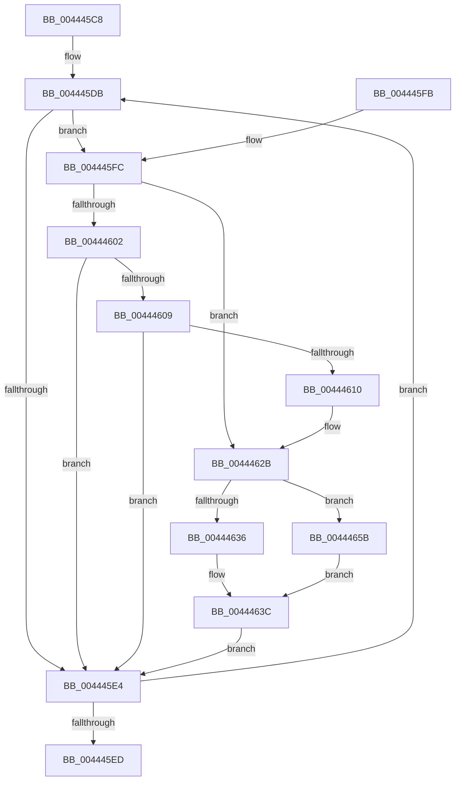

# MiConvertStaticSubsections

- RVA: `0x004445C8`–`0x00444673` (길이 `171` bytes)
- VA: `0x00000001404445C8`
- 실행 섹션: `.text`
- PDB 이름 있음: `예`; PDB Function 태그: `아니요`
- unwind 정보 RVA: `0x000A56E8`
- 디코드: `48`개 명령, `171/171` bytes 표시
- 미해석 바이트: `0` (있으면 어셈블리에 `.byte`로 보존)

> 이 문서는 커널 이미지의 기계어와 PDB 기호를 분석해 생성했습니다. 4번과 5번은 함수 원형과 자료형을 바이너리 사용 방식에서 추정한 C 해석이며 원본 소스 복구 결과는 아닙니다.

## 1. Dependencies

- 직접 호출 지점: **2**; 고유 호출 대상: **2**
- 직접 호출자로 확인된 함수: **1**
- RIP 상대 이미지 참조: **0**

### Outgoing calls
- `0x00444625` → [KeBugCheckEx](../4F/KeBugCheckEx_function_004FD660.md) (function, `0x004FD660`)
- `0x00444651` → [MiRemoveViewsFromSection](../29/MiRemoveViewsFromSection_function_00298960.md) (function, `0x00298960`)

### Direct callers
- [MiInsertUnusedSegment](MiInsertUnusedSegment_function_004443DC.md) at `0x004443FC`

### Static image references
- 디코드된 RIP-relative 메모리 참조가 없습니다.

## 2. Other-region calls and transfers

- 다른 실행 섹션으로 향하는 call: **0**
- 별도 외부 분기/꼬리 이동을 확인하지 못했습니다.

## 3. Assembly (complete function range)

```asm
004445C8  48 89 5C 24 08                  mov qword ptr [rsp + 8], rbx
004445CD  57                              push rdi
004445CE  48 83 EC 30                     sub rsp, 0x30
004445D2  33 FF                           xor edi, edi
004445D4  48 8D 99 80 00 00 00            lea rbx, [rcx + 0x80]
004445DB  8B 43 20                        mov eax, dword ptr [rbx + 0x20]
004445DE  0F BA E0 13                     bt eax, 0x13
004445E2  73 18                           jae 0x1404445fc
004445E4  48 8B 5B 10                     mov rbx, qword ptr [rbx + 0x10]
004445E8  48 85 DB                        test rbx, rbx
004445EB  75 EE                           jne 0x1404445db
004445ED  48 8B 5C 24 40                  mov rbx, qword ptr [rsp + 0x40]
004445F2  48 8B C7                        mov rax, rdi
004445F5  48 83 C4 30                     add rsp, 0x30
004445F9  5F                              pop rdi
004445FA  C3                              ret
004445FB  CC                              int3
004445FC  0F BA E0 10                     bt eax, 0x10
00444600  72 29                           jb 0x14044462b
00444602  48 83 7B 08 00                  cmp qword ptr [rbx + 8], 0
00444607  74 DB                           je 0x1404445e4
00444609  48 83 7B 50 00                  cmp qword ptr [rbx + 0x50], 0
0044460E  75 D4                           jne 0x1404445e4
00444610  48 83 64 24 20 00               and qword ptr [rsp + 0x20], 0
00444616  45 33 C9                        xor r9d, r9d
00444619  4C 8B C3                        mov r8, rbx
0044461C  BA 03 20 04 00                  mov edx, 0x42003
00444621  41 8D 49 1A                     lea ecx, [r9 + 0x1a]
00444625  E8 36 90 0B 00                  call 0x1404fd660
0044462A  CC                              int3
0044462B  8B 4B 30                        mov ecx, dword ptr [rbx + 0x30]
0044462E  F7 C1 FF FF FF 3F               test ecx, 0x3fffffff
00444634  75 25                           jne 0x14044465b
00444636  41 B8 04 00 00 00               mov r8d, 4
0044463C  0F BA F0 10                     btr eax, 0x10
00444640  48 8B CB                        mov rcx, rbx
00444643  89 43 20                        mov dword ptr [rbx + 0x20], eax
00444646  8B 53 2C                        mov edx, dword ptr [rbx + 0x2c]
00444649  48 C7 43 50 01 00 00 00         mov qword ptr [rbx + 0x50], 1
00444651  E8 0A 43 E5 FF                  call 0x140298960
00444656  48 03 F8                        add rdi, rax
00444659  EB 89                           jmp 0x1404445e4
0044465B  81 C9 FF FF FF 3F               or ecx, 0x3fffffff
00444661  41 B8 18 00 00 00               mov r8d, 0x18
00444667  89 4B 30                        mov dword ptr [rbx + 0x30], ecx
0044466A  48 8B 0B                        mov rcx, qword ptr [rbx]
0044466D  80 49 3E 02                     or byte ptr [rcx + 0x3e], 2
00444671  EB C9                           jmp 0x14044463c
```

## 4. C-style interpretation (structured pseudocode)

```c
__int64 __fastcall MiConvertStaticSubsections(__int64 a1, __int64 a2, __int64 a3, int a4)
{
    __int64 result;
    __int64 v_rdi;
    __int64 v_rsp;
    unsigned __int64 v_stack_p20;
    unsigned __int64 v_stack_p8;

    v_stack_p8 = v_rbx;
    v_rsp = (v_rsp) - (48);
    v_rdi = 0;
loc_004445DB:
    if (condition_is_above_or_equal) goto loc_004445FC;
loc_004445E4:
    if (*(unsigned __int64 *)(a1 + 128 + 16) != 0) goto loc_004445DB;
    v_rsp = (v_rsp) + (48);
    return 0;
loc_004445FC:
    if (condition_is_below) goto loc_0044462B;
    if ((*(unsigned __int64 *)(v_stack_p8 + 8)) == 0) goto loc_004445E4;
    if ((*(unsigned __int64 *)(v_stack_p8 + 80)) != 0) goto loc_004445E4;
    a4 = 0;
    result = KeBugCheckEx(a4 + 26, (unsigned int)(0x42003ULL), v_stack_p8, a4);
loc_0044462B:
    if ((((unsigned int)((unsigned int)(*(unsigned int *)(v_stack_p8 + 48)))) & (0x3FFFFFFFULL)) != 0) goto loc_0044465B;
loc_0044463C:
    *(unsigned int *)(v_stack_p8 + 32) = (unsigned int)(result);
    *(unsigned __int64 *)(v_stack_p8 + 80) = 1;
    result = MiRemoveViewsFromSection(v_stack_p8, (unsigned int)(*(unsigned int *)(v_stack_p8 + 44)), 4, a4);
    v_rdi = (v_rdi) + (result);
    goto loc_004445E4;
loc_0044465B:
    a1 = (unsigned int)((v_stack_p8) | (0x3FFFFFFFULL));
    *(unsigned int *)(v_stack_p8 + 48) = (unsigned int)(a1);
    goto loc_0044463C;
}
```

## 5. (Beta) C Style

```c
int64_t MiConvertStaticSubsections(void *Arg1, int64_t Arg2, int64_t Arg3, int32_t Arg4)
{
    uint8_t *arg1 = (uint8_t *)Arg1;

    int64_t result;
    int64_t local_rdi;
    int64_t local_rsp;
    uint64_t v_stack_p20;
    uint64_t v_stack_p8;

    v_stack_p8 = local_rbx;
    local_rsp = (local_rsp) - (48);
    local_rdi = 0;
loc_004445DB:
    if (condition_is_above_or_equal) goto loc_004445FC;
loc_004445E4:
    if (*(uint64_t *)(arg1 + 0x80 + 0x10) != 0) goto loc_004445DB;
    local_rsp = (local_rsp) + (48);
    return 0;
loc_004445FC:
    if (condition_is_below) goto loc_0044462B;
    if ((*(uint64_t *)(v_stack_p8 + 0x8)) == 0) goto loc_004445E4;
    if ((*(uint64_t *)(v_stack_p8 + 0x50)) != 0) goto loc_004445E4;
    Arg4 = 0;
    result = KeBugCheckEx(Arg4 + 26, (uint32_t)(0x42003ULL), v_stack_p8, Arg4);
loc_0044462B:
    if ((((uint32_t)((uint32_t)(*(uint32_t *)(v_stack_p8 + 0x30)))) & (0x3FFFFFFFULL)) != 0) goto loc_0044465B;
loc_0044463C:
    *(uint32_t *)(v_stack_p8 + 0x20) = (uint32_t)(result);
    *(uint64_t *)(v_stack_p8 + 0x50) = 1;
    result = MiRemoveViewsFromSection(v_stack_p8, (uint32_t)(*(uint32_t *)(v_stack_p8 + 0x2C)), 4, Arg4);
    local_rdi = (local_rdi) + (result);
    goto loc_004445E4;
loc_0044465B:
    Arg1 = (uint32_t)((v_stack_p8) | (0x3FFFFFFFULL));
    *(uint32_t *)(v_stack_p8 + 0x30) = (uint32_t)(Arg1);
    goto loc_0044463C;
}
```

### 관측된 메모리 오프셋

구조체 형식이 확인되지 않은 접근은 인자 기준의 오프셋으로만 기록했습니다.

| 기준 인자 | 오프셋 표현 | 폭 (bit) | 접근 |
|---|---:|---:|---|
| `Arg1` | `+ 0x80` | `64` | `R` |

## 6. Execution-region graph

[열기: 2D/3D 그래프와 함수 탐색 컨트롤 패널](../../../control-panel.html?section=text&rva=0x004445C8&view=graph)

- 2D 그래프는 위에서 아래로 흐르고, 3D 그래프는 빈 공간을 드래그해 회전합니다. Shift+드래그는 이동, 휠은 확대·축소, 함수 노드 선택은 대상 보고서 이동입니다.

### Static fallback


