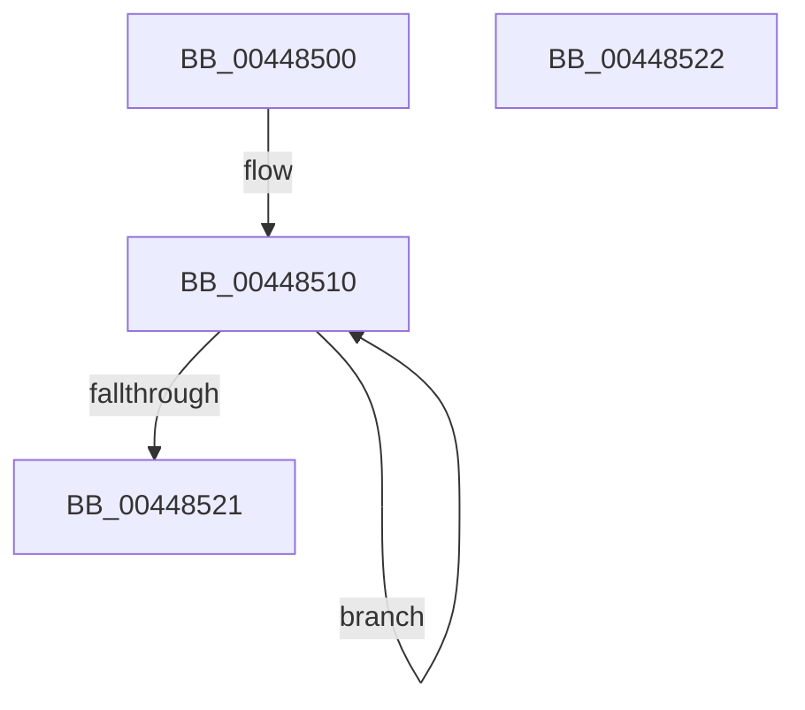

# MiCopyPfnEntryRaw

- RVA: `0x00448500`–`0x00448523` (길이 `35` bytes)
- VA: `0x0000000140448500`
- 실행 섹션: `.text`
- PDB 이름 있음: `예`; PDB Function 태그: `아니요`
- unwind 정보 RVA: `0x000DB714`
- 디코드: `10`개 명령, `35/35` bytes 표시
- 미해석 바이트: `0` (있으면 어셈블리에 `.byte`로 보존)

> 이 문서는 커널 이미지의 기계어와 PDB 기호를 분석해 생성했습니다. 4번과 5번은 함수 원형과 자료형을 바이너리 사용 방식에서 추정한 C 해석이며 원본 소스 복구 결과는 아닙니다.

## 1. Dependencies

- 직접 호출 지점: **0**; 고유 호출 대상: **0**
- 직접 호출자로 확인된 함수: **6**
- RIP 상대 이미지 참조: **0**

### Outgoing calls
- 직접 디코드된 call 명령이 없습니다.

### Direct callers
- [MiSplitDirectMapPage](../4D/MiSplitDirectMapPage_function_004DAAA0.md) at `0x004DABDC`
- [MiIdealClusterPage](../4D/MiIdealClusterPage_function_004DB964.md) at `0x004DBD28`
- [MiIdealClusterPage](../4D/MiIdealClusterPage_function_004DB964.md) at `0x004DBD52`
- [MiCreateInitialPfns](../67/MiCreateInitialPfns_function_00671774.md) at `0x00671797`
- [MiInitializeDynamicPfns](../67/MiInitializeDynamicPfns_function_00672BD0.md) at `0x00673018`
- [MiInitializeDynamicPfns](../67/MiInitializeDynamicPfns_function_00672BD0.md) at `0x00673031`
- [MiInitNucleus](../../init/C5/MiInitNucleus_function_00C5FD38.md) at `0x00C60003`
- [MxCreatePfn](../../init/C6/MxCreatePfn_function_00C63464.md) at `0x00C63517`

### Static image references
- 디코드된 RIP-relative 메모리 참조가 없습니다.

## 2. Other-region calls and transfers

- 다른 실행 섹션으로 향하는 call: **0**
- 별도 외부 분기/꼬리 이동을 확인하지 못했습니다.

## 3. Assembly (complete function range)

```asm
00448500  48 2B CA                        sub rcx, rdx
00448503  41 B8 06 00 00 00               mov r8d, 6
00448509  0F 1F 80 00 00 00 00            nop dword ptr [rax]
00448510  48 8B 02                        mov rax, qword ptr [rdx]
00448513  48 89 04 11                     mov qword ptr [rcx + rdx], rax
00448517  48 8D 52 08                     lea rdx, [rdx + 8]
0044851B  49 83 E8 01                     sub r8, 1
0044851F  75 EF                           jne 0x140448510
00448521  C3                              ret
00448522  CC                              int3
```

## 4. C-style interpretation (structured pseudocode)

```c
__int64 __fastcall MiCopyPfnEntryRaw(__int64 a1, __int64 a2)
{
    a1 = (a1) - (a2);
loc_00448510:
    *(unsigned __int64 *)(a1 + a2 * 1) = *(unsigned __int64 *)(a2);
    a3 = (6) - (1);
    if (condition_is_not_equal) goto loc_00448510;
    return *(unsigned __int64 *)(a2);
}
```

## 5. (Beta) C Style

```c
int64_t MiCopyPfnEntryRaw(void *Arg1, void *Arg2)
{
    uint8_t *arg1 = (uint8_t *)Arg1;
    uint8_t *arg2 = (uint8_t *)Arg2;

    Arg1 = (Arg1) - (Arg2);
loc_00448510:
    *(uint64_t *)(arg1 + arg2 * 1) = *(uint64_t *)(arg2);
    a3 = (6) - (1);
    if (condition_is_not_equal) goto loc_00448510;
    return *(uint64_t *)(arg2);
}
```

### 관측된 메모리 오프셋

구조체 형식이 확인되지 않은 접근은 인자 기준의 오프셋으로만 기록했습니다.

| 기준 인자 | 오프셋 표현 | 폭 (bit) | 접근 |
|---|---:|---:|---|
| `Arg1` | `+ 0x0 + rdx*1` | `64` | `W` |
| `Arg2` | `+ 0x0` | `64` | `R` |
| `Arg2` | `+ 0x8` | `64` | `R` |

## 6. Execution-region graph

[열기: 2D/3D 그래프와 함수 탐색 컨트롤 패널](../../../control-panel.html?section=text&rva=0x00448500&view=graph)

- 2D 그래프는 위에서 아래로 흐르고, 3D 그래프는 빈 공간을 드래그해 회전합니다. Shift+드래그는 이동, 휠은 확대·축소, 함수 노드 선택은 대상 보고서 이동입니다.

### Static fallback


