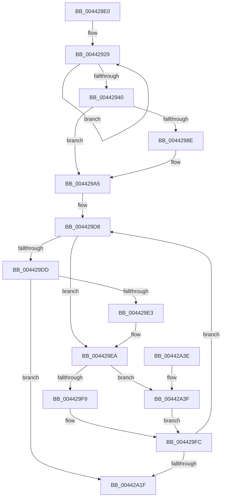

# MiCreateInitialLargeLeafPfns

- RVA: `0x004428E0`–`0x00442A4D` (길이 `365` bytes)
- VA: `0x00000001404428E0`
- 실행 섹션: `.text`
- PDB 이름 있음: `예`; PDB Function 태그: `아니요`
- unwind 정보 RVA: `0x000A5318`
- 디코드: `95`개 명령, `365/365` bytes 표시
- 미해석 바이트: `0` (있으면 어셈블리에 `.byte`로 보존)

> 이 문서는 커널 이미지의 기계어와 PDB 기호를 분석해 생성했습니다. 4번과 5번은 함수 원형과 자료형을 바이너리 사용 방식에서 추정한 C 해석이며 원본 소스 복구 결과는 아닙니다.

## 1. Dependencies

- 직접 호출 지점: **1**; 고유 호출 대상: **1**
- 직접 호출자로 확인된 함수: **4**
- RIP 상대 이미지 참조: **1**

### Outgoing calls
- `0x00442A04` → [MiInitializePfnEntriesRaw](MiInitializePfnEntriesRaw_function_00442A60.md) (function, `0x00442A60`)

### Direct callers
- [MiCoalesceFreeSmallPages](../33/MiCoalesceFreeSmallPages_function_00336340.md) at `0x00336932`
- [MiDeleteSectionCluster](../37/MiDeleteSectionCluster_function_00373DF0.md) at `0x003742A0`
- [MiInitializeNewPfns](../67/MiInitializeNewPfns_function_00670E94.md) at `0x00670F09`
- [MxInsertFreePages](../../init/C6/MxInsertFreePages_function_00C63AD0.md) at `0x00C63C64`

### Static image references
- `0x0044291A` → RVA `0x00000000` (`image boundary/outside`; read)

## 2. Other-region calls and transfers

- 다른 실행 섹션으로 향하는 call: **0**
- 별도 외부 분기/꼬리 이동을 확인하지 못했습니다.

## 3. Assembly (complete function range)

```asm
004428E0  48 8B C4                        mov rax, rsp
004428E3  48 89 58 08                     mov qword ptr [rax + 8], rbx
004428E7  48 89 68 10                     mov qword ptr [rax + 0x10], rbp
004428EB  48 89 70 18                     mov qword ptr [rax + 0x18], rsi
004428EF  48 89 78 20                     mov qword ptr [rax + 0x20], rdi
004428F3  41 54                           push r12
004428F5  41 56                           push r14
004428F7  41 57                           push r15
004428F9  48 83 EC 50                     sub rsp, 0x50
004428FD  0F 57 C0                        xorps xmm0, xmm0
00442900  48 8B D9                        mov rbx, rcx
00442903  0F 11 40 B8                     movups xmmword ptr [rax - 0x48], xmm0
00442907  33 C9                           xor ecx, ecx
00442909  48 8B F2                        mov rsi, rdx
0044290C  0F 11 40 C8                     movups xmmword ptr [rax - 0x38], xmm0
00442910  0F 11 40 D8                     movups xmmword ptr [rax - 0x28], xmm0
00442914  41 8B C0                        mov eax, r8d
00442917  8D 51 06                        lea edx, [rcx + 6]
0044291A  4C 8D 05 DF D6 BB FF            lea r8, [rip - 0x442921]
00442921  4D 8B BC C0 60 1C 01 00         mov r15, qword ptr [r8 + rax*8 + 0x11c60]
00442929  4A 8B 84 01 40 FF E2 00         mov rax, qword ptr [rcx + r8 + 0xe2ff40]
00442931  48 89 44 0C 20                  mov qword ptr [rsp + rcx + 0x20], rax
00442936  48 8D 49 08                     lea rcx, [rcx + 8]
0044293A  48 83 EA 01                     sub rdx, 1
0044293E  75 E9                           jne 0x140442929
00442940  48 8B 44 24 48                  mov rax, qword ptr [rsp + 0x48]
00442945  0F B7 94 24 90 00 00 00         movzx edx, word ptr [rsp + 0x90]
0044294D  48 C1 E2 2B                     shl rdx, 0x2b
00442951  48 8B CA                        mov rcx, rdx
00442954  49 BC 00 00 00 00 00 DE FF FF   movabs r12, 0xffffde0000000000
0044295E  48 33 C8                        xor rcx, rax
00442961  48 B8 FF FF FF FF FF 07 E0 FF   movabs rax, 0xffe007ffffffffff
0044296B  48 23 C8                        and rcx, rax
0044296E  48 33 CA                        xor rcx, rdx
00442971  48 89 4C 24 48                  mov qword ptr [rsp + 0x48], rcx
00442976  48 8D 0C 5B                     lea rcx, [rbx + rbx*2]
0044297A  48 C1 E1 04                     shl rcx, 4
0044297E  49 8B C4                        mov rax, r12
00442981  48 03 C8                        add rcx, rax
00442984  83 BC 24 98 00 00 00 00         cmp dword ptr [rsp + 0x98], 0
0044298C  74 17                           je 0x1404429a5
0044298E  48 8B 44 24 38                  mov rax, qword ptr [rsp + 0x38]
00442993  48 BA 00 00 00 00 00 00 00 80   movabs rdx, 0x8000000000000000
0044299D  48 0B C2                        or rax, rdx
004429A0  48 89 44 24 38                  mov qword ptr [rsp + 0x38], rax
004429A5  8B 44 24 40                     mov eax, dword ptr [rsp + 0x40]
004429A9  49 8D 6F FF                     lea rbp, [r15 - 1]
004429AD  89 84 24 90 00 00 00            mov dword ptr [rsp + 0x90], eax
004429B4  4C 8B F5                        mov r14, rbp
004429B7  C1 E8 10                        shr eax, 0x10
004429BA  49 F7 D6                        not r14
004429BD  24 3F                           and al, 0x3f
004429BF  41 C0 E1 06                     shl r9b, 6
004429C3  41 0A C1                        or al, r9b
004429C6  88 84 24 92 00 00 00            mov byte ptr [rsp + 0x92], al
004429CD  8B 84 24 90 00 00 00            mov eax, dword ptr [rsp + 0x90]
004429D4  89 44 24 40                     mov dword ptr [rsp + 0x40], eax
004429D8  48 85 EB                        test rbx, rbp
004429DB  75 0D                           jne 0x1404429ea
004429DD  48 83 EE 01                     sub rsi, 1
004429E1  74 3C                           je 0x140442a1f
004429E3  48 FF C3                        inc rbx
004429E6  48 83 C1 30                     add rcx, 0x30
004429EA  48 8D 46 FF                     lea rax, [rsi - 1]
004429EE  48 03 C3                        add rax, rbx
004429F1  48 33 C3                        xor rax, rbx
004429F4  49 85 C6                        test r14, rax
004429F7  75 46                           jne 0x140442a3f
004429F9  48 8B FE                        mov rdi, rsi
004429FC  4C 8B C7                        mov r8, rdi
004429FF  48 8D 54 24 20                  lea rdx, [rsp + 0x20]
00442A04  E8 57 00 00 00                  call 0x140442a60
00442A09  48 03 DF                        add rbx, rdi
00442A0C  48 8D 0C 5B                     lea rcx, [rbx + rbx*2]
00442A10  48 C1 E1 04                     shl rcx, 4
00442A14  49 8B C4                        mov rax, r12
00442A17  48 03 C8                        add rcx, rax
00442A1A  48 2B F7                        sub rsi, rdi
00442A1D  75 B9                           jne 0x1404429d8
00442A1F  4C 8D 5C 24 50                  lea r11, [rsp + 0x50]
00442A24  49 8B 5B 20                     mov rbx, qword ptr [r11 + 0x20]
00442A28  49 8B 6B 28                     mov rbp, qword ptr [r11 + 0x28]
00442A2C  49 8B 73 30                     mov rsi, qword ptr [r11 + 0x30]
00442A30  49 8B 7B 38                     mov rdi, qword ptr [r11 + 0x38]
00442A34  49 8B E3                        mov rsp, r11
00442A37  41 5F                           pop r15
00442A39  41 5E                           pop r14
00442A3B  41 5C                           pop r12
00442A3D  C3                              ret
00442A3E  CC                              int3
00442A3F  48 8B C5                        mov rax, rbp
00442A42  49 8B FF                        mov rdi, r15
00442A45  48 23 C3                        and rax, rbx
00442A48  48 2B F8                        sub rdi, rax
00442A4B  EB AF                           jmp 0x1404429fc
```

## 4. C-style interpretation (structured pseudocode)

```c
__int64 __fastcall MiCreateInitialLargeLeafPfns(__int64 a1, __int64 a2, int a3, unsigned __int8 a4, unsigned __int16 a5, unsigned int a6)
{
    __int64 result;
    __int64 v_r14;
    __int64 v_rbx;
    __int64 v_rdi;
    __int64 v_rsi;
    __int64 v_rsp;
    unsigned __int64 v_stack_m18;
    unsigned __int64 v_stack_m20;
    unsigned int v_stack_m28;
    unsigned __int64 v_stack_m30;
    unsigned __int64 v_stack_m48;
    unsigned int v_stack_p28;
    unsigned __int8 v_stack_p2A;

    *(unsigned __int64 *)(v_rsp + 8) = v_rbx;
    *(unsigned __int64 *)(v_rsp + 16) = v_rbp;
    *(unsigned __int64 *)(v_rsp + 24) = v_rsi;
    *(unsigned __int64 *)(v_rsp + 32) = v_rdi;
    v_rsp = (v_rsp) - (80);
    *(unsigned __int64 *)(v_rsp - 72) = v_xmm0;
    a1 = 0;
    *(unsigned __int64 *)(v_rsp - 56) = v_xmm0;
    *(unsigned __int64 *)(v_rsp - 40) = v_xmm0;
loc_00442929:
    *(unsigned __int64 *)(v_rsp + a1 * 1 + 32) = *(unsigned __int64 *)(a1 + v_rip - 4466977 * 1 + 14876480);
    a2 = (a1 + 6) - (1);
    if (condition_is_not_equal) goto loc_00442929;
    a2 = (a5) << (43);
    a1 = (a2) ^ (v_stack_m20);
    a1 = (a1) & (v_stack_m20);
    a1 = (a1) ^ (a2);
    v_stack_m20 = a1;
    a1 = (a1 + a1 * 2) << (4);
    a1 = (a1) + (v_r12);
    result = v_r12;
    if (a6 != 0) {
        result = v_stack_m30;
        result = (result) | (a2);
        v_stack_m30 = result;
    }
    v_stack_p28 = (unsigned int)((unsigned int)(v_stack_m28));
    result = (unsigned int)(((unsigned int)(v_stack_m28)) >> (16));
    v_r14 = ~(*(unsigned __int64 *)(v_rip - 4466977 + (unsigned int)(a3) * 8 + 72800) - 1);
    result = (unsigned __int8)((result) & (63));
    a4 = (unsigned __int8)((a4) << (6));
    result = (unsigned __int8)((result) | (a4));
    v_stack_p2A = (unsigned __int8)(result);
    v_stack_m28 = (unsigned int)((unsigned int)(a5));
loc_004429D8:
    if (((a1) & (*(unsigned __int64 *)(v_rip - 4466977 + (unsigned int)(a3) * 8 + 72800) - 1)) != 0) goto loc_004429EA;
    v_rsi = (a2) - (1);
    if (condition_is_equal) goto loc_00442A1F;
    v_rbx = (a1) + 1;
    a1 = (a1) + (48);
loc_004429EA:
    result = (v_rsi - 1) + (v_rbx);
    result = (result) ^ (v_rbx);
    if (((v_r14) & (result)) != 0) goto loc_00442A3F;
loc_004429FC:
    result = MiInitializePfnEntriesRaw(a1, v_stack_m48, v_rsi, a4);
    v_rbx = (v_rbx) + (v_rsi);
    a1 = (v_rbx + v_rbx * 2) << (4);
    a1 = (a1) + (v_r12);
    v_rsi = (v_rsi) - (v_rsi);
    if (condition_is_not_equal) goto loc_004429D8;
loc_00442A1F:
    return v_r12;
loc_00442A3F:
    result = (*(unsigned __int64 *)(v_stack_m18 + 40)) & (*(unsigned __int64 *)(v_stack_m18 + 32));
    v_rdi = (*(unsigned __int64 *)(v_rip - 4466977 + (unsigned int)(a3) * 8 + 72800)) - (result);
    goto loc_004429FC;
}
```

## 5. (Beta) C Style

```c
int64_t MiCreateInitialLargeLeafPfns(void *Arg1, void *Arg2, int32_t Arg3, uint8_t Arg4, uint16_t Arg5, uint32_t Arg6)
{
    uint8_t *arg1 = (uint8_t *)Arg1;
    uint8_t *arg2 = (uint8_t *)Arg2;

    int64_t result;
    int64_t local_r14;
    int64_t local_rbx;
    int64_t local_rdi;
    int64_t local_rsi;
    int64_t local_rsp;
    uint64_t v_stack_m18;
    uint64_t v_stack_m20;
    uint32_t v_stack_m28;
    uint64_t v_stack_m30;
    uint64_t v_stack_m48;
    uint32_t v_stack_p28;
    uint8_t v_stack_p2A;

    *(uint64_t *)(local_rsp + 0x8) = local_rbx;
    *(uint64_t *)(local_rsp + 0x10) = local_rbp;
    *(uint64_t *)(local_rsp + 0x18) = local_rsi;
    *(uint64_t *)(local_rsp + 0x20) = local_rdi;
    local_rsp = (local_rsp) - (80);
    *(uint64_t *)(local_rsp - 0x48) = v_xmm0;
    Arg1 = 0;
    *(uint64_t *)(local_rsp - 0x38) = v_xmm0;
    *(uint64_t *)(local_rsp - 0x28) = v_xmm0;
loc_00442929:
    *(uint64_t *)(local_rsp + arg1 * 1 + 0x20) = *(uint64_t *)(arg1 + v_rip - 0x442921 * 1 + 0xE2FF40);
    Arg2 = (Arg1 + 6) - (1);
    if (condition_is_not_equal) goto loc_00442929;
    Arg2 = (Arg5) << (43);
    Arg1 = (Arg2) ^ (v_stack_m20);
    Arg1 = (Arg1) & (v_stack_m20);
    Arg1 = (Arg1) ^ (Arg2);
    v_stack_m20 = Arg1;
    Arg1 = (Arg1 + Arg1 * 2) << (4);
    Arg1 = (Arg1) + (local_r12);
    result = local_r12;
    if (Arg6 != 0) {
        result = v_stack_m30;
        result = (result) | (Arg2);
        v_stack_m30 = result;
    }
    v_stack_p28 = (uint32_t)((uint32_t)(v_stack_m28));
    result = (uint32_t)(((uint32_t)(v_stack_m28)) >> (16));
    local_r14 = ~(*(uint64_t *)(v_rip - 0x442921 + (uint32_t)(Arg3) * 8 + 0x11C60) - 1);
    result = (uint8_t)((result) & (63));
    Arg4 = (uint8_t)((Arg4) << (6));
    result = (uint8_t)((result) | (Arg4));
    v_stack_p2A = (uint8_t)(result);
    v_stack_m28 = (uint32_t)((uint32_t)(Arg5));
loc_004429D8:
    if (((Arg1) & (*(uint64_t *)(v_rip - 0x442921 + (uint32_t)(Arg3) * 8 + 0x11C60) - 1)) != 0) goto loc_004429EA;
    local_rsi = (Arg2) - (1);
    if (condition_is_equal) goto loc_00442A1F;
    local_rbx = (Arg1) + 1;
    Arg1 = (Arg1) + (48);
loc_004429EA:
    result = (local_rsi - 1) + (local_rbx);
    result = (result) ^ (local_rbx);
    if (((local_r14) & (result)) != 0) goto loc_00442A3F;
loc_004429FC:
    result = MiInitializePfnEntriesRaw(Arg1, v_stack_m48, local_rsi, Arg4);
    local_rbx = (local_rbx) + (local_rsi);
    Arg1 = (local_rbx + local_rbx * 2) << (4);
    Arg1 = (Arg1) + (local_r12);
    local_rsi = (local_rsi) - (local_rsi);
    if (condition_is_not_equal) goto loc_004429D8;
loc_00442A1F:
    return local_r12;
loc_00442A3F:
    result = (*(uint64_t *)(v_stack_m18 + 0x28)) & (*(uint64_t *)(v_stack_m18 + 0x20));
    local_rdi = (*(uint64_t *)(v_rip - 0x442921 + (uint32_t)(Arg3) * 8 + 0x11C60)) - (result);
    goto loc_004429FC;
}
```

### 관측된 메모리 오프셋

구조체 형식이 확인되지 않은 접근은 인자 기준의 오프셋으로만 기록했습니다.

| 기준 인자 | 오프셋 표현 | 폭 (bit) | 접근 |
|---|---:|---:|---|
| `Arg1` | `+ 0x0 + rbx*2` | `64` | `R` |
| `Arg2` | `- 0x1` | `64` | `R` |

## 6. Execution-region graph

[열기: 2D/3D 그래프와 함수 탐색 컨트롤 패널](../../../control-panel.html?section=text&rva=0x004428E0&view=graph)

- 2D 그래프는 위에서 아래로 흐르고, 3D 그래프는 빈 공간을 드래그해 회전합니다. Shift+드래그는 이동, 휠은 확대·축소, 함수 노드 선택은 대상 보고서 이동입니다.

### Static fallback


