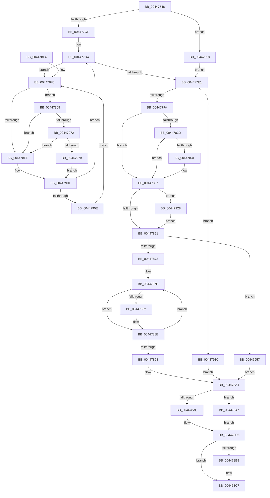

# MiDecayPfnFullyInitialized

- RVA: `0x00447748`–`0x00447987` (길이 `575` bytes)
- VA: `0x0000000140447748`
- 실행 섹션: `.text`
- PDB 이름 있음: `예`; PDB Function 태그: `아니요`
- unwind 정보 RVA: `0x000A5E9C`
- 디코드: `140`개 명령, `575/575` bytes 표시
- 미해석 바이트: `0` (있으면 어셈블리에 `.byte`로 보존)

> 이 문서는 커널 이미지의 기계어와 PDB 기호를 분석해 생성했습니다. 4번과 5번은 함수 원형과 자료형을 바이너리 사용 방식에서 추정한 C 해석이며 원본 소스 복구 결과는 아닙니다.

## 1. Dependencies

- 직접 호출 지점: **11**; 고유 호출 대상: **11**
- 직접 호출자로 확인된 함수: **3**
- RIP 상대 이미지 참조: **6**

### Outgoing calls
- `0x00447785` → [memset](../6C/memset_function_006C6C40.md) (function, `0x006C6C40`)
- `0x00447818` → [MiAcquirePageListLock](../27/MiAcquirePageListLock_function_0027C450.md) (function, `0x0027C450`)
- `0x0044789F` → [ExReleaseSpinLockSharedFromDpcLevel](../24/ExReleaseSpinLockSharedFromDpcLevel_function_0024A590.md) (function, `0x0024A590`)
- `0x004478C2` → [ExpInterlockedPushEntrySList](../6B/ExpInterlockedPushEntrySList_function_006BA5B0.md) (function, `0x006BA5B0`)
- `0x004478D2` → [_security_check_cookie](../6A/_security_check_cookie_function_006AC640.md) (function, `0x006AC640`)
- `0x0044791B` → [MiLockPageInline](../31/MiLockPageInline_function_0031A340.md) (function, `0x0031A340`)
- `0x00447937` → [MiUnlinkPageFromListEx](../28/MiUnlinkPageFromListEx_function_00287590.md) (function, `0x00287590`)
- `0x0044794D` → [MiUnlockPage](../31/MiUnlockPage_function_0031A3E0.md) (function, `0x0031A3E0`)
- `0x0044795E` → [ExReleaseSpinLockExclusiveFromDpcLevel](../24/ExReleaseSpinLockExclusiveFromDpcLevel_function_002497E0.md) (function, `0x002497E0`)
- `0x00447972` → [KiCheckVpBackingLongSpinWaitHypercall](../30/KiCheckVpBackingLongSpinWaitHypercall_function_0030F490.md) (function, `0x0030F490`)
- `0x0044797D` → [HvlNotifyLongSpinWait](../30/HvlNotifyLongSpinWait_function_0030F460.md) (function, `0x0030F460`)

### Direct callers
- [MiDecommitPagesTail](../27/MiDecommitPagesTail_function_002790FC.md) at `0x002791EC`
- [MiFinishHardFault](../2B/MiFinishHardFault_function_002B6F10.md) at `0x002B748D`
- [MiWalkEntireImage](../36/MiWalkEntireImage_function_00365D70.md) at `0x00366595`

### Static image references
- `0x00447763` → RVA `0x00E0A740` (`.data`; read)
- `0x004477B3` → RVA `0x00E30088` (`.data`; read)
- `0x0044781D` → RVA `0x00E2DC80` (`.data`; read)
- `0x004478BB` → RVA `0x00E35C10` (`.data`; read)
- `0x004478F7` → RVA `0x00FC52AC` (`ALMOSTRO`; reference)
- `0x00447968` → RVA `0x00FC6AB8` (`ALMOSTRO`; read)

## 2. Other-region calls and transfers

- 다른 실행 섹션으로 향하는 call: **0**
- 별도 외부 분기/꼬리 이동을 확인하지 못했습니다.

## 3. Assembly (complete function range)

```asm
00447748  48 89 5C 24 10                  mov qword ptr [rsp + 0x10], rbx
0044774D  48 89 6C 24 18                  mov qword ptr [rsp + 0x18], rbp
00447752  48 89 74 24 20                  mov qword ptr [rsp + 0x20], rsi
00447757  57                              push rdi
00447758  41 56                           push r14
0044775A  41 57                           push r15
0044775C  48 81 EC C0 00 00 00            sub rsp, 0xc0
00447763  48 8B 05 D6 2F 9C 00            mov rax, qword ptr [rip + 0x9c2fd6]
0044776A  48 33 C4                        xor rax, rsp
0044776D  48 89 84 24 B0 00 00 00         mov qword ptr [rsp + 0xb0], rax
00447775  8B DA                           mov ebx, edx
00447777  48 8B F9                        mov rdi, rcx
0044777A  33 D2                           xor edx, edx
0044777C  48 8D 4C 24 40                  lea rcx, [rsp + 0x40]
00447781  44 8D 42 68                     lea r8d, [rdx + 0x68]
00447785  E8 B6 F4 27 00                  call 0x1406c6c40
0044778A  48 B8 00 00 00 00 00 DE FF FF   movabs rax, 0xffffde0000000000
00447794  4C 8B FF                        mov r15, rdi
00447797  45 33 F6                        xor r14d, r14d
0044779A  4C 2B F8                        sub r15, rax
0044779D  48 B8 AB AA AA AA AA AA AA AA   movabs rax, 0xaaaaaaaaaaaaaaab
004477A7  49 C1 FF 04                     sar r15, 4
004477AB  4C 0F AF F8                     imul r15, rax
004477AF  48 8B 47 28                     mov rax, qword ptr [rdi + 0x28]
004477B3  48 8B 0D CE 88 9E 00            mov rcx, qword ptr [rip + 0x9e88ce]
004477BA  48 C1 E8 2B                     shr rax, 0x2b
004477BE  25 FF 03 00 00                  and eax, 0x3ff
004477C3  48 8B 2C C1                     mov rbp, qword ptr [rcx + rax*8]
004477C7  85 DB                           test ebx, ebx
004477C9  0F 84 49 01 00 00               je 0x140447918
004477CF  40 B6 11                        mov sil, 0x11
004477D2  33 DB                           xor ebx, ebx
004477D4  F0 48 0F BA 6F 18 3F            lock bts qword ptr [rdi + 0x18], 0x3f
004477DB  0F 82 14 01 00 00               jb 0x1404478f5
004477E1  8B 4F 20                        mov ecx, dword ptr [rdi + 0x20]
004477E4  48 BB FF FF FF FF FF FF FF 7F   movabs rbx, 0x7fffffffffffffff
004477EE  C1 E9 18                        shr ecx, 0x18
004477F1  F6 C1 08                        test cl, 8
004477F4  0F 84 16 01 00 00               je 0x140447910
004477FA  41 B9 01 00 00 00               mov r9d, 1
00447800  48 8D 44 24 40                  lea rax, [rsp + 0x40]
00447805  48 8B D7                        mov rdx, rdi
00447808  48 89 44 24 20                  mov qword ptr [rsp + 0x20], rax
0044780D  48 8D 8D 78 0E 00 00            lea rcx, [rbp + 0xe78]
00447814  45 8D 41 08                     lea r8d, [r9 + 8]
00447818  E8 33 4C E3 FF                  call 0x14027c450
0044781D  48 8B 0D 5C 64 9E 00            mov rcx, qword ptr [rip + 0x9e645c]
00447824  48 8B 47 10                     mov rax, qword ptr [rdi + 0x10]
00447828  48 85 C9                        test rcx, rcx
0044782B  74 0A                           je 0x140447837
0044782D  A8 10                           test al, 0x10
0044782F  75 06                           jne 0x140447837
00447831  48 F7 D1                        not rcx
00447834  48 23 C1                        and rax, rcx
00447837  48 C1 E8 0C                     shr rax, 0xc
0044783B  48 B9 FF FF FF FF FF 00 00 00   movabs rcx, 0xffffffffff
00447845  48 23 C1                        and rax, rcx
00447848  49 3B C7                        cmp rax, r15
0044784B  0F 84 D7 00 00 00               je 0x140447928
00447851  8B 47 20                        mov eax, dword ptr [rdi + 0x20]
00447854  89 44 24 30                     mov dword ptr [rsp + 0x30], eax
00447858  C1 E8 18                        shr eax, 0x18
0044785B  24 F7                           and al, 0xf7
0044785D  80 7C 24 40 00                  cmp byte ptr [rsp + 0x40], 0
00447862  88 44 24 33                     mov byte ptr [rsp + 0x33], al
00447866  8B 44 24 30                     mov eax, dword ptr [rsp + 0x30]
0044786A  89 47 20                        mov dword ptr [rdi + 0x20], eax
0044786D  0F 84 E4 00 00 00               je 0x140447957
00447873  48 8D 4C 24 58                  lea rcx, [rsp + 0x58]
00447878  BA 04 00 00 00                  mov edx, 4
0044787D  80 39 00                        cmp byte ptr [rcx], 0
00447880  74 0C                           je 0x14044788e
00447882  48 8B 41 F8                     mov rax, qword ptr [rcx - 8]
00447886  F0 48 21 58 18                  lock and qword ptr [rax + 0x18], rbx
0044788B  C6 01 00                        mov byte ptr [rcx], 0
0044788E  48 83 C1 18                     add rcx, 0x18
00447892  48 83 EA 01                     sub rdx, 1
00447896  75 E5                           jne 0x14044787d
00447898  48 8D 8D 98 0E 00 00            lea rcx, [rbp + 0xe98]
0044789F  E8 EC 2C E0 FF                  call 0x14024a590
004478A4  40 80 FE 11                     cmp sil, 0x11
004478A8  0F 85 99 00 00 00               jne 0x140447947
004478AE  F0 48 21 5F 18                  lock and qword ptr [rdi + 0x18], rbx
004478B3  45 85 F6                        test r14d, r14d
004478B6  74 0F                           je 0x1404478c7
004478B8  48 8B D7                        mov rdx, rdi
004478BB  48 8D 0D 4E E3 9E 00            lea rcx, [rip + 0x9ee34e]
004478C2  E8 E9 2C 27 00                  call 0x1406ba5b0
004478C7  48 8B 8C 24 B0 00 00 00         mov rcx, qword ptr [rsp + 0xb0]
004478CF  48 33 CC                        xor rcx, rsp
004478D2  E8 69 4D 26 00                  call 0x1406ac640
004478D7  4C 8D 9C 24 C0 00 00 00         lea r11, [rsp + 0xc0]
004478DF  49 8B 5B 28                     mov rbx, qword ptr [r11 + 0x28]
004478E3  49 8B 6B 30                     mov rbp, qword ptr [r11 + 0x30]
004478E7  49 8B 73 38                     mov rsi, qword ptr [r11 + 0x38]
004478EB  49 8B E3                        mov rsp, r11
004478EE  41 5F                           pop r15
004478F0  41 5E                           pop r14
004478F2  5F                              pop rdi
004478F3  C3                              ret
004478F4  CC                              int3
004478F5  FF C3                           inc ebx
004478F7  85 1D AF D9 B7 00               test dword ptr [rip + 0xb7d9af], ebx
004478FD  74 69                           je 0x140447968
004478FF  F3 90                           pause
00447901  48 8B 47 18                     mov rax, qword ptr [rdi + 0x18]
00447905  48 85 C0                        test rax, rax
00447908  0F 89 C6 FE FF FF               jns 0x1404477d4
0044790E  EB E5                           jmp 0x1404478f5
00447910  41 BE 01 00 00 00               mov r14d, 1
00447916  EB 8C                           jmp 0x1404478a4
00447918  48 8B CF                        mov rcx, rdi
0044791B  E8 20 2A ED FF                  call 0x14031a340
00447920  40 8A F0                        mov sil, al
00447923  E9 B9 FE FF FF                  jmp 0x1404477e1
00447928  8A 44 24 40                     mov al, byte ptr [rsp + 0x40]
0044792C  48 8B CF                        mov rcx, rdi
0044792F  F6 D8                           neg al
00447931  1B D2                           sbb edx, edx
00447933  F7 DA                           neg edx
00447935  FF C2                           inc edx
00447937  E8 54 FC E3 FF                  call 0x140287590
0044793C  41 BE 01 00 00 00               mov r14d, 1
00447942  E9 0A FF FF FF                  jmp 0x140447851
00447947  40 8A D6                        mov dl, sil
0044794A  48 8B CF                        mov rcx, rdi
0044794D  E8 8E 2A ED FF                  call 0x14031a3e0
00447952  E9 5C FF FF FF                  jmp 0x1404478b3
00447957  48 8D 8D 98 0E 00 00            lea rcx, [rbp + 0xe98]
0044795E  E8 7D 1E E0 FF                  call 0x1402497e0
00447963  E9 3C FF FF FF                  jmp 0x1404478a4
00447968  8B 05 4A F1 B7 00               mov eax, dword ptr [rip + 0xb7f14a]
0044796E  A8 40                           test al, 0x40
00447970  74 8D                           je 0x1404478ff
00447972  E8 19 7B EC FF                  call 0x14030f490
00447977  84 C0                           test al, al
00447979  74 84                           je 0x1404478ff
0044797B  8B CB                           mov ecx, ebx
0044797D  E8 DE 7A EC FF                  call 0x14030f460
00447982  E9 7A FF FF FF                  jmp 0x140447901
```

## 4. C-style interpretation (structured pseudocode)

```c
__int64 __fastcall MiDecayPfnFullyInitialized(__int64 a1, int a2)
{
    __int64 result;
    __int64 v_r14;
    __int64 v_r15;
    __int64 v_rbx;
    __int64 v_rsp;
    unsigned __int64 v_stack_m18;
    unsigned __int64 v_stack_m28;
    unsigned __int64 v_stack_m80;
    unsigned __int64 v_stack_m98;
    unsigned __int8 v_stack_mA5;
    unsigned int v_stack_mA8;
    unsigned __int64 v_stack_mB8;
    unsigned __int64 v_stack_p10;
    unsigned __int64 v_stack_p18;
    unsigned __int64 v_stack_p20;

    v_stack_p10 = v_rbx;
    v_stack_p18 = v_rbp;
    v_stack_p20 = v_rsi;
    v_rsp = (v_rsp) - (192);
    result = (*(unsigned __int64 *)(v_rip + 10235862)) ^ (v_rsp);
    v_stack_m28 = result;
    a2 = 0;
    result = memset(v_stack_m98, a2, a2 + 104, a4);
    v_r14 = 0;
    v_r15 = (a1) - (result);
    v_r15 = (v_r15) >> (4);
    v_r15 = (v_r15) * (result);
    result = (*(unsigned __int64 *)(a1 + 40)) >> (43);
    result = (unsigned int)((result) & (0x3FFULL));
    if ((unsigned int)((unsigned int)(a2)) == 0) goto loc_00447918;
    v_rbx = 0;
loc_004477D4:
    if (condition_is_below) goto loc_004478F5;
loc_004477E1:
    a1 = (unsigned int)(((unsigned int)(*(unsigned int *)(a1 + 32))) >> (24));
    if ((((unsigned __int8)(a1)) & (8)) == 0) goto loc_00447910;
    v_stack_mB8 = v_stack_m98;
    result = MiAcquirePageListLock(*(unsigned __int64 *)(*(unsigned __int64 *)(v_rip + 10389710) + result * 8) + 3704, a1, 1 + 8, 1);
    if (*(unsigned __int64 *)(v_rip + 10380380) == 0) goto loc_00447837;
    result = *(unsigned __int64 *)(a1 + 16);
    if ((((unsigned __int8)(*(unsigned __int64 *)(a1 + 16))) & (16)) == 0) {
        a1 = ~(*(unsigned __int64 *)(v_rip + 10380380));
        result = (*(unsigned __int64 *)(a1 + 16)) & (a1);
    }
    result = (result) >> (12);
    result = (result) & (a1);
    if (result == v_r15) goto loc_00447928;
loc_00447851:
    v_stack_mA8 = (unsigned int)((unsigned int)(*(unsigned int *)(a1 + 32)));
    result = (unsigned int)(((unsigned int)(*(unsigned int *)(a1 + 32))) >> (24));
    result = (unsigned __int8)((result) & (247));
    v_stack_mA5 = (unsigned __int8)(result);
    *(unsigned int *)(a1 + 32) = (unsigned int)((unsigned int)(v_stack_mA8));
    if (v_stack_m98 == 0) goto loc_00447957;
loc_0044787D:
    result = (unsigned int)(v_stack_mA8);
    if ((*(unsigned __int8 *)(v_stack_m80)) != 0) {
        result = *(unsigned __int64 *)(v_stack_m80 - 8);
        *(unsigned __int8 *)(v_stack_m80) = 0;
    }
    a1 = (v_stack_m80) + (24);
    a2 = (4) - (1);
    if (condition_is_not_equal) goto loc_0044787D;
    result = ExReleaseSpinLockSharedFromDpcLevel(*(unsigned __int64 *)(*(unsigned __int64 *)(v_rip + 10389710) + result * 8) + 3736, a2, 1 + 8, 1);
loc_004478A4:
    if (17 != 17) goto loc_00447947;
loc_004478B3:
    if (0 != 0) {
        a2 = a1;
        a1 = v_rip + 10412878;
        result = ExpInterlockedPushEntrySList(a1, a2, 1 + 8, 1);
    }
    a1 = (v_stack_m28) ^ (v_rsp);
    result = _security_check_cookie(a1, a2, 1 + 8, 1);
    return result;
loc_004478F5:
    v_rbx = (unsigned int)((*(unsigned __int64 *)(v_stack_m18 + 40)) + 1);
    if (((*(unsigned int *)(v_rip + 12048815)) & ((unsigned int)(v_rbx))) == 0) goto loc_00447968;
loc_004478FF:
loc_00447901:
    if (!sign_flag) goto loc_004477D4;
    goto loc_004478F5;
loc_00447910:
    goto loc_004478A4;
loc_00447918:
    result = MiLockPageInline(a1, a2, 1 + 8, 1);
    goto loc_004477E1;
loc_00447928:
    result = (unsigned __int8)(-(v_stack_m80));
    a2 = (unsigned int)(-(a2));
    a2 = (unsigned int)((a2) + 1);
    result = MiUnlinkPageFromListEx(a1, a2, 1 + 8, 1);
    goto loc_00447851;
loc_00447947:
    result = MiUnlockPage(a1, (unsigned __int8)((unsigned __int8)(result)), 1 + 8, 1);
    goto loc_004478B3;
loc_00447957:
    result = ExReleaseSpinLockExclusiveFromDpcLevel(*(unsigned __int64 *)(v_stack_m18 + 48) + 3736, (unsigned __int8)((unsigned __int8)(result)), 1 + 8, 1);
    goto loc_004478A4;
loc_00447968:
    if ((((unsigned __int8)((unsigned int)(*(unsigned int *)(v_rip + 12054858)))) & (64)) == 0) goto loc_004478FF;
    result = KiCheckVpBackingLongSpinWaitHypercall(*(unsigned __int64 *)(v_stack_m18 + 48) + 3736, (unsigned __int8)((unsigned __int8)(result)), 1 + 8, 1);
    if ((unsigned __int8)(result) == 0) goto loc_004478FF;
    result = HvlNotifyLongSpinWait((unsigned int)((unsigned int)(v_rbx)), (unsigned __int8)((unsigned __int8)(result)), 1 + 8, 1);
    goto loc_00447901;
}
```

## 5. (Beta) C Style

```c
int64_t MiDecayPfnFullyInitialized(void *Arg1, int32_t Arg2)
{
    uint8_t *arg1 = (uint8_t *)Arg1;

    int64_t result;
    int64_t local_r14;
    int64_t local_r15;
    int64_t local_rbx;
    int64_t local_rsp;
    uint64_t v_stack_m18;
    uint64_t v_stack_m28;
    uint64_t v_stack_m80;
    uint64_t v_stack_m98;
    uint8_t v_stack_mA5;
    uint32_t v_stack_mA8;
    uint64_t v_stack_mB8;
    uint64_t v_stack_p10;
    uint64_t v_stack_p18;
    uint64_t v_stack_p20;

    v_stack_p10 = local_rbx;
    v_stack_p18 = local_rbp;
    v_stack_p20 = local_rsi;
    local_rsp = (local_rsp) - (192);
    result = (*(uint64_t *)(v_rip + 0x9C2FD6)) ^ (local_rsp);
    v_stack_m28 = result;
    Arg2 = 0;
    result = memset(v_stack_m98, Arg2, Arg2 + 104, a4);
    local_r14 = 0;
    local_r15 = (Arg1) - (result);
    local_r15 = (local_r15) >> (4);
    local_r15 = (local_r15) * (result);
    result = (*(uint64_t *)(arg1 + 0x28)) >> (43);
    result = (uint32_t)((result) & (0x3FFULL));
    if ((uint32_t)((uint32_t)(Arg2)) == 0) goto loc_00447918;
    local_rbx = 0;
loc_004477D4:
    if (condition_is_below) goto loc_004478F5;
loc_004477E1:
    Arg1 = (uint32_t)(((uint32_t)(*(uint32_t *)(arg1 + 0x20))) >> (24));
    if ((((uint8_t)(Arg1)) & (8)) == 0) goto loc_00447910;
    v_stack_mB8 = v_stack_m98;
    result = MiAcquirePageListLock(*(uint64_t *)(*(uint64_t *)(v_rip + 0x9E88CE) + result * 8) + 3704, Arg1, 1 + 8, 1);
    if (*(uint64_t *)(v_rip + 0x9E645C) == 0) goto loc_00447837;
    result = *(uint64_t *)(arg1 + 0x10);
    if ((((uint8_t)(*(uint64_t *)(arg1 + 0x10))) & (16)) == 0) {
        Arg1 = ~(*(uint64_t *)(v_rip + 0x9E645C));
        result = (*(uint64_t *)(arg1 + 0x10)) & (Arg1);
    }
    result = (result) >> (12);
    result = (result) & (Arg1);
    if (result == local_r15) goto loc_00447928;
loc_00447851:
    v_stack_mA8 = (uint32_t)((uint32_t)(*(uint32_t *)(arg1 + 0x20)));
    result = (uint32_t)(((uint32_t)(*(uint32_t *)(arg1 + 0x20))) >> (24));
    result = (uint8_t)((result) & (247));
    v_stack_mA5 = (uint8_t)(result);
    *(uint32_t *)(arg1 + 0x20) = (uint32_t)((uint32_t)(v_stack_mA8));
    if (v_stack_m98 == 0) goto loc_00447957;
loc_0044787D:
    result = (uint32_t)(v_stack_mA8);
    if ((*(uint8_t *)(v_stack_m80)) != 0) {
        result = *(uint64_t *)(v_stack_m80 - 0x8);
        *(uint8_t *)(v_stack_m80) = 0;
    }
    Arg1 = (v_stack_m80) + (24);
    Arg2 = (4) - (1);
    if (condition_is_not_equal) goto loc_0044787D;
    result = ExReleaseSpinLockSharedFromDpcLevel(*(uint64_t *)(*(uint64_t *)(v_rip + 0x9E88CE) + result * 8) + 3736, Arg2, 1 + 8, 1);
loc_004478A4:
    if (17 != 17) goto loc_00447947;
loc_004478B3:
    if (0 != 0) {
        Arg2 = Arg1;
        Arg1 = v_rip + 10412878;
        result = ExpInterlockedPushEntrySList(Arg1, Arg2, 1 + 8, 1);
    }
    Arg1 = (v_stack_m28) ^ (local_rsp);
    result = _security_check_cookie(Arg1, Arg2, 1 + 8, 1);
    return result;
loc_004478F5:
    local_rbx = (uint32_t)((*(uint64_t *)(v_stack_m18 + 0x28)) + 1);
    if (((*(uint32_t *)(v_rip + 0xB7D9AF)) & ((uint32_t)(local_rbx))) == 0) goto loc_00447968;
loc_004478FF:
loc_00447901:
    if (!sign_flag) goto loc_004477D4;
    goto loc_004478F5;
loc_00447910:
    goto loc_004478A4;
loc_00447918:
    result = MiLockPageInline(Arg1, Arg2, 1 + 8, 1);
    goto loc_004477E1;
loc_00447928:
    result = (uint8_t)(-(v_stack_m80));
    Arg2 = (uint32_t)(-(Arg2));
    Arg2 = (uint32_t)((Arg2) + 1);
    result = MiUnlinkPageFromListEx(Arg1, Arg2, 1 + 8, 1);
    goto loc_00447851;
loc_00447947:
    result = MiUnlockPage(Arg1, (uint8_t)((uint8_t)(result)), 1 + 8, 1);
    goto loc_004478B3;
loc_00447957:
    result = ExReleaseSpinLockExclusiveFromDpcLevel(*(uint64_t *)(v_stack_m18 + 0x30) + 3736, (uint8_t)((uint8_t)(result)), 1 + 8, 1);
    goto loc_004478A4;
loc_00447968:
    if ((((uint8_t)((uint32_t)(*(uint32_t *)(v_rip + 0xB7F14A)))) & (64)) == 0) goto loc_004478FF;
    result = KiCheckVpBackingLongSpinWaitHypercall(*(uint64_t *)(v_stack_m18 + 0x30) + 3736, (uint8_t)((uint8_t)(result)), 1 + 8, 1);
    if ((uint8_t)(result) == 0) goto loc_004478FF;
    result = HvlNotifyLongSpinWait((uint32_t)((uint32_t)(local_rbx)), (uint8_t)((uint8_t)(result)), 1 + 8, 1);
    goto loc_00447901;
}
```

### 관측된 메모리 오프셋

구조체 형식이 확인되지 않은 접근은 인자 기준의 오프셋으로만 기록했습니다.

| 기준 인자 | 오프셋 표현 | 폭 (bit) | 접근 |
|---|---:|---:|---|
| `Arg1` | `+ 0x10` | `64` | `R` |
| `Arg1` | `+ 0x18` | `64` | `R` |
| `Arg1` | `+ 0x18` | `64` | `R/W` |
| `Arg1` | `+ 0x20` | `32` | `R` |
| `Arg1` | `+ 0x20` | `32` | `W` |
| `Arg1` | `+ 0x28` | `64` | `R` |

## 6. Execution-region graph

[열기: 2D/3D 그래프와 함수 탐색 컨트롤 패널](../../../control-panel.html?section=text&rva=0x00447748&view=graph)

- 2D 그래프는 위에서 아래로 흐르고, 3D 그래프는 빈 공간을 드래그해 회전합니다. Shift+드래그는 이동, 휠은 확대·축소, 함수 노드 선택은 대상 보고서 이동입니다.

### Static fallback


