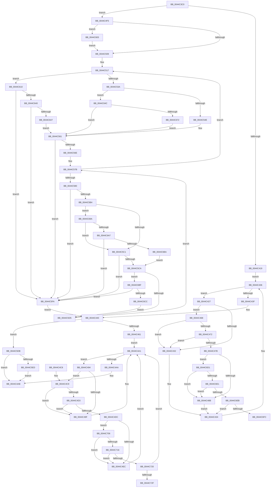

# MiDemoteSlabEntriesDpc

- RVA: `0x0044C3C0`–`0x0044C739` (길이 `889` bytes)
- VA: `0x000000014044C3C0`
- 실행 섹션: `.text`
- PDB 이름 있음: `예`; PDB Function 태그: `예`
- unwind 정보 RVA: `0x000A6854`
- 디코드: `235`개 명령, `889/889` bytes 표시
- 미해석 바이트: `0` (있으면 어셈블리에 `.byte`로 보존)

> 이 문서는 커널 이미지의 기계어와 PDB 기호를 분석해 생성했습니다. 4번과 5번은 함수 원형과 자료형을 바이너리 사용 방식에서 추정한 C 해석이며 원본 소스 복구 결과는 아닙니다.

## 1. Dependencies

- 직접 호출 지점: **16**; 고유 호출 대상: **10**
- 직접 호출자로 확인된 함수: **0**
- RIP 상대 이미지 참조: **5**

### Outgoing calls
- `0x0044C472` → [KiCheckVpBackingLongSpinWaitHypercall](../30/KiCheckVpBackingLongSpinWaitHypercall_function_0030F490.md) (function, `0x0030F490`)
- `0x0044C47E` → [KeCanUseHaltOnAddress](../4F/KeCanUseHaltOnAddress_function_004FC22C.md) (function, `0x004FC22C`)
- `0x0044C48D` → [HvlNotifyLongSpinWait](../30/HvlNotifyLongSpinWait_function_0030F460.md) (function, `0x0030F460`)
- `0x0044C4D3` → [KiCheckVpBackingLongSpinWaitHypercall](../30/KiCheckVpBackingLongSpinWaitHypercall_function_0030F490.md) (function, `0x0030F490`)
- `0x0044C4DF` → [KeCanUseHaltOnAddress](../4F/KeCanUseHaltOnAddress_function_004FC22C.md) (function, `0x004FC22C`)
- `0x0044C4EE` → [HvlNotifyLongSpinWait](../30/HvlNotifyLongSpinWait_function_0030F460.md) (function, `0x0030F460`)
- `0x0044C55C` → [MiGatherSlabDemoteCandidates](MiGatherSlabDemoteCandidates_function_0044D3C0.md) (function, `0x0044D3C0`)
- `0x0044C58D` → [MiDemoteSlabEntry](MiDemoteSlabEntry_function_0044CB0C.md) (function, `0x0044CB0C`)
- `0x0044C5F0` → [KeWakeAddressAll](../21/KeWakeAddressAll_function_00217C20.md) (function, `0x00217C20`)
- `0x0044C606` → [KeWakeAddressAll](../21/KeWakeAddressAll_function_00217C20.md) (function, `0x00217C20`)
- `0x0044C614` → [MiPageToNode](../33/MiPageToNode_function_00338CD0.md) (function, `0x00338CD0`)
- `0x0044C632` → [MiEnumerateSlabAllocatorsEx](../47/MiEnumerateSlabAllocatorsEx_function_004746F8.md) (function, `0x004746F8`)
- `0x0044C65F` → [MiEnumerateSlabAllocatorsEx](../47/MiEnumerateSlabAllocatorsEx_function_004746F8.md) (function, `0x004746F8`)
- `0x0044C690` → [MiEnumerateSlabAllocatorsEx](../47/MiEnumerateSlabAllocatorsEx_function_004746F8.md) (function, `0x004746F8`)
- `0x0044C6AD` → [MiCheckMdlSlabFragmentation](../49/MiCheckMdlSlabFragmentation_function_0049FCF0.md) (function, `0x0049FCF0`)
- `0x0044C6BF` → [KeShouldYieldProcessor](../27/KeShouldYieldProcessor_function_002773E0.md) (function, `0x002773E0`)

### Direct callers
- 이 함수 시작 RVA로 연결되는 직접 call은 확인되지 않았습니다. 간접 호출은 완전히 역산할 수 없습니다.

### Static image references
- `0x0044C42A` → RVA `0x00FC52AC` (`ALMOSTRO`; reference)
- `0x0044C468` → RVA `0x00FC6AB8` (`ALMOSTRO`; read)
- `0x0044C62B` → RVA `0x0068E650` (`MiFindSlabEntryForDemoteByPage`; read)
- `0x0044C658` → RVA `0x0044D3C0` (`MiGatherSlabDemoteCandidates`; read)
- `0x0044C6D1` → RVA `0x00FC6B38` (`ALMOSTRO`; read)

## 2. Other-region calls and transfers

- 다른 실행 섹션으로 향하는 call: **0**
- call이 아닌 외부 분기/꼬리 이동: **2**
  - `0x0044C701` → [sub_006F0E0E](../6F/Unknown_function_006F0E0E.md) (`tail-transfer`)
  - `0x0044C734` → [sub_006F0E0E + 0x47](../6F/Unknown_function_006F0E0E.md) (`tail-transfer`)

## 3. Assembly (complete function range)

```asm
0044C3C0  48 89 5C 24 08                  mov qword ptr [rsp + 8], rbx
0044C3C5  4C 89 44 24 18                  mov qword ptr [rsp + 0x18], r8
0044C3CA  55                              push rbp
0044C3CB  56                              push rsi
0044C3CC  57                              push rdi
0044C3CD  41 54                           push r12
0044C3CF  41 55                           push r13
0044C3D1  41 56                           push r14
0044C3D3  41 57                           push r15
0044C3D5  48 8B EC                        mov rbp, rsp
0044C3D8  48 83 EC 70                     sub rsp, 0x70
0044C3DC  0F 57 C0                        xorps xmm0, xmm0
0044C3DF  33 C0                           xor eax, eax
0044C3E1  48 89 45 F8                     mov qword ptr [rbp - 8], rax
0044C3E5  49 8B D9                        mov rbx, r9
0044C3E8  83 C8 FF                        or eax, 0xffffffff
0044C3EB  4D 8B E8                        mov r13, r8
0044C3EE  48 8B F2                        mov rsi, rdx
0044C3F1  0F 11 45 C8                     movups xmmword ptr [rbp - 0x38], xmm0
0044C3F5  0F 11 45 D8                     movups xmmword ptr [rbp - 0x28], xmm0
0044C3F9  0F 11 45 E8                     movups xmmword ptr [rbp - 0x18], xmm0
0044C3FD  F0 41 0F C1 01                  lock xadd dword ptr [r9], eax
0044C402  FF C8                           dec eax
0044C404  8B F8                           mov edi, eax
0044C406  F7 D7                           not edi
0044C408  81 E7 00 00 00 80               and edi, 0x80000000
0044C40E  A9 FF FF FF 3F                  test eax, 0x3fffffff
0044C413  0F 84 DC 00 00 00               je 0x14044c4f5
0044C419  41 8B 01                        mov eax, dword ptr [r9]
0044C41C  33 F6                           xor esi, esi
0044C41E  45 33 FF                        xor r15d, r15d
0044C421  44 8D 66 01                     lea r12d, [rsi + 1]
0044C425  EB 0F                           jmp 0x14044c436
0044C427  41 03 F4                        add esi, r12d
0044C42A  85 35 7C 8E B7 00               test dword ptr [rip + 0xb78e7c], esi
0044C430  74 36                           je 0x14044c468
0044C432  F3 90                           pause
0044C434  8B 03                           mov eax, dword ptr [rbx]
0044C436  25 00 00 00 80                  and eax, 0x80000000
0044C43B  3B C7                           cmp eax, edi
0044C43D  75 E8                           jne 0x14044c427
0044C43F  90                              nop
0044C440  83 C8 FF                        or eax, 0xffffffff
0044C443  F0 0F C1 03                     lock xadd dword ptr [rbx], eax
0044C447  FF C8                           dec eax
0044C449  41 BE 00 00 00 80               mov r14d, 0x80000000
0044C44F  8B F8                           mov edi, eax
0044C451  F7 D7                           not edi
0044C453  41 23 FE                        and edi, r14d
0044C456  A9 FF FF FF 3F                  test eax, 0x3fffffff
0044C45B  0F 84 7A 01 00 00               je 0x14044c5db
0044C461  33 F6                           xor esi, esi
0044C463  45 33 FF                        xor r15d, r15d
0044C466  EB 39                           jmp 0x14044c4a1
0044C468  8B 05 4A A6 B7 00               mov eax, dword ptr [rip + 0xb7a64a]
0044C46E  A8 40                           test al, 0x40
0044C470  74 C0                           je 0x14044c432
0044C472  E8 19 30 EC FF                  call 0x14030f490
0044C477  84 C0                           test al, al
0044C479  74 B7                           je 0x14044c432
0044C47B  45 03 FC                        add r15d, r12d
0044C47E  E8 A9 FD 0A 00                  call 0x1404fc22c
0044C483  84 C0                           test al, al
0044C485  0F 85 46 02 00 00               jne 0x14044c6d1
0044C48B  8B CE                           mov ecx, esi
0044C48D  E8 CE 2F EC FF                  call 0x14030f460
0044C492  EB A0                           jmp 0x14044c434
0044C494  41 03 F4                        add esi, r12d
0044C497  85 35 0F 8E B7 00               test dword ptr [rip + 0xb78e0f], esi
0044C49D  74 2A                           je 0x14044c4c9
0044C49F  F3 90                           pause
0044C4A1  8B 03                           mov eax, dword ptr [rbx]
0044C4A3  41 23 C6                        and eax, r14d
0044C4A6  3B C7                           cmp eax, edi
0044C4A8  75 EA                           jne 0x14044c494
0044C4AA  90                              nop
0044C4AB  F0 41 FF 4D 00                  lock dec dword ptr [r13]
0044C4B0  48 8B 9C 24 B0 00 00 00         mov rbx, qword ptr [rsp + 0xb0]
0044C4B8  48 83 C4 70                     add rsp, 0x70
0044C4BC  41 5F                           pop r15
0044C4BE  41 5E                           pop r14
0044C4C0  41 5D                           pop r13
0044C4C2  41 5C                           pop r12
0044C4C4  5F                              pop rdi
0044C4C5  5E                              pop rsi
0044C4C6  5D                              pop rbp
0044C4C7  C3                              ret
0044C4C8  CC                              int3
0044C4C9  8B 05 E9 A5 B7 00               mov eax, dword ptr [rip + 0xb7a5e9]
0044C4CF  A8 40                           test al, 0x40
0044C4D1  74 CC                           je 0x14044c49f
0044C4D3  E8 B8 2F EC FF                  call 0x14030f490
0044C4D8  84 C0                           test al, al
0044C4DA  74 C3                           je 0x14044c49f
0044C4DC  45 03 FC                        add r15d, r12d
0044C4DF  E8 48 FD 0A 00                  call 0x1404fc22c
0044C4E4  84 C0                           test al, al
0044C4E6  0F 85 1A 02 00 00               jne 0x14044c706
0044C4EC  8B CE                           mov ecx, esi
0044C4EE  E8 6D 2F EC FF                  call 0x14030f460
0044C4F3  EB AC                           jmp 0x14044c4a1
0044C4F5  41 0B 79 04                     or edi, dword ptr [r9 + 4]
0044C4F9  41 87 39                        xchg dword ptr [r9], edi
0044C4FC  89 7D 48                        mov dword ptr [rbp + 0x48], edi
0044C4FF  0F BA E7 1E                     bt edi, 0x1e
0044C503  0F 82 FA 00 00 00               jb 0x14044c603
0044C509  4C 8B 36                        mov r14, qword ptr [rsi]
0044C50C  41 BC 01 00 00 00               mov r12d, 1
0044C512  48 83 65 C0 00                  and qword ptr [rbp - 0x40], 0
0044C517  48 8B 4E 60                     mov rcx, qword ptr [rsi + 0x60]
0044C51B  0F 57 C0                        xorps xmm0, xmm0
0044C51E  33 C0                           xor eax, eax
0044C520  48 89 45 F8                     mov qword ptr [rbp - 8], rax
0044C524  0F 11 45 C8                     movups xmmword ptr [rbp - 0x38], xmm0
0044C528  0F 11 45 D8                     movups xmmword ptr [rbp - 0x28], xmm0
0044C52C  0F 11 45 E8                     movups xmmword ptr [rbp - 0x18], xmm0
0044C530  48 83 F9 FF                     cmp rcx, -1
0044C534  0F 85 D6 00 00 00               jne 0x14044c610
0044C53A  48 8B 56 58                     mov rdx, qword ptr [rsi + 0x58]
0044C53E  4C 8D 45 C8                     lea r8, [rbp - 0x38]
0044C542  49 8B CE                        mov rcx, r14
0044C545  48 85 D2                        test rdx, rdx
0044C548  0F 84 FE 00 00 00               je 0x14044c64c
0044C54E  83 BA 80 00 00 00 04            cmp dword ptr [rdx + 0x80], 4
0044C555  41 0F 46 C4                     cmovbe eax, r12d
0044C559  89 45 F8                        mov dword ptr [rbp - 8], eax
0044C55C  E8 5F 0E 00 00                  call 0x14044d3c0
0044C561  48 8B 45 E8                     mov rax, qword ptr [rbp - 0x18]
0044C565  48 85 C0                        test rax, rax
0044C568  0F 84 8C 00 00 00               je 0x14044c5fa
0044C56E  4C 8D 6D C8                     lea r13, [rbp - 0x38]
0044C572  4D 8D 6C C5 00                  lea r13, [r13 + rax*8]
0044C577  48 8D 7D C8                     lea rdi, [rbp - 0x38]
0044C57B  49 3B FD                        cmp rdi, r13
0044C57E  73 97                           jae 0x14044c517
0044C580  4C 8B 07                        mov r8, qword ptr [rdi]
0044C583  49 8B CE                        mov rcx, r14
0044C586  4D 8B 78 38                     mov r15, qword ptr [r8 + 0x38]
0044C58A  49 8B D7                        mov rdx, r15
0044C58D  E8 7A 05 00 00                  call 0x14044cb0c
0044C592  4C 01 66 50                     add qword ptr [rsi + 0x50], r12
0044C596  48 8B 4D C0                     mov rcx, qword ptr [rbp - 0x40]
0044C59A  48 03 C8                        add rcx, rax
0044C59D  49 63 87 80 00 00 00            movsxd rax, dword ptr [r15 + 0x80]
0044C5A4  48 89 4D C0                     mov qword ptr [rbp - 0x40], rcx
0044C5A8  4C 01 64 C6 08                  add qword ptr [rsi + rax*8 + 8], r12
0044C5AD  48 83 7E 60 FF                  cmp qword ptr [rsi + 0x60], -1
0044C5B2  75 46                           jne 0x14044c5fa
0044C5B4  48 8B 46 58                     mov rax, qword ptr [rsi + 0x58]
0044C5B8  48 85 C0                        test rax, rax
0044C5BB  0F 85 D9 00 00 00               jne 0x14044c69a
0044C5C1  48 81 F9 20 04 00 00            cmp rcx, 0x420
0044C5C8  73 30                           jae 0x14044c5fa
0044C5CA  48 83 7E 50 40                  cmp qword ptr [rsi + 0x50], 0x40
0044C5CF  0F 83 EA 00 00 00               jae 0x14044c6bf
0044C5D5  48 83 C7 08                     add rdi, 8
0044C5D9  EB A0                           jmp 0x14044c57b
0044C5DB  0B 7B 04                        or edi, dword ptr [rbx + 4]
0044C5DE  87 3B                           xchg dword ptr [rbx], edi
0044C5E0  89 7D 58                        mov dword ptr [rbp + 0x58], edi
0044C5E3  0F BA E7 1E                     bt edi, 0x1e
0044C5E7  0F 83 BE FE FF FF               jae 0x14044c4ab
0044C5ED  48 8B CB                        mov rcx, rbx
0044C5F0  E8 2B B6 DC FF                  call 0x140217c20
0044C5F5  E9 B1 FE FF FF                  jmp 0x14044c4ab
0044C5FA  4C 8B 6D 50                     mov r13, qword ptr [rbp + 0x50]
0044C5FE  E9 3D FE FF FF                  jmp 0x14044c440
0044C603  48 8B CB                        mov rcx, rbx
0044C606  E8 15 B6 DC FF                  call 0x140217c20
0044C60B  E9 F9 FE FF FF                  jmp 0x14044c509
0044C610  48 89 4D F0                     mov qword ptr [rbp - 0x10], rcx
0044C614  E8 B7 C6 EE FF                  call 0x140338cd0
0044C619  44 8B C8                        mov r9d, eax
0044C61C  C7 44 24 20 09 00 00 00         mov dword ptr [rsp + 0x20], 9
0044C624  4C 8D 45 C8                     lea r8, [rbp - 0x38]
0044C628  49 8B CE                        mov rcx, r14
0044C62B  48 8D 15 1E 20 24 00            lea rdx, [rip + 0x24201e]
0044C632  E8 C1 80 02 00                  call 0x1404746f8
0044C637  48 8B 45 C8                     mov rax, qword ptr [rbp - 0x38]
0044C63B  48 85 C0                        test rax, rax
0044C63E  74 BA                           je 0x14044c5fa
0044C640  8B 40 5C                        mov eax, dword ptr [rax + 0x5c]
0044C643  A8 03                           test al, 3
0044C645  75 B3                           jne 0x14044c5fa
0044C647  E9 15 FF FF FF                  jmp 0x14044c561
0044C64C  41 83 C9 FF                     or r9d, 0xffffffff
0044C650  C7 44 24 20 09 00 00 00         mov dword ptr [rsp + 0x20], 9
0044C658  48 8D 15 61 0D 00 00            lea rdx, [rip + 0xd61]
0044C65F  E8 94 80 02 00                  call 0x1404746f8
0044C664  48 81 7D F0 20 04 00 00         cmp qword ptr [rbp - 0x10], 0x420
0044C66C  0F 83 EF FE FF FF               jae 0x14044c561
0044C672  41 83 C9 FF                     or r9d, 0xffffffff
0044C676  44 89 65 F8                     mov dword ptr [rbp - 8], r12d
0044C67A  4C 8D 45 C8                     lea r8, [rbp - 0x38]
0044C67E  C7 44 24 20 09 00 00 00         mov dword ptr [rsp + 0x20], 9
0044C686  48 8D 15 33 0D 00 00            lea rdx, [rip + 0xd33]
0044C68D  49 8B CE                        mov rcx, r14
0044C690  E8 63 80 02 00                  call 0x1404746f8
0044C695  E9 C7 FE FF FF                  jmp 0x14044c561
0044C69A  83 B8 80 00 00 00 07            cmp dword ptr [rax + 0x80], 7
0044C6A1  0F 85 1A FF FF FF               jne 0x14044c5c1
0044C6A7  41 8B D4                        mov edx, r12d
0044C6AA  49 8B CF                        mov rcx, r15
0044C6AD  E8 3E 36 05 00                  call 0x14049fcf0
0044C6B2  85 C0                           test eax, eax
0044C6B4  0F 84 40 FF FF FF               je 0x14044c5fa
0044C6BA  E9 0B FF FF FF                  jmp 0x14044c5ca
0044C6BF  E8 1C AD E2 FF                  call 0x1402773e0
0044C6C4  85 C0                           test eax, eax
0044C6C6  0F 85 2E FF FF FF               jne 0x14044c5fa
0044C6CC  E9 04 FF FF FF                  jmp 0x14044c5d5
0044C6D1  F7 05 5D A4 B7 00 00 00 02 00   test dword ptr [rip + 0xb7a45d], 0x20000
0044C6DB  0F 84 AA FD FF FF               je 0x14044c48b
0044C6E1  41 F6 C7 07                     test r15b, 7
0044C6E5  0F 85 A0 FD FF FF               jne 0x14044c48b
0044C6EB  8B 0B                           mov ecx, dword ptr [rbx]
0044C6ED  8B C1                           mov eax, ecx
0044C6EF  25 00 00 00 80                  and eax, 0x80000000
0044C6F4  3B C7                           cmp eax, edi
0044C6F6  0F 84 38 FD FF FF               je 0x14044c434
0044C6FC  8B D1                           mov edx, ecx
0044C6FE  44 8B C1                        mov r8d, ecx
0044C701  E9 08 47 2A 00                  jmp 0x1406f0e0e
0044C706  F7 05 28 A4 B7 00 00 00 02 00   test dword ptr [rip + 0xb7a428], 0x20000
0044C710  0F 84 D6 FD FF FF               je 0x14044c4ec
0044C716  41 F6 C7 07                     test r15b, 7
0044C71A  0F 85 CC FD FF FF               jne 0x14044c4ec
0044C720  8B 0B                           mov ecx, dword ptr [rbx]
0044C722  8B C1                           mov eax, ecx
0044C724  41 23 C6                        and eax, r14d
0044C727  3B C7                           cmp eax, edi
0044C729  0F 84 72 FD FF FF               je 0x14044c4a1
0044C72F  8B D1                           mov edx, ecx
0044C731  44 8B C1                        mov r8d, ecx
0044C734  E9 1C 47 2A 00                  jmp 0x1406f0e55
```

## 4. C-style interpretation (structured pseudocode)

```c
__int64 __fastcall MiDemoteSlabEntriesDpc(__int64 a1, __int64 a2, __int64 a3, __int64 a4)
{
    __int64 result;
    __int64 v_r15;
    __int64 v_rdi;
    __int64 v_rsi;
    __int64 v_rsp;
    unsigned __int64 v_stack_m40;
    unsigned __int64 v_stack_m48;
    unsigned __int64 v_stack_m50;
    unsigned __int64 v_stack_m60;
    unsigned __int64 v_stack_m70;
    unsigned __int64 v_stack_m78;
    unsigned int v_stack_p10;
    unsigned __int64 v_stack_p18;
    unsigned int v_stack_p20;
    unsigned __int64 v_stack_p8;

    v_stack_p8 = v_rbx;
    v_stack_p18 = a3;
    v_rsp = (v_rsp) - (112);
    result = 0;
    v_stack_m40 = 0;
    result = (unsigned int)((result) | (0xFFFFFFFFULL));
    v_stack_m70 = v_xmm0;
    v_stack_m60 = v_xmm0;
    v_stack_m50 = v_xmm0;
    result = (unsigned int)((result) - 1);
    v_rdi = (unsigned int)(~((unsigned int)((unsigned int)(result))));
    v_rdi = (unsigned int)((v_rdi) & (0x80000000ULL));
    if ((((unsigned int)(result)) & (0x3FFFFFFFULL)) == 0) goto loc_0044C4F5;
    v_rsi = 0;
    v_r15 = 0;
    goto loc_0044C436;
loc_0044C427:
    v_rsi = (unsigned int)((v_rsi) + ((unsigned int)(v_rsi + 1)));
    if (((*(unsigned int *)(v_rip + 12029564)) & ((unsigned int)(v_rsi))) == 0) goto loc_0044C468;
loc_0044C432:
loc_0044C434:
loc_0044C436:
    result = (unsigned int)(((unsigned int)(*(unsigned int *)(a4))) & (0x80000000ULL));
    if (((unsigned int)(result)) != ((unsigned int)(v_rdi))) goto loc_0044C427;
loc_0044C440:
    result = (unsigned int)((result) | (0xFFFFFFFFULL));
    result = (unsigned int)((result) - 1);
    v_rdi = (unsigned int)(~((unsigned int)((unsigned int)(result))));
    v_rdi = (unsigned int)((v_rdi) & ((unsigned int)((unsigned int)(0x80000000ULL))));
    if ((((unsigned int)(result)) & (0x3FFFFFFFULL)) == 0) goto loc_0044C5DB;
    v_rsi = 0;
    v_r15 = 0;
    goto loc_0044C4A1;
loc_0044C468:
    if ((((unsigned __int8)((unsigned int)(*(unsigned int *)(v_rip + 12035658)))) & (64)) == 0) goto loc_0044C432;
    result = KiCheckVpBackingLongSpinWaitHypercall(a1, a2, a3, a4);
    if ((unsigned __int8)(result) == 0) goto loc_0044C432;
    v_r15 = (unsigned int)((v_r15) + ((unsigned int)(v_rsi + 1)));
    result = KeCanUseHaltOnAddress(a1, a2, a3, a4);
    if ((unsigned __int8)(result) != 0) goto loc_0044C6D1;
loc_0044C48B:
    result = HvlNotifyLongSpinWait(0, a2, a3, a4);
    goto loc_0044C434;
loc_0044C494:
    v_rsi = (unsigned int)((v_rsi) + ((unsigned int)(v_rsi + 1)));
    if (((*(unsigned int *)(v_rip + 12029455)) & ((unsigned int)(v_rsi))) == 0) goto loc_0044C4C9;
loc_0044C49F:
loc_0044C4A1:
    result = (unsigned int)(((unsigned int)(*(unsigned int *)(a4))) & ((unsigned int)((unsigned int)(0x80000000ULL))));
    if (((unsigned int)(result)) != ((unsigned int)(v_rdi))) goto loc_0044C494;
loc_0044C4AB:
    v_rsp = (v_rsp) + (112);
    return result;
loc_0044C4C9:
    if ((((unsigned __int8)((unsigned int)(*(unsigned int *)(v_rip + 12035561)))) & (64)) == 0) goto loc_0044C49F;
    result = KiCheckVpBackingLongSpinWaitHypercall(0, a2, a3, a4);
    if ((unsigned __int8)(result) == 0) goto loc_0044C49F;
    v_r15 = (unsigned int)((v_r15) + ((unsigned int)(v_rsi + 1)));
    result = KeCanUseHaltOnAddress(0, a2, a3, a4);
    if ((unsigned __int8)(result) != 0) goto loc_0044C706;
loc_0044C4EC:
    result = HvlNotifyLongSpinWait((unsigned int)((unsigned int)(v_rsi)), a2, a3, a4);
    goto loc_0044C4A1;
loc_0044C4F5:
    v_rdi = (unsigned int)((v_rdi) | (*(unsigned int *)(a4 + 4)));
    v_stack_p10 = (unsigned int)(v_rdi);
    if (condition_is_below) goto loc_0044C603;
loc_0044C509:
loc_0044C517:
    result = 0;
    v_stack_m40 = 0;
    v_stack_m70 = v_xmm0;
    v_stack_m60 = v_xmm0;
    v_stack_m50 = v_xmm0;
    if ((*(unsigned __int64 *)(v_rsi + 96)) != -1) goto loc_0044C610;
    if (*(unsigned __int64 *)(v_rsi + 88) == 0) goto loc_0044C64C;
    if ((*(unsigned int *)(*(unsigned __int64 *)(v_rsi + 88) + 128)) <= 4) { result = 1; }
    v_stack_m40 = (unsigned int)(result);
    result = MiGatherSlabDemoteCandidates(*(unsigned __int64 *)(v_rsi), *(unsigned __int64 *)(v_rsi + 88), v_stack_m70, a4);
loc_0044C561:
    if (v_stack_m50 == 0) goto loc_0044C5FA;
loc_0044C57B:
    if (v_stack_m70 >= (v_stack_m70 + v_stack_m50 * 8)) goto loc_0044C517;
    result = MiDemoteSlabEntry(*(unsigned __int64 *)(v_rsi), *(unsigned __int64 *)(*(unsigned __int64 *)(v_stack_m70) + 56), *(unsigned __int64 *)(v_stack_m70), a4);
    a1 = (v_stack_m78) + (result);
    v_stack_m78 = a1;
    if ((*(unsigned __int64 *)(v_rsi + 96)) != -1) goto loc_0044C5FA;
    if (*(unsigned __int64 *)(v_rsi + 88) != 0) goto loc_0044C69A;
loc_0044C5C1:
    if (a1 >= 0x420ULL) goto loc_0044C5FA;
loc_0044C5CA:
    if ((*(unsigned __int64 *)(v_rsi + 80)) >= 64) goto loc_0044C6BF;
loc_0044C5D5:
    v_rdi = (v_stack_m70) + (8);
    goto loc_0044C57B;
loc_0044C5DB:
    v_rdi = (unsigned int)((v_rdi) | (*(unsigned int *)(v_stack_p8 + 4)));
    v_stack_p20 = (unsigned int)(v_rdi);
    if (condition_is_above_or_equal) goto loc_0044C4AB;
    result = KeWakeAddressAll(v_stack_p8, *(unsigned __int64 *)(*(unsigned __int64 *)(v_stack_m70) + 56), *(unsigned __int64 *)(v_stack_m70), a4);
    goto loc_0044C4AB;
loc_0044C5FA:
    goto loc_0044C440;
loc_0044C603:
    result = KeWakeAddressAll(v_stack_p8, *(unsigned __int64 *)(*(unsigned __int64 *)(v_stack_m70) + 56), *(unsigned __int64 *)(v_stack_m70), a4);
    goto loc_0044C509;
loc_0044C610:
    v_stack_m48 = v_stack_p8;
    result = MiPageToNode(v_stack_p8, *(unsigned __int64 *)(*(unsigned __int64 *)(v_stack_m70) + 56), *(unsigned __int64 *)(v_stack_m70), a4);
    v_stack_p20 = 9;
    result = MiEnumerateSlabAllocatorsEx(*(unsigned __int64 *)(v_rsi), v_rip + 2367518, v_stack_m70, (unsigned int)((unsigned int)(result)));
    if (v_stack_m70 == 0) goto loc_0044C5FA;
    if ((((unsigned __int8)((unsigned int)(*(unsigned int *)(v_stack_m70 + 92)))) & (3)) != 0) goto loc_0044C5FA;
    goto loc_0044C561;
loc_0044C64C:
    a4 = (unsigned int)(((unsigned int)((unsigned int)(result))) | (0xFFFFFFFFULL));
    v_stack_p20 = 9;
    result = MiEnumerateSlabAllocatorsEx(*(unsigned __int64 *)(v_rsi), v_rip + 3425, v_stack_m70, a4);
    if (v_stack_m48 >= 0x420ULL) goto loc_0044C561;
    a4 = (unsigned int)((a4) | (0xFFFFFFFFULL));
    v_stack_m40 = 1;
    v_stack_p20 = 9;
    result = MiEnumerateSlabAllocatorsEx(*(unsigned __int64 *)(v_rsi), v_rip + 3379, v_stack_m70, a4);
    goto loc_0044C561;
loc_0044C69A:
    if ((*(unsigned int *)(result + 128)) != 7) goto loc_0044C5C1;
    result = MiCheckMdlSlabFragmentation(*(unsigned __int64 *)(*(unsigned __int64 *)(v_stack_m70) + 56), 1, v_stack_m70, a4);
    if ((unsigned int)(result) == 0) goto loc_0044C5FA;
    goto loc_0044C5CA;
loc_0044C6BF:
    result = KeShouldYieldProcessor(*(unsigned __int64 *)(*(unsigned __int64 *)(v_stack_m70) + 56), 1, v_stack_m70, a4);
    if ((unsigned int)(result) != 0) goto loc_0044C5FA;
    goto loc_0044C5D5;
loc_0044C6D1:
    if (((*(unsigned int *)(v_rip + 12035165)) & (0x20000ULL)) == 0) goto loc_0044C48B;
    if ((((unsigned __int8)(*(unsigned __int64 *)(*(unsigned __int64 *)(v_stack_m70) + 56))) & (7)) != 0) goto loc_0044C48B;
    result = (unsigned int)(((unsigned int)((unsigned int)((unsigned int)(*(unsigned int *)(v_stack_p8))))) & (0x80000000ULL));
    if (((unsigned int)(result)) == ((unsigned int)(v_rdi))) goto loc_0044C434;
loc_0044C706:
    if (((*(unsigned int *)(v_rip + 12035112)) & (0x20000ULL)) == 0) goto loc_0044C4EC;
    if ((((unsigned __int8)(*(unsigned __int64 *)(*(unsigned __int64 *)(v_stack_m70) + 56))) & (7)) != 0) goto loc_0044C4EC;
    result = (unsigned int)(((unsigned int)((unsigned int)((unsigned int)(*(unsigned int *)(v_stack_p8))))) & ((unsigned int)(*(unsigned __int64 *)(v_rsi))));
    if (((unsigned int)(result)) == ((unsigned int)(v_rdi))) goto loc_0044C4A1;
}
```

## 5. (Beta) C Style

```c
int64_t MiDemoteSlabEntriesDpc(int64_t Arg1, void *Arg2, int64_t Arg3, void *Arg4)
{
    uint8_t *arg2 = (uint8_t *)Arg2;
    uint8_t *arg4 = (uint8_t *)Arg4;

    int64_t result;
    int64_t local_r15;
    int64_t local_rdi;
    int64_t local_rsi;
    int64_t local_rsp;
    uint64_t v_stack_m40;
    uint64_t v_stack_m48;
    uint64_t v_stack_m50;
    uint64_t v_stack_m60;
    uint64_t v_stack_m70;
    uint64_t v_stack_m78;
    uint32_t v_stack_p10;
    uint64_t v_stack_p18;
    uint32_t v_stack_p20;
    uint64_t v_stack_p8;

    v_stack_p8 = local_rbx;
    v_stack_p18 = Arg3;
    local_rsp = (local_rsp) - (112);
    result = 0;
    v_stack_m40 = 0;
    result = (uint32_t)((result) | (0xFFFFFFFFULL));
    v_stack_m70 = v_xmm0;
    v_stack_m60 = v_xmm0;
    v_stack_m50 = v_xmm0;
    result = (uint32_t)((result) - 1);
    local_rdi = (uint32_t)(~((uint32_t)((uint32_t)(result))));
    local_rdi = (uint32_t)((local_rdi) & (0x80000000ULL));
    if ((((uint32_t)(result)) & (0x3FFFFFFFULL)) == 0) goto loc_0044C4F5;
    local_rsi = 0;
    local_r15 = 0;
    goto loc_0044C436;
loc_0044C427:
    local_rsi = (uint32_t)((local_rsi) + ((uint32_t)(local_rsi + 1)));
    if (((*(uint32_t *)(v_rip + 0xB78E7C)) & ((uint32_t)(local_rsi))) == 0) goto loc_0044C468;
loc_0044C432:
loc_0044C434:
loc_0044C436:
    result = (uint32_t)(((uint32_t)(*(uint32_t *)(arg4))) & (0x80000000ULL));
    if (((uint32_t)(result)) != ((uint32_t)(local_rdi))) goto loc_0044C427;
loc_0044C440:
    result = (uint32_t)((result) | (0xFFFFFFFFULL));
    result = (uint32_t)((result) - 1);
    local_rdi = (uint32_t)(~((uint32_t)((uint32_t)(result))));
    local_rdi = (uint32_t)((local_rdi) & ((uint32_t)((uint32_t)(0x80000000ULL))));
    if ((((uint32_t)(result)) & (0x3FFFFFFFULL)) == 0) goto loc_0044C5DB;
    local_rsi = 0;
    local_r15 = 0;
    goto loc_0044C4A1;
loc_0044C468:
    if ((((uint8_t)((uint32_t)(*(uint32_t *)(v_rip + 0xB7A64A)))) & (64)) == 0) goto loc_0044C432;
    result = KiCheckVpBackingLongSpinWaitHypercall(Arg1, Arg2, Arg3, Arg4);
    if ((uint8_t)(result) == 0) goto loc_0044C432;
    local_r15 = (uint32_t)((local_r15) + ((uint32_t)(local_rsi + 1)));
    result = KeCanUseHaltOnAddress(Arg1, Arg2, Arg3, Arg4);
    if ((uint8_t)(result) != 0) goto loc_0044C6D1;
loc_0044C48B:
    result = HvlNotifyLongSpinWait(0, Arg2, Arg3, Arg4);
    goto loc_0044C434;
loc_0044C494:
    local_rsi = (uint32_t)((local_rsi) + ((uint32_t)(local_rsi + 1)));
    if (((*(uint32_t *)(v_rip + 0xB78E0F)) & ((uint32_t)(local_rsi))) == 0) goto loc_0044C4C9;
loc_0044C49F:
loc_0044C4A1:
    result = (uint32_t)(((uint32_t)(*(uint32_t *)(arg4))) & ((uint32_t)((uint32_t)(0x80000000ULL))));
    if (((uint32_t)(result)) != ((uint32_t)(local_rdi))) goto loc_0044C494;
loc_0044C4AB:
    local_rsp = (local_rsp) + (112);
    return result;
loc_0044C4C9:
    if ((((uint8_t)((uint32_t)(*(uint32_t *)(v_rip + 0xB7A5E9)))) & (64)) == 0) goto loc_0044C49F;
    result = KiCheckVpBackingLongSpinWaitHypercall(0, Arg2, Arg3, Arg4);
    if ((uint8_t)(result) == 0) goto loc_0044C49F;
    local_r15 = (uint32_t)((local_r15) + ((uint32_t)(local_rsi + 1)));
    result = KeCanUseHaltOnAddress(0, Arg2, Arg3, Arg4);
    if ((uint8_t)(result) != 0) goto loc_0044C706;
loc_0044C4EC:
    result = HvlNotifyLongSpinWait((uint32_t)((uint32_t)(local_rsi)), Arg2, Arg3, Arg4);
    goto loc_0044C4A1;
loc_0044C4F5:
    local_rdi = (uint32_t)((local_rdi) | (*(uint32_t *)(arg4 + 0x4)));
    v_stack_p10 = (uint32_t)(local_rdi);
    if (condition_is_below) goto loc_0044C603;
loc_0044C509:
loc_0044C517:
    result = 0;
    v_stack_m40 = 0;
    v_stack_m70 = v_xmm0;
    v_stack_m60 = v_xmm0;
    v_stack_m50 = v_xmm0;
    if ((*(uint64_t *)(local_rsi + 0x60)) != -1) goto loc_0044C610;
    if (*(uint64_t *)(local_rsi + 0x58) == 0) goto loc_0044C64C;
    if ((*(uint32_t *)(*(uint64_t *)(local_rsi + 0x58) + 0x80)) <= 4) { result = 1; }
    v_stack_m40 = (uint32_t)(result);
    result = MiGatherSlabDemoteCandidates(*(uint64_t *)(local_rsi), *(uint64_t *)(local_rsi + 0x58), v_stack_m70, Arg4);
loc_0044C561:
    if (v_stack_m50 == 0) goto loc_0044C5FA;
loc_0044C57B:
    if (v_stack_m70 >= (v_stack_m70 + v_stack_m50 * 8)) goto loc_0044C517;
    result = MiDemoteSlabEntry(*(uint64_t *)(local_rsi), *(uint64_t *)(*(uint64_t *)(v_stack_m70) + 0x38), *(uint64_t *)(v_stack_m70), Arg4);
    Arg1 = (v_stack_m78) + (result);
    v_stack_m78 = Arg1;
    if ((*(uint64_t *)(local_rsi + 0x60)) != -1) goto loc_0044C5FA;
    if (*(uint64_t *)(local_rsi + 0x58) != 0) goto loc_0044C69A;
loc_0044C5C1:
    if (Arg1 >= 0x420ULL) goto loc_0044C5FA;
loc_0044C5CA:
    if ((*(uint64_t *)(local_rsi + 0x50)) >= 64) goto loc_0044C6BF;
loc_0044C5D5:
    local_rdi = (v_stack_m70) + (8);
    goto loc_0044C57B;
loc_0044C5DB:
    local_rdi = (uint32_t)((local_rdi) | (*(uint32_t *)(v_stack_p8 + 0x4)));
    v_stack_p20 = (uint32_t)(local_rdi);
    if (condition_is_above_or_equal) goto loc_0044C4AB;
    result = KeWakeAddressAll(v_stack_p8, *(uint64_t *)(*(uint64_t *)(v_stack_m70) + 0x38), *(uint64_t *)(v_stack_m70), Arg4);
    goto loc_0044C4AB;
loc_0044C5FA:
    goto loc_0044C440;
loc_0044C603:
    result = KeWakeAddressAll(v_stack_p8, *(uint64_t *)(*(uint64_t *)(v_stack_m70) + 0x38), *(uint64_t *)(v_stack_m70), Arg4);
    goto loc_0044C509;
loc_0044C610:
    v_stack_m48 = v_stack_p8;
    result = MiPageToNode(v_stack_p8, *(uint64_t *)(*(uint64_t *)(v_stack_m70) + 0x38), *(uint64_t *)(v_stack_m70), Arg4);
    v_stack_p20 = 9;
    result = MiEnumerateSlabAllocatorsEx(*(uint64_t *)(local_rsi), v_rip + 2367518, v_stack_m70, (uint32_t)((uint32_t)(result)));
    if (v_stack_m70 == 0) goto loc_0044C5FA;
    if ((((uint8_t)((uint32_t)(*(uint32_t *)(v_stack_m70 + 0x5C)))) & (3)) != 0) goto loc_0044C5FA;
    goto loc_0044C561;
loc_0044C64C:
    Arg4 = (uint32_t)(((uint32_t)((uint32_t)(result))) | (0xFFFFFFFFULL));
    v_stack_p20 = 9;
    result = MiEnumerateSlabAllocatorsEx(*(uint64_t *)(local_rsi), v_rip + 3425, v_stack_m70, Arg4);
    if (v_stack_m48 >= 0x420ULL) goto loc_0044C561;
    Arg4 = (uint32_t)((Arg4) | (0xFFFFFFFFULL));
    v_stack_m40 = 1;
    v_stack_p20 = 9;
    result = MiEnumerateSlabAllocatorsEx(*(uint64_t *)(local_rsi), v_rip + 3379, v_stack_m70, Arg4);
    goto loc_0044C561;
loc_0044C69A:
    if ((*(uint32_t *)(result + 0x80)) != 7) goto loc_0044C5C1;
    result = MiCheckMdlSlabFragmentation(*(uint64_t *)(*(uint64_t *)(v_stack_m70) + 0x38), 1, v_stack_m70, Arg4);
    if ((uint32_t)(result) == 0) goto loc_0044C5FA;
    goto loc_0044C5CA;
loc_0044C6BF:
    result = KeShouldYieldProcessor(*(uint64_t *)(*(uint64_t *)(v_stack_m70) + 0x38), 1, v_stack_m70, Arg4);
    if ((uint32_t)(result) != 0) goto loc_0044C5FA;
    goto loc_0044C5D5;
loc_0044C6D1:
    if (((*(uint32_t *)(v_rip + 0xB7A45D)) & (0x20000ULL)) == 0) goto loc_0044C48B;
    if ((((uint8_t)(*(uint64_t *)(*(uint64_t *)(v_stack_m70) + 0x38))) & (7)) != 0) goto loc_0044C48B;
    result = (uint32_t)(((uint32_t)((uint32_t)((uint32_t)(*(uint32_t *)(v_stack_p8))))) & (0x80000000ULL));
    if (((uint32_t)(result)) == ((uint32_t)(local_rdi))) goto loc_0044C434;
loc_0044C706:
    if (((*(uint32_t *)(v_rip + 0xB7A428)) & (0x20000ULL)) == 0) goto loc_0044C4EC;
    if ((((uint8_t)(*(uint64_t *)(*(uint64_t *)(v_stack_m70) + 0x38))) & (7)) != 0) goto loc_0044C4EC;
    result = (uint32_t)(((uint32_t)((uint32_t)((uint32_t)(*(uint32_t *)(v_stack_p8))))) & ((uint32_t)(*(uint64_t *)(local_rsi))));
    if (((uint32_t)(result)) == ((uint32_t)(local_rdi))) goto loc_0044C4A1;
}
```

### 관측된 메모리 오프셋

구조체 형식이 확인되지 않은 접근은 인자 기준의 오프셋으로만 기록했습니다.

| 기준 인자 | 오프셋 표현 | 폭 (bit) | 접근 |
|---|---:|---:|---|
| `Arg2` | `+ 0x0` | `64` | `R` |
| `Arg2` | `+ 0x8 + rax*8` | `64` | `R/W` |
| `Arg2` | `+ 0x50` | `64` | `R` |
| `Arg2` | `+ 0x50` | `64` | `R/W` |
| `Arg2` | `+ 0x58` | `64` | `R` |
| `Arg2` | `+ 0x60` | `64` | `R` |
| `Arg4` | `+ 0x0` | `32` | `R` |
| `Arg4` | `+ 0x0` | `32` | `R/W` |
| `Arg4` | `+ 0x4` | `32` | `R` |

## 6. Execution-region graph

[열기: 2D/3D 그래프와 함수 탐색 컨트롤 패널](../../../control-panel.html?section=text&rva=0x0044C3C0&view=graph)

- 2D 그래프는 위에서 아래로 흐르고, 3D 그래프는 빈 공간을 드래그해 회전합니다. Shift+드래그는 이동, 휠은 확대·축소, 함수 노드 선택은 대상 보고서 이동입니다.

### Static fallback


