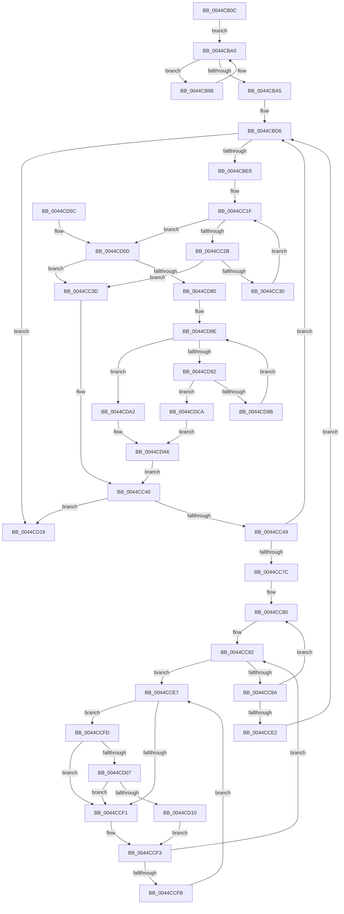

# MiDemoteSlabEntry

- RVA: `0x0044CB0C`–`0x0044CDD1` (길이 `709` bytes)
- VA: `0x000000014044CB0C`
- 실행 섹션: `.text`
- PDB 이름 있음: `예`; PDB Function 태그: `아니요`
- unwind 정보 RVA: `0x000A68AC`
- 디코드: `196`개 명령, `709/709` bytes 표시
- 미해석 바이트: `0` (있으면 어셈블리에 `.byte`로 보존)

> 이 문서는 커널 이미지의 기계어와 PDB 기호를 분석해 생성했습니다. 4번과 5번은 함수 원형과 자료형을 바이너리 사용 방식에서 추정한 C 해석이며 원본 소스 복구 결과는 아닙니다.

## 1. Dependencies

- 직접 호출 지점: **12**; 고유 호출 대상: **12**
- 직접 호출자로 확인된 함수: **1**
- RIP 상대 이미지 참조: **4**

### Outgoing calls
- `0x0044CB49` → [ExAcquireSpinLockExclusiveAtDpcLevel](../24/ExAcquireSpinLockExclusiveAtDpcLevel_function_00248E80.md) (function, `0x00248E80`)
- `0x0044CB5C` → [MiRemoveSlabEntry](MiRemoveSlabEntry_function_0044CF08.md) (function, `0x0044CF08`)
- `0x0044CB64` → [ExReleaseSpinLockExclusiveFromDpcLevel](../24/ExReleaseSpinLockExclusiveFromDpcLevel_function_002497E0.md) (function, `0x002497E0`)
- `0x0044CB6C` → [MiUnlinkTransitionSlabPages](MiUnlinkTransitionSlabPages_function_0044D140.md) (function, `0x0044D140`)
- `0x0044CBB5` → [MiUpdateLargePageBitMap](../37/MiUpdateLargePageBitMap_function_0037619C.md) (function, `0x0037619C`)
- `0x0044CBBD` → [MiRelinkTransitionSlabPages](MiRelinkTransitionSlabPages_function_0044D060.md) (function, `0x0044D060`)
- `0x0044CCBA` → [MiUpdateSlabPagePlaceholderState](../2A/MiUpdateSlabPagePlaceholderState_function_002A0FB0.md) (function, `0x002A0FB0`)
- `0x0044CCC2` → [MiReleaseFreshPageLocked](MiReleaseFreshPageLocked_function_0044CDD8.md) (function, `0x0044CDD8`)
- `0x0044CD07` → [KiCheckVpBackingLongSpinWaitHypercall](../30/KiCheckVpBackingLongSpinWaitHypercall_function_0030F490.md) (function, `0x0030F490`)
- `0x0044CD12` → [HvlNotifyLongSpinWait](../30/HvlNotifyLongSpinWait_function_0030F460.md) (function, `0x0030F460`)
- `0x0044CD21` → [MiLogSlabEntryDemote](MiLogSlabEntryDemote_function_0044CDF0.md) (function, `0x0044CDF0`)
- `0x0044CD2B` → [ExFreePoolWithTag](../../poolcode/B8/ExFreePoolWithTag_function_00B82870.md) (function, `0x00B82870`)

### Direct callers
- [MiDemoteSlabEntriesDpc](MiDemoteSlabEntriesDpc_function_0044C3C0.md) at `0x0044C58D`

### Static image references
- `0x0044CB33` → RVA `0x00011C60` (`.rdata`; read)
- `0x0044CB78` → RVA `0x00E3D240` (`.data`; read)
- `0x0044CCE9` → RVA `0x00FC52AC` (`ALMOSTRO`; reference)
- `0x0044CCFD` → RVA `0x00FC6AB8` (`ALMOSTRO`; read)

## 2. Other-region calls and transfers

- 다른 실행 섹션으로 향하는 call: **1**
  - `0x0044CD2B` → [ExFreePoolWithTag](../../poolcode/B8/ExFreePoolWithTag_function_00B82870.md) (`.text` → `POOLCODE`)
- 별도 외부 분기/꼬리 이동을 확인하지 못했습니다.

## 3. Assembly (complete function range)

```asm
0044CB0C  48 89 54 24 10                  mov qword ptr [rsp + 0x10], rdx
0044CB11  48 89 4C 24 08                  mov qword ptr [rsp + 8], rcx
0044CB16  53                              push rbx
0044CB17  56                              push rsi
0044CB18  57                              push rdi
0044CB19  41 54                           push r12
0044CB1B  41 55                           push r13
0044CB1D  41 56                           push r14
0044CB1F  41 57                           push r15
0044CB21  48 83 EC 20                     sub rsp, 0x20
0044CB25  8B 82 88 00 00 00               mov eax, dword ptr [rdx + 0x88]
0044CB2B  48 8D 5A 10                     lea rbx, [rdx + 0x10]
0044CB2F  48 C1 E8 04                     shr rax, 4
0044CB33  48 8D 3D 26 51 BC FF            lea rdi, [rip - 0x43aeda]
0044CB3A  83 E0 03                        and eax, 3
0044CB3D  48 8B CB                        mov rcx, rbx
0044CB40  4D 8B F0                        mov r14, r8
0044CB43  48 8B F2                        mov rsi, rdx
0044CB46  8B 3C C7                        mov edi, dword ptr [rdi + rax*8]
0044CB49  E8 32 C3 DF FF                  call 0x140248e80
0044CB4E  48 8B D6                        mov rdx, rsi
0044CB51  4D 8B C6                        mov r8, r14
0044CB54  48 8B 74 24 60                  mov rsi, qword ptr [rsp + 0x60]
0044CB59  48 8B CE                        mov rcx, rsi
0044CB5C  E8 A7 03 00 00                  call 0x14044cf08
0044CB61  48 8B CB                        mov rcx, rbx
0044CB64  E8 77 CC DF FF                  call 0x1402497e0
0044CB69  49 8B D6                        mov rdx, r14
0044CB6C  E8 CF 05 00 00                  call 0x14044d140
0044CB71  4D 8B 46 28                     mov r8, qword ptr [r14 + 0x28]
0044CB75  48 8B D8                        mov rbx, rax
0044CB78  48 8B 15 C1 06 9F 00            mov rdx, qword ptr [rip + 0x9f06c1]
0044CB7F  49 8D 48 FF                     lea rcx, [r8 - 1]
0044CB83  48 03 CF                        add rcx, rdi
0044CB86  48 C1 E9 09                     shr rcx, 9
0044CB8A  49 C1 E8 09                     shr r8, 9
0044CB8E  4C 8D 0C 4A                     lea r9, [rdx + rcx*2]
0044CB92  4A 8D 0C 42                     lea rcx, [rdx + r8*2]
0044CB96  EB 08                           jmp 0x14044cba0
0044CB98  66 83 21 00                     and word ptr [rcx], 0
0044CB9C  48 83 C1 02                     add rcx, 2
0044CBA0  49 3B C9                        cmp rcx, r9
0044CBA3  76 F3                           jbe 0x14044cb98
0044CBA5  49 8B 56 28                     mov rdx, qword ptr [r14 + 0x28]
0044CBA9  41 B9 06 00 00 00               mov r9d, 6
0044CBAF  4C 8B C7                        mov r8, rdi
0044CBB2  48 8B CE                        mov rcx, rsi
0044CBB5  E8 E2 95 F2 FF                  call 0x14037619c
0044CBBA  48 8B CB                        mov rcx, rbx
0044CBBD  E8 9E 04 00 00                  call 0x14044d060
0044CBC2  41 8B 4E 54                     mov ecx, dword ptr [r14 + 0x54]
0044CBC6  4C 8B 6C 24 68                  mov r13, qword ptr [rsp + 0x68]
0044CBCB  48 03 C1                        add rax, rcx
0044CBCE  48 89 44 24 78                  mov qword ptr [rsp + 0x78], rax
0044CBD3  45 33 E4                        xor r12d, r12d
0044CBD6  83 64 24 70 00                  and dword ptr [rsp + 0x70], 0
0044CBDB  45 8B 5E 40                     mov r11d, dword ptr [r14 + 0x40]
0044CBDF  45 3B DC                        cmp r11d, r12d
0044CBE2  0F 86 31 01 00 00               jbe 0x14044cd19
0044CBE8  49 8B 7E 48                     mov rdi, qword ptr [r14 + 0x48]
0044CBEC  41 8D 53 FF                     lea edx, [r11 - 1]
0044CBF0  41 8B C4                        mov eax, r12d
0044CBF3  45 33 C9                        xor r9d, r9d
0044CBF6  48 C1 E8 05                     shr rax, 5
0044CBFA  41 83 E4 1F                     and r12d, 0x1f
0044CBFE  48 C1 EA 05                     shr rdx, 5
0044CC02  41 8A CC                        mov cl, r12b
0044CC05  4C 8D 04 87                     lea r8, [rdi + rax*4]
0044CC09  45 8B 10                        mov r10d, dword ptr [r8]
0044CC0C  41 8D 41 01                     lea eax, [r9 + 1]
0044CC10  D3 E0                           shl eax, cl
0044CC12  48 8D 1C 97                     lea rbx, [rdi + rdx*4]
0044CC16  FF C8                           dec eax
0044CC18  44 0B D0                        or r10d, eax
0044CC1B  49 8D 40 04                     lea rax, [r8 + 4]
0044CC1F  41 F7 D2                        not r10d
0044CC22  45 85 D2                        test r10d, r10d
0044CC25  0F 85 32 01 00 00               jne 0x14044cd5d
0044CC2B  48 3B C3                        cmp rax, rbx
0044CC2E  77 0D                           ja 0x14044cc3d
0044CC30  49 83 C0 04                     add r8, 4
0044CC34  48 83 C0 04                     add rax, 4
0044CC38  45 8B 10                        mov r10d, dword ptr [r8]
0044CC3B  EB E2                           jmp 0x14044cc1f
0044CC3D  41 8B D3                        mov edx, r11d
0044CC40  45 85 C9                        test r9d, r9d
0044CC43  0F 84 D0 00 00 00               je 0x14044cd19
0044CC49  8B C2                           mov eax, edx
0044CC4B  45 8D 24 11                     lea r12d, [r9 + rdx]
0044CC4F  49 03 46 28                     add rax, qword ptr [r14 + 0x28]
0044CC53  48 8D 1C 40                     lea rbx, [rax + rax*2]
0044CC57  48 C1 E3 04                     shl rbx, 4
0044CC5B  48 B8 00 00 00 00 00 DE FF FF   movabs rax, 0xffffde0000000000
0044CC65  48 03 D8                        add rbx, rax
0044CC68  4F 8D 3C 49                     lea r15, [r9 + r9*2]
0044CC6C  49 C1 E7 04                     shl r15, 4
0044CC70  4C 03 FB                        add r15, rbx
0044CC73  49 3B DF                        cmp rbx, r15
0044CC76  0F 83 5A FF FF FF               jae 0x14044cbd6
0044CC7C  48 8D 7B 18                     lea rdi, [rbx + 0x18]
0044CC80  33 F6                           xor esi, esi
0044CC82  F0 48 0F BA 2F 3F               lock bts qword ptr [rdi], 0x3f
0044CC88  72 5D                           jb 0x14044cce7
0044CC8A  48 B8 18 00 00 00 00 DE FF FF   movabs rax, 0xffffde0000000018
0044CC94  41 8B 8D 80 00 00 00            mov ecx, dword ptr [r13 + 0x80]
0044CC9B  45 33 C9                        xor r9d, r9d
0044CC9E  48 8B D7                        mov rdx, rdi
0044CCA1  48 2B D0                        sub rdx, rax
0044CCA4  48 B8 AB AA AA AA AA AA AA AA   movabs rax, 0xaaaaaaaaaaaaaaab
0044CCAE  48 C1 FA 04                     sar rdx, 4
0044CCB2  48 0F AF D0                     imul rdx, rax
0044CCB6  45 8D 41 01                     lea r8d, [r9 + 1]
0044CCBA  E8 F1 42 E5 FF                  call 0x1402a0fb0
0044CCBF  48 8B CB                        mov rcx, rbx
0044CCC2  E8 11 01 00 00                  call 0x14044cdd8
0044CCC7  48 B8 FF FF FF FF FF FF FF 7F   movabs rax, 0x7fffffffffffffff
0044CCD1  F0 48 21 07                     lock and qword ptr [rdi], rax
0044CCD5  48 83 C3 30                     add rbx, 0x30
0044CCD9  48 83 C7 30                     add rdi, 0x30
0044CCDD  49 3B DF                        cmp rbx, r15
0044CCE0  72 9E                           jb 0x14044cc80
0044CCE2  E9 EF FE FF FF                  jmp 0x14044cbd6
0044CCE7  FF C6                           inc esi
0044CCE9  85 35 BD 85 B7 00               test dword ptr [rip + 0xb785bd], esi
0044CCEF  74 0C                           je 0x14044ccfd
0044CCF1  F3 90                           pause
0044CCF3  48 8B 07                        mov rax, qword ptr [rdi]
0044CCF6  48 85 C0                        test rax, rax
0044CCF9  79 87                           jns 0x14044cc82
0044CCFB  EB EA                           jmp 0x14044cce7
0044CCFD  8B 05 B5 9D B7 00               mov eax, dword ptr [rip + 0xb79db5]
0044CD03  A8 40                           test al, 0x40
0044CD05  74 EA                           je 0x14044ccf1
0044CD07  E8 84 27 EC FF                  call 0x14030f490
0044CD0C  84 C0                           test al, al
0044CD0E  74 E1                           je 0x14044ccf1
0044CD10  8B CE                           mov ecx, esi
0044CD12  E8 49 27 EC FF                  call 0x14030f460
0044CD17  EB DA                           jmp 0x14044ccf3
0044CD19  48 8B 54 24 78                  mov rdx, qword ptr [rsp + 0x78]
0044CD1E  49 8B CE                        mov rcx, r14
0044CD21  E8 CA 00 00 00                  call 0x14044cdf0
0044CD26  33 D2                           xor edx, edx
0044CD28  49 8B CE                        mov rcx, r14
0044CD2B  E8 40 5B 73 00                  call 0x140b82870
0044CD30  48 8B 74 24 60                  mov rsi, qword ptr [rsp + 0x60]
0044CD35  48 8B 44 24 78                  mov rax, qword ptr [rsp + 0x78]
0044CD3A  48 FF 86 48 45 00 00            inc qword ptr [rsi + 0x4548]
0044CD41  48 8B 74 24 68                  mov rsi, qword ptr [rsp + 0x68]
0044CD46  FF 86 94 00 00 00               inc dword ptr [rsi + 0x94]
0044CD4C  48 83 C4 20                     add rsp, 0x20
0044CD50  41 5F                           pop r15
0044CD52  41 5E                           pop r14
0044CD54  41 5D                           pop r13
0044CD56  41 5C                           pop r12
0044CD58  5F                              pop rdi
0044CD59  5E                              pop rsi
0044CD5A  5B                              pop rbx
0044CD5B  C3                              ret
0044CD5C  CC                              int3
0044CD5D  41 8B C2                        mov eax, r10d
0044CD60  49 8B D0                        mov rdx, r8
0044CD63  48 2B D7                        sub rdx, rdi
0044CD66  48 0F BC C8                     bsf rcx, rax
0044CD6A  48 C1 FA 02                     sar rdx, 2
0044CD6E  C1 E2 05                        shl edx, 5
0044CD71  03 D1                           add edx, ecx
0044CD73  89 4C 24 70                     mov dword ptr [rsp + 0x70], ecx
0044CD77  41 3B D3                        cmp edx, r11d
0044CD7A  0F 87 BD FE FF FF               ja 0x14044cc3d
0044CD80  B8 01 00 00 00                  mov eax, 1
0044CD85  D3 E0                           shl eax, cl
0044CD87  FF C8                           dec eax
0044CD89  41 0B C2                        or eax, r10d
0044CD8C  F7 D0                           not eax
0044CD8E  85 C0                           test eax, eax
0044CD90  75 10                           jne 0x14044cda2
0044CD92  49 8D 40 04                     lea rax, [r8 + 4]
0044CD96  48 3B C3                        cmp rax, rbx
0044CD99  77 2F                           ja 0x14044cdca
0044CD9B  4C 8B C0                        mov r8, rax
0044CD9E  8B 00                           mov eax, dword ptr [rax]
0044CDA0  EB EC                           jmp 0x14044cd8e
0044CDA2  48 0F BC C0                     bsf rax, rax
0044CDA6  4C 2B C7                        sub r8, rdi
0044CDA9  89 44 24 70                     mov dword ptr [rsp + 0x70], eax
0044CDAD  4D 8B C8                        mov r9, r8
0044CDB0  49 C1 F9 02                     sar r9, 2
0044CDB4  41 C1 E1 05                     shl r9d, 5
0044CDB8  44 03 C8                        add r9d, eax
0044CDBB  45 3B CB                        cmp r9d, r11d
0044CDBE  45 0F 47 CB                     cmova r9d, r11d
0044CDC2  44 2B CA                        sub r9d, edx
0044CDC5  E9 76 FE FF FF                  jmp 0x14044cc40
0044CDCA  B8 20 00 00 00                  mov eax, 0x20
0044CDCF  EB D5                           jmp 0x14044cda6
```

## 4. C-style interpretation (structured pseudocode)

```c
__int64 __fastcall MiDemoteSlabEntry(__int64 a1, __int64 a2, __int64 a3)
{
    __int64 result;
    __int64 v_r10;
    __int64 v_r12;
    __int64 v_r15;
    __int64 v_rbx;
    __int64 v_rdi;
    __int64 v_rsi;
    __int64 v_rsp;
    unsigned __int64 v_stack_p10;
    unsigned int v_stack_p18;
    unsigned __int64 v_stack_p20;
    unsigned int v_stack_p70;
    unsigned __int64 v_stack_p8;

    v_stack_p10 = a2;
    v_stack_p8 = a1;
    v_rsp = (v_rsp) - (32);
    result = ((unsigned int)(*(unsigned int *)(a2 + 136))) >> (4);
    result = (unsigned int)((result) & (3));
    result = ExAcquireSpinLockExclusiveAtDpcLevel(a2 + 16, a2, a3, a4);
    result = MiRemoveSlabEntry(v_stack_p8, a2, a3, a4);
    result = ExReleaseSpinLockExclusiveFromDpcLevel(a2 + 16, a2, a3, a4);
    result = MiUnlinkTransitionSlabPages(a2 + 16, a3, a3, a4);
    a1 = (*(unsigned __int64 *)(a3 + 40) - 1) + ((unsigned int)(*(unsigned int *)(v_rip - 4435674 + result * 8)));
    a1 = (a1) >> (9);
    a3 = (*(unsigned __int64 *)(a3 + 40)) >> (9);
    goto loc_0044CBA0;
loc_0044CB98:
    a1 = (*(unsigned __int64 *)(v_rip + 10421953) + a3 * 2) + (2);
loc_0044CBA0:
    if (a1 <= (*(unsigned __int64 *)(v_rip + 10421953) + a1 * 2)) goto loc_0044CB98;
    result = MiUpdateLargePageBitMap(v_stack_p8, *(unsigned __int64 *)(a3 + 40), (unsigned int)(*(unsigned int *)(v_rip - 4435674 + result * 8)), 6);
    result = MiRelinkTransitionSlabPages(result, *(unsigned __int64 *)(a3 + 40), (unsigned int)(*(unsigned int *)(v_rip - 4435674 + result * 8)), 6);
    result = (result) + ((unsigned int)(*(unsigned int *)(a3 + 84)));
    v_stack_p20 = result;
    v_r12 = 0;
loc_0044CBD6:
    if (((unsigned int)((unsigned int)(*(unsigned int *)(a3 + 64)))) <= 0) goto loc_0044CD19;
    a4 = 0;
    result = (0) >> (5);
    v_r12 = (unsigned int)((v_r12) & (31));
    a2 = ((unsigned int)(*(unsigned int *)(a3 + 64)) - 1) >> (5);
    result = (unsigned int)((a4 + 1) << ((unsigned __int8)((unsigned __int8)(v_r12))));
    result = (unsigned int)((result) - 1);
    v_r10 = (unsigned int)(((unsigned int)(*(unsigned int *)(*(unsigned __int64 *)(a3 + 72) + result * 4))) | ((unsigned int)(result)));
loc_0044CC1F:
    v_r10 = (unsigned int)(~(v_r10));
    if ((unsigned int)(v_r10) != 0) goto loc_0044CD5D;
    if ((*(unsigned __int64 *)(a3 + 72) + result * 4 + 4) > (*(unsigned __int64 *)(a3 + 72) + a2 * 4)) goto loc_0044CC3D;
    a3 = (*(unsigned __int64 *)(a3 + 72) + result * 4) + (4);
    result = (*(unsigned __int64 *)(a3 + 72) + result * 4 + 4) + (4);
    goto loc_0044CC1F;
loc_0044CC3D:
loc_0044CC40:
    if (0 == 0) goto loc_0044CD19;
    result = ((unsigned int)((unsigned int)((unsigned int)((unsigned int)((unsigned int)(*(unsigned int *)(a3 + 64))))))) + (*(unsigned __int64 *)(a3 + 40));
    v_rbx = (result + result * 2) << (4);
    v_rbx = (v_rbx) + (result);
    v_r15 = (a4 + a4 * 2) << (4);
    v_r15 = (v_r15) + (v_rbx);
    if (v_rbx >= v_r15) goto loc_0044CBD6;
loc_0044CC80:
    v_rsi = 0;
loc_0044CC82:
    if (condition_is_below) goto loc_0044CCE7;
    a4 = 0;
    a2 = (v_rbx + 24) - (result);
    a2 = (a2) >> (4);
    a2 = (a2) * (result);
    result = MiUpdateSlabPagePlaceholderState((unsigned int)(*(unsigned int *)(v_stack_p10 + 128)), a2, a4 + 1, a4);
    result = MiReleaseFreshPageLocked(v_rbx, a2, a4 + 1, a4);
    v_rbx = (v_rbx) + (48);
    v_rdi = (v_rbx + 24) + (48);
    if (v_rbx < v_r15) goto loc_0044CC80;
    goto loc_0044CBD6;
loc_0044CCE7:
    v_rsi = (unsigned int)((v_rsi) + 1);
    if (((*(unsigned int *)(v_rip + 12027325)) & ((unsigned int)(v_rsi))) == 0) goto loc_0044CCFD;
loc_0044CCF1:
loc_0044CCF3:
    if (!sign_flag) goto loc_0044CC82;
    goto loc_0044CCE7;
loc_0044CCFD:
    if ((((unsigned __int8)((unsigned int)(*(unsigned int *)(v_rip + 12033461)))) & (64)) == 0) goto loc_0044CCF1;
    result = KiCheckVpBackingLongSpinWaitHypercall(v_rbx, a2, a4 + 1, a4);
    if ((unsigned __int8)(result) == 0) goto loc_0044CCF1;
    result = HvlNotifyLongSpinWait((unsigned int)((unsigned int)(v_rsi)), a2, a4 + 1, a4);
    goto loc_0044CCF3;
loc_0044CD19:
    result = MiLogSlabEntryDemote(a3, v_stack_p20, a4 + 1, a4);
    a2 = 0;
    result = ExFreePoolWithTag(a3, a2, a4 + 1, a4);
    v_rsp = (v_rsp) + (32);
    return v_stack_p20;
loc_0044CD5D:
    a2 = (a4 + 1) - (v_rdi);
    a2 = (a2) >> (2);
    a2 = (unsigned int)((a2) << (5));
    a2 = (unsigned int)((a2) + ((unsigned int)(a3)));
    v_stack_p70 = (unsigned int)(a3);
    if (((unsigned int)(a2)) > ((unsigned int)((unsigned int)(*(unsigned int *)(a3 + 64))))) goto loc_0044CC3D;
    result = (unsigned int)((1) << ((unsigned __int8)(a3)));
    result = (unsigned int)((result) - 1);
    result = (unsigned int)((result) | ((unsigned int)((unsigned int)(*(unsigned int *)(a3)))));
    result = (unsigned int)(~(result));
loc_0044CD8E:
    if ((unsigned int)(result) != 0) goto loc_0044CDA2;
    if ((a4 + 1 + 4) > v_rbx) goto loc_0044CDCA;
    goto loc_0044CD8E;
loc_0044CDA2:
loc_0044CDA6:
    a3 = (a4 + 1 + 4) - (v_rdi);
    v_stack_p70 = (unsigned int)((unsigned int)(*(unsigned int *)(a4 + 1 + 4)));
    a4 = (a3) >> (2);
    a4 = (unsigned int)((a4) << (5));
    a4 = (unsigned int)((a4) + ((unsigned int)((unsigned int)(*(unsigned int *)(a4 + 1 + 4)))));
    if (((unsigned int)(a4)) > ((unsigned int)((unsigned int)(*(unsigned int *)(a3 + 64))))) { a4 = (unsigned int)((unsigned int)(*(unsigned int *)(a3 + 64))); }
    a4 = (unsigned int)((a4) - ((unsigned int)(a2)));
    goto loc_0044CC40;
loc_0044CDCA:
    goto loc_0044CDA6;
}
```

## 5. (Beta) C Style

```c
int64_t MiDemoteSlabEntry(int64_t Arg1, void *Arg2, void *Arg3)
{
    uint8_t *arg2 = (uint8_t *)Arg2;
    uint8_t *arg3 = (uint8_t *)Arg3;

    int64_t result;
    int64_t local_r10;
    int64_t local_r12;
    int64_t local_r15;
    int64_t local_rbx;
    int64_t local_rdi;
    int64_t local_rsi;
    int64_t local_rsp;
    uint64_t v_stack_p10;
    uint32_t v_stack_p18;
    uint64_t v_stack_p20;
    uint32_t v_stack_p70;
    uint64_t v_stack_p8;

    v_stack_p10 = Arg2;
    v_stack_p8 = Arg1;
    local_rsp = (local_rsp) - (32);
    result = ((uint32_t)(*(uint32_t *)(arg2 + 0x88))) >> (4);
    result = (uint32_t)((result) & (3));
    result = ExAcquireSpinLockExclusiveAtDpcLevel(Arg2 + 16, Arg2, Arg3, a4);
    result = MiRemoveSlabEntry(v_stack_p8, Arg2, Arg3, a4);
    result = ExReleaseSpinLockExclusiveFromDpcLevel(Arg2 + 16, Arg2, Arg3, a4);
    result = MiUnlinkTransitionSlabPages(Arg2 + 16, Arg3, Arg3, a4);
    Arg1 = (*(uint64_t *)(arg3 + 0x28) - 1) + ((uint32_t)(*(uint32_t *)(v_rip - 0x43AEDA + result * 8)));
    Arg1 = (Arg1) >> (9);
    Arg3 = (*(uint64_t *)(arg3 + 0x28)) >> (9);
    goto loc_0044CBA0;
loc_0044CB98:
    Arg1 = (*(uint64_t *)(v_rip + 0x9F06C1) + Arg3 * 2) + (2);
loc_0044CBA0:
    if (Arg1 <= (*(uint64_t *)(v_rip + 0x9F06C1) + Arg1 * 2)) goto loc_0044CB98;
    result = MiUpdateLargePageBitMap(v_stack_p8, *(uint64_t *)(arg3 + 0x28), (uint32_t)(*(uint32_t *)(v_rip - 0x43AEDA + result * 8)), 6);
    result = MiRelinkTransitionSlabPages(result, *(uint64_t *)(arg3 + 0x28), (uint32_t)(*(uint32_t *)(v_rip - 0x43AEDA + result * 8)), 6);
    result = (result) + ((uint32_t)(*(uint32_t *)(arg3 + 0x54)));
    v_stack_p20 = result;
    local_r12 = 0;
loc_0044CBD6:
    if (((uint32_t)((uint32_t)(*(uint32_t *)(arg3 + 0x40)))) <= 0) goto loc_0044CD19;
    a4 = 0;
    result = (0) >> (5);
    local_r12 = (uint32_t)((local_r12) & (31));
    Arg2 = ((uint32_t)(*(uint32_t *)(arg3 + 0x40)) - 1) >> (5);
    result = (uint32_t)((a4 + 1) << ((uint8_t)((uint8_t)(local_r12))));
    result = (uint32_t)((result) - 1);
    local_r10 = (uint32_t)(((uint32_t)(*(uint32_t *)(*(uint64_t *)(arg3 + 0x48) + result * 4))) | ((uint32_t)(result)));
loc_0044CC1F:
    local_r10 = (uint32_t)(~(local_r10));
    if ((uint32_t)(local_r10) != 0) goto loc_0044CD5D;
    if ((*(uint64_t *)(arg3 + 0x48) + result * 4 + 4) > (*(uint64_t *)(arg3 + 0x48) + Arg2 * 4)) goto loc_0044CC3D;
    Arg3 = (*(uint64_t *)(arg3 + 0x48) + result * 4) + (4);
    result = (*(uint64_t *)(arg3 + 0x48) + result * 4 + 4) + (4);
    goto loc_0044CC1F;
loc_0044CC3D:
loc_0044CC40:
    if (0 == 0) goto loc_0044CD19;
    result = ((uint32_t)((uint32_t)((uint32_t)((uint32_t)((uint32_t)(*(uint32_t *)(arg3 + 0x40))))))) + (*(uint64_t *)(arg3 + 0x28));
    local_rbx = (result + result * 2) << (4);
    local_rbx = (local_rbx) + (result);
    local_r15 = (a4 + a4 * 2) << (4);
    local_r15 = (local_r15) + (local_rbx);
    if (local_rbx >= local_r15) goto loc_0044CBD6;
loc_0044CC80:
    local_rsi = 0;
loc_0044CC82:
    if (condition_is_below) goto loc_0044CCE7;
    a4 = 0;
    Arg2 = (local_rbx + 24) - (result);
    Arg2 = (Arg2) >> (4);
    Arg2 = (Arg2) * (result);
    result = MiUpdateSlabPagePlaceholderState((uint32_t)(*(uint32_t *)(v_stack_p10 + 0x80)), Arg2, a4 + 1, a4);
    result = MiReleaseFreshPageLocked(local_rbx, Arg2, a4 + 1, a4);
    local_rbx = (local_rbx) + (48);
    local_rdi = (local_rbx + 24) + (48);
    if (local_rbx < local_r15) goto loc_0044CC80;
    goto loc_0044CBD6;
loc_0044CCE7:
    local_rsi = (uint32_t)((local_rsi) + 1);
    if (((*(uint32_t *)(v_rip + 0xB785BD)) & ((uint32_t)(local_rsi))) == 0) goto loc_0044CCFD;
loc_0044CCF1:
loc_0044CCF3:
    if (!sign_flag) goto loc_0044CC82;
    goto loc_0044CCE7;
loc_0044CCFD:
    if ((((uint8_t)((uint32_t)(*(uint32_t *)(v_rip + 0xB79DB5)))) & (64)) == 0) goto loc_0044CCF1;
    result = KiCheckVpBackingLongSpinWaitHypercall(local_rbx, Arg2, a4 + 1, a4);
    if ((uint8_t)(result) == 0) goto loc_0044CCF1;
    result = HvlNotifyLongSpinWait((uint32_t)((uint32_t)(local_rsi)), Arg2, a4 + 1, a4);
    goto loc_0044CCF3;
loc_0044CD19:
    result = MiLogSlabEntryDemote(Arg3, v_stack_p20, a4 + 1, a4);
    Arg2 = 0;
    result = ExFreePoolWithTag(Arg3, Arg2, a4 + 1, a4);
    local_rsp = (local_rsp) + (32);
    return v_stack_p20;
loc_0044CD5D:
    Arg2 = (a4 + 1) - (local_rdi);
    Arg2 = (Arg2) >> (2);
    Arg2 = (uint32_t)((Arg2) << (5));
    Arg2 = (uint32_t)((Arg2) + ((uint32_t)(Arg3)));
    v_stack_p70 = (uint32_t)(Arg3);
    if (((uint32_t)(Arg2)) > ((uint32_t)((uint32_t)(*(uint32_t *)(arg3 + 0x40))))) goto loc_0044CC3D;
    result = (uint32_t)((1) << ((uint8_t)(Arg3)));
    result = (uint32_t)((result) - 1);
    result = (uint32_t)((result) | ((uint32_t)((uint32_t)(*(uint32_t *)(arg3)))));
    result = (uint32_t)(~(result));
loc_0044CD8E:
    if ((uint32_t)(result) != 0) goto loc_0044CDA2;
    if ((a4 + 1 + 4) > local_rbx) goto loc_0044CDCA;
    goto loc_0044CD8E;
loc_0044CDA2:
loc_0044CDA6:
    Arg3 = (a4 + 1 + 4) - (local_rdi);
    v_stack_p70 = (uint32_t)((uint32_t)(*(uint32_t *)(a4 + 0x1 + 0x4)));
    a4 = (Arg3) >> (2);
    a4 = (uint32_t)((a4) << (5));
    a4 = (uint32_t)((a4) + ((uint32_t)((uint32_t)(*(uint32_t *)(a4 + 0x1 + 0x4)))));
    if (((uint32_t)(a4)) > ((uint32_t)((uint32_t)(*(uint32_t *)(arg3 + 0x40))))) { a4 = (uint32_t)((uint32_t)(*(uint32_t *)(arg3 + 0x40))); }
    a4 = (uint32_t)((a4) - ((uint32_t)(Arg2)));
    goto loc_0044CC40;
loc_0044CDCA:
    goto loc_0044CDA6;
}
```

### 관측된 메모리 오프셋

구조체 형식이 확인되지 않은 접근은 인자 기준의 오프셋으로만 기록했습니다.

| 기준 인자 | 오프셋 표현 | 폭 (bit) | 접근 |
|---|---:|---:|---|
| `Arg2` | `+ 0x10` | `64` | `R` |
| `Arg2` | `+ 0x88` | `32` | `R` |
| `Arg3` | `+ 0x28` | `64` | `R` |
| `Arg3` | `+ 0x40` | `32` | `R` |
| `Arg3` | `+ 0x48` | `64` | `R` |
| `Arg3` | `+ 0x54` | `32` | `R` |

## 6. Execution-region graph

[열기: 2D/3D 그래프와 함수 탐색 컨트롤 패널](../../../control-panel.html?section=text&rva=0x0044CB0C&view=graph)

- 2D 그래프는 위에서 아래로 흐르고, 3D 그래프는 빈 공간을 드래그해 회전합니다. Shift+드래그는 이동, 휠은 확대·축소, 함수 노드 선택은 대상 보고서 이동입니다.

### Static fallback


