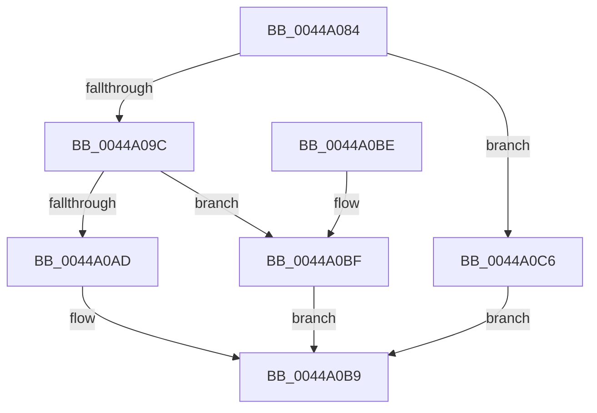

# MiDoesPageRequireImportLinkingFixups

- RVA: `0x0044A084`–`0x0044A0CA` (길이 `70` bytes)
- VA: `0x000000014044A084`
- 실행 섹션: `.text`
- PDB 이름 있음: `예`; PDB Function 태그: `아니요`
- unwind 정보 RVA: `0x00068784`
- 디코드: `22`개 명령, `70/70` bytes 표시
- 미해석 바이트: `0` (있으면 어셈블리에 `.byte`로 보존)

> 이 문서는 커널 이미지의 기계어와 PDB 기호를 분석해 생성했습니다. 4번과 5번은 함수 원형과 자료형을 바이너리 사용 방식에서 추정한 C 해석이며 원본 소스 복구 결과는 아닙니다.

## 1. Dependencies

- 직접 호출 지점: **1**; 고유 호출 대상: **1**
- 직접 호출자로 확인된 함수: **2**
- RIP 상대 이미지 참조: **0**

### Outgoing calls
- `0x0044A090` → [MiDoesPageRequireRetpolineFixups](../../page/A0/MiDoesPageRequireRetpolineFixups_function_00A0E79C.md) (function, `0x00A0E79C`)

### Direct callers
- [MiUpdateImagePfnImportRelocations](MiUpdateImagePfnImportRelocations_function_00449E84.md) at `0x00449EB3`
- [MiWalkEntireImagePageNeedsProcessing](../4D/MiWalkEntireImagePageNeedsProcessing_function_004DC2BC.md) at `0x004DC302`

### Static image references
- 디코드된 RIP-relative 메모리 참조가 없습니다.

## 2. Other-region calls and transfers

- 다른 실행 섹션으로 향하는 call: **1**
  - `0x0044A090` → [MiDoesPageRequireRetpolineFixups](../../page/A0/MiDoesPageRequireRetpolineFixups_function_00A0E79C.md) (`.text` → `PAGE`)
- 별도 외부 분기/꼬리 이동을 확인하지 못했습니다.

## 3. Assembly (complete function range)

```asm
0044A084  48 83 EC 28                     sub rsp, 0x28
0044A088  4C 8B 49 20                     mov r9, qword ptr [rcx + 0x20]
0044A08C  49 8D 49 48                     lea rcx, [r9 + 0x48]
0044A090  E8 07 47 5C 00                  call 0x140a0e79c
0044A095  45 33 C0                        xor r8d, r8d
0044A098  85 C0                           test eax, eax
0044A09A  74 2A                           je 0x14044a0c6
0044A09C  49 8B 49 58                     mov rcx, qword ptr [r9 + 0x58]
0044A0A0  8B D2                           mov edx, edx
0044A0A2  48 8B 44 D1 40                  mov rax, qword ptr [rcx + rdx*8 + 0x40]
0044A0A7  66 44 39 00                     cmp word ptr [rax], r8w
0044A0AB  75 12                           jne 0x14044a0bf
0044A0AD  66 83 78 06 03                  cmp word ptr [rax + 6], 3
0044A0B2  41 0F 94 C0                     sete r8b
0044A0B6  41 8B C0                        mov eax, r8d
0044A0B9  48 83 C4 28                     add rsp, 0x28
0044A0BD  C3                              ret
0044A0BE  CC                              int3
0044A0BF  B8 01 00 00 00                  mov eax, 1
0044A0C4  EB F3                           jmp 0x14044a0b9
0044A0C6  33 C0                           xor eax, eax
0044A0C8  EB EF                           jmp 0x14044a0b9
```

## 4. C-style interpretation (structured pseudocode)

```c
__int64 __fastcall MiDoesPageRequireImportLinkingFixups(__int64 a1, int a2, int a3)
{
    __int64 result;
    __int64 v_rsp;

    v_rsp = (v_rsp) - (40);
    result = MiDoesPageRequireRetpolineFixups(*(unsigned __int64 *)(a1 + 32) + 72, a2, a3, *(unsigned __int64 *)(a1 + 32));
    a3 = 0;
    if ((unsigned int)(result) == 0) goto loc_0044A0C6;
    if ((*(unsigned __int16 *)(*(unsigned __int64 *)(*(unsigned __int64 *)(*(unsigned __int64 *)(a1 + 32) + 88) + (unsigned int)(a2) * 8 + 64))) != 0) goto loc_0044A0BF;
    a3 = ((*(unsigned __int16 *)(*(unsigned __int64 *)(*(unsigned __int64 *)(*(unsigned __int64 *)(a1 + 32) + 88) + (unsigned int)(a2) * 8 + 64) + 6)) == 3) ? 1 : 0;
loc_0044A0B9:
    v_rsp = (v_rsp) + (40);
    return (unsigned int)(a3);
loc_0044A0BF:
    goto loc_0044A0B9;
loc_0044A0C6:
    result = 0;
    goto loc_0044A0B9;
}
```

## 5. (Beta) C Style

```c
int64_t MiDoesPageRequireImportLinkingFixups(void *Arg1, int32_t Arg2, int32_t Arg3)
{
    uint8_t *arg1 = (uint8_t *)Arg1;

    int64_t result;
    int64_t local_rsp;

    local_rsp = (local_rsp) - (40);
    result = MiDoesPageRequireRetpolineFixups(*(uint64_t *)(arg1 + 0x20) + 72, Arg2, Arg3, *(uint64_t *)(arg1 + 0x20));
    Arg3 = 0;
    if ((uint32_t)(result) == 0) goto loc_0044A0C6;
    if ((*(uint16_t *)(*(uint64_t *)(*(uint64_t *)(*(uint64_t *)(arg1 + 0x20) + 0x58) + (uint32_t)(Arg2) * 8 + 0x40))) != 0) goto loc_0044A0BF;
    Arg3 = ((*(uint16_t *)(*(uint64_t *)(*(uint64_t *)(*(uint64_t *)(arg1 + 0x20) + 0x58) + (uint32_t)(Arg2) * 8 + 0x40) + 0x6)) == 3) ? 1 : 0;
loc_0044A0B9:
    local_rsp = (local_rsp) + (40);
    return (uint32_t)(Arg3);
loc_0044A0BF:
    goto loc_0044A0B9;
loc_0044A0C6:
    result = 0;
    goto loc_0044A0B9;
}
```

### 관측된 메모리 오프셋

구조체 형식이 확인되지 않은 접근은 인자 기준의 오프셋으로만 기록했습니다.

| 기준 인자 | 오프셋 표현 | 폭 (bit) | 접근 |
|---|---:|---:|---|
| `Arg1` | `+ 0x20` | `64` | `R` |

## 6. Execution-region graph

[열기: 2D/3D 그래프와 함수 탐색 컨트롤 패널](../../../control-panel.html?section=text&rva=0x0044A084&view=graph)

- 2D 그래프는 위에서 아래로 흐르고, 3D 그래프는 빈 공간을 드래그해 회전합니다. Shift+드래그는 이동, 휠은 확대·축소, 함수 노드 선택은 대상 보고서 이동입니다.

### Static fallback


