# MiDrainZeroLookasides

- RVA: `0x0044D818`–`0x0044DB9D` (길이 `901` bytes)
- VA: `0x000000014044D818`
- 실행 섹션: `.text`
- PDB 이름 있음: `예`; PDB Function 태그: `아니요`
- unwind 정보 RVA: `0x000A69B4`
- 디코드: `221`개 명령, `901/901` bytes 표시
- 미해석 바이트: `0` (있으면 어셈블리에 `.byte`로 보존)

> 이 문서는 커널 이미지의 기계어와 PDB 기호를 분석해 생성했습니다. 4번과 5번은 함수 원형과 자료형을 바이너리 사용 방식에서 추정한 C 해석이며 원본 소스 복구 결과는 아닙니다.

## 1. Dependencies

- 직접 호출 지점: **7**; 고유 호출 대상: **7**
- 직접 호출자로 확인된 함수: **4**
- RIP 상대 이미지 참조: **6**

### Outgoing calls
- `0x0044D85E` → [MI_NODE_FROM_PFN](../2B/MI_NODE_FROM_PFN_function_002B0F30.md) (function, `0x002B0F30`)
- `0x0044D95F` → [ExpInterlockedFlushSList](../6B/ExpInterlockedFlushSList_function_006BA5F0.md) (function, `0x006BA5F0`)
- `0x0044DA33` → [MiInsertPageInFreeOrZeroedList](../33/MiInsertPageInFreeOrZeroedList_function_00334D20.md) (function, `0x00334D20`)
- `0x0044DA7E` → [KiLowerIrqlProcessIrqlFlags](../4F/KiLowerIrqlProcessIrqlFlags_function_004F5698.md) (function, `0x004F5698`)
- `0x0044DB3D` → [KiRaiseIrqlProcessIrqlFlags](../4F/KiRaiseIrqlProcessIrqlFlags_function_004F56FC.md) (function, `0x004F56FC`)
- `0x0044DB58` → [KiCheckVpBackingLongSpinWaitHypercall](../30/KiCheckVpBackingLongSpinWaitHypercall_function_0030F490.md) (function, `0x0030F490`)
- `0x0044DB6B` → [HvlNotifyLongSpinWait](../30/HvlNotifyLongSpinWait_function_0030F460.md) (function, `0x0030F460`)

### Direct callers
- [MiTradePage](../28/MiTradePage_function_0028D160.md) at `0x0028D646`
- [MiProcessWorkingSets](../34/MiProcessWorkingSets_function_0034E710.md) at `0x0034ECC9`
- [MiReturnPartitionPagesToParent](../69/MiReturnPartitionPagesToParent_function_00691B5C.md) at `0x00691BB4`
- [MiTransferPartitionPageRun](../69/MiTransferPartitionPageRun_function_00691DCC.md) at `0x00691F6C`

### Static image references
- `0x0044D983` → RVA `0x00FC6D20` (`ALMOSTRO`; read)
- `0x0044D9E4` → RVA `0x00E2DC80` (`.data`; read)
- `0x0044DAB0` → RVA `0x00FC52AC` (`ALMOSTRO`; reference)
- `0x0044DB4A` → RVA `0x00FC6AB8` (`ALMOSTRO`; read)
- `0x0044DB78` → RVA `0x00E2DCCC` (`.data`; read)
- `0x0044DB83` → RVA `0x00FC5000` (`ALMOSTRO`; read)

## 2. Other-region calls and transfers

- 다른 실행 섹션으로 향하는 call: **0**
- 별도 외부 분기/꼬리 이동을 확인하지 못했습니다.

## 3. Assembly (complete function range)

```asm
0044D818  44 89 4C 24 20                  mov dword ptr [rsp + 0x20], r9d
0044D81D  4C 89 44 24 18                  mov qword ptr [rsp + 0x18], r8
0044D822  53                              push rbx
0044D823  55                              push rbp
0044D824  56                              push rsi
0044D825  57                              push rdi
0044D826  41 54                           push r12
0044D828  41 55                           push r13
0044D82A  41 56                           push r14
0044D82C  41 57                           push r15
0044D82E  48 83 EC 58                     sub rsp, 0x58
0044D832  48 8B 69 10                     mov rbp, qword ptr [rcx + 0x10]
0044D836  41 8B D9                        mov ebx, r9d
0044D839  45 33 C9                        xor r9d, r9d
0044D83C  48 89 6C 24 20                  mov qword ptr [rsp + 0x20], rbp
0044D841  4D 8B F0                        mov r14, r8
0044D844  4C 8B FA                        mov r15, rdx
0044D847  48 85 D2                        test rdx, rdx
0044D84A  0F 84 28 03 00 00               je 0x14044db78
0044D850  41 8D 71 01                     lea esi, [r9 + 1]
0044D854  48 8B CA                        mov rcx, rdx
0044D857  89 B4 24 A0 00 00 00            mov dword ptr [rsp + 0xa0], esi
0044D85E  E8 CD 36 E6 FF                  call 0x1402b0f30
0044D863  8B C0                           mov eax, eax
0044D865  48 69 C8 80 DF 00 00            imul rcx, rax, 0xdf80
0044D86C  8B C6                           mov eax, esi
0044D86E  48 03 E9                        add rbp, rcx
0044D871  48 89 6C 24 20                  mov qword ptr [rsp + 0x20], rbp
0044D876  45 33 C9                        xor r9d, r9d
0044D879  48 69 C8 80 DF 00 00            imul rcx, rax, 0xdf80
0044D880  4B 8D 04 76                     lea rax, [r14 + r14*2]
0044D884  BF 00 02 00 00                  mov edi, 0x200
0044D889  48 81 C1 80 20 FF FF            add rcx, -0xdf80
0044D890  48 C1 E0 04                     shl rax, 4
0044D894  48 03 CD                        add rcx, rbp
0044D897  49 03 C7                        add rax, r15
0044D89A  48 89 4C 24 48                  mov qword ptr [rsp + 0x48], rcx
0044D89F  48 89 44 24 38                  mov qword ptr [rsp + 0x38], rax
0044D8A4  48 3B E9                        cmp rbp, rcx
0044D8A7  0F 87 63 02 00 00               ja 0x14044db10
0044D8AD  41 BD 02 00 00 00               mov r13d, 2
0044D8B3  4D 8B E1                        mov r12, r9
0044D8B6  4C 89 64 24 30                  mov qword ptr [rsp + 0x30], r12
0044D8BB  49 83 FC 01                     cmp r12, 1
0044D8BF  0F 8F 34 02 00 00               jg 0x14044daf9
0044D8C5  4D 85 E4                        test r12, r12
0044D8C8  0F 84 54 02 00 00               je 0x14044db22
0044D8CE  83 E7 FE                        and edi, 0xfffffffe
0044D8D1  41 0B FD                        or edi, r13d
0044D8D4  4A 8B 8C E5 60 3A 00 00         mov rcx, qword ptr [rbp + r12*8 + 0x3a60]
0044D8DC  0F B6 C3                        movzx eax, bl
0044D8DF  89 84 24 A8 00 00 00            mov dword ptr [rsp + 0xa8], eax
0044D8E6  48 89 4C 24 40                  mov qword ptr [rsp + 0x40], rcx
0044D8EB  85 F6                           test esi, esi
0044D8ED  74 5F                           je 0x14044d94e
0044D8EF  8B 9C 24 A8 00 00 00            mov ebx, dword ptr [rsp + 0xa8]
0044D8F6  48 8B 6C 24 38                  mov rbp, qword ptr [rsp + 0x38]
0044D8FB  4C 8B A4 24 B0 00 00 00         mov r12, qword ptr [rsp + 0xb0]
0044D903  8B C6                           mov eax, esi
0044D905  48 89 44 24 28                  mov qword ptr [rsp + 0x28], rax
0044D90A  83 FE 01                        cmp esi, 1
0044D90D  74 08                           je 0x14044d917
0044D90F  8B C3                           mov eax, ebx
0044D911  33 D2                           xor edx, edx
0044D913  F7 F6                           div esi
0044D915  8B DA                           mov ebx, edx
0044D917  8B C3                           mov eax, ebx
0044D919  48 C1 E0 04                     shl rax, 4
0044D91D  48 03 C8                        add rcx, rax
0044D920  66 44 39 09                     cmp word ptr [rcx], r9w
0044D924  75 39                           jne 0x14044d95f
0044D926  48 8B 4C 24 40                  mov rcx, qword ptr [rsp + 0x40]
0044D92B  FF C3                           inc ebx
0044D92D  48 83 6C 24 28 01               sub qword ptr [rsp + 0x28], 1
0044D933  75 D5                           jne 0x14044d90a
0044D935  8B 9C 24 B8 00 00 00            mov ebx, dword ptr [rsp + 0xb8]
0044D93C  48 8B 6C 24 20                  mov rbp, qword ptr [rsp + 0x20]
0044D941  4C 8B 64 24 30                  mov r12, qword ptr [rsp + 0x30]
0044D946  4C 8B B4 24 B0 00 00 00         mov r14, qword ptr [rsp + 0xb0]
0044D94E  4D 85 FF                        test r15, r15
0044D951  0F 85 D6 01 00 00               jne 0x14044db2d
0044D957  49 FF C4                        inc r12
0044D95A  E9 57 FF FF FF                  jmp 0x14044d8b6
0044D95F  E8 8C CC 26 00                  call 0x1406ba5f0
0044D964  45 33 C9                        xor r9d, r9d
0044D967  48 8B F0                        mov rsi, rax
0044D96A  48 85 C0                        test rax, rax
0044D96D  0F 84 21 01 00 00               je 0x14044da94
0044D973  44 0F 20 C0                     mov rax, cr8
0044D977  48 89 84 24 A8 00 00 00         mov qword ptr [rsp + 0xa8], rax
0044D97F  45 0F 22 C5                     mov cr8, r13
0044D983  44 39 0D 96 93 B7 00            cmp dword ptr [rip + 0xb79396], r9d
0044D98A  0F 85 A8 01 00 00               jne 0x14044db38
0044D990  48 8B 06                        mov rax, qword ptr [rsi]
0044D993  48 89 84 24 B0 00 00 00         mov qword ptr [rsp + 0xb0], rax
0044D99B  48 B9 00 00 00 00 00 DE FF FF   movabs rcx, 0xffffde0000000000
0044D9A5  4C 8B EE                        mov r13, rsi
0044D9A8  48 B8 AB AA AA AA AA AA AA AA   movabs rax, 0xaaaaaaaaaaaaaaab
0044D9B2  4C 2B E9                        sub r13, rcx
0044D9B5  49 C1 FD 04                     sar r13, 4
0044D9B9  4C 0F AF E8                     imul r13, rax
0044D9BD  4D 85 FF                        test r15, r15
0044D9C0  0F 85 DA 00 00 00               jne 0x14044daa0
0044D9C6  41 8D 4F 01                     lea ecx, [r15 + 1]
0044D9CA  8B C7                           mov eax, edi
0044D9CC  83 CF 40                        or edi, 0x40
0044D9CF  83 E0 BF                        and eax, 0xffffffbf
0044D9D2  85 C9                           test ecx, ecx
0044D9D4  0F 44 F8                        cmove edi, eax
0044D9D7  48 8B 46 10                     mov rax, qword ptr [rsi + 0x10]
0044D9DB  48 85 C0                        test rax, rax
0044D9DE  0F 84 0D 01 00 00               je 0x14044daf1
0044D9E4  48 8B 0D 95 02 9E 00            mov rcx, qword ptr [rip + 0x9e0295]
0044D9EB  48 85 C9                        test rcx, rcx
0044D9EE  74 0E                           je 0x14044d9fe
0044D9F0  A8 10                           test al, 0x10
0044D9F2  0F 85 DE 00 00 00               jne 0x14044dad6
0044D9F8  48 F7 D1                        not rcx
0044D9FB  48 23 C1                        and rax, rcx
0044D9FE  4C 8B 05 7B 02 9E 00            mov r8, qword ptr [rip + 0x9e027b]
0044DA05  8B C8                           mov ecx, eax
0044DA07  4D 85 C0                        test r8, r8
0044DA0A  74 12                           je 0x14044da1e
0044DA0C  49 8B D0                        mov rdx, r8
0044DA0F  48 23 D0                        and rdx, rax
0044DA12  85 D2                           test edx, edx
0044DA14  0F 84 B4 00 00 00               je 0x14044dace
0044DA1A  48 83 C9 10                     or rcx, 0x10
0044DA1E  48 89 4E 10                     mov qword ptr [rsi + 0x10], rcx
0044DA22  45 8B F1                        mov r14d, r9d
0044DA25  F0 48 0F BA 6E 18 3F            lock bts qword ptr [rsi + 0x18], 0x3f
0044DA2C  72 7F                           jb 0x14044daad
0044DA2E  8B D7                           mov edx, edi
0044DA30  49 8B CD                        mov rcx, r13
0044DA33  E8 E8 72 EE FF                  call 0x140334d20
0044DA38  48 B8 FF FF FF FF FF FF FF 7F   movabs rax, 0x7fffffffffffffff
0044DA42  F0 48 21 46 18                  lock and qword ptr [rsi + 0x18], rax
0044DA47  48 8B 84 24 B0 00 00 00         mov rax, qword ptr [rsp + 0xb0]
0044DA4F  45 33 C9                        xor r9d, r9d
0044DA52  48 8B F0                        mov rsi, rax
0044DA55  48 85 C0                        test rax, rax
0044DA58  0F 85 32 FF FF FF               jne 0x14044d990
0044DA5E  44 39 0D BB 92 B7 00            cmp dword ptr [rip + 0xb792bb], r9d
0044DA65  48 8B B4 24 A8 00 00 00         mov rsi, qword ptr [rsp + 0xa8]
0044DA6D  4C 89 A4 24 B0 00 00 00         mov qword ptr [rsp + 0xb0], r12
0044DA75  74 0F                           je 0x14044da86
0044DA77  44 0F 20 C1                     mov rcx, cr8
0044DA7B  40 8A D6                        mov dl, sil
0044DA7E  E8 15 7C 0A 00                  call 0x1404f5698
0044DA83  45 33 C9                        xor r9d, r9d
0044DA86  40 0F B6 C6                     movzx eax, sil
0044DA8A  44 0F 22 C0                     mov cr8, rax
0044DA8E  41 BD 02 00 00 00               mov r13d, 2
0044DA94  8B B4 24 A0 00 00 00            mov esi, dword ptr [rsp + 0xa0]
0044DA9B  E9 86 FE FF FF                  jmp 0x14044d926
0044DAA0  49 3B F7                        cmp rsi, r15
0044DAA3  73 3A                           jae 0x14044dadf
0044DAA5  41 8B C9                        mov ecx, r9d
0044DAA8  E9 1D FF FF FF                  jmp 0x14044d9ca
0044DAAD  41 FF C6                        inc r14d
0044DAB0  44 85 35 F5 77 B7 00            test dword ptr [rip + 0xb777f5], r14d
0044DAB7  0F 84 8D 00 00 00               je 0x14044db4a
0044DABD  F3 90                           pause
0044DABF  48 8B 46 18                     mov rax, qword ptr [rsi + 0x18]
0044DAC3  48 85 C0                        test rax, rax
0044DAC6  0F 89 59 FF FF FF               jns 0x14044da25
0044DACC  EB DF                           jmp 0x14044daad
0044DACE  49 0B C8                        or rcx, r8
0044DAD1  E9 48 FF FF FF                  jmp 0x14044da1e
0044DAD6  48 83 E0 EF                     and rax, 0xffffffffffffffef
0044DADA  E9 1F FF FF FF                  jmp 0x14044d9fe
0044DADF  48 3B F5                        cmp rsi, rbp
0044DAE2  73 C1                           jae 0x14044daa5
0044DAE4  B9 01 00 00 00                  mov ecx, 1
0044DAE9  49 FF CC                        dec r12
0044DAEC  E9 D9 FE FF FF                  jmp 0x14044d9ca
0044DAF1  49 8B C1                        mov rax, r9
0044DAF4  E9 05 FF FF FF                  jmp 0x14044d9fe
0044DAF9  48 81 C5 80 DF 00 00            add rbp, 0xdf80
0044DB00  48 89 6C 24 20                  mov qword ptr [rsp + 0x20], rbp
0044DB05  48 3B 6C 24 48                  cmp rbp, qword ptr [rsp + 0x48]
0044DB0A  0F 86 A3 FD FF FF               jbe 0x14044d8b3
0044DB10  48 83 C4 58                     add rsp, 0x58
0044DB14  41 5F                           pop r15
0044DB16  41 5E                           pop r14
0044DB18  41 5D                           pop r13
0044DB1A  41 5C                           pop r12
0044DB1C  5F                              pop rdi
0044DB1D  5E                              pop rsi
0044DB1E  5D                              pop rbp
0044DB1F  5B                              pop rbx
0044DB20  C3                              ret
0044DB21  CC                              int3
0044DB22  83 E7 FD                        and edi, 0xfffffffd
0044DB25  83 CF 01                        or edi, 1
0044DB28  E9 A7 FD FF FF                  jmp 0x14044d8d4
0044DB2D  4D 85 F6                        test r14, r14
0044DB30  0F 85 21 FE FF FF               jne 0x14044d957
0044DB36  EB D8                           jmp 0x14044db10
0044DB38  41 8A D5                        mov dl, r13b
0044DB3B  8A C8                           mov cl, al
0044DB3D  E8 BA 7B 0A 00                  call 0x1404f56fc
0044DB42  45 33 C9                        xor r9d, r9d
0044DB45  E9 46 FE FF FF                  jmp 0x14044d990
0044DB4A  8B 05 68 8F B7 00               mov eax, dword ptr [rip + 0xb78f68]
0044DB50  A8 40                           test al, 0x40
0044DB52  0F 84 65 FF FF FF               je 0x14044dabd
0044DB58  E8 33 19 EC FF                  call 0x14030f490
0044DB5D  45 33 C9                        xor r9d, r9d
0044DB60  84 C0                           test al, al
0044DB62  0F 84 55 FF FF FF               je 0x14044dabd
0044DB68  41 8B CE                        mov ecx, r14d
0044DB6B  E8 F0 18 EC FF                  call 0x14030f460
0044DB70  45 33 C9                        xor r9d, r9d
0044DB73  E9 47 FF FF FF                  jmp 0x14044dabf
0044DB78  8B 35 4E 01 9E 00               mov esi, dword ptr [rip + 0x9e014e]
0044DB7E  BB 00 00 07 00                  mov ebx, 0x70000
0044DB83  0F B7 05 76 74 B7 00            movzx eax, word ptr [rip + 0xb77476]
0044DB8A  89 9C 24 B8 00 00 00            mov dword ptr [rsp + 0xb8], ebx
0044DB91  89 B4 24 A0 00 00 00            mov dword ptr [rsp + 0xa0], esi
0044DB98  E9 DC FC FF FF                  jmp 0x14044d879
```

## 4. C-style interpretation (structured pseudocode)

```c
__int64 __fastcall MiDrainZeroLookasides(__int64 a1, __int64 a2, __int64 a3, int a4)
{
    __int64 result;
    __int64 v_r12;
    __int64 v_r13;
    __int64 v_r14;
    __int64 v_rbp;
    __int64 v_rbx;
    __int64 v_rdi;
    __int64 v_rsp;
    unsigned __int64 v_stack_m50;
    unsigned __int64 v_stack_m58;
    unsigned __int64 v_stack_m60;
    unsigned __int64 v_stack_m68;
    unsigned __int64 v_stack_m70;
    unsigned __int64 v_stack_m78;
    unsigned int v_stack_p10;
    unsigned __int64 v_stack_p18;
    unsigned int v_stack_p20;
    unsigned int v_stack_p8;
    unsigned int v_stack_pA0;
    unsigned int v_stack_pB8;

    v_stack_p20 = a4;
    v_stack_p18 = a3;
    v_rsp = (v_rsp) - (88);
    a4 = 0;
    v_stack_m78 = *(unsigned __int64 *)(a1 + 16);
    if (a2 == 0) goto loc_0044DB78;
    v_stack_p8 = (unsigned int)(a4 + 1);
    result = MI_NODE_FROM_PFN(a2, a2, a3, a4);
    a1 = (a2) * ((unsigned int)((unsigned int)(result)));
    v_rbp = (*(unsigned __int64 *)(a1 + 16)) + (a1);
    v_stack_m78 = v_rbp;
    a4 = 0;
loc_0044D879:
    a1 = (a1) * ((unsigned int)((unsigned int)(a4 + 1)));
    a1 = (a1) + (0xFFFFFFFFFFFF2080ULL);
    result = (a3 + a3 * 2) << (4);
    a1 = (a1) + (v_rbp);
    result = (result) + (a2);
    v_stack_m50 = a1;
    v_stack_m60 = result;
    if (v_rbp > a1) goto loc_0044DB10;
loc_0044D8B3:
loc_0044D8B6:
    v_stack_m68 = 0;
    if (0 > 1) goto loc_0044DAF9;
    if (0 == 0) goto loc_0044DB22;
    v_rdi = (unsigned int)((512) & (0xFFFFFFFEULL));
    v_rdi = (unsigned int)((v_rdi) | (2));
loc_0044D8D4:
    v_stack_p10 = (unsigned int)((unsigned __int8)((unsigned int)(a4)));
    v_stack_m58 = *(unsigned __int64 *)(v_rbp + 0 * 8 + 14944);
    if ((unsigned int)(a4 + 1) == 0) goto loc_0044D94E;
    v_stack_m70 = (unsigned int)((unsigned int)(a4 + 1));
loc_0044D90A:
    result = (unsigned int)((unsigned int)(a4 + 1));
    v_rbx = (unsigned int)(v_stack_p10);
    if (((unsigned int)(a4 + 1)) != 1) {
        result = (unsigned int)((unsigned int)(v_stack_p10));
        a2 = 0;
        v_rbx = 0;
    }
    result = ((unsigned int)((unsigned int)(v_rbx))) << (4);
    a1 = (*(unsigned __int64 *)(v_rbp + 0 * 8 + 14944)) + (result);
    if ((*(unsigned __int16 *)(a1)) != 0) goto loc_0044D95F;
loc_0044D926:
    v_rbx = (unsigned int)((v_rbx) + 1);
    if ((*(unsigned __int16 *)(a1)) != 0) goto loc_0044D90A;
loc_0044D94E:
    if (0 != 0) goto loc_0044DB2D;
loc_0044D957:
    v_r12 = (v_stack_m68) + 1;
    goto loc_0044D8B6;
loc_0044D95F:
    result = ExpInterlockedFlushSList(v_stack_m58, a2, a3, a4);
    a4 = 0;
    if (result == 0) goto loc_0044DA94;
    v_stack_p10 = v_cr8;
    if ((*(unsigned int *)(v_rip + 12030870)) != 0) goto loc_0044DB38;
loc_0044D990:
    v_stack_p18 = *(unsigned __int64 *)(result);
    v_r13 = (result) - (v_stack_m58);
    v_r13 = (v_r13) >> (4);
    v_r13 = (v_r13) * (*(unsigned __int64 *)(result));
    if (0 != 0) goto loc_0044DAA0;
loc_0044D9CA:
    v_rdi = (unsigned int)((v_rdi) | (64));
    result = (unsigned int)(((unsigned int)((unsigned int)(v_rdi))) & (0xFFFFFFBFULL));
    if ((unsigned int)(a2 + 1) == 0) { v_rdi = (unsigned int)(result); }
    if (*(unsigned __int64 *)(result + 16) == 0) goto loc_0044DAF1;
    if (*(unsigned __int64 *)(v_rip + 10355349) == 0) goto loc_0044D9FE;
    if ((((unsigned __int8)(*(unsigned __int64 *)(result + 16))) & (16)) != 0) goto loc_0044DAD6;
    a1 = ~(*(unsigned __int64 *)(v_rip + 10355349));
    result = (*(unsigned __int64 *)(result + 16)) & (a1);
loc_0044D9FE:
    if (*(unsigned __int64 *)(v_rip + 10355323) == 0) goto loc_0044DA1E;
    a2 = (*(unsigned __int64 *)(v_rip + 10355323)) & (result);
    if ((unsigned int)(a2) == 0) goto loc_0044DACE;
    a1 = ((unsigned int)((unsigned int)(result))) | (16);
loc_0044DA1E:
    *(unsigned __int64 *)(result + 16) = a1;
loc_0044DA25:
    if (condition_is_below) goto loc_0044DAAD;
    result = MiInsertPageInFreeOrZeroedList(v_r13, (unsigned int)((unsigned int)(v_rdi)), *(unsigned __int64 *)(v_rip + 10355323), a4);
    a4 = 0;
    if (v_stack_p18 != 0) goto loc_0044D990;
    v_stack_p18 = v_r12;
    result = v_stack_p18;
    if ((*(unsigned int *)(v_rip + 12030651)) != 0) {
        a1 = 2;
        a2 = (unsigned __int8)(v_stack_p10);
        result = KiLowerIrqlProcessIrqlFlags(a1, a2, *(unsigned __int64 *)(v_rip + 10355323), a4);
        a4 = 0;
    }
loc_0044DA94:
    goto loc_0044D926;
loc_0044DAA0:
    if (((unsigned int)(v_stack_p8)) >= a2) goto loc_0044DADF;
loc_0044DAA5:
    goto loc_0044D9CA;
loc_0044DAAD:
    v_r14 = (unsigned int)((0) + 1);
    if (((*(unsigned int *)(v_rip + 12023797)) & ((unsigned int)(v_r14))) == 0) goto loc_0044DB4A;
loc_0044DABD:
loc_0044DABF:
    if (!sign_flag) goto loc_0044DA25;
    goto loc_0044DAAD;
loc_0044DACE:
    a1 = (0) | (*(unsigned __int64 *)(v_rip + 10355323));
    goto loc_0044DA1E;
loc_0044DAD6:
    result = (*(unsigned __int64 *)((unsigned int)(v_stack_p8) + 24)) & (-17);
    goto loc_0044D9FE;
loc_0044DADF:
    if (((unsigned int)(v_stack_p8)) >= v_stack_m78) goto loc_0044DAA5;
    v_r12 = (v_r12) - 1;
    goto loc_0044D9CA;
loc_0044DAF1:
    goto loc_0044D9FE;
loc_0044DAF9:
    v_rbp = (v_stack_m78) + (0xDF80ULL);
    v_stack_m78 = v_rbp;
    if (v_rbp <= v_stack_m50) goto loc_0044D8B3;
loc_0044DB10:
    v_rsp = (v_rsp) + (88);
    return 0;
loc_0044DB22:
    v_rdi = (unsigned int)((v_rdi) & (0xFFFFFFFDULL));
    v_rdi = (unsigned int)((v_rdi) | (1));
    goto loc_0044D8D4;
loc_0044DB2D:
    if (v_r14 != 0) goto loc_0044D957;
    goto loc_0044DB10;
loc_0044DB38:
    result = KiRaiseIrqlProcessIrqlFlags(0, 2, *(unsigned __int64 *)(v_rip + 10355323), a4);
    a4 = 0;
    goto loc_0044D990;
loc_0044DB4A:
    if ((((unsigned __int8)((unsigned int)(*(unsigned int *)(v_rip + 12029800)))) & (64)) == 0) goto loc_0044DABD;
    result = KiCheckVpBackingLongSpinWaitHypercall(0, 2, *(unsigned __int64 *)(v_rip + 10355323), a4);
    a4 = 0;
    if ((unsigned __int8)(result) == 0) goto loc_0044DABD;
    result = HvlNotifyLongSpinWait((unsigned int)((unsigned int)(v_r14)), 2, *(unsigned __int64 *)(v_rip + 10355323), a4);
    a4 = 0;
    goto loc_0044DABF;
loc_0044DB78:
    v_stack_pB8 = (unsigned int)((unsigned int)(0x70000ULL));
    v_stack_pA0 = (unsigned int)((unsigned int)(*(unsigned int *)(v_rip + 10355022)));
    goto loc_0044D879;
}
```

## 5. (Beta) C Style

```c
int64_t MiDrainZeroLookasides(void *Arg1, int64_t Arg2, void *Arg3, int32_t Arg4)
{
    uint8_t *arg1 = (uint8_t *)Arg1;
    uint8_t *arg3 = (uint8_t *)Arg3;

    int64_t result;
    int64_t local_r12;
    int64_t local_r13;
    int64_t local_r14;
    int64_t local_rbp;
    int64_t local_rbx;
    int64_t local_rdi;
    int64_t local_rsp;
    uint64_t v_stack_m50;
    uint64_t v_stack_m58;
    uint64_t v_stack_m60;
    uint64_t v_stack_m68;
    uint64_t v_stack_m70;
    uint64_t v_stack_m78;
    uint32_t v_stack_p10;
    uint64_t v_stack_p18;
    uint32_t v_stack_p20;
    uint32_t v_stack_p8;
    uint32_t v_stack_pA0;
    uint32_t v_stack_pB8;

    v_stack_p20 = Arg4;
    v_stack_p18 = Arg3;
    local_rsp = (local_rsp) - (88);
    Arg4 = 0;
    v_stack_m78 = *(uint64_t *)(arg1 + 0x10);
    if (Arg2 == 0) goto loc_0044DB78;
    v_stack_p8 = (uint32_t)(Arg4 + 1);
    result = MI_NODE_FROM_PFN(Arg2, Arg2, Arg3, Arg4);
    Arg1 = (Arg2) * ((uint32_t)((uint32_t)(result)));
    local_rbp = (*(uint64_t *)(arg1 + 0x10)) + (Arg1);
    v_stack_m78 = local_rbp;
    Arg4 = 0;
loc_0044D879:
    Arg1 = (Arg1) * ((uint32_t)((uint32_t)(Arg4 + 1)));
    Arg1 = (Arg1) + (0xFFFFFFFFFFFF2080ULL);
    result = (Arg3 + Arg3 * 2) << (4);
    Arg1 = (Arg1) + (local_rbp);
    result = (result) + (Arg2);
    v_stack_m50 = Arg1;
    v_stack_m60 = result;
    if (local_rbp > Arg1) goto loc_0044DB10;
loc_0044D8B3:
loc_0044D8B6:
    v_stack_m68 = 0;
    if (0 > 1) goto loc_0044DAF9;
    if (0 == 0) goto loc_0044DB22;
    local_rdi = (uint32_t)((512) & (0xFFFFFFFEULL));
    local_rdi = (uint32_t)((local_rdi) | (2));
loc_0044D8D4:
    v_stack_p10 = (uint32_t)((uint8_t)((uint32_t)(Arg4)));
    v_stack_m58 = *(uint64_t *)(local_rbp + 0x0 * 8 + 0x3A60);
    if ((uint32_t)(Arg4 + 1) == 0) goto loc_0044D94E;
    v_stack_m70 = (uint32_t)((uint32_t)(Arg4 + 1));
loc_0044D90A:
    result = (uint32_t)((uint32_t)(Arg4 + 1));
    local_rbx = (uint32_t)(v_stack_p10);
    if (((uint32_t)(Arg4 + 1)) != 1) {
        result = (uint32_t)((uint32_t)(v_stack_p10));
        Arg2 = 0;
        local_rbx = 0;
    }
    result = ((uint32_t)((uint32_t)(local_rbx))) << (4);
    Arg1 = (*(uint64_t *)(local_rbp + 0x0 * 8 + 0x3A60)) + (result);
    if ((*(uint16_t *)(arg1)) != 0) goto loc_0044D95F;
loc_0044D926:
    local_rbx = (uint32_t)((local_rbx) + 1);
    if ((*(uint16_t *)(arg1)) != 0) goto loc_0044D90A;
loc_0044D94E:
    if (0 != 0) goto loc_0044DB2D;
loc_0044D957:
    local_r12 = (v_stack_m68) + 1;
    goto loc_0044D8B6;
loc_0044D95F:
    result = ExpInterlockedFlushSList(v_stack_m58, Arg2, Arg3, Arg4);
    Arg4 = 0;
    if (result == 0) goto loc_0044DA94;
    v_stack_p10 = v_cr8;
    if ((*(uint32_t *)(v_rip + 0xB79396)) != 0) goto loc_0044DB38;
loc_0044D990:
    v_stack_p18 = *(uint64_t *)(result);
    local_r13 = (result) - (v_stack_m58);
    local_r13 = (local_r13) >> (4);
    local_r13 = (local_r13) * (*(uint64_t *)(result));
    if (0 != 0) goto loc_0044DAA0;
loc_0044D9CA:
    local_rdi = (uint32_t)((local_rdi) | (64));
    result = (uint32_t)(((uint32_t)((uint32_t)(local_rdi))) & (0xFFFFFFBFULL));
    if ((uint32_t)(Arg2 + 1) == 0) { local_rdi = (uint32_t)(result); }
    if (*(uint64_t *)(result + 0x10) == 0) goto loc_0044DAF1;
    if (*(uint64_t *)(v_rip + 0x9E0295) == 0) goto loc_0044D9FE;
    if ((((uint8_t)(*(uint64_t *)(result + 0x10))) & (16)) != 0) goto loc_0044DAD6;
    Arg1 = ~(*(uint64_t *)(v_rip + 0x9E0295));
    result = (*(uint64_t *)(result + 0x10)) & (Arg1);
loc_0044D9FE:
    if (*(uint64_t *)(v_rip + 0x9E027B) == 0) goto loc_0044DA1E;
    Arg2 = (*(uint64_t *)(v_rip + 0x9E027B)) & (result);
    if ((uint32_t)(Arg2) == 0) goto loc_0044DACE;
    Arg1 = ((uint32_t)((uint32_t)(result))) | (16);
loc_0044DA1E:
    *(void **)(result + 0x10) = Arg1;
loc_0044DA25:
    if (condition_is_below) goto loc_0044DAAD;
    result = MiInsertPageInFreeOrZeroedList(local_r13, (uint32_t)((uint32_t)(local_rdi)), *(uint64_t *)(v_rip + 0x9E027B), Arg4);
    Arg4 = 0;
    if (v_stack_p18 != 0) goto loc_0044D990;
    v_stack_p18 = local_r12;
    result = v_stack_p18;
    if ((*(uint32_t *)(v_rip + 0xB792BB)) != 0) {
        Arg1 = 2;
        Arg2 = (uint8_t)(v_stack_p10);
        result = KiLowerIrqlProcessIrqlFlags(Arg1, Arg2, *(uint64_t *)(v_rip + 0x9E027B), Arg4);
        Arg4 = 0;
    }
loc_0044DA94:
    goto loc_0044D926;
loc_0044DAA0:
    if (((uint32_t)(v_stack_p8)) >= Arg2) goto loc_0044DADF;
loc_0044DAA5:
    goto loc_0044D9CA;
loc_0044DAAD:
    local_r14 = (uint32_t)((0) + 1);
    if (((*(uint32_t *)(v_rip + 0xB777F5)) & ((uint32_t)(local_r14))) == 0) goto loc_0044DB4A;
loc_0044DABD:
loc_0044DABF:
    if (!sign_flag) goto loc_0044DA25;
    goto loc_0044DAAD;
loc_0044DACE:
    Arg1 = (0) | (*(uint64_t *)(v_rip + 0x9E027B));
    goto loc_0044DA1E;
loc_0044DAD6:
    result = (*(uint64_t *)((uint32_t)(v_stack_p8) + 0x18)) & (-17);
    goto loc_0044D9FE;
loc_0044DADF:
    if (((uint32_t)(v_stack_p8)) >= v_stack_m78) goto loc_0044DAA5;
    local_r12 = (local_r12) - 1;
    goto loc_0044D9CA;
loc_0044DAF1:
    goto loc_0044D9FE;
loc_0044DAF9:
    local_rbp = (v_stack_m78) + (0xDF80ULL);
    v_stack_m78 = local_rbp;
    if (local_rbp <= v_stack_m50) goto loc_0044D8B3;
loc_0044DB10:
    local_rsp = (local_rsp) + (88);
    return 0;
loc_0044DB22:
    local_rdi = (uint32_t)((local_rdi) & (0xFFFFFFFDULL));
    local_rdi = (uint32_t)((local_rdi) | (1));
    goto loc_0044D8D4;
loc_0044DB2D:
    if (local_r14 != 0) goto loc_0044D957;
    goto loc_0044DB10;
loc_0044DB38:
    result = KiRaiseIrqlProcessIrqlFlags(0, 2, *(uint64_t *)(v_rip + 0x9E027B), Arg4);
    Arg4 = 0;
    goto loc_0044D990;
loc_0044DB4A:
    if ((((uint8_t)((uint32_t)(*(uint32_t *)(v_rip + 0xB78F68)))) & (64)) == 0) goto loc_0044DABD;
    result = KiCheckVpBackingLongSpinWaitHypercall(0, 2, *(uint64_t *)(v_rip + 0x9E027B), Arg4);
    Arg4 = 0;
    if ((uint8_t)(result) == 0) goto loc_0044DABD;
    result = HvlNotifyLongSpinWait((uint32_t)((uint32_t)(local_r14)), 2, *(uint64_t *)(v_rip + 0x9E027B), Arg4);
    Arg4 = 0;
    goto loc_0044DABF;
loc_0044DB78:
    v_stack_pB8 = (uint32_t)((uint32_t)(0x70000ULL));
    v_stack_pA0 = (uint32_t)((uint32_t)(*(uint32_t *)(v_rip + 0x9E014E)));
    goto loc_0044D879;
}
```

### 관측된 메모리 오프셋

구조체 형식이 확인되지 않은 접근은 인자 기준의 오프셋으로만 기록했습니다.

| 기준 인자 | 오프셋 표현 | 폭 (bit) | 접근 |
|---|---:|---:|---|
| `Arg1` | `+ 0x10` | `64` | `R` |
| `Arg3` | `+ 0x0 + r14*2` | `64` | `R` |

## 6. Execution-region graph

[열기: 2D/3D 그래프와 함수 탐색 컨트롤 패널](../../../control-panel.html?section=text&rva=0x0044D818&view=graph)

- 2D 그래프는 위에서 아래로 흐르고, 3D 그래프는 빈 공간을 드래그해 회전합니다. Shift+드래그는 이동, 휠은 확대·축소, 함수 노드 선택은 대상 보고서 이동입니다.

### Static fallback

```mermaid
flowchart TD
  bb_0044D818[BB_0044D818]
  bb_0044D850[BB_0044D850]
  bb_0044D879[BB_0044D879]
  bb_0044D8AD[BB_0044D8AD]
  bb_0044D8B3[BB_0044D8B3]
  bb_0044D8B6[BB_0044D8B6]
  bb_0044D8C5[BB_0044D8C5]
  bb_0044D8CE[BB_0044D8CE]
  bb_0044D8D4[BB_0044D8D4]
  bb_0044D8EF[BB_0044D8EF]
  bb_0044D90A[BB_0044D90A]
  bb_0044D90F[BB_0044D90F]
  bb_0044D917[BB_0044D917]
  bb_0044D926[BB_0044D926]
  bb_0044D935[BB_0044D935]
  bb_0044D94E[BB_0044D94E]
  bb_0044D957[BB_0044D957]
  bb_0044D95F[BB_0044D95F]
  bb_0044D973[BB_0044D973]
  bb_0044D990[BB_0044D990]
  bb_0044D9C6[BB_0044D9C6]
  bb_0044D9CA[BB_0044D9CA]
  bb_0044D9E4[BB_0044D9E4]
  bb_0044D9F0[BB_0044D9F0]
  bb_0044D9F8[BB_0044D9F8]
  bb_0044D9FE[BB_0044D9FE]
  bb_0044DA0C[BB_0044DA0C]
  bb_0044DA1A[BB_0044DA1A]
  bb_0044DA1E[BB_0044DA1E]
  bb_0044DA25[BB_0044DA25]
  bb_0044DA2E[BB_0044DA2E]
  bb_0044DA5E[BB_0044DA5E]
  bb_0044DA77[BB_0044DA77]
  bb_0044DA86[BB_0044DA86]
  bb_0044DA94[BB_0044DA94]
  bb_0044DAA0[BB_0044DAA0]
  bb_0044DAA5[BB_0044DAA5]
  bb_0044DAAD[BB_0044DAAD]
  bb_0044DABD[BB_0044DABD]
  bb_0044DABF[BB_0044DABF]
  bb_0044DACC[BB_0044DACC]
  bb_0044DACE[BB_0044DACE]
  bb_0044DAD6[BB_0044DAD6]
  bb_0044DADF[BB_0044DADF]
  bb_0044DAE4[BB_0044DAE4]
  bb_0044DAF1[BB_0044DAF1]
  bb_0044DAF9[BB_0044DAF9]
  bb_0044DB10[BB_0044DB10]
  bb_0044DB21[BB_0044DB21]
  bb_0044DB22[BB_0044DB22]
  bb_0044DB2D[BB_0044DB2D]
  bb_0044DB36[BB_0044DB36]
  bb_0044DB38[BB_0044DB38]
  bb_0044DB4A[BB_0044DB4A]
  bb_0044DB58[BB_0044DB58]
  bb_0044DB68[BB_0044DB68]
  bb_0044DB78[BB_0044DB78]
  bb_0044D818 -->|branch| bb_0044DB78
  bb_0044D818 -->|fallthrough| bb_0044D850
  bb_0044D850 -->|flow| bb_0044D879
  bb_0044D879 -->|branch| bb_0044DB10
  bb_0044D879 -->|fallthrough| bb_0044D8AD
  bb_0044D8AD -->|flow| bb_0044D8B3
  bb_0044D8B3 -->|flow| bb_0044D8B6
  bb_0044D8B6 -->|branch| bb_0044DAF9
  bb_0044D8B6 -->|fallthrough| bb_0044D8C5
  bb_0044D8C5 -->|branch| bb_0044DB22
  bb_0044D8C5 -->|fallthrough| bb_0044D8CE
  bb_0044D8CE -->|flow| bb_0044D8D4
  bb_0044D8D4 -->|branch| bb_0044D94E
  bb_0044D8D4 -->|fallthrough| bb_0044D8EF
  bb_0044D8EF -->|flow| bb_0044D90A
  bb_0044D90A -->|branch| bb_0044D917
  bb_0044D90A -->|fallthrough| bb_0044D90F
  bb_0044D90F -->|flow| bb_0044D917
  bb_0044D917 -->|branch| bb_0044D95F
  bb_0044D917 -->|fallthrough| bb_0044D926
  bb_0044D926 -->|branch| bb_0044D90A
  bb_0044D926 -->|fallthrough| bb_0044D935
  bb_0044D935 -->|flow| bb_0044D94E
  bb_0044D94E -->|branch| bb_0044DB2D
  bb_0044D94E -->|fallthrough| bb_0044D957
  bb_0044D957 -->|branch| bb_0044D8B6
  bb_0044D95F -->|branch| bb_0044DA94
  bb_0044D95F -->|fallthrough| bb_0044D973
  bb_0044D973 -->|branch| bb_0044DB38
  bb_0044D973 -->|fallthrough| bb_0044D990
  bb_0044D990 -->|branch| bb_0044DAA0
  bb_0044D990 -->|fallthrough| bb_0044D9C6
  bb_0044D9C6 -->|flow| bb_0044D9CA
  bb_0044D9CA -->|branch| bb_0044DAF1
  bb_0044D9CA -->|fallthrough| bb_0044D9E4
  bb_0044D9E4 -->|branch| bb_0044D9FE
  bb_0044D9E4 -->|fallthrough| bb_0044D9F0
  bb_0044D9F0 -->|branch| bb_0044DAD6
  bb_0044D9F0 -->|fallthrough| bb_0044D9F8
  bb_0044D9F8 -->|flow| bb_0044D9FE
  bb_0044D9FE -->|branch| bb_0044DA1E
  bb_0044D9FE -->|fallthrough| bb_0044DA0C
  bb_0044DA0C -->|branch| bb_0044DACE
  bb_0044DA0C -->|fallthrough| bb_0044DA1A
  bb_0044DA1A -->|flow| bb_0044DA1E
  bb_0044DA1E -->|flow| bb_0044DA25
  bb_0044DA25 -->|branch| bb_0044DAAD
  bb_0044DA25 -->|fallthrough| bb_0044DA2E
  bb_0044DA2E -->|branch| bb_0044D990
  bb_0044DA2E -->|fallthrough| bb_0044DA5E
  bb_0044DA5E -->|branch| bb_0044DA86
  bb_0044DA5E -->|fallthrough| bb_0044DA77
  bb_0044DA77 -->|flow| bb_0044DA86
  bb_0044DA86 -->|flow| bb_0044DA94
  bb_0044DA94 -->|branch| bb_0044D926
  bb_0044DAA0 -->|branch| bb_0044DADF
  bb_0044DAA0 -->|fallthrough| bb_0044DAA5
  bb_0044DAA5 -->|branch| bb_0044D9CA
  bb_0044DAAD -->|branch| bb_0044DB4A
  bb_0044DAAD -->|fallthrough| bb_0044DABD
  bb_0044DABD -->|flow| bb_0044DABF
  bb_0044DABF -->|branch| bb_0044DA25
  bb_0044DABF -->|fallthrough| bb_0044DACC
  bb_0044DACC -->|branch| bb_0044DAAD
  bb_0044DACE -->|branch| bb_0044DA1E
  bb_0044DAD6 -->|branch| bb_0044D9FE
  bb_0044DADF -->|branch| bb_0044DAA5
  bb_0044DADF -->|fallthrough| bb_0044DAE4
  bb_0044DAE4 -->|branch| bb_0044D9CA
  bb_0044DAF1 -->|branch| bb_0044D9FE
  bb_0044DAF9 -->|branch| bb_0044D8B3
  bb_0044DAF9 -->|fallthrough| bb_0044DB10
  bb_0044DB21 -->|flow| bb_0044DB22
  bb_0044DB22 -->|branch| bb_0044D8D4
  bb_0044DB2D -->|branch| bb_0044D957
  bb_0044DB2D -->|fallthrough| bb_0044DB36
  bb_0044DB36 -->|branch| bb_0044DB10
  bb_0044DB38 -->|branch| bb_0044D990
  bb_0044DB4A -->|branch| bb_0044DABD
  bb_0044DB4A -->|fallthrough| bb_0044DB58
  bb_0044DB58 -->|branch| bb_0044DABD
  bb_0044DB58 -->|fallthrough| bb_0044DB68
  bb_0044DB68 -->|branch| bb_0044DABF
  bb_0044DB78 -->|branch| bb_0044D879
```


