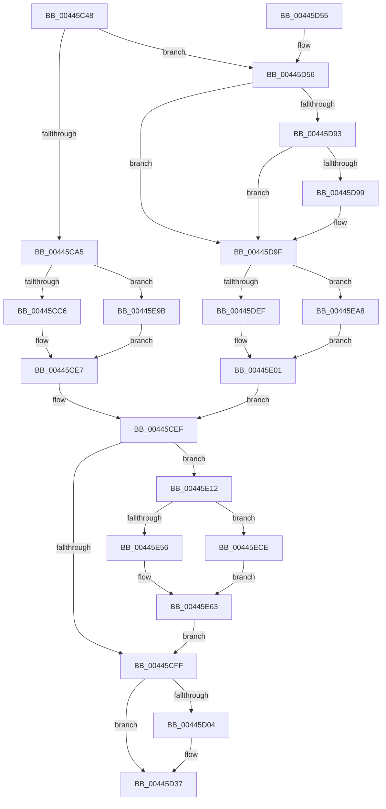

# MiExclusiveInsertPfnChainInList

- RVA: `0x00445C48`–`0x00445EF4` (길이 `684` bytes)
- VA: `0x0000000140445C48`
- 실행 섹션: `.text`
- PDB 이름 있음: `예`; PDB Function 태그: `아니요`
- unwind 정보 RVA: `0x000A5A04`
- 디코드: `168`개 명령, `684/684` bytes 표시
- 미해석 바이트: `0` (있으면 어셈블리에 `.byte`로 보존)

> 이 문서는 커널 이미지의 기계어와 PDB 기호를 분석해 생성했습니다. 4번과 5번은 함수 원형과 자료형을 바이너리 사용 방식에서 추정한 C 해석이며 원본 소스 복구 결과는 아닙니다.

## 1. Dependencies

- 직접 호출 지점: **6**; 고유 호출 대상: **6**
- 직접 호출자로 확인된 함수: **1**
- RIP 상대 이미지 참조: **1**

### Outgoing calls
- `0x00445D56` → [MiMarkLockedChainAsProtected](MiMarkLockedChainAsProtected_function_00445EFC.md) (function, `0x00445EFC`)
- `0x00445DF8` → [MiMakeTransitionPte](../36/MiMakeTransitionPte_function_00363F70.md) (function, `0x00363F70`)
- `0x00445E08` → [MiSetPfnContainingFrame](../36/MiSetPfnContainingFrame_function_00363FC0.md) (function, `0x00363FC0`)
- `0x00445E43` → [MiPfnToStandbyLookaside](../33/MiPfnToStandbyLookaside_function_0033BAE0.md) (function, `0x0033BAE0`)
- `0x00445E69` → [MiSetPfnNodeBlinkLow](../2A/MiSetPfnNodeBlinkLow_function_002AF2A0.md) (function, `0x002AF2A0`)
- `0x00445EEA` → [MiSetNextStandbyPageSecondaryNoLockAsserts](../2A/MiSetNextStandbyPageSecondaryNoLockAsserts_function_002AF300.md) (function, `0x002AF300`)

### Direct callers
- [sub_0033EABD](../33/Unknown_function_0033EABD.md) at `0x0033EBCB`
- [sub_0033EABD](../33/Unknown_function_0033EABD.md) at `0x0033ED6B`

### Static image references
- `0x00445D87` → RVA `0x00E2DC80` (`.data`; read)

## 2. Other-region calls and transfers

- 다른 실행 섹션으로 향하는 call: **0**
- 별도 외부 분기/꼬리 이동을 확인하지 못했습니다.

## 3. Assembly (complete function range)

```asm
00445C48  48 89 5C 24 10                  mov qword ptr [rsp + 0x10], rbx
00445C4D  48 89 6C 24 18                  mov qword ptr [rsp + 0x18], rbp
00445C52  48 89 74 24 20                  mov qword ptr [rsp + 0x20], rsi
00445C57  57                              push rdi
00445C58  41 54                           push r12
00445C5A  41 55                           push r13
00445C5C  41 56                           push r14
00445C5E  41 57                           push r15
00445C60  48 83 EC 50                     sub rsp, 0x50
00445C64  48 8B 41 10                     mov rax, qword ptr [rcx + 0x10]
00445C68  4C 8B CA                        mov r9, rdx
00445C6B  48 8B 71 58                     mov rsi, qword ptr [rcx + 0x58]
00445C6F  48 8B D9                        mov rbx, rcx
00445C72  49 BA 00 00 00 00 00 DE FF FF   movabs r10, 0xffffde0000000000
00445C7C  48 8D 2C 40                     lea rbp, [rax + rax*2]
00445C80  48 C1 E5 04                     shl rbp, 4
00445C84  49 8B C2                        mov rax, r10
00445C87  48 03 E8                        add rbp, rax
00445C8A  48 8B 41 18                     mov rax, qword ptr [rcx + 0x18]
00445C8E  4C 8D 2C 40                     lea r13, [rax + rax*2]
00445C92  49 C1 E5 04                     shl r13, 4
00445C96  49 8B C2                        mov rax, r10
00445C99  4C 03 E8                        add r13, rax
00445C9C  48 85 F6                        test rsi, rsi
00445C9F  0F 85 B1 00 00 00               jne 0x140445d56
00445CA5  4C 8B 72 18                     mov r14, qword ptr [rdx + 0x18]
00445CA9  49 BC FF FF FF FF 3F 00 00 00   movabs r12, 0x3fffffffff
00445CB3  48 BF 00 00 00 00 00 FF FF FF   movabs rdi, 0xffffff0000000000
00445CBD  4D 3B F4                        cmp r14, r12
00445CC0  0F 84 D5 01 00 00               je 0x140445e9b
00445CC6  4B 8D 14 76                     lea rdx, [r14 + r14*2]
00445CCA  48 C1 E2 04                     shl rdx, 4
00445CCE  49 8B C2                        mov rax, r10
00445CD1  48 8B 49 10                     mov rcx, qword ptr [rcx + 0x10]
00445CD5  48 03 D0                        add rdx, rax
00445CD8  48 8B 02                        mov rax, qword ptr [rdx]
00445CDB  48 33 C1                        xor rax, rcx
00445CDE  48 23 C7                        and rax, rdi
00445CE1  48 33 C1                        xor rax, rcx
00445CE4  48 89 02                        mov qword ptr [rdx], rax
00445CE7  48 8B 43 18                     mov rax, qword ptr [rbx + 0x18]
00445CEB  49 89 41 18                     mov qword ptr [r9 + 0x18], rax
00445CEF  83 7B 0C 02                     cmp dword ptr [rbx + 0xc], 2
00445CF3  41 BF 18 00 00 00               mov r15d, 0x18
00445CF9  0F 84 13 01 00 00               je 0x140445e12
00445CFF  48 85 F6                        test rsi, rsi
00445D02  75 33                           jne 0x140445d37
00445D04  49 8B 45 00                     mov rax, qword ptr [r13]
00445D08  48 B9 FF FF FF FF 3F FF FF FF   movabs rcx, 0xffffff3fffffffff
00445D12  48 23 C1                        and rax, rcx
00445D15  48 B9 00 00 00 00 00 FF FF FF   movabs rcx, 0xffffff0000000000
00445D1F  49 0B C4                        or rax, r12
00445D22  49 89 45 00                     mov qword ptr [r13], rax
00445D26  49 8B 04 2F                     mov rax, qword ptr [r15 + rbp]
00445D2A  49 33 C6                        xor rax, r14
00445D2D  48 23 C1                        and rax, rcx
00445D30  49 33 C6                        xor rax, r14
00445D33  48 89 45 18                     mov qword ptr [rbp + 0x18], rax
00445D37  4C 8D 5C 24 50                  lea r11, [rsp + 0x50]
00445D3C  49 8B 5B 38                     mov rbx, qword ptr [r11 + 0x38]
00445D40  49 8B 6B 40                     mov rbp, qword ptr [r11 + 0x40]
00445D44  49 8B 73 48                     mov rsi, qword ptr [r11 + 0x48]
00445D48  49 8B E3                        mov rsp, r11
00445D4B  41 5F                           pop r15
00445D4D  41 5E                           pop r14
00445D4F  41 5D                           pop r13
00445D51  41 5C                           pop r12
00445D53  5F                              pop rdi
00445D54  C3                              ret
00445D55  CC                              int3
00445D56  E8 A1 01 00 00                  call 0x140445efc
00445D5B  49 BC FF FF FF FF 3F 00 00 00   movabs r12, 0x3fffffffff
00445D65  4D 8B F4                        mov r14, r12
00445D68  49 8B C2                        mov rax, r10
00445D6B  4C 8B 46 10                     mov r8, qword ptr [rsi + 0x10]
00445D6F  48 8B D6                        mov rdx, rsi
00445D72  48 2B D0                        sub rdx, rax
00445D75  48 B8 AB AA AA AA AA AA AA AA   movabs rax, 0xaaaaaaaaaaaaaaab
00445D7F  48 C1 FA 04                     sar rdx, 4
00445D83  48 0F AF D0                     imul rdx, rax
00445D87  48 8B 05 F2 7E 9E 00            mov rax, qword ptr [rip + 0x9e7ef2]
00445D8E  48 85 C0                        test rax, rax
00445D91  74 0C                           je 0x140445d9f
00445D93  41 F6 C0 10                     test r8b, 0x10
00445D97  75 06                           jne 0x140445d9f
00445D99  48 F7 D0                        not rax
00445D9C  4C 23 C0                        and r8, rax
00445D9F  48 8B 4E 28                     mov rcx, qword ptr [rsi + 0x28]
00445DA3  48 B8 FF FF FF FF FF 00 00 00   movabs rax, 0xffffffffff
00445DAD  49 C1 E8 0C                     shr r8, 0xc
00445DB1  48 BF 00 00 00 00 00 FF FF FF   movabs rdi, 0xffffff0000000000
00445DBB  4C 23 C0                        and r8, rax
00445DBE  4C 8B C9                        mov r9, rcx
00445DC1  4C 23 C8                        and r9, rax
00445DC4  49 8B 45 00                     mov rax, qword ptr [r13]
00445DC8  48 33 C2                        xor rax, rdx
00445DCB  48 23 C7                        and rax, rdi
00445DCE  48 33 C2                        xor rax, rdx
00445DD1  49 89 45 00                     mov qword ptr [r13], rax
00445DD5  48 8B 45 18                     mov rax, qword ptr [rbp + 0x18]
00445DD9  48 33 C1                        xor rax, rcx
00445DDC  48 23 C7                        and rax, rdi
00445DDF  48 33 C1                        xor rax, rcx
00445DE2  48 89 45 18                     mov qword ptr [rbp + 0x18], rax
00445DE6  4C 3B C2                        cmp r8, rdx
00445DE9  0F 85 B9 00 00 00               jne 0x140445ea8
00445DEF  48 8B 4B 10                     mov rcx, qword ptr [rbx + 0x10]
00445DF3  BA 04 00 00 00                  mov edx, 4
00445DF8  E8 73 E1 F1 FF                  call 0x140363f70
00445DFD  48 89 46 10                     mov qword ptr [rsi + 0x10], rax
00445E01  48 8B 53 18                     mov rdx, qword ptr [rbx + 0x18]
00445E05  48 8B CE                        mov rcx, rsi
00445E08  E8 B3 E1 F1 FF                  call 0x140363fc0
00445E0D  E9 DD FE FF FF                  jmp 0x140445cef
00445E12  48 8B 4B 10                     mov rcx, qword ptr [rbx + 0x10]
00445E16  4C 8D 4C 24 20                  lea r9, [rsp + 0x20]
00445E1B  0F 57 C0                        xorps xmm0, xmm0
00445E1E  C7 84 24 80 00 00 00 09 00 00 00  mov dword ptr [rsp + 0x80], 9
00445E29  4C 8B C6                        mov r8, rsi
00445E2C  48 8D 94 24 80 00 00 00         lea rdx, [rsp + 0x80]
00445E34  0F 11 44 24 20                  movups xmmword ptr [rsp + 0x20], xmm0
00445E39  0F 11 44 24 30                  movups xmmword ptr [rsp + 0x30], xmm0
00445E3E  0F 11 44 24 40                  movups xmmword ptr [rsp + 0x40], xmm0
00445E43  E8 98 5C EF FF                  call 0x14033bae0
00445E48  48 8B 44 24 30                  mov rax, qword ptr [rsp + 0x30]
00445E4D  48 8B 78 18                     mov rdi, qword ptr [rax + 0x18]
00445E51  49 3B FC                        cmp rdi, r12
00445E54  75 78                           jne 0x140445ece
00445E56  48 8B 4B 10                     mov rcx, qword ptr [rbx + 0x10]
00445E5A  48 8B 44 24 30                  mov rax, qword ptr [rsp + 0x30]
00445E5F  48 89 48 10                     mov qword ptr [rax + 0x10], rcx
00445E63  48 8B D7                        mov rdx, rdi
00445E66  48 8B CD                        mov rcx, rbp
00445E69  E8 32 94 E6 FF                  call 0x1402af2a0
00445E6E  8B 45 24                        mov eax, dword ptr [rbp + 0x24]
00445E71  48 C1 EF 13                     shr rdi, 0x13
00445E75  33 F8                           xor edi, eax
00445E77  81 E7 FF FF 1F 00               and edi, 0x1fffff
00445E7D  33 F8                           xor edi, eax
00445E7F  89 7D 24                        mov dword ptr [rbp + 0x24], edi
00445E82  48 8B 43 18                     mov rax, qword ptr [rbx + 0x18]
00445E86  48 8B 4C 24 30                  mov rcx, qword ptr [rsp + 0x30]
00445E8B  48 89 41 18                     mov qword ptr [rcx + 0x18], rax
00445E8F  48 8B 03                        mov rax, qword ptr [rbx]
00445E92  F0 48 01 01                     lock add qword ptr [rcx], rax
00445E96  E9 64 FE FF FF                  jmp 0x140445cff
00445E9B  48 8B 41 10                     mov rax, qword ptr [rcx + 0x10]
00445E9F  48 89 42 10                     mov qword ptr [rdx + 0x10], rax
00445EA3  E9 3F FE FF FF                  jmp 0x140445ce7
00445EA8  4B 8D 14 49                     lea rdx, [r9 + r9*2]
00445EAC  48 C1 E2 04                     shl rdx, 4
00445EB0  49 8B C2                        mov rax, r10
00445EB3  48 8B 4B 10                     mov rcx, qword ptr [rbx + 0x10]
00445EB7  48 03 D0                        add rdx, rax
00445EBA  48 8B 02                        mov rax, qword ptr [rdx]
00445EBD  48 33 C1                        xor rax, rcx
00445EC0  48 23 C7                        and rax, rdi
00445EC3  48 33 C1                        xor rax, rcx
00445EC6  48 89 02                        mov qword ptr [rdx], rax
00445EC9  E9 33 FF FF FF                  jmp 0x140445e01
00445ECE  48 8B 53 10                     mov rdx, qword ptr [rbx + 0x10]
00445ED2  48 8D 0C 7F                     lea rcx, [rdi + rdi*2]
00445ED6  48 C1 E1 04                     shl rcx, 4
00445EDA  48 B8 00 00 00 00 00 DE FF FF   movabs rax, 0xffffde0000000000
00445EE4  48 8B C0                        mov rax, rax
00445EE7  48 03 C8                        add rcx, rax
00445EEA  E8 11 94 E6 FF                  call 0x1402af300
00445EEF  E9 6F FF FF FF                  jmp 0x140445e63
```

## 4. C-style interpretation (structured pseudocode)

```c
__int64 __fastcall MiExclusiveInsertPfnChainInList(__int64 a1, __int64 a2)
{
    __int64 result;
    __int64 v_r13;
    __int64 v_rbp;
    __int64 v_rdi;
    __int64 v_rsp;
    unsigned __int64 v_stack_m10;
    unsigned __int64 v_stack_m20;
    unsigned __int64 v_stack_m28;
    unsigned __int64 v_stack_m30;
    unsigned __int64 v_stack_p10;
    unsigned __int64 v_stack_p18;
    unsigned __int64 v_stack_p20;
    unsigned int v_stack_p30;

    v_stack_p10 = v_rbx;
    v_stack_p18 = v_rbp;
    v_stack_p20 = v_rsi;
    v_rsp = (v_rsp) - (80);
    v_rbp = (*(unsigned __int64 *)(a1 + 16) + *(unsigned __int64 *)(a1 + 16) * 2) << (4);
    v_rbp = (v_rbp) + (v_r10);
    v_r13 = (*(unsigned __int64 *)(a1 + 24) + *(unsigned __int64 *)(a1 + 24) * 2) << (4);
    v_r13 = (v_r13) + (v_r10);
    if (*(unsigned __int64 *)(a1 + 88) != 0) goto loc_00445D56;
    if ((*(unsigned __int64 *)(a2 + 24)) == v_r12) goto loc_00445E9B;
    a2 = (*(unsigned __int64 *)(a2 + 24) + *(unsigned __int64 *)(a2 + 24) * 2) << (4);
    a2 = (a2) + (v_r10);
    result = (*(unsigned __int64 *)(a2)) ^ (*(unsigned __int64 *)(a1 + 16));
    result = (result) & (v_rdi);
    result = (result) ^ (*(unsigned __int64 *)(a1 + 16));
    *(unsigned __int64 *)(a2) = result;
loc_00445CE7:
    *(unsigned __int64 *)(a2 + 24) = *(unsigned __int64 *)(a1 + 24);
loc_00445CEF:
    if ((*(unsigned int *)(a1 + 12)) == 2) goto loc_00445E12;
loc_00445CFF:
    result = *(unsigned __int64 *)(a1 + 24);
    if (*(unsigned __int64 *)(a1 + 88) == 0) {
        result = *(unsigned __int64 *)(v_r13);
        result = (result) & (*(unsigned __int64 *)(a1 + 16));
        result = (result) | (v_r12);
        *(unsigned __int64 *)(v_r13) = result;
        result = *(unsigned __int64 *)(24 + v_rbp * 1);
        result = (result) ^ (*(unsigned __int64 *)(a2 + 24));
        result = (result) & (*(unsigned __int64 *)(a1 + 16));
        result = (result) ^ (*(unsigned __int64 *)(a2 + 24));
        *(unsigned __int64 *)(v_rbp + 24) = result;
    }
    return result;
loc_00445D56:
    result = MiMarkLockedChainAsProtected(*(unsigned __int64 *)(a1 + 16), a2, a3, a2);
    a2 = (*(unsigned __int64 *)(v_stack_m28 + 72)) - (v_r10);
    a2 = (a2) >> (4);
    a2 = (a2) * (v_r10);
    if (*(unsigned __int64 *)(v_rip + 10387186) == 0) goto loc_00445D9F;
    result = *(unsigned __int64 *)(v_rip + 10387186);
    if ((((unsigned __int8)(*(unsigned __int64 *)(*(unsigned __int64 *)(v_stack_m28 + 72) + 16))) & (16)) == 0) {
        result = ~(*(unsigned __int64 *)(v_rip + 10387186));
        a3 = (*(unsigned __int64 *)(*(unsigned __int64 *)(v_stack_m28 + 72) + 16)) & (result);
    }
    a3 = (a3) >> (12);
    a3 = (a3) & (result);
    a4 = (*(unsigned __int64 *)(*(unsigned __int64 *)(v_stack_m28 + 72) + 40)) & (result);
    result = (*(unsigned __int64 *)(v_r13)) ^ (a2);
    result = (result) & (v_rdi);
    result = (result) ^ (a2);
    *(unsigned __int64 *)(v_r13) = result;
    result = (*(unsigned __int64 *)(*(unsigned __int64 *)(v_stack_m28 + 64) + 24)) ^ (*(unsigned __int64 *)(*(unsigned __int64 *)(v_stack_m28 + 72) + 40));
    result = (result) & (v_rdi);
    result = (result) ^ (*(unsigned __int64 *)(*(unsigned __int64 *)(v_stack_m28 + 72) + 40));
    *(unsigned __int64 *)(*(unsigned __int64 *)(v_stack_m28 + 64) + 24) = result;
    if (a3 != a2) goto loc_00445EA8;
    result = MiMakeTransitionPte(*(unsigned __int64 *)(*(unsigned __int64 *)(v_stack_m28 + 56) + 16), 4, a3, a4);
    *(unsigned __int64 *)(*(unsigned __int64 *)(v_stack_m28 + 72) + 16) = result;
loc_00445E01:
    result = MiSetPfnContainingFrame(*(unsigned __int64 *)(v_stack_m28 + 72), *(unsigned __int64 *)(*(unsigned __int64 *)(v_stack_m28 + 56) + 24), a3, a4);
    goto loc_00445CEF;
loc_00445E12:
    v_stack_p30 = 9;
    v_stack_m30 = v_xmm0;
    v_stack_m20 = v_xmm0;
    v_stack_m10 = v_xmm0;
    result = MiPfnToStandbyLookaside(*(unsigned __int64 *)(*(unsigned __int64 *)(v_stack_m28 + 56) + 16), v_stack_p30, *(unsigned __int64 *)(v_stack_m28 + 72), v_stack_m30);
    if ((*(unsigned __int64 *)(v_stack_m20 + 24)) != v_r12) goto loc_00445ECE;
    *(unsigned __int64 *)(v_stack_m20 + 16) = *(unsigned __int64 *)(*(unsigned __int64 *)(v_stack_m28 + 56) + 16);
loc_00445E63:
    result = MiSetPfnNodeBlinkLow(*(unsigned __int64 *)(v_stack_m28 + 64), *(unsigned __int64 *)(v_stack_m20 + 24), *(unsigned __int64 *)(v_stack_m28 + 72), v_stack_m30);
    v_rdi = (*(unsigned __int64 *)(v_stack_m20 + 24)) >> (19);
    v_rdi = (unsigned int)((v_rdi) ^ ((unsigned int)((unsigned int)(*(unsigned int *)(*(unsigned __int64 *)(v_stack_m28 + 64) + 36)))));
    v_rdi = (unsigned int)((v_rdi) & (0x1FFFFFULL));
    v_rdi = (unsigned int)((v_rdi) ^ ((unsigned int)((unsigned int)(*(unsigned int *)(*(unsigned __int64 *)(v_stack_m28 + 64) + 36)))));
    *(unsigned int *)(*(unsigned __int64 *)(v_stack_m28 + 64) + 36) = (unsigned int)(v_rdi);
    *(unsigned __int64 *)(v_stack_m20 + 24) = *(unsigned __int64 *)(*(unsigned __int64 *)(v_stack_m28 + 56) + 24);
    goto loc_00445CFF;
loc_00445E9B:
    *(unsigned __int64 *)(*(unsigned __int64 *)(v_stack_m20 + 24) + 16) = *(unsigned __int64 *)(v_stack_m20 + 16);
    goto loc_00445CE7;
loc_00445EA8:
    a2 = (v_stack_m30 + v_stack_m30 * 2) << (4);
    a2 = (a2) + (v_r10);
    result = (*(unsigned __int64 *)(a2)) ^ (*(unsigned __int64 *)(*(unsigned __int64 *)(v_stack_m28 + 56) + 16));
    result = (result) & (v_rdi);
    result = (result) ^ (*(unsigned __int64 *)(*(unsigned __int64 *)(v_stack_m28 + 56) + 16));
    *(unsigned __int64 *)(a2) = result;
    goto loc_00445E01;
loc_00445ECE:
    a1 = (v_rdi + v_rdi * 2) << (4);
    a1 = (a1) + (result);
    result = MiSetNextStandbyPageSecondaryNoLockAsserts(a1, *(unsigned __int64 *)(*(unsigned __int64 *)(v_stack_m28 + 56) + 16), *(unsigned __int64 *)(v_stack_m28 + 72), v_stack_m30);
    goto loc_00445E63;
}
```

## 5. (Beta) C Style

```c
int64_t MiExclusiveInsertPfnChainInList(void *Arg1, void *Arg2)
{
    uint8_t *arg1 = (uint8_t *)Arg1;
    uint8_t *arg2 = (uint8_t *)Arg2;

    int64_t result;
    int64_t local_r13;
    int64_t local_rbp;
    int64_t local_rdi;
    int64_t local_rsp;
    uint64_t v_stack_m10;
    uint64_t v_stack_m20;
    uint64_t v_stack_m28;
    uint64_t v_stack_m30;
    uint64_t v_stack_p10;
    uint64_t v_stack_p18;
    uint64_t v_stack_p20;
    uint32_t v_stack_p30;

    v_stack_p10 = local_rbx;
    v_stack_p18 = local_rbp;
    v_stack_p20 = local_rsi;
    local_rsp = (local_rsp) - (80);
    local_rbp = (*(uint64_t *)(arg1 + 0x10) + *(uint64_t *)(arg1 + 0x10) * 2) << (4);
    local_rbp = (local_rbp) + (local_r10);
    local_r13 = (*(uint64_t *)(arg1 + 0x18) + *(uint64_t *)(arg1 + 0x18) * 2) << (4);
    local_r13 = (local_r13) + (local_r10);
    if (*(uint64_t *)(arg1 + 0x58) != 0) goto loc_00445D56;
    if ((*(uint64_t *)(arg2 + 0x18)) == local_r12) goto loc_00445E9B;
    Arg2 = (*(uint64_t *)(arg2 + 0x18) + *(uint64_t *)(arg2 + 0x18) * 2) << (4);
    Arg2 = (Arg2) + (local_r10);
    result = (*(uint64_t *)(arg2)) ^ (*(uint64_t *)(arg1 + 0x10));
    result = (result) & (local_rdi);
    result = (result) ^ (*(uint64_t *)(arg1 + 0x10));
    *(uint64_t *)(arg2) = result;
loc_00445CE7:
    *(uint64_t *)(arg2 + 0x18) = *(uint64_t *)(arg1 + 0x18);
loc_00445CEF:
    if ((*(uint32_t *)(arg1 + 0xC)) == 2) goto loc_00445E12;
loc_00445CFF:
    result = *(uint64_t *)(arg1 + 0x18);
    if (*(uint64_t *)(arg1 + 0x58) == 0) {
        result = *(uint64_t *)(local_r13);
        result = (result) & (*(uint64_t *)(arg1 + 0x10));
        result = (result) | (local_r12);
        *(uint64_t *)(local_r13) = result;
        result = *(uint64_t *)(24 + local_rbp * 1);
        result = (result) ^ (*(uint64_t *)(arg2 + 0x18));
        result = (result) & (*(uint64_t *)(arg1 + 0x10));
        result = (result) ^ (*(uint64_t *)(arg2 + 0x18));
        *(uint64_t *)(local_rbp + 0x18) = result;
    }
    return result;
loc_00445D56:
    result = MiMarkLockedChainAsProtected(*(uint64_t *)(arg1 + 0x10), Arg2, a3, Arg2);
    Arg2 = (*(uint64_t *)(v_stack_m28 + 0x48)) - (local_r10);
    Arg2 = (Arg2) >> (4);
    Arg2 = (Arg2) * (local_r10);
    if (*(uint64_t *)(v_rip + 0x9E7EF2) == 0) goto loc_00445D9F;
    result = *(uint64_t *)(v_rip + 0x9E7EF2);
    if ((((uint8_t)(*(uint64_t *)(*(uint64_t *)(v_stack_m28 + 0x48) + 0x10))) & (16)) == 0) {
        result = ~(*(uint64_t *)(v_rip + 0x9E7EF2));
        a3 = (*(uint64_t *)(*(uint64_t *)(v_stack_m28 + 0x48) + 0x10)) & (result);
    }
    a3 = (a3) >> (12);
    a3 = (a3) & (result);
    a4 = (*(uint64_t *)(*(uint64_t *)(v_stack_m28 + 0x48) + 0x28)) & (result);
    result = (*(uint64_t *)(local_r13)) ^ (Arg2);
    result = (result) & (local_rdi);
    result = (result) ^ (Arg2);
    *(uint64_t *)(local_r13) = result;
    result = (*(uint64_t *)(*(uint64_t *)(v_stack_m28 + 0x40) + 0x18)) ^ (*(uint64_t *)(*(uint64_t *)(v_stack_m28 + 0x48) + 0x28));
    result = (result) & (local_rdi);
    result = (result) ^ (*(uint64_t *)(*(uint64_t *)(v_stack_m28 + 0x48) + 0x28));
    *(uint64_t *)(*(uint64_t *)(v_stack_m28 + 0x40) + 0x18) = result;
    if (a3 != Arg2) goto loc_00445EA8;
    result = MiMakeTransitionPte(*(uint64_t *)(*(uint64_t *)(v_stack_m28 + 0x38) + 0x10), 4, a3, a4);
    *(uint64_t *)(*(uint64_t *)(v_stack_m28 + 0x48) + 0x10) = result;
loc_00445E01:
    result = MiSetPfnContainingFrame(*(uint64_t *)(v_stack_m28 + 0x48), *(uint64_t *)(*(uint64_t *)(v_stack_m28 + 0x38) + 0x18), a3, a4);
    goto loc_00445CEF;
loc_00445E12:
    v_stack_p30 = 9;
    v_stack_m30 = v_xmm0;
    v_stack_m20 = v_xmm0;
    v_stack_m10 = v_xmm0;
    result = MiPfnToStandbyLookaside(*(uint64_t *)(*(uint64_t *)(v_stack_m28 + 0x38) + 0x10), v_stack_p30, *(uint64_t *)(v_stack_m28 + 0x48), v_stack_m30);
    if ((*(uint64_t *)(v_stack_m20 + 0x18)) != local_r12) goto loc_00445ECE;
    *(uint64_t *)(v_stack_m20 + 0x10) = *(uint64_t *)(*(uint64_t *)(v_stack_m28 + 0x38) + 0x10);
loc_00445E63:
    result = MiSetPfnNodeBlinkLow(*(uint64_t *)(v_stack_m28 + 0x40), *(uint64_t *)(v_stack_m20 + 0x18), *(uint64_t *)(v_stack_m28 + 0x48), v_stack_m30);
    local_rdi = (*(uint64_t *)(v_stack_m20 + 0x18)) >> (19);
    local_rdi = (uint32_t)((local_rdi) ^ ((uint32_t)((uint32_t)(*(uint32_t *)(*(uint64_t *)(v_stack_m28 + 0x40) + 0x24)))));
    local_rdi = (uint32_t)((local_rdi) & (0x1FFFFFULL));
    local_rdi = (uint32_t)((local_rdi) ^ ((uint32_t)((uint32_t)(*(uint32_t *)(*(uint64_t *)(v_stack_m28 + 0x40) + 0x24)))));
    *(uint32_t *)(*(uint64_t *)(v_stack_m28 + 0x40) + 0x24) = (uint32_t)(local_rdi);
    *(uint64_t *)(v_stack_m20 + 0x18) = *(uint64_t *)(*(uint64_t *)(v_stack_m28 + 0x38) + 0x18);
    goto loc_00445CFF;
loc_00445E9B:
    *(uint64_t *)(*(uint64_t *)(v_stack_m20 + 0x18) + 0x10) = *(uint64_t *)(v_stack_m20 + 0x10);
    goto loc_00445CE7;
loc_00445EA8:
    Arg2 = (v_stack_m30 + v_stack_m30 * 2) << (4);
    Arg2 = (Arg2) + (local_r10);
    result = (*(uint64_t *)(arg2)) ^ (*(uint64_t *)(*(uint64_t *)(v_stack_m28 + 0x38) + 0x10));
    result = (result) & (local_rdi);
    result = (result) ^ (*(uint64_t *)(*(uint64_t *)(v_stack_m28 + 0x38) + 0x10));
    *(uint64_t *)(arg2) = result;
    goto loc_00445E01;
loc_00445ECE:
    Arg1 = (local_rdi + local_rdi * 2) << (4);
    Arg1 = (Arg1) + (result);
    result = MiSetNextStandbyPageSecondaryNoLockAsserts(Arg1, *(uint64_t *)(*(uint64_t *)(v_stack_m28 + 0x38) + 0x10), *(uint64_t *)(v_stack_m28 + 0x48), v_stack_m30);
    goto loc_00445E63;
}
```

### 관측된 메모리 오프셋

구조체 형식이 확인되지 않은 접근은 인자 기준의 오프셋으로만 기록했습니다.

| 기준 인자 | 오프셋 표현 | 폭 (bit) | 접근 |
|---|---:|---:|---|
| `Arg1` | `+ 0x0` | `64` | `R` |
| `Arg1` | `+ 0xC` | `32` | `R` |
| `Arg1` | `+ 0x10` | `64` | `R` |
| `Arg1` | `+ 0x18` | `64` | `R` |
| `Arg1` | `+ 0x58` | `64` | `R` |
| `Arg2` | `+ 0x10` | `64` | `W` |
| `Arg2` | `+ 0x18` | `64` | `R` |
| `Arg2` | `+ 0x18` | `64` | `W` |

## 6. Execution-region graph

[열기: 2D/3D 그래프와 함수 탐색 컨트롤 패널](../../../control-panel.html?section=text&rva=0x00445C48&view=graph)

- 2D 그래프는 위에서 아래로 흐르고, 3D 그래프는 빈 공간을 드래그해 회전합니다. Shift+드래그는 이동, 휠은 확대·축소, 함수 노드 선택은 대상 보고서 이동입니다.

### Static fallback


