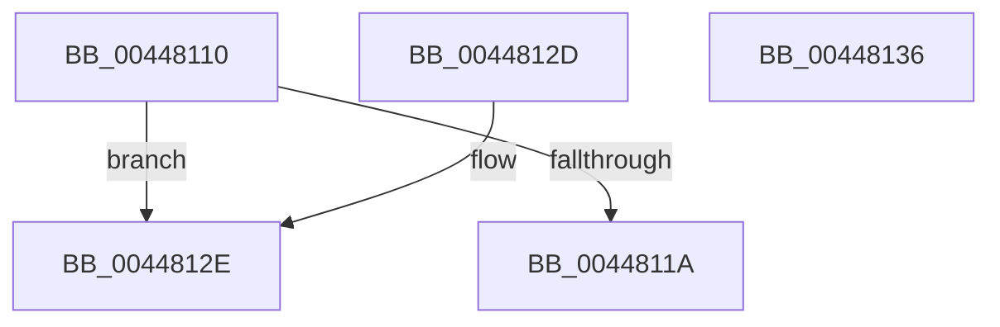

# MiFillLogProcessInfo

- RVA: `0x00448110`–`0x00448137` (길이 `39` bytes)
- VA: `0x0000000140448110`
- 실행 섹션: `.text`
- PDB 이름 있음: `예`; PDB Function 태그: `아니요`
- unwind 정보 RVA: `0x000DB714`
- 디코드: `14`개 명령, `39/39` bytes 표시
- 미해석 바이트: `0` (있으면 어셈블리에 `.byte`로 보존)

> 이 문서는 커널 이미지의 기계어와 PDB 기호를 분석해 생성했습니다. 4번과 5번은 함수 원형과 자료형을 바이너리 사용 방식에서 추정한 C 해석이며 원본 소스 복구 결과는 아닙니다.

## 1. Dependencies

- 직접 호출 지점: **0**; 고유 호출 대상: **0**
- 직접 호출자로 확인된 함수: **5**
- RIP 상대 이미지 참조: **0**

### Outgoing calls
- 직접 디코드된 call 명령이 없습니다.

### Direct callers
- [MiLogUpdateOldPagesInWs](../67/MiLogUpdateOldPagesInWs_function_0067EB40.md) at `0x0067EB97`
- [MiLogUnlockVmTrim](../68/MiLogUnlockVmTrim_function_00689C7C.md) at `0x00689CD0`
- [MiLogHotPatchOperation](../../page/80/MiLogHotPatchOperation_function_00804A04.md) at `0x00804A7C`
- [MiLogHotPatchOperationStatus](../../page/80/MiLogHotPatchOperationStatus_function_00804E84.md) at `0x00804F32`
- [MiLogHotPatchOperationStatus](../../page/80/MiLogHotPatchOperationStatus_function_00804E84.md) at `0x008050AF`
- [MiLogHotPatchOperationStatus](../../page/80/MiLogHotPatchOperationStatus_function_00804E84.md) at `0x008052A8`
- [MiLogHotPatchOperationStatus](../../page/80/MiLogHotPatchOperationStatus_function_00804E84.md) at `0x008053B1`
- [MiLogHotPatchRundown](../../page/80/MiLogHotPatchRundown_function_008057A4.md) at `0x00806077`

### Static image references
- 디코드된 RIP-relative 메모리 참조가 없습니다.

## 2. Other-region calls and transfers

- 다른 실행 섹션으로 향하는 call: **0**
- 별도 외부 분기/꼬리 이동을 확인하지 못했습니다.

## 3. Assembly (complete function range)

```asm
00448110  8B 81 B8 00 00 00               mov eax, dword ptr [rcx + 0xb8]
00448116  A8 0F                           test al, 0xf
00448118  75 14                           jne 0x14044812e
0044811A  8B 81 D0 FD FF FF               mov eax, dword ptr [rcx - 0x230]
00448120  4C 8D 89 38 FF FF FF            lea r9, [rcx - 0xc8]
00448127  89 02                           mov dword ptr [rdx], eax
00448129  4D 89 08                        mov qword ptr [r8], r9
0044812C  C3                              ret
0044812D  CC                              int3
0044812E  33 C0                           xor eax, eax
00448130  89 02                           mov dword ptr [rdx], eax
00448132  49 89 00                        mov qword ptr [r8], rax
00448135  C3                              ret
00448136  CC                              int3
```

## 4. C-style interpretation (structured pseudocode)

```c
__int64 __fastcall MiFillLogProcessInfo(__int64 a1, __int64 a2, __int64 a3)
{
    __int64 result;

    if ((((unsigned __int8)((unsigned int)(*(unsigned int *)(a1 + 184)))) & (15)) != 0) goto loc_0044812E;
    *(unsigned int *)(a2) = (unsigned int)((unsigned int)(*(unsigned int *)(a1 - 560)));
    *(unsigned __int64 *)(a3) = a1 - 200;
    return (unsigned int)(*(unsigned int *)(a1 - 560));
loc_0044812E:
    result = 0;
    *(unsigned int *)(a2) = 0;
    *(unsigned __int64 *)(a3) = 0;
    return result;
}
```

## 5. (Beta) C Style

```c
int64_t MiFillLogProcessInfo(void *Arg1, void *Arg2, void *Arg3)
{
    uint8_t *arg1 = (uint8_t *)Arg1;
    uint8_t *arg2 = (uint8_t *)Arg2;
    uint8_t *arg3 = (uint8_t *)Arg3;

    int64_t result;

    if ((((uint8_t)((uint32_t)(*(uint32_t *)(arg1 + 0xB8)))) & (15)) != 0) goto loc_0044812E;
    *(uint32_t *)(arg2) = (uint32_t)((uint32_t)(*(uint32_t *)(arg1 - 0x230)));
    *(void **)(arg3) = Arg1 - 200;
    return (uint32_t)(*(uint32_t *)(arg1 - 0x230));
loc_0044812E:
    result = 0;
    *(uint32_t *)(arg2) = 0;
    *(uint64_t *)(arg3) = 0;
    return result;
}
```

### 관측된 메모리 오프셋

구조체 형식이 확인되지 않은 접근은 인자 기준의 오프셋으로만 기록했습니다.

| 기준 인자 | 오프셋 표현 | 폭 (bit) | 접근 |
|---|---:|---:|---|
| `Arg1` | `- 0x230` | `32` | `R` |
| `Arg1` | `- 0xC8` | `64` | `R` |
| `Arg1` | `+ 0xB8` | `32` | `R` |
| `Arg2` | `+ 0x0` | `32` | `W` |
| `Arg3` | `+ 0x0` | `64` | `W` |

## 6. Execution-region graph

[열기: 2D/3D 그래프와 함수 탐색 컨트롤 패널](../../../control-panel.html?section=text&rva=0x00448110&view=graph)

- 2D 그래프는 위에서 아래로 흐르고, 3D 그래프는 빈 공간을 드래그해 회전합니다. Shift+드래그는 이동, 휠은 확대·축소, 함수 노드 선택은 대상 보고서 이동입니다.

### Static fallback


