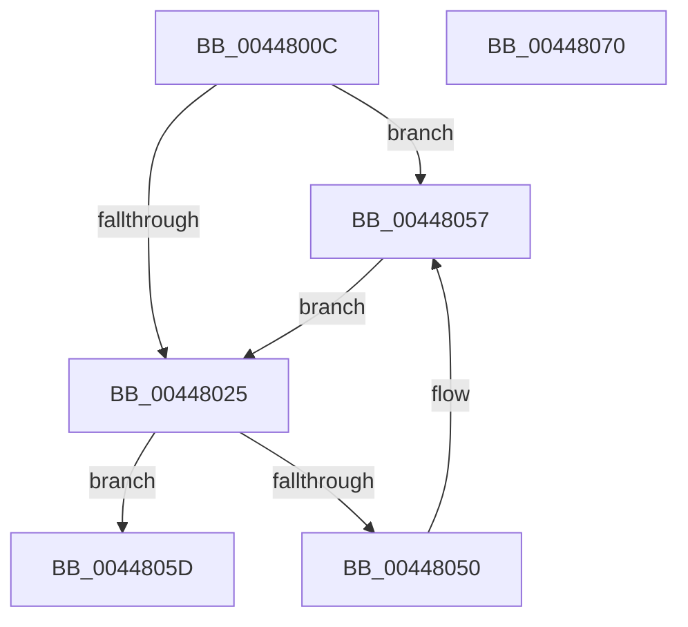

# MiFreeSystemCacheView

- RVA: `0x0044800C`–`0x00448071` (길이 `101` bytes)
- VA: `0x000000014044800C`
- 실행 섹션: `.text`
- PDB 이름 있음: `예`; PDB Function 태그: `아니요`
- unwind 정보 RVA: `0x000DB714`
- 디코드: `27`개 명령, `101/101` bytes 표시
- 미해석 바이트: `0` (있으면 어셈블리에 `.byte`로 보존)

> 이 문서는 커널 이미지의 기계어와 PDB 기호를 분석해 생성했습니다. 4번과 5번은 함수 원형과 자료형을 바이너리 사용 방식에서 추정한 C 해석이며 원본 소스 복구 결과는 아닙니다.

## 1. Dependencies

- 직접 호출 지점: **0**; 고유 호출 대상: **0**
- 직접 호출자로 확인된 함수: **1**
- RIP 상대 이미지 참조: **0**

### Outgoing calls
- 직접 디코드된 call 명령이 없습니다.

### Direct callers
- [MiReleaseSystemCacheView](../29/MiReleaseSystemCacheView_function_00294CE0.md) at `0x00294D6C`

### Static image references
- 디코드된 RIP-relative 메모리 참조가 없습니다.

## 2. Other-region calls and transfers

- 다른 실행 섹션으로 향하는 call: **0**
- 별도 외부 분기/꼬리 이동을 확인하지 못했습니다.

## 3. Assembly (complete function range)

```asm
0044800C  44 8B CA                        mov r9d, edx
0044800F  41 83 E1 03                     and r9d, 3
00448013  49 83 C1 44                     add r9, 0x44
00448017  49 C1 E1 05                     shl r9, 5
0044801B  4C 03 C9                        add r9, rcx
0044801E  49 83 79 10 00                  cmp qword ptr [r9 + 0x10], 0
00448023  74 32                           je 0x140448057
00448025  49 8B 40 20                     mov rax, qword ptr [r8 + 0x20]
00448029  48 BA FF FF FF FF FF FF FF 3F   movabs rdx, 0x3fffffffffffffff
00448033  48 23 C2                        and rax, rdx
00448036  48 BA 00 00 00 00 00 00 00 40   movabs rdx, 0x4000000000000000
00448040  48 0B C2                        or rax, rdx
00448043  49 89 40 20                     mov qword ptr [r8 + 0x20], rax
00448047  49 8B 41 08                     mov rax, qword ptr [r9 + 8]
0044804B  4C 39 08                        cmp qword ptr [rax], r9
0044804E  74 0D                           je 0x14044805d
00448050  B9 03 00 00 00                  mov ecx, 3
00448055  CD 29                           int 0x29
00448057  41 89 51 18                     mov dword ptr [r9 + 0x18], edx
0044805B  EB C8                           jmp 0x140448025
0044805D  4D 89 08                        mov qword ptr [r8], r9
00448060  49 89 40 08                     mov qword ptr [r8 + 8], rax
00448064  4C 89 00                        mov qword ptr [rax], r8
00448067  4D 89 41 08                     mov qword ptr [r9 + 8], r8
0044806B  49 FF 41 10                     inc qword ptr [r9 + 0x10]
0044806F  C3                              ret
00448070  CC                              int3
```

## 4. C-style interpretation (structured pseudocode)

```c
__int64 __fastcall MiFreeSystemCacheView(__int64 a1, int a2, __int64 a3)
{
    __int64 result;

    a4 = (unsigned int)(((unsigned int)(a2)) & (3));
    a4 = (a4) + (68);
    a4 = (a4) << (5);
    a4 = (a4) + (a1);
    if ((*(unsigned __int64 *)(a4 + 16)) == 0) goto loc_00448057;
loc_00448025:
    result = (*(unsigned __int64 *)(a3 + 32)) & (a2);
    result = (result) | (a2);
    *(unsigned __int64 *)(a3 + 32) = result;
    if ((*(unsigned __int64 *)(*(unsigned __int64 *)(a4 + 8))) == a4) goto loc_0044805D;
loc_00448057:
    *(unsigned int *)(a4 + 24) = a2;
    goto loc_00448025;
loc_0044805D:
    *(unsigned __int64 *)(a3) = a4;
    *(unsigned __int64 *)(a3 + 8) = *(unsigned __int64 *)(a4 + 8);
    *(unsigned __int64 *)(*(unsigned __int64 *)(a4 + 8)) = a3;
    *(unsigned __int64 *)(a4 + 8) = a3;
    return *(unsigned __int64 *)(a4 + 8);
}
```

## 5. (Beta) C Style

```c
int64_t MiFreeSystemCacheView(int64_t Arg1, int32_t Arg2, void *Arg3)
{
    uint8_t *arg3 = (uint8_t *)Arg3;

    int64_t result;

    a4 = (uint32_t)(((uint32_t)(Arg2)) & (3));
    a4 = (a4) + (68);
    a4 = (a4) << (5);
    a4 = (a4) + (Arg1);
    if ((*(uint64_t *)(a4 + 0x10)) == 0) goto loc_00448057;
loc_00448025:
    result = (*(uint64_t *)(arg3 + 0x20)) & (Arg2);
    result = (result) | (Arg2);
    *(uint64_t *)(arg3 + 0x20) = result;
    if ((*(uint64_t *)(*(uint64_t *)(a4 + 0x8))) == a4) goto loc_0044805D;
loc_00448057:
    *(uint32_t *)(a4 + 0x18) = Arg2;
    goto loc_00448025;
loc_0044805D:
    *(uint64_t *)(arg3) = a4;
    *(uint64_t *)(arg3 + 0x8) = *(uint64_t *)(a4 + 0x8);
    *(void **)(*(uint64_t *)(a4 + 0x8)) = Arg3;
    *(void **)(a4 + 0x8) = Arg3;
    return *(uint64_t *)(a4 + 0x8);
}
```

### 관측된 메모리 오프셋

구조체 형식이 확인되지 않은 접근은 인자 기준의 오프셋으로만 기록했습니다.

| 기준 인자 | 오프셋 표현 | 폭 (bit) | 접근 |
|---|---:|---:|---|
| `Arg3` | `+ 0x0` | `64` | `W` |
| `Arg3` | `+ 0x8` | `64` | `W` |
| `Arg3` | `+ 0x20` | `64` | `R` |
| `Arg3` | `+ 0x20` | `64` | `W` |

## 6. Execution-region graph

[열기: 2D/3D 그래프와 함수 탐색 컨트롤 패널](../../../control-panel.html?section=text&rva=0x0044800C&view=graph)

- 2D 그래프는 위에서 아래로 흐르고, 3D 그래프는 빈 공간을 드래그해 회전합니다. Shift+드래그는 이동, 휠은 확대·축소, 함수 노드 선택은 대상 보고서 이동입니다.

### Static fallback


