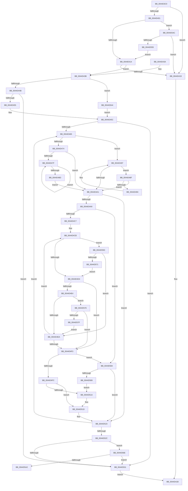

# MiGatherSlabDemoteCandidates

- RVA: `0x0044D3C0`–`0x0044D5AA` (길이 `490` bytes)
- VA: `0x000000014044D3C0`
- 실행 섹션: `.text`
- PDB 이름 있음: `예`; PDB Function 태그: `예`
- unwind 정보 RVA: `0x000A6920`
- 디코드: `140`개 명령, `490/490` bytes 표시
- 미해석 바이트: `0` (있으면 어셈블리에 `.byte`로 보존)

> 이 문서는 커널 이미지의 기계어와 PDB 기호를 분석해 생성했습니다. 4번과 5번은 함수 원형과 자료형을 바이너리 사용 방식에서 추정한 C 해석이며 원본 소스 복구 결과는 아닙니다.

## 1. Dependencies

- 직접 호출 지점: **1**; 고유 호출 대상: **1**
- 직접 호출자로 확인된 함수: **1**
- RIP 상대 이미지 참조: **0**

### Outgoing calls
- `0x0044D50D` → [memcpy](../6C/memcpy_function_006C6840.md) (function, `0x006C6840`)

### Direct callers
- [MiDemoteSlabEntriesDpc](MiDemoteSlabEntriesDpc_function_0044C3C0.md) at `0x0044C55C`

### Static image references
- 디코드된 RIP-relative 메모리 참조가 없습니다.

## 2. Other-region calls and transfers

- 다른 실행 섹션으로 향하는 call: **0**
- call이 아닌 외부 분기/꼬리 이동: **1**
  - `0x0044D5A5` → [sub_006F0ED6](../6F/Unknown_function_006F0ED6.md) (`tail-transfer`)

## 3. Assembly (complete function range)

```asm
0044D3C0  48 8B C4                        mov rax, rsp
0044D3C3  48 89 58 08                     mov qword ptr [rax + 8], rbx
0044D3C7  48 89 68 10                     mov qword ptr [rax + 0x10], rbp
0044D3CB  48 89 70 18                     mov qword ptr [rax + 0x18], rsi
0044D3CF  48 89 78 20                     mov qword ptr [rax + 0x20], rdi
0044D3D3  41 55                           push r13
0044D3D5  41 56                           push r14
0044D3D7  41 57                           push r15
0044D3D9  48 83 EC 20                     sub rsp, 0x20
0044D3DD  33 FF                           xor edi, edi
0044D3DF  49 8B F0                        mov rsi, r8
0044D3E2  41 39 78 30                     cmp dword ptr [r8 + 0x30], edi
0044D3E6  44 8B CF                        mov r9d, edi
0044D3E9  8B CF                           mov ecx, edi
0044D3EB  48 8B DA                        mov rbx, rdx
0044D3EE  41 0F 94 C1                     sete r9b
0044D3F2  83 BA 80 00 00 00 04            cmp dword ptr [rdx + 0x80], 4
0044D3F9  0F 97 C1                        seta cl
0044D3FC  44 3B C9                        cmp r9d, ecx
0044D3FF  75 18                           jne 0x14044d419
0044D401  48 8B 4A 08                     mov rcx, qword ptr [rdx + 8]
0044D405  48 8B 03                        mov rax, qword ptr [rbx]
0044D408  48 8B D1                        mov rdx, rcx
0044D40B  83 E2 01                        and edx, 1
0044D40E  0F 85 38 01 00 00               jne 0x14044d54c
0044D414  48 85 C0                        test rax, rax
0044D417  75 22                           jne 0x14044d43b
0044D419  33 C0                           xor eax, eax
0044D41B  48 8B 5C 24 40                  mov rbx, qword ptr [rsp + 0x40]
0044D420  48 8B 6C 24 48                  mov rbp, qword ptr [rsp + 0x48]
0044D425  48 8B 74 24 50                  mov rsi, qword ptr [rsp + 0x50]
0044D42A  48 8B 7C 24 58                  mov rdi, qword ptr [rsp + 0x58]
0044D42F  48 83 C4 20                     add rsp, 0x20
0044D433  41 5F                           pop r15
0044D435  41 5E                           pop r14
0044D437  41 5D                           pop r13
0044D439  C3                              ret
0044D43A  CC                              int3
0044D43B  4C 8D 7E 20                     lea r15, [rsi + 0x20]
0044D43F  44 8B C7                        mov r8d, edi
0044D442  48 85 D2                        test rdx, rdx
0044D445  0F 84 F9 00 00 00               je 0x14044d544
0044D44B  48 83 F9 01                     cmp rcx, 1
0044D44F  0F 84 DC 00 00 00               je 0x14044d531
0044D455  48 83 CB 01                     or rbx, 1
0044D459  48 33 D9                        xor rbx, rcx
0044D45C  48 85 DB                        test rbx, rbx
0044D45F  0F 84 CC 00 00 00               je 0x14044d531
0044D465  48 8B 43 08                     mov rax, qword ptr [rbx + 8]
0044D469  4C 8B EB                        mov r13, rbx
0044D46C  48 8B CB                        mov rcx, rbx
0044D46F  48 85 C0                        test rax, rax
0044D472  74 23                           je 0x14044d497
0044D474  48 8B 08                        mov rcx, qword ptr [rax]
0044D477  48 8B D8                        mov rbx, rax
0044D47A  48 85 C9                        test rcx, rcx
0044D47D  74 22                           je 0x14044d4a1
0044D47F  48 8B 01                        mov rax, qword ptr [rcx]
0044D482  48 8B D9                        mov rbx, rcx
0044D485  48 8B C8                        mov rcx, rax
0044D488  48 85 C0                        test rax, rax
0044D48B  75 F2                           jne 0x14044d47f
0044D48D  EB 12                           jmp 0x14044d4a1
0044D48F  48 39 0B                        cmp qword ptr [rbx], rcx
0044D492  74 0D                           je 0x14044d4a1
0044D494  48 8B CB                        mov rcx, rbx
0044D497  48 8B 5B 10                     mov rbx, qword ptr [rbx + 0x10]
0044D49B  48 83 E3 FC                     and rbx, 0xfffffffffffffffc
0044D49F  75 EE                           jne 0x14044d48f
0044D4A1  41 8B 45 5C                     mov eax, dword ptr [r13 + 0x5c]
0044D4A5  A8 02                           test al, 2
0044D4A7  75 7A                           jne 0x14044d523
0044D4A9  49 8B 07                        mov rax, qword ptr [r15]
0044D4AC  4C 8B F6                        mov r14, rsi
0044D4AF  45 8B 55 58                     mov r10d, dword ptr [r13 + 0x58]
0044D4B3  45 8B 4D 54                     mov r9d, dword ptr [r13 + 0x54]
0044D4B7  45 03 D1                        add r10d, r9d
0044D4BA  48 8D 2C C6                     lea rbp, [rsi + rax*8]
0044D4BE  48 3B F5                        cmp rsi, rbp
0044D4C1  0F 83 BD 00 00 00               jae 0x14044d584
0044D4C7  44 8B 5E 30                     mov r11d, dword ptr [rsi + 0x30]
0044D4CB  45 85 DB                        test r11d, r11d
0044D4CE  0F 85 89 00 00 00               jne 0x14044d55d
0044D4D4  49 8B 06                        mov rax, qword ptr [r14]
0044D4D7  8B 48 58                        mov ecx, dword ptr [rax + 0x58]
0044D4DA  8B 50 54                        mov edx, dword ptr [rax + 0x54]
0044D4DD  03 CA                           add ecx, edx
0044D4DF  44 3B D1                        cmp r10d, ecx
0044D4E2  77 0F                           ja 0x14044d4f3
0044D4E4  0F 84 8C 00 00 00               je 0x14044d576
0044D4EA  49 83 C6 08                     add r14, 8
0044D4EE  4C 3B F5                        cmp r14, rbp
0044D4F1  72 D8                           jb 0x14044d4cb
0044D4F3  4C 3B F5                        cmp r14, rbp
0044D4F6  0F 83 88 00 00 00               jae 0x14044d584
0044D4FC  4D 8B C7                        mov r8, r15
0044D4FF  49 8D 4E 08                     lea rcx, [r14 + 8]
0044D503  4D 2B C6                        sub r8, r14
0044D506  49 8B D6                        mov rdx, r14
0044D509  49 83 E8 08                     sub r8, 8
0044D50D  E8 2E 93 27 00                  call 0x1406c6840
0044D512  4D 89 2E                        mov qword ptr [r14], r13
0044D515  49 3B EF                        cmp rbp, r15
0044D518  73 03                           jae 0x14044d51d
0044D51A  49 FF 07                        inc qword ptr [r15]
0044D51D  41 B8 01 00 00 00               mov r8d, 1
0044D523  48 85 DB                        test rbx, rbx
0044D526  0F 85 39 FF FF FF               jne 0x14044d465
0044D52C  45 85 C0                        test r8d, r8d
0044D52F  75 5D                           jne 0x14044d58e
0044D531  48 81 7E 28 20 04 00 00         cmp qword ptr [rsi + 0x28], 0x420
0044D539  40 0F 93 C7                     setae dil
0044D53D  8B C7                           mov eax, edi
0044D53F  E9 D7 FE FF FF                  jmp 0x14044d41b
0044D544  48 8B D9                        mov rbx, rcx
0044D547  E9 10 FF FF FF                  jmp 0x14044d45c
0044D54C  48 85 C0                        test rax, rax
0044D54F  0F 84 C4 FE FF FF               je 0x14044d419
0044D555  48 33 C3                        xor rax, rbx
0044D558  E9 B7 FE FF FF                  jmp 0x14044d414
0044D55D  49 8B 06                        mov rax, qword ptr [r14]
0044D560  48 8B 48 38                     mov rcx, qword ptr [rax + 0x38]
0044D564  83 B9 80 00 00 00 04            cmp dword ptr [rcx + 0x80], 4
0044D56B  0F 87 79 FF FF FF               ja 0x14044d4ea
0044D571  E9 5E FF FF FF                  jmp 0x14044d4d4
0044D576  44 3B CA                        cmp r9d, edx
0044D579  0F 87 74 FF FF FF               ja 0x14044d4f3
0044D57F  E9 66 FF FF FF                  jmp 0x14044d4ea
0044D584  4D 3B F7                        cmp r14, r15
0044D587  73 9A                           jae 0x14044d523
0044D589  4D 89 2E                        mov qword ptr [r14], r13
0044D58C  EB 8C                           jmp 0x14044d51a
0044D58E  48 8B 46 20                     mov rax, qword ptr [rsi + 0x20]
0044D592  4C 8B C6                        mov r8, rsi
0044D595  48 89 7E 28                     mov qword ptr [rsi + 0x28], rdi
0044D599  4C 8D 0C C6                     lea r9, [rsi + rax*8]
0044D59D  49 3B F1                        cmp rsi, r9
0044D5A0  73 8F                           jae 0x14044d531
0044D5A2  48 8B C7                        mov rax, rdi
0044D5A5  E9 2C 39 2A 00                  jmp 0x1406f0ed6
```

## 4. C-style interpretation (structured pseudocode)

```c
__int64 __fastcall MiGatherSlabDemoteCandidates(__int64 a1, __int64 a2, __int64 a3)
{
    __int64 result;
    __int64 v_r10;
    __int64 v_r14;
    __int64 v_rbx;
    __int64 v_rdi;
    __int64 v_rsp;
    unsigned __int64 v_stack_p10;
    unsigned __int64 v_stack_p18;
    unsigned __int64 v_stack_p20;
    unsigned __int64 v_stack_p8;

    *(unsigned __int64 *)(v_rsp + 8) = v_rbx;
    *(unsigned __int64 *)(v_rsp + 16) = v_rbp;
    *(unsigned __int64 *)(v_rsp + 24) = v_rsi;
    *(unsigned __int64 *)(v_rsp + 32) = v_rdi;
    v_rsp = (v_rsp) - (32);
    v_rdi = 0;
    a4 = ((*(unsigned int *)(a3 + 48)) == 0) ? 1 : 0;
    a1 = ((*(unsigned int *)(a2 + 128)) > 4) ? 1 : 0;
    if (((unsigned int)(a4)) != ((unsigned int)(a1))) goto loc_0044D419;
    a2 = (unsigned int)((*(unsigned __int64 *)(a2 + 8)) & (1));
    if (condition_is_not_equal) goto loc_0044D54C;
loc_0044D414:
    if (*(unsigned __int64 *)(a2) != 0) goto loc_0044D43B;
loc_0044D419:
    result = 0;
loc_0044D41B:
    v_rsp = (v_rsp) + (32);
    return result;
loc_0044D43B:
    if (a2 == 0) goto loc_0044D544;
    if ((*(unsigned __int64 *)(a2 + 8)) == 1) goto loc_0044D531;
    v_rbx = (v_stack_p8) | (1);
    v_rbx = (v_rbx) ^ (*(unsigned __int64 *)(a2 + 8));
loc_0044D45C:
    if (v_rbx == 0) goto loc_0044D531;
loc_0044D465:
    if (*(unsigned __int64 *)(v_rbx + 8) == 0) goto loc_0044D497;
    if (*(unsigned __int64 *)(*(unsigned __int64 *)(v_rbx + 8)) == 0) goto loc_0044D4A1;
loc_0044D47F:
    if (*(unsigned __int64 *)(*(unsigned __int64 *)(*(unsigned __int64 *)(v_rbx + 8))) != 0) goto loc_0044D47F;
    goto loc_0044D4A1;
loc_0044D48F:
    if ((*(unsigned __int64 *)(*(unsigned __int64 *)(*(unsigned __int64 *)(v_rbx + 8)))) == (*(unsigned __int64 *)(*(unsigned __int64 *)(*(unsigned __int64 *)(v_rbx + 8))))) goto loc_0044D4A1;
loc_0044D497:
    v_rbx = (*(unsigned __int64 *)(*(unsigned __int64 *)(*(unsigned __int64 *)(v_rbx + 8)) + 16)) & (-4);
    if (condition_is_not_equal) goto loc_0044D48F;
loc_0044D4A1:
    if ((((unsigned __int8)((unsigned int)(*(unsigned int *)(v_rbx + 92)))) & (2)) != 0) goto loc_0044D523;
    v_r10 = (unsigned int)(((unsigned int)(*(unsigned int *)(v_rbx + 88))) + ((unsigned int)((unsigned int)(*(unsigned int *)(v_rbx + 84)))));
    if (v_stack_p18 >= (v_stack_p18 + *(unsigned __int64 *)(v_stack_p18 + 32) * 8)) goto loc_0044D584;
loc_0044D4CB:
    if ((unsigned int)((unsigned int)(*(unsigned int *)(v_stack_p18 + 48))) != 0) goto loc_0044D55D;
loc_0044D4D4:
    a1 = (unsigned int)(((unsigned int)(*(unsigned int *)(*(unsigned __int64 *)(v_stack_p18) + 88))) + ((unsigned int)((unsigned int)(*(unsigned int *)(*(unsigned __int64 *)(v_stack_p18) + 84)))));
    if (((unsigned int)(v_r10)) > ((unsigned int)(a1))) goto loc_0044D4F3;
    if (((unsigned int)(v_r10)) == ((unsigned int)(a1))) goto loc_0044D576;
loc_0044D4EA:
    v_r14 = (v_stack_p18) + (8);
    if (v_r14 < (v_stack_p18 + *(unsigned __int64 *)(v_stack_p18 + 32) * 8)) goto loc_0044D4CB;
loc_0044D4F3:
    if (v_r14 >= (v_stack_p18 + *(unsigned __int64 *)(v_stack_p18 + 32) * 8)) goto loc_0044D584;
    a3 = (v_stack_p18 + 32) - (v_r14);
    a3 = (a3) - (8);
    result = memcpy(v_r14 + 8, v_r14, a3, (unsigned int)(*(unsigned int *)(v_rbx + 84)));
    *(unsigned __int64 *)(v_r14) = v_rbx;
    if ((v_stack_p18 + *(unsigned __int64 *)(v_stack_p18 + 32) * 8) < (v_stack_p18 + 32)) {
    }
loc_0044D523:
    if (v_rbx != 0) goto loc_0044D465;
    if (1 != 0) goto loc_0044D58E;
loc_0044D531:
    v_rdi = ((*(unsigned __int64 *)(v_stack_p18 + 40)) >= 0x420ULL) ? 1 : 0;
    goto loc_0044D41B;
loc_0044D544:
    goto loc_0044D45C;
loc_0044D54C:
    if ((unsigned int)((unsigned int)(v_rdi)) == 0) goto loc_0044D419;
    result = ((unsigned int)((unsigned int)(v_rdi))) ^ (v_r14 + 8);
    goto loc_0044D414;
loc_0044D55D:
    if ((*(unsigned int *)(*(unsigned __int64 *)(*(unsigned __int64 *)(v_r14) + 56) + 128)) > 4) goto loc_0044D4EA;
    goto loc_0044D4D4;
loc_0044D576:
    if (((unsigned int)((unsigned int)(*(unsigned int *)(v_rbx + 84)))) > ((unsigned int)(v_r14))) goto loc_0044D4F3;
    goto loc_0044D4EA;
loc_0044D584:
    if (v_r14 >= (v_stack_p18 + 32)) goto loc_0044D523;
    *(unsigned __int64 *)(v_r14) = v_rbx;
    goto loc_0044D51A;
loc_0044D58E:
    *(unsigned __int64 *)(v_stack_p18 + 40) = v_rdi;
    if (v_stack_p18 >= (v_stack_p18 + *(unsigned __int64 *)(v_stack_p18 + 32) * 8)) goto loc_0044D531;
}
```

## 5. (Beta) C Style

```c
int64_t MiGatherSlabDemoteCandidates(int64_t Arg1, void *Arg2, void *Arg3)
{
    uint8_t *arg2 = (uint8_t *)Arg2;
    uint8_t *arg3 = (uint8_t *)Arg3;

    int64_t result;
    int64_t local_r10;
    int64_t local_r14;
    int64_t local_rbx;
    int64_t local_rdi;
    int64_t local_rsp;
    uint64_t v_stack_p10;
    uint64_t v_stack_p18;
    uint64_t v_stack_p20;
    uint64_t v_stack_p8;

    *(uint64_t *)(local_rsp + 0x8) = local_rbx;
    *(uint64_t *)(local_rsp + 0x10) = local_rbp;
    *(uint64_t *)(local_rsp + 0x18) = local_rsi;
    *(uint64_t *)(local_rsp + 0x20) = local_rdi;
    local_rsp = (local_rsp) - (32);
    local_rdi = 0;
    a4 = ((*(uint32_t *)(arg3 + 0x30)) == 0) ? 1 : 0;
    Arg1 = ((*(uint32_t *)(arg2 + 0x80)) > 4) ? 1 : 0;
    if (((uint32_t)(a4)) != ((uint32_t)(Arg1))) goto loc_0044D419;
    Arg2 = (uint32_t)((*(uint64_t *)(arg2 + 0x8)) & (1));
    if (condition_is_not_equal) goto loc_0044D54C;
loc_0044D414:
    if (*(uint64_t *)(arg2) != 0) goto loc_0044D43B;
loc_0044D419:
    result = 0;
loc_0044D41B:
    local_rsp = (local_rsp) + (32);
    return result;
loc_0044D43B:
    if (Arg2 == NULL) goto loc_0044D544;
    if ((*(uint64_t *)(arg2 + 0x8)) == 1) goto loc_0044D531;
    local_rbx = (v_stack_p8) | (1);
    local_rbx = (local_rbx) ^ (*(uint64_t *)(arg2 + 0x8));
loc_0044D45C:
    if (local_rbx == 0) goto loc_0044D531;
loc_0044D465:
    if (*(uint64_t *)(local_rbx + 0x8) == 0) goto loc_0044D497;
    if (*(uint64_t *)(*(uint64_t *)(local_rbx + 0x8)) == 0) goto loc_0044D4A1;
loc_0044D47F:
    if (*(uint64_t *)(*(uint64_t *)(*(uint64_t *)(local_rbx + 0x8))) != 0) goto loc_0044D47F;
    goto loc_0044D4A1;
loc_0044D48F:
    if ((*(uint64_t *)(*(uint64_t *)(*(uint64_t *)(local_rbx + 0x8)))) == (*(uint64_t *)(*(uint64_t *)(*(uint64_t *)(local_rbx + 0x8))))) goto loc_0044D4A1;
loc_0044D497:
    local_rbx = (*(uint64_t *)(*(uint64_t *)(*(uint64_t *)(local_rbx + 0x8)) + 0x10)) & (-4);
    if (condition_is_not_equal) goto loc_0044D48F;
loc_0044D4A1:
    if ((((uint8_t)((uint32_t)(*(uint32_t *)(local_rbx + 0x5C)))) & (2)) != 0) goto loc_0044D523;
    local_r10 = (uint32_t)(((uint32_t)(*(uint32_t *)(local_rbx + 0x58))) + ((uint32_t)((uint32_t)(*(uint32_t *)(local_rbx + 0x54)))));
    if (v_stack_p18 >= (v_stack_p18 + *(uint64_t *)(v_stack_p18 + 0x20) * 8)) goto loc_0044D584;
loc_0044D4CB:
    if ((uint32_t)((uint32_t)(*(uint32_t *)(v_stack_p18 + 0x30))) != 0) goto loc_0044D55D;
loc_0044D4D4:
    Arg1 = (uint32_t)(((uint32_t)(*(uint32_t *)(*(uint64_t *)(v_stack_p18) + 0x58))) + ((uint32_t)((uint32_t)(*(uint32_t *)(*(uint64_t *)(v_stack_p18) + 0x54)))));
    if (((uint32_t)(local_r10)) > ((uint32_t)(Arg1))) goto loc_0044D4F3;
    if (((uint32_t)(local_r10)) == ((uint32_t)(Arg1))) goto loc_0044D576;
loc_0044D4EA:
    local_r14 = (v_stack_p18) + (8);
    if (local_r14 < (v_stack_p18 + *(uint64_t *)(v_stack_p18 + 0x20) * 8)) goto loc_0044D4CB;
loc_0044D4F3:
    if (local_r14 >= (v_stack_p18 + *(uint64_t *)(v_stack_p18 + 0x20) * 8)) goto loc_0044D584;
    Arg3 = (v_stack_p18 + 32) - (local_r14);
    Arg3 = (Arg3) - (8);
    result = memcpy(local_r14 + 8, local_r14, Arg3, (uint32_t)(*(uint32_t *)(local_rbx + 0x54)));
    *(uint64_t *)(local_r14) = local_rbx;
    if ((v_stack_p18 + *(uint64_t *)(v_stack_p18 + 0x20) * 8) < (v_stack_p18 + 32)) {
    }
loc_0044D523:
    if (local_rbx != 0) goto loc_0044D465;
    if (1 != 0) goto loc_0044D58E;
loc_0044D531:
    local_rdi = ((*(uint64_t *)(v_stack_p18 + 0x28)) >= 0x420ULL) ? 1 : 0;
    goto loc_0044D41B;
loc_0044D544:
    goto loc_0044D45C;
loc_0044D54C:
    if ((uint32_t)((uint32_t)(local_rdi)) == 0) goto loc_0044D419;
    result = ((uint32_t)((uint32_t)(local_rdi))) ^ (local_r14 + 8);
    goto loc_0044D414;
loc_0044D55D:
    if ((*(uint32_t *)(*(uint64_t *)(*(uint64_t *)(local_r14) + 0x38) + 0x80)) > 4) goto loc_0044D4EA;
    goto loc_0044D4D4;
loc_0044D576:
    if (((uint32_t)((uint32_t)(*(uint32_t *)(local_rbx + 0x54)))) > ((uint32_t)(local_r14))) goto loc_0044D4F3;
    goto loc_0044D4EA;
loc_0044D584:
    if (local_r14 >= (v_stack_p18 + 32)) goto loc_0044D523;
    *(uint64_t *)(local_r14) = local_rbx;
    goto loc_0044D51A;
loc_0044D58E:
    *(uint64_t *)(v_stack_p18 + 0x28) = local_rdi;
    if (v_stack_p18 >= (v_stack_p18 + *(uint64_t *)(v_stack_p18 + 0x20) * 8)) goto loc_0044D531;
}
```

### 관측된 메모리 오프셋

구조체 형식이 확인되지 않은 접근은 인자 기준의 오프셋으로만 기록했습니다.

| 기준 인자 | 오프셋 표현 | 폭 (bit) | 접근 |
|---|---:|---:|---|
| `Arg2` | `+ 0x0` | `64` | `R` |
| `Arg2` | `+ 0x8` | `64` | `R` |
| `Arg2` | `+ 0x80` | `32` | `R` |
| `Arg3` | `+ 0x0` | `64` | `R` |
| `Arg3` | `+ 0x0` | `64` | `R/W` |
| `Arg3` | `+ 0x20` | `64` | `R` |
| `Arg3` | `+ 0x30` | `32` | `R` |

## 6. Execution-region graph

[열기: 2D/3D 그래프와 함수 탐색 컨트롤 패널](../../../control-panel.html?section=text&rva=0x0044D3C0&view=graph)

- 2D 그래프는 위에서 아래로 흐르고, 3D 그래프는 빈 공간을 드래그해 회전합니다. Shift+드래그는 이동, 휠은 확대·축소, 함수 노드 선택은 대상 보고서 이동입니다.

### Static fallback


