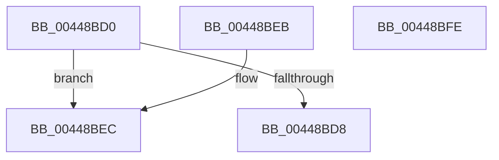

# MiGetAnyMultiplexedVm

- RVA: `0x00448BD0`–`0x00448BFF` (길이 `47` bytes)
- VA: `0x0000000140448BD0`
- 실행 섹션: `.text`
- PDB 이름 있음: `예`; PDB Function 태그: `아니요`
- unwind 정보 RVA: `0x000DB714`
- 디코드: `14`개 명령, `47/47` bytes 표시
- 미해석 바이트: `0` (있으면 어셈블리에 `.byte`로 보존)

> 이 문서는 커널 이미지의 기계어와 PDB 기호를 분석해 생성했습니다. 4번과 5번은 함수 원형과 자료형을 바이너리 사용 방식에서 추정한 C 해석이며 원본 소스 복구 결과는 아닙니다.

## 1. Dependencies

- 직접 호출 지점: **0**; 고유 호출 대상: **0**
- 직접 호출자로 확인된 함수: **55**
- RIP 상대 이미지 참조: **2**

### Outgoing calls
- 직접 디코드된 call 명령이 없습니다.

### Direct callers
- [MiTranslatePageForCopy](../22/MiTranslatePageForCopy_function_00228960.md) at `0x00228DE7`
- [sub_0023F124](../23/Unknown_function_0023F124.md) at `0x0023F4C2`
- [sub_002435CD](../24/Unknown_function_002435CD.md) at `0x002435E8`
- [MiWalkVaRange](../24/MiWalkVaRange_function_00243BF0.md) at `0x002448CE`
- [MiSystemVaTypeToVm](../28/MiSystemVaTypeToVm_function_0028EB50.md) at `0x0028EC11`
- [MiDecommitSystemPageTables](../2C/MiDecommitSystemPageTables_function_002C1054.md) at `0x002C10FD`
- [MiEvictPageTableLock](../2C/MiEvictPageTableLock_function_002C1FBC.md) at `0x002C20D4`
- [sub_002C3069](../2C/Unknown_function_002C3069.md) at `0x002C3084`
- [sub_002F6E32](../2F/Unknown_function_002F6E32.md) at `0x002F7453`
- [MiQueryAddressState](../32/MiQueryAddressState_function_0032C380.md) at `0x0032D40F`
- [MiInsertInSystemSpace](../3B/MiInsertInSystemSpace_function_003B2F5C.md) at `0x003B36B2`
- [MiMakeZeroedPageTablesEx](../3B/MiMakeZeroedPageTablesEx_function_003B59FC.md) at `0x003B5DC6`
- [MiComputeMaximumFaultCluster](../41/MiComputeMaximumFaultCluster_function_00418210.md) at `0x004183D8`
- [MiMapMdlWithLargePages](../4D/MiMapMdlWithLargePages_function_004D10B8.md) at `0x004D11E8`
- [MiDeleteBootRange](../66/MiDeleteBootRange_function_0066E450.md) at `0x0066E4BB`
- [MiPageBootRegistry](../66/MiPageBootRegistry_function_0066E82C.md) at `0x0066E892`
- [MmProtectDriverSection](../67/MmProtectDriverSection_function_00670A80.md) at `0x00670C82`
- [MiReplaceImportEntry](../67/MiReplaceImportEntry_function_00671440.md) at `0x006714F9`
- [MmAddRangeToCrashDump](../67/MmAddRangeToCrashDump_function_0067D8B0.md) at `0x0067D977`
- [MmRemoveSystemCacheFromDump](../67/MmRemoveSystemCacheFromDump_function_0067DD58.md) at `0x0067DDCA`
- [MiExceptionForMappedVa](../67/MiExceptionForMappedVa_function_0067E164.md) at `0x0067E17B`
- [MiTrimAllSystemPagableMemory](../67/MiTrimAllSystemPagableMemory_function_0067EDF0.md) at `0x0067EE25`
- [MiTrimAllSystemPagableMemory](../67/MiTrimAllSystemPagableMemory_function_0067EDF0.md) at `0x0067EE96`
- [MiInitializeDynamicBitmap](../67/MiInitializeDynamicBitmap_function_0067F5BC.md) at `0x0067F6C0`
- [MiLockPatchIatForDV](../68/MiLockPatchIatForDV_function_00682050.md) at `0x006820DF`
- [MiClearDriverTablePtes](../68/MiClearDriverTablePtes_function_00683024.md) at `0x00683079`
- [MmMapDriverTablePage](../68/MmMapDriverTablePage_function_00683EAC.md) at `0x00683EE4`
- [MmWriteSystemImageTracepoint](../68/MmWriteSystemImageTracepoint_function_00684150.md) at `0x006841BA`
- [MiCalibrateTbFlush](../69/MiCalibrateTbFlush_function_006955EC.md) at `0x0069563B`
- [MiUnloadSystemImageSoftWsles](../69/MiUnloadSystemImageSoftWsles_function_00697978.md) at `0x00697984`
- [MiProtectLargeKernelHalRange](../../page/7F/MiProtectLargeKernelHalRange_function_007F8D20.md) at `0x007F8D73`
- [MmMapLockedRestartPages](../../page/7F/MmMapLockedRestartPages_function_007F9020.md) at `0x007F90A4`
- [MmUnmapLockedRestartPages](../../page/7F/MmUnmapLockedRestartPages_function_007F90E0.md) at `0x007F9118`
- [MiLockAndMapEntireDriver](../../page/80/MiLockAndMapEntireDriver_function_008015C8.md) at `0x008015F4`
- [MiApplyDriverHotPatch](../../page/80/MiApplyDriverHotPatch_function_008018EC.md) at `0x00801AB5`
- [MmLogSystemShareablePfnInfo](../../page/80/MmLogSystemShareablePfnInfo_function_008093F4.md) at `0x0080941F`
- [MmLogSystemShareablePfnInfo](../../page/80/MmLogSystemShareablePfnInfo_function_008093F4.md) at `0x00809450`
- [MiUpdateCfgSystemWideBitmapWorker](../../page/8C/MiUpdateCfgSystemWideBitmapWorker_function_008CE650.md) at `0x008CE93C`
- [MiGetCcAccessLog](../../page/93/MiGetCcAccessLog_function_0093E364.md) at `0x0093E43C`
- [MiMapImageInSystemSpace](../../page/94/MiMapImageInSystemSpace_function_00941DD8.md) at `0x00941F51`
- [HvTrimHive](../../page/A4/HvTrimHive_function_00A4F38C.md) at `0x00A4F402`
- [MiMapSystemImage](../../page/AA/MiMapSystemImage_function_00AA3558.md) at `0x00AA35C0`
- [MiConvertHiberPhasePages](../../pagelk/B7/MiConvertHiberPhasePages_function_00B73E24.md) at `0x00B73E5E`
- [MiMarkKernelPageTablePages](../../pagelk/B7/MiMarkKernelPageTablePages_function_00B73F68.md) at `0x00B73FAD`
- [MiMarkNonPagedHiberPhasePages](../../pagelk/B7/MiMarkNonPagedHiberPhasePages_function_00B73FEC.md) at `0x00B74039`
- [MmMarkHiberPhase](../../pagelk/B7/MmMarkHiberPhase_function_00B74578.md) at `0x00B7489C`
- [MiAddLoaderHalIoMappings](../../init/C5/MiAddLoaderHalIoMappings_function_00C5E568.md) at `0x00C5E597`
- [MiInitNucleus](../../init/C5/MiInitNucleus_function_00C5FD38.md) at `0x00C602FB`
- [MiMapDummyPages](../../init/C6/MiMapDummyPages_function_00C60A58.md) at `0x00C60A9A`
- [MiMarkLargePageMappings](../../init/C6/MiMarkLargePageMappings_function_00C60BC8.md) at `0x00C60BE8`
- [MiProtectSharedUserPage](../../init/C6/MiProtectSharedUserPage_function_00C60F44.md) at `0x00C61047`
- [MiCreateInitialSystemWsles](../../init/C6/MiCreateInitialSystemWsles_function_00C642C8.md) at `0x00C642EC`
- [MiBuildPagedPool](../../init/C6/MiBuildPagedPool_function_00C64918.md) at `0x00C64958`
- [MiInitializeNonPagedPool](../../init/C6/MiInitializeNonPagedPool_function_00C64A24.md) at `0x00C64A42`
- [MiBuildSystemDataViews](../../init/C6/MiBuildSystemDataViews_function_00C64DCC.md) at `0x00C64DFE`
- [MmReapplyBootPatchImports](../../init/C6/MmReapplyBootPatchImports_function_00C67768.md) at `0x00C67816`
- [MiInitializeSystemPtes](../../init/C6/MiInitializeSystemPtes_function_00C6A998.md) at `0x00C6A9BD`
- [MiInitializeSystemPtes](../../init/C6/MiInitializeSystemPtes_function_00C6A998.md) at `0x00C6AA0F`

### Static image references
- `0x00448BE0` → RVA `0x00E37D00` (`.data`; read)
- `0x00448BF3` → RVA `0x00E3D680` (`.data`; read)

## 2. Other-region calls and transfers

- 다른 실행 섹션으로 향하는 call: **0**
- 별도 외부 분기/꼬리 이동을 확인하지 못했습니다.

## 3. Assembly (complete function range)

```asm
00448BD0  48 63 C1                        movsxd rax, ecx
00448BD3  83 F9 01                        cmp ecx, 1
00448BD6  7C 14                           jl 0x140448bec
00448BD8  48 8D 04 80                     lea rax, [rax + rax*4]
00448BDC  48 C1 E0 06                     shl rax, 6
00448BE0  48 8D 0D 19 F1 9E 00            lea rcx, [rip + 0x9ef119]
00448BE7  48 03 C1                        add rax, rcx
00448BEA  C3                              ret
00448BEB  CC                              int3
00448BEC  48 69 C0 C0 01 00 00            imul rax, rax, 0x1c0
00448BF3  48 8D 0D 86 4A 9F 00            lea rcx, [rip + 0x9f4a86]
00448BFA  48 03 C1                        add rax, rcx
00448BFD  C3                              ret
00448BFE  CC                              int3
```

## 4. C-style interpretation (structured pseudocode)

```c
__int64 __fastcall MiGetAnyMultiplexedVm(int a1)
{
    __int64 result;

    if (a1 < 1) goto loc_00448BEC;
    result = ((int)(a1) + (int)(a1) * 4) << (6);
    result = (result) + (v_rip + 10416409);
    return result;
loc_00448BEC:
    result = (result) * (result);
    result = (result) + (v_rip + 10439302);
    return result;
}
```

## 5. (Beta) C Style

```c
int64_t MiGetAnyMultiplexedVm(void *Arg1)
{
    uint8_t *arg1 = (uint8_t *)Arg1;

    int64_t result;

    if (Arg1 < 1) goto loc_00448BEC;
    result = ((int32_t)(Arg1) + (int32_t)(Arg1) * 4) << (6);
    result = (result) + (v_rip + 10416409);
    return result;
loc_00448BEC:
    result = (result) * (result);
    result = (result) + (v_rip + 10439302);
    return result;
}
```

### 관측된 메모리 오프셋

구조체 형식이 확인되지 않은 접근은 인자 기준의 오프셋으로만 기록했습니다.

| 기준 인자 | 오프셋 표현 | 폭 (bit) | 접근 |
|---|---:|---:|---|
| `Arg1` | `+ 0x0 + rax*4` | `64` | `R` |

## 6. Execution-region graph

[열기: 2D/3D 그래프와 함수 탐색 컨트롤 패널](../../../control-panel.html?section=text&rva=0x00448BD0&view=graph)

- 2D 그래프는 위에서 아래로 흐르고, 3D 그래프는 빈 공간을 드래그해 회전합니다. Shift+드래그는 이동, 휠은 확대·축소, 함수 노드 선택은 대상 보고서 이동입니다.

### Static fallback


