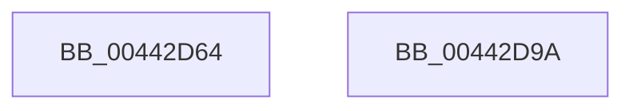

# MiGetNextPageColor

- RVA: `0x00442D64`–`0x00442D9B` (길이 `55` bytes)
- VA: `0x0000000140442D64`
- 실행 섹션: `.text`
- PDB 이름 있음: `예`; PDB Function 태그: `아니요`
- unwind 정보 RVA: `0x000DB714`
- 디코드: `16`개 명령, `55/55` bytes 표시
- 미해석 바이트: `0` (있으면 어셈블리에 `.byte`로 보존)

> 이 문서는 커널 이미지의 기계어와 PDB 기호를 분석해 생성했습니다. 4번과 5번은 함수 원형과 자료형을 바이너리 사용 방식에서 추정한 C 해석이며 원본 소스 복구 결과는 아닙니다.

## 1. Dependencies

- 직접 호출 지점: **0**; 고유 호출 대상: **0**
- 직접 호출자로 확인된 함수: **8**
- RIP 상대 이미지 참조: **1**

### Outgoing calls
- 직접 디코드된 call 명령이 없습니다.

### Direct callers
- [MmAllocateMemoryRanges](../../page/7F/MmAllocateMemoryRanges_function_007FC0C0.md) at `0x007FC1CA`
- [MiAllocatePartitionPhysicalPages](../../page/80/MiAllocatePartitionPhysicalPages_function_0080C9D4.md) at `0x0080CC01`
- [MiPfPrepareReadList](../../page/93/MiPfPrepareReadList_function_0093CD5C.md) at `0x0093D1D7`
- [MiAllocateTopLevelPage](../../page/A5/MiAllocateTopLevelPage_function_00A5F2EC.md) at `0x00A5F339`
- [MiDoneWithThisPageGetAnother](../../page/A7/MiDoneWithThisPageGetAnother_function_00A7DDDC.md) at `0x00A7DE22`
- [MiAllocateDriverPage](../../page/A8/MiAllocateDriverPage_function_00A80128.md) at `0x00A8016B`
- [MmAllocateIndependentPagesEx](../../page/AA/MmAllocateIndependentPagesEx_function_00AA0CFC.md) at `0x00AA0E1B`
- [sub_00B25214](../../page/B2/Unknown_function_00B25214.md) at `0x00B25242`

### Static image references
- `0x00442D78` → RVA `0x00E2DCC0` (`.data`; read)

## 2. Other-region calls and transfers

- 다른 실행 섹션으로 향하는 call: **0**
- 별도 외부 분기/꼬리 이동을 확인하지 못했습니다.

## 3. Assembly (complete function range)

```asm
00442D64  44 8B 41 08                     mov r8d, dword ptr [rcx + 8]
00442D68  41 B9 01 00 00 00               mov r9d, 1
00442D6E  48 8B 01                        mov rax, qword ptr [rcx]
00442D71  F0 44 0F C1 08                  lock xadd dword ptr [rax], r9d
00442D76  33 D2                           xor edx, edx
00442D78  4C 8D 15 41 AF 9E 00            lea r10, [rip + 0x9eaf41]
00442D7F  41 8B C8                        mov ecx, r8d
00442D82  41 8B C1                        mov eax, r9d
00442D85  48 C1 E9 10                     shr rcx, 0x10
00442D89  83 E1 03                        and ecx, 3
00442D8C  41 F7 34 8A                     div dword ptr [r10 + rcx*4]
00442D90  41 33 D0                        xor edx, r8d
00442D93  0F B6 C2                        movzx eax, dl
00442D96  41 33 C0                        xor eax, r8d
00442D99  C3                              ret
00442D9A  CC                              int3
```

## 4. C-style interpretation (structured pseudocode)

```c
__int64 __fastcall MiGetNextPageColor(__int64 a1, int a2)
{
    __int64 result;

    a2 = 0;
    a1 = ((unsigned int)((unsigned int)((unsigned int)(*(unsigned int *)(a1 + 8))))) >> (16);
    a1 = (unsigned int)((a1) & (3));
    a2 = (unsigned int)((a2) ^ ((unsigned int)((unsigned int)(*(unsigned int *)(a1 + 8)))));
    result = (unsigned int)(((unsigned __int8)(a2)) ^ ((unsigned int)((unsigned int)(*(unsigned int *)(a1 + 8)))));
    return result;
}
```

## 5. (Beta) C Style

```c
int64_t MiGetNextPageColor(void *Arg1, int32_t Arg2)
{
    uint8_t *arg1 = (uint8_t *)Arg1;

    int64_t result;

    Arg2 = 0;
    Arg1 = ((uint32_t)((uint32_t)((uint32_t)(*(uint32_t *)(arg1 + 0x8))))) >> (16);
    Arg1 = (uint32_t)((Arg1) & (3));
    Arg2 = (uint32_t)((Arg2) ^ ((uint32_t)((uint32_t)(*(uint32_t *)(arg1 + 0x8)))));
    result = (uint32_t)(((uint8_t)(Arg2)) ^ ((uint32_t)((uint32_t)(*(uint32_t *)(arg1 + 0x8)))));
    return result;
}
```

### 관측된 메모리 오프셋

구조체 형식이 확인되지 않은 접근은 인자 기준의 오프셋으로만 기록했습니다.

| 기준 인자 | 오프셋 표현 | 폭 (bit) | 접근 |
|---|---:|---:|---|
| `Arg1` | `+ 0x0` | `64` | `R` |
| `Arg1` | `+ 0x8` | `32` | `R` |

## 6. Execution-region graph

[열기: 2D/3D 그래프와 함수 탐색 컨트롤 패널](../../../control-panel.html?section=text&rva=0x00442D64&view=graph)

- 2D 그래프는 위에서 아래로 흐르고, 3D 그래프는 빈 공간을 드래그해 회전합니다. Shift+드래그는 이동, 휠은 확대·축소, 함수 노드 선택은 대상 보고서 이동입니다.

### Static fallback


