# MiGetPfnKernelStack

- RVA: `0x0044EFB8`–`0x0044F02A` (길이 `114` bytes)
- VA: `0x000000014044EFB8`
- 실행 섹션: `.text`
- PDB 이름 있음: `예`; PDB Function 태그: `아니요`
- unwind 정보 RVA: `0x000DB714`
- 디코드: `35`개 명령, `114/114` bytes 표시
- 미해석 바이트: `0` (있으면 어셈블리에 `.byte`로 보존)

> 이 문서는 커널 이미지의 기계어와 PDB 기호를 분석해 생성했습니다. 4번과 5번은 함수 원형과 자료형을 바이너리 사용 방식에서 추정한 C 해석이며 원본 소스 복구 결과는 아닙니다.

## 1. Dependencies

- 직접 호출 지점: **0**; 고유 호출 대상: **0**
- 직접 호출자로 확인된 함수: **3**
- RIP 상대 이미지 참조: **0**

### Outgoing calls
- 직접 디코드된 call 명령이 없습니다.

### Direct callers
- [MiCanStealKernelStack](../29/MiCanStealKernelStack_function_0029FD2C.md) at `0x0029FDC4`
- [MiSwapStackPage](../29/MiSwapStackPage_function_0029FDE0.md) at `0x002A01E6`
- [sub_006F60F8](../6F/Unknown_function_006F60F8.md) at `0x006F61A6`
- [sub_006F60F8](../6F/Unknown_function_006F60F8.md) at `0x006F61B8`

### Static image references
- 디코드된 RIP-relative 메모리 참조가 없습니다.

## 2. Other-region calls and transfers

- 다른 실행 섹션으로 향하는 call: **0**
- 별도 외부 분기/꼬리 이동을 확인하지 못했습니다.

## 3. Assembly (complete function range)

```asm
0044EFB8  45 33 C0                        xor r8d, r8d
0044EFBB  85 D2                           test edx, edx
0044EFBD  74 34                           je 0x14044eff3
0044EFBF  48 8B 41 28                     mov rax, qword ptr [rcx + 0x28]
0044EFC3  48 C1 E8 3C                     shr rax, 0x3c
0044EFC7  24 07                           and al, 7
0044EFC9  3C 02                           cmp al, 2
0044EFCB  75 57                           jne 0x14044f024
0044EFCD  48 8B 41 28                     mov rax, qword ptr [rcx + 0x28]
0044EFD1  48 85 C0                        test rax, rax
0044EFD4  78 1D                           js 0x14044eff3
0044EFD6  48 8B 41 28                     mov rax, qword ptr [rcx + 0x28]
0044EFDA  48 0F BA E0 28                  bt rax, 0x28
0044EFDF  72 12                           jb 0x14044eff3
0044EFE1  48 8B 41 28                     mov rax, qword ptr [rcx + 0x28]
0044EFE5  48 C1 E8 3C                     shr rax, 0x3c
0044EFE9  24 07                           and al, 7
0044EFEB  3C 01                           cmp al, 1
0044EFED  74 04                           je 0x14044eff3
0044EFEF  48 8B 41 08                     mov rax, qword ptr [rcx + 8]
0044EFF3  48 8B 01                        mov rax, qword ptr [rcx]
0044EFF6  48 B9 FE FF FF FF FF 0F 00 00   movabs rcx, 0xffffffffffe
0044F000  48 85 C1                        test rcx, rax
0044F003  75 05                           jne 0x14044f00a
0044F005  49 8B C0                        mov rax, r8
0044F008  C3                              ret
0044F009  CC                              int3
0044F00A  4C 8B C0                        mov r8, rax
0044F00D  48 B8 00 00 00 00 00 F0 FF FF   movabs rax, 0xfffff00000000000
0044F017  49 83 E0 FE                     and r8, 0xfffffffffffffffe
0044F01B  4C 0B C0                        or r8, rax
0044F01E  49 C1 E0 03                     shl r8, 3
0044F022  EB E1                           jmp 0x14044f005
0044F024  48 8B 41 08                     mov rax, qword ptr [rcx + 8]
0044F028  EB A3                           jmp 0x14044efcd
```

## 4. C-style interpretation (structured pseudocode)

```c
__int64 __fastcall MiGetPfnKernelStack(__int64 a1, int a2, int a3)
{
    __int64 result;

    a3 = 0;
    if (a2 == 0) goto loc_0044EFF3;
    result = (*(unsigned __int64 *)(a1 + 40)) >> (60);
    result = (unsigned __int8)((result) & (7));
    if (((unsigned __int8)(result)) != 2) goto loc_0044F024;
loc_0044EFCD:
    if (sign_flag) goto loc_0044EFF3;
    if (condition_is_below) goto loc_0044EFF3;
    result = (*(unsigned __int64 *)(a1 + 40)) >> (60);
    result = (unsigned __int8)((result) & (7));
    if (((unsigned __int8)(result)) != 1) {
        result = *(unsigned __int64 *)(a1 + 8);
    }
    if (((a1) & (*(unsigned __int64 *)(a1))) != 0) goto loc_0044F00A;
loc_0044F005:
    return 0;
loc_0044F00A:
    a3 = (0) & (-2);
    a3 = (a3) | (0);
    a3 = (a3) << (3);
    goto loc_0044F005;
loc_0044F024:
    goto loc_0044EFCD;
}
```

## 5. (Beta) C Style

```c
int64_t MiGetPfnKernelStack(void *Arg1, int32_t Arg2, int32_t Arg3)
{
    uint8_t *arg1 = (uint8_t *)Arg1;

    int64_t result;

    Arg3 = 0;
    if (Arg2 == 0) goto loc_0044EFF3;
    result = (*(uint64_t *)(arg1 + 0x28)) >> (60);
    result = (uint8_t)((result) & (7));
    if (((uint8_t)(result)) != 2) goto loc_0044F024;
loc_0044EFCD:
    if (sign_flag) goto loc_0044EFF3;
    if (condition_is_below) goto loc_0044EFF3;
    result = (*(uint64_t *)(arg1 + 0x28)) >> (60);
    result = (uint8_t)((result) & (7));
    if (((uint8_t)(result)) != 1) {
        result = *(uint64_t *)(arg1 + 0x8);
    }
    if (((Arg1) & (*(uint64_t *)(arg1))) != 0) goto loc_0044F00A;
loc_0044F005:
    return 0;
loc_0044F00A:
    Arg3 = (0) & (-2);
    Arg3 = (Arg3) | (0);
    Arg3 = (Arg3) << (3);
    goto loc_0044F005;
loc_0044F024:
    goto loc_0044EFCD;
}
```

### 관측된 메모리 오프셋

구조체 형식이 확인되지 않은 접근은 인자 기준의 오프셋으로만 기록했습니다.

| 기준 인자 | 오프셋 표현 | 폭 (bit) | 접근 |
|---|---:|---:|---|
| `Arg1` | `+ 0x0` | `64` | `R` |
| `Arg1` | `+ 0x8` | `64` | `R` |
| `Arg1` | `+ 0x28` | `64` | `R` |

## 6. Execution-region graph

[열기: 2D/3D 그래프와 함수 탐색 컨트롤 패널](../../../control-panel.html?section=text&rva=0x0044EFB8&view=graph)

- 2D 그래프는 위에서 아래로 흐르고, 3D 그래프는 빈 공간을 드래그해 회전합니다. Shift+드래그는 이동, 휠은 확대·축소, 함수 노드 선택은 대상 보고서 이동입니다.

### Static fallback

```mermaid
flowchart TD
  bb_0044EFB8[BB_0044EFB8]
  bb_0044EFBF[BB_0044EFBF]
  bb_0044EFCD[BB_0044EFCD]
  bb_0044EFD6[BB_0044EFD6]
  bb_0044EFE1[BB_0044EFE1]
  bb_0044EFEF[BB_0044EFEF]
  bb_0044EFF3[BB_0044EFF3]
  bb_0044F005[BB_0044F005]
  bb_0044F009[BB_0044F009]
  bb_0044F00A[BB_0044F00A]
  bb_0044F024[BB_0044F024]
  bb_0044EFB8 -->|branch| bb_0044EFF3
  bb_0044EFB8 -->|fallthrough| bb_0044EFBF
  bb_0044EFBF -->|branch| bb_0044F024
  bb_0044EFBF -->|fallthrough| bb_0044EFCD
  bb_0044EFCD -->|branch| bb_0044EFF3
  bb_0044EFCD -->|fallthrough| bb_0044EFD6
  bb_0044EFD6 -->|branch| bb_0044EFF3
  bb_0044EFD6 -->|fallthrough| bb_0044EFE1
  bb_0044EFE1 -->|branch| bb_0044EFF3
  bb_0044EFE1 -->|fallthrough| bb_0044EFEF
  bb_0044EFEF -->|flow| bb_0044EFF3
  bb_0044EFF3 -->|branch| bb_0044F00A
  bb_0044EFF3 -->|fallthrough| bb_0044F005
  bb_0044F009 -->|flow| bb_0044F00A
  bb_0044F00A -->|branch| bb_0044F005
  bb_0044F024 -->|branch| bb_0044EFCD
```


