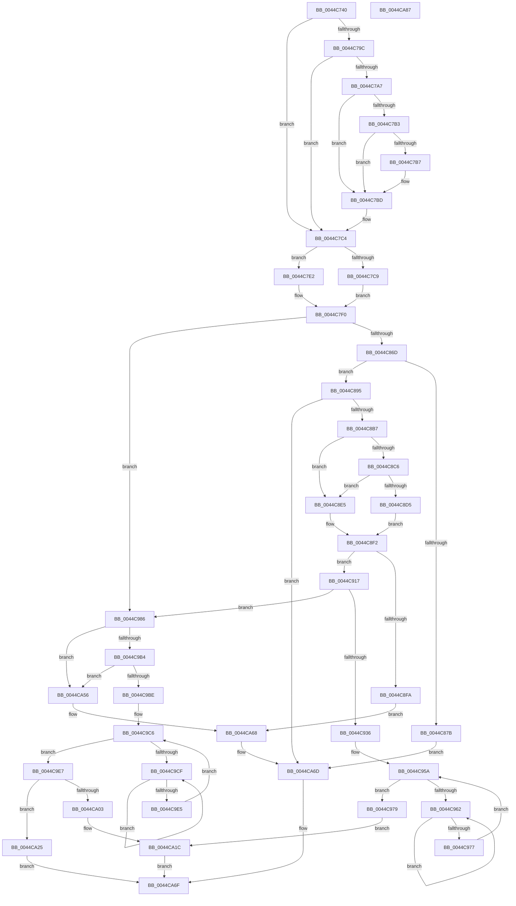

# MiHandleSpecialPurposeMemoryCachedFault

- RVA: `0x0044C740`–`0x0044CA88` (길이 `840` bytes)
- VA: `0x000000014044C740`
- 실행 섹션: `.text`
- PDB 이름 있음: `예`; PDB Function 태그: `아니요`
- unwind 정보 RVA: `0x000A6880`
- 디코드: `220`개 명령, `840/840` bytes 표시
- 미해석 바이트: `0` (있으면 어셈블리에 `.byte`로 보존)

> 이 문서는 커널 이미지의 기계어와 PDB 기호를 분석해 생성했습니다. 4번과 5번은 함수 원형과 자료형을 바이너리 사용 방식에서 추정한 C 해석이며 원본 소스 복구 결과는 아닙니다.

## 1. Dependencies

- 직접 호출 지점: **22**; 고유 호출 대상: **16**
- 직접 호출자로 확인된 함수: **3**
- RIP 상대 이미지 참조: **4**

### Outgoing calls
- `0x0044C7D4` → [MiComputeFaultNode](../2B/MiComputeFaultNode_function_002B60C0.md) (function, `0x002B60C0`)
- `0x0044C7FE` → [MiInitializePageColorBase](../32/MiInitializePageColorBase_function_00320410.md) (function, `0x00320410`)
- `0x0044C838` → [MiGetSystemRegionType](../28/MiGetSystemRegionType_function_0028EC80.md) (function, `0x0028EC80`)
- `0x0044C851` → [MiGetPage](../28/MiGetPage_function_002884C0.md) (function, `0x002884C0`)
- `0x0044C872` → [MiPageAvailable](../2A/MiPageAvailable_function_002A3138.md) (function, `0x002A3138`)
- `0x0044C87E` → [MiReuseStandbyPage](MiReuseStandbyPage_function_0044CA90.md) (function, `0x0044CA90`)
- `0x0044C886` → [MiReleaseFreshPageLocked](MiReleaseFreshPageLocked_function_0044CDD8.md) (function, `0x0044CDD8`)
- `0x0044C8A5` → [MiGetPage](../28/MiGetPage_function_002884C0.md) (function, `0x002884C0`)
- `0x0044C8DE` → [MiLockTransitionLeafPageEx](../40/MiLockTransitionLeafPageEx_function_00405884.md) (function, `0x00405884`)
- `0x0044C8ED` → [MiLockLeafPage](../36/MiLockLeafPage_function_003658C0.md) (function, `0x003658C0`)
- `0x0044C96A` → [KeYieldProcessorEx](../3F/KeYieldProcessorEx_function_003FBD00.md) (function, `0x003FBD00`)
- `0x0044C97C` → [MiReleaseFreshPageLocked](MiReleaseFreshPageLocked_function_0044CDD8.md) (function, `0x0044CDD8`)
- `0x0044C9A6` → [MiUnlinkPageFromListEx](../28/MiUnlinkPageFromListEx_function_00287590.md) (function, `0x00287590`)
- `0x0044C9D7` → [KeYieldProcessorEx](../3F/KeYieldProcessorEx_function_003FBD00.md) (function, `0x003FBD00`)
- `0x0044C9FA` → [MiReplaceTransitionPage](../2B/MiReplaceTransitionPage_function_002B1120.md) (function, `0x002B1120`)
- `0x0044CA06` → [MiReleaseFreshPageLocked](MiReleaseFreshPageLocked_function_0044CDD8.md) (function, `0x0044CDD8`)
- `0x0044CA15` → [MiDiscardTransitionPteEx](../37/MiDiscardTransitionPteEx_function_00375954.md) (function, `0x00375954`)
- `0x0044CA33` → [MiSetOriginalPtePfnFromFreeList](../28/MiSetOriginalPtePfnFromFreeList_function_0028A99C.md) (function, `0x0028A99C`)
- `0x0044CA3B` → [MiReleaseFreshPageLocked](MiReleaseFreshPageLocked_function_0044CDD8.md) (function, `0x0044CDD8`)
- `0x0044CA4C` → [MiInsertPageInList](../2B/MiInsertPageInList_function_002BA000.md) (function, `0x002BA000`)
- `0x0044CA5B` → [MiDiscardTransitionPteEx](../37/MiDiscardTransitionPteEx_function_00375954.md) (function, `0x00375954`)
- `0x0044CA68` → [MiReleaseFreshPageAtDpc](../33/MiReleaseFreshPageAtDpc_function_00334B50.md) (function, `0x00334B50`)

### Direct callers
- [MiResolveTransitionFault](../28/MiResolveTransitionFault_function_00282940.md) at `0x00283797`
- [sub_002F6E32](../2F/Unknown_function_002F6E32.md) at `0x002F7714`
- [MmCopyToCachedPage](../34/MmCopyToCachedPage_function_00347B44.md) at `0x003480F8`

### Static image references
- `0x0044C770` → RVA `0x00E30088` (`.data`; read)
- `0x0044C7A7` → RVA `0x00E2DC80` (`.data`; read)
- `0x0044C815` → RVA `0x00E2DCC0` (`.data`; read)
- `0x0044CA25` → RVA `0x00010880` (`.rdata`; read)

## 2. Other-region calls and transfers

- 다른 실행 섹션으로 향하는 call: **0**
- 별도 외부 분기/꼬리 이동을 확인하지 못했습니다.

## 3. Assembly (complete function range)

```asm
0044C740  48 89 5C 24 10                  mov qword ptr [rsp + 0x10], rbx
0044C745  55                              push rbp
0044C746  56                              push rsi
0044C747  57                              push rdi
0044C748  41 54                           push r12
0044C74A  41 55                           push r13
0044C74C  41 56                           push r14
0044C74E  41 57                           push r15
0044C750  48 83 EC 40                     sub rsp, 0x40
0044C754  48 83 64 24 20 00               and qword ptr [rsp + 0x20], 0
0044C75A  49 8B F1                        mov rsi, r9
0044C75D  48 8B D9                        mov rbx, rcx
0044C760  48 8B EA                        mov rbp, rdx
0044C763  45 33 C9                        xor r9d, r9d
0044C766  0F 57 C0                        xorps xmm0, xmm0
0044C769  4D 8B E0                        mov r12, r8
0044C76C  48 8B 46 28                     mov rax, qword ptr [rsi + 0x28]
0044C770  48 8B 0D 11 39 9E 00            mov rcx, qword ptr [rip + 0x9e3911]
0044C777  48 C1 E8 2B                     shr rax, 0x2b
0044C77B  25 FF 03 00 00                  and eax, 0x3ff
0044C780  0F 11 44 24 28                  movups xmmword ptr [rsp + 0x28], xmm0
0044C785  48 8B 14 C1                     mov rdx, qword ptr [rcx + rax*8]
0044C789  48 8B 82 D8 44 00 00            mov rax, qword ptr [rdx + 0x44d8]
0044C790  4C 8B 28                        mov r13, qword ptr [rax]
0044C793  48 8B 46 28                     mov rax, qword ptr [rsi + 0x28]
0044C797  48 85 C0                        test rax, rax
0044C79A  79 28                           jns 0x14044c7c4
0044C79C  48 8B 46 10                     mov rax, qword ptr [rsi + 0x10]
0044C7A0  48 0F BA E0 0A                  bt rax, 0xa
0044C7A5  73 1D                           jae 0x14044c7c4
0044C7A7  48 8B 0D D2 14 9E 00            mov rcx, qword ptr [rip + 0x9e14d2]
0044C7AE  48 85 C9                        test rcx, rcx
0044C7B1  74 0A                           je 0x14044c7bd
0044C7B3  A8 10                           test al, 0x10
0044C7B5  75 06                           jne 0x14044c7bd
0044C7B7  48 F7 D1                        not rcx
0044C7BA  48 23 C1                        and rax, rcx
0044C7BD  48 C1 F8 10                     sar rax, 0x10
0044C7C1  4C 8B 08                        mov r9, qword ptr [rax]
0044C7C4  48 85 DB                        test rbx, rbx
0044C7C7  74 19                           je 0x14044c7e2
0044C7C9  4C 8D 44 24 20                  lea r8, [rsp + 0x20]
0044C7CE  49 8B D1                        mov rdx, r9
0044C7D1  48 8B CB                        mov rcx, rbx
0044C7D4  E8 E7 98 E6 FF                  call 0x1402b60c0
0044C7D9  48 8B 4B 38                     mov rcx, qword ptr [rbx + 0x38]
0044C7DD  44 8B C0                        mov r8d, eax
0044C7E0  EB 0E                           jmp 0x14044c7f0
0044C7E2  45 8B 41 38                     mov r8d, dword ptr [r9 + 0x38]
0044C7E6  41 C1 E8 14                     shr r8d, 0x14
0044C7EA  41 83 E0 7F                     and r8d, 0x7f
0044C7EE  33 C9                           xor ecx, ecx
0044C7F0  41 BF 03 00 00 00               mov r15d, 3
0044C7F6  4C 8D 4C 24 28                  lea r9, [rsp + 0x28]
0044C7FB  41 8B D7                        mov edx, r15d
0044C7FE  E8 0D 3C ED FF                  call 0x140320410
0044C803  48 8B 4C 24 28                  mov rcx, qword ptr [rsp + 0x28]
0044C808  41 8D 47 FE                     lea eax, [r15 - 2]
0044C80C  F0 0F C1 01                     lock xadd dword ptr [rcx], eax
0044C810  4C 8B 44 24 30                  mov r8, qword ptr [rsp + 0x30]
0044C815  4C 8D 0D A4 14 9E 00            lea r9, [rip + 0x9e14a4]
0044C81C  33 D2                           xor edx, edx
0044C81E  49 8B C8                        mov rcx, r8
0044C821  48 C1 E9 10                     shr rcx, 0x10
0044C825  49 23 CF                        and rcx, r15
0044C828  41 F7 34 89                     div dword ptr [r9 + rcx*4]
0044C82C  48 8B CD                        mov rcx, rbp
0044C82F  41 33 D0                        xor edx, r8d
0044C832  0F B6 FA                        movzx edi, dl
0044C835  41 33 F8                        xor edi, r8d
0044C838  E8 43 24 E4 FF                  call 0x14028ec80
0044C83D  83 F8 0B                        cmp eax, 0xb
0044C840  BB 83 00 00 00                  mov ebx, 0x83
0044C845  8B D7                           mov edx, edi
0044C847  49 8B CD                        mov rcx, r13
0044C84A  41 0F 45 DF                     cmovne ebx, r15d
0044C84E  44 8B C3                        mov r8d, ebx
0044C851  E8 6A BC E3 FF                  call 0x1402884c0
0044C856  4C 8B F0                        mov r14, rax
0044C859  48 BD FF FF FF FF FF FF FF 7F   movabs rbp, 0x7fffffffffffffff
0044C863  48 83 F8 FF                     cmp rax, -1
0044C867  0F 85 19 01 00 00               jne 0x14044c986
0044C86D  8B D3                           mov edx, ebx
0044C86F  49 8B CD                        mov rcx, r13
0044C872  E8 C1 68 E5 FF                  call 0x1402a3138
0044C877  85 C0                           test eax, eax
0044C879  75 1A                           jne 0x14044c895
0044C87B  48 8B CE                        mov rcx, rsi
0044C87E  E8 0D 02 00 00                  call 0x14044ca90
0044C883  48 8B CE                        mov rcx, rsi
0044C886  E8 4D 05 00 00                  call 0x14044cdd8
0044C88B  F0 48 21 6E 18                  lock and qword ptr [rsi + 0x18], rbp
0044C890  E9 D8 01 00 00                  jmp 0x14044ca6d
0044C895  F0 48 21 6E 18                  lock and qword ptr [rsi + 0x18], rbp
0044C89A  83 E3 FD                        and ebx, 0xfffffffd
0044C89D  8B D7                           mov edx, edi
0044C89F  44 8B C3                        mov r8d, ebx
0044C8A2  49 8B CD                        mov rcx, r13
0044C8A5  E8 16 BC E3 FF                  call 0x1402884c0
0044C8AA  4C 8B F0                        mov r14, rax
0044C8AD  48 83 F8 FF                     cmp rax, -1
0044C8B1  0F 84 B6 01 00 00               je 0x14044ca6d
0044C8B7  48 B8 00 00 00 00 80 F6 FF FF   movabs rax, 0xfffff68000000000
0044C8C1  4C 3B E0                        cmp r12, rax
0044C8C4  72 1F                           jb 0x14044c8e5
0044C8C6  48 B8 FF FF FF FF FF F6 FF FF   movabs rax, 0xfffff6ffffffffff
0044C8D0  4C 3B E0                        cmp r12, rax
0044C8D3  77 10                           ja 0x14044c8e5
0044C8D5  33 D2                           xor edx, edx
0044C8D7  49 8B CC                        mov rcx, r12
0044C8DA  44 8D 42 01                     lea r8d, [rdx + 1]
0044C8DE  E8 A1 8F FB FF                  call 0x140405884
0044C8E3  EB 0D                           jmp 0x14044c8f2
0044C8E5  BA 02 00 00 00                  mov edx, 2
0044C8EA  49 8B CC                        mov rcx, r12
0044C8ED  E8 CE 8F F1 FF                  call 0x1403658c0
0044C8F2  48 8B F0                        mov rsi, rax
0044C8F5  48 85 C0                        test rax, rax
0044C8F8  75 1D                           jne 0x14044c917
0044C8FA  4B 8D 0C 76                     lea rcx, [r14 + r14*2]
0044C8FE  48 B8 00 00 00 00 00 DE FF FF   movabs rax, 0xffffde0000000000
0044C908  48 C1 E1 04                     shl rcx, 4
0044C90C  48 8B C0                        mov rax, rax
0044C90F  48 03 C8                        add rcx, rax
0044C912  E9 51 01 00 00                  jmp 0x14044ca68
0044C917  48 8B 46 28                     mov rax, qword ptr [rsi + 0x28]
0044C91B  48 8B 0D 66 37 9E 00            mov rcx, qword ptr [rip + 0x9e3766]
0044C922  48 C1 E8 2B                     shr rax, 0x2b
0044C926  25 FF 03 00 00                  and eax, 0x3ff
0044C92B  48 8B 04 C1                     mov rax, qword ptr [rcx + rax*8]
0044C92F  8B 40 04                        mov eax, dword ptr [rax + 4]
0044C932  84 C0                           test al, al
0044C934  78 50                           js 0x14044c986
0044C936  4B 8D 1C 76                     lea rbx, [r14 + r14*2]
0044C93A  48 B8 00 00 00 00 00 DE FF FF   movabs rax, 0xffffde0000000000
0044C944  48 C1 E3 04                     shl rbx, 4
0044C948  48 8B C0                        mov rax, rax
0044C94B  48 03 D8                        add rbx, rax
0044C94E  83 A4 24 80 00 00 00 00         and dword ptr [rsp + 0x80], 0
0044C956  48 8D 7B 18                     lea rdi, [rbx + 0x18]
0044C95A  F0 48 0F BA 2F 3F               lock bts qword ptr [rdi], 0x3f
0044C960  73 17                           jae 0x14044c979
0044C962  48 8D 8C 24 80 00 00 00         lea rcx, [rsp + 0x80]
0044C96A  E8 91 F3 FA FF                  call 0x1403fbd00
0044C96F  48 8B 07                        mov rax, qword ptr [rdi]
0044C972  48 85 C0                        test rax, rax
0044C975  78 EB                           js 0x14044c962
0044C977  EB E1                           jmp 0x14044c95a
0044C979  48 8B CB                        mov rcx, rbx
0044C97C  E8 57 04 00 00                  call 0x14044cdd8
0044C981  E9 96 00 00 00                  jmp 0x14044ca1c
0044C986  4B 8D 1C 76                     lea rbx, [r14 + r14*2]
0044C98A  48 B8 00 00 00 00 00 DE FF FF   movabs rax, 0xffffde0000000000
0044C994  48 C1 E3 04                     shl rbx, 4
0044C998  48 8B C0                        mov rax, rax
0044C99B  BA 04 00 00 00                  mov edx, 4
0044C9A0  48 8B CE                        mov rcx, rsi
0044C9A3  48 03 D8                        add rbx, rax
0044C9A6  E8 E5 AB E3 FF                  call 0x140287590
0044C9AB  41 84 C7                        test r15b, al
0044C9AE  0F 85 A2 00 00 00               jne 0x14044ca56
0044C9B4  80 7E 23 00                     cmp byte ptr [rsi + 0x23], 0
0044C9B8  0F 8C 98 00 00 00               jl 0x14044ca56
0044C9BE  83 A4 24 98 00 00 00 00         and dword ptr [rsp + 0x98], 0
0044C9C6  F0 48 0F BA 6B 18 3F            lock bts qword ptr [rbx + 0x18], 0x3f
0044C9CD  73 18                           jae 0x14044c9e7
0044C9CF  48 8D 8C 24 98 00 00 00         lea rcx, [rsp + 0x98]
0044C9D7  E8 24 F3 FA FF                  call 0x1403fbd00
0044C9DC  48 8B 43 18                     mov rax, qword ptr [rbx + 0x18]
0044C9E0  48 85 C0                        test rax, rax
0044C9E3  78 EA                           js 0x14044c9cf
0044C9E5  EB DF                           jmp 0x14044c9c6
0044C9E7  45 8B CF                        mov r9d, r15d
0044C9EA  48 8D 7E 18                     lea rdi, [rsi + 0x18]
0044C9EE  41 B8 09 00 00 00               mov r8d, 9
0044C9F4  48 8B D3                        mov rdx, rbx
0044C9F7  48 8B CE                        mov rcx, rsi
0044C9FA  E8 21 47 E6 FF                  call 0x1402b1120
0044C9FF  85 C0                           test eax, eax
0044CA01  75 22                           jne 0x14044ca25
0044CA03  48 8B CB                        mov rcx, rbx
0044CA06  E8 CD 03 00 00                  call 0x14044cdd8
0044CA0B  F0 48 21 6B 18                  lock and qword ptr [rbx + 0x18], rbp
0044CA10  33 D2                           xor edx, edx
0044CA12  48 8B CE                        mov rcx, rsi
0044CA15  E8 3A 8F F2 FF                  call 0x140375954
0044CA1A  33 F6                           xor esi, esi
0044CA1C  F0 48 21 2F                     lock and qword ptr [rdi], rbp
0044CA20  48 8B C6                        mov rax, rsi
0044CA23  EB 4A                           jmp 0x14044ca6f
0044CA25  48 8B 05 54 3E BC FF            mov rax, qword ptr [rip - 0x43c1ac]
0044CA2C  48 8D 4E 10                     lea rcx, [rsi + 0x10]
0044CA30  48 89 01                        mov qword ptr [rcx], rax
0044CA33  E8 64 DF E3 FF                  call 0x14028a99c
0044CA38  48 8B CE                        mov rcx, rsi
0044CA3B  E8 98 03 00 00                  call 0x14044cdd8
0044CA40  F0 48 21 2F                     lock and qword ptr [rdi], rbp
0044CA44  BA 04 00 00 00                  mov edx, 4
0044CA49  48 8B CB                        mov rcx, rbx
0044CA4C  E8 AF D5 E6 FF                  call 0x1402ba000
0044CA51  48 8B C3                        mov rax, rbx
0044CA54  EB 19                           jmp 0x14044ca6f
0044CA56  33 D2                           xor edx, edx
0044CA58  48 8B CE                        mov rcx, rsi
0044CA5B  E8 F4 8E F2 FF                  call 0x140375954
0044CA60  F0 48 21 6E 18                  lock and qword ptr [rsi + 0x18], rbp
0044CA65  48 8B CB                        mov rcx, rbx
0044CA68  E8 E3 80 EE FF                  call 0x140334b50
0044CA6D  33 C0                           xor eax, eax
0044CA6F  48 8B 9C 24 88 00 00 00         mov rbx, qword ptr [rsp + 0x88]
0044CA77  48 83 C4 40                     add rsp, 0x40
0044CA7B  41 5F                           pop r15
0044CA7D  41 5E                           pop r14
0044CA7F  41 5D                           pop r13
0044CA81  41 5C                           pop r12
0044CA83  5F                              pop rdi
0044CA84  5E                              pop rsi
0044CA85  5D                              pop rbp
0044CA86  C3                              ret
0044CA87  CC                              int3
```

## 4. C-style interpretation (structured pseudocode)

```c
__int64 __fastcall MiHandleSpecialPurposeMemoryCachedFault(__int64 a1, __int64 a2, __int64 a3, __int64 a4)
{
    __int64 result;
    __int64 v_rbx;
    __int64 v_rdi;
    __int64 v_rsi;
    __int64 v_rsp;
    unsigned __int64 v_stack_m48;
    unsigned __int64 v_stack_m50;
    unsigned __int64 v_stack_m58;
    unsigned __int64 v_stack_p10;
    unsigned int v_stack_p20;
    unsigned int v_stack_p8;

    v_stack_p10 = v_rbx;
    v_rsp = (v_rsp) - (64);
    a4 = 0;
    result = (*(unsigned __int64 *)(a4 + 40)) >> (43);
    result = (unsigned int)((result) & (0x3FFULL));
    v_stack_m50 = v_xmm0;
    if (!sign_flag) goto loc_0044C7C4;
    if (condition_is_above_or_equal) goto loc_0044C7C4;
    if (*(unsigned __int64 *)(v_rip + 10360018) == 0) goto loc_0044C7BD;
    result = *(unsigned __int64 *)(a4 + 16);
    if ((((unsigned __int8)(*(unsigned __int64 *)(a4 + 16))) & (16)) == 0) {
        a1 = ~(*(unsigned __int64 *)(v_rip + 10360018));
        result = (*(unsigned __int64 *)(a4 + 16)) & (a1);
    }
    result = (result) >> (16);
loc_0044C7C4:
    if (a1 == 0) goto loc_0044C7E2;
    result = MiComputeFaultNode(a1, *(unsigned __int64 *)(result), v_stack_m58, *(unsigned __int64 *)(result));
    goto loc_0044C7F0;
loc_0044C7E2:
    a3 = (unsigned int)(((unsigned int)(*(unsigned int *)(*(unsigned __int64 *)(result) + 56))) >> (20));
    a3 = (unsigned int)((a3) & (127));
    a1 = 0;
loc_0044C7F0:
    result = MiInitializePageColorBase(a1, 3, a3, v_stack_m50);
    a2 = 0;
    a1 = (v_stack_m48) >> (16);
    a1 = (a1) & (3);
    a2 = (unsigned int)((a2) ^ ((unsigned int)(v_stack_m48)));
    v_rdi = (unsigned int)(((unsigned __int8)(a2)) ^ ((unsigned int)(v_stack_m48)));
    result = MiGetSystemRegionType(0, a2, v_stack_m48, v_rip + 10359972);
    v_rbx = 131;
    if (((unsigned int)(result)) != 11) { v_rbx = 3; }
    result = MiGetPage(*(unsigned __int64 *)(*(unsigned __int64 *)(*(unsigned __int64 *)(*(unsigned __int64 *)(v_rip + 10369297) + result * 8) + 17624)), (unsigned int)((unsigned int)(v_rdi)), (unsigned int)((unsigned int)(v_rbx)), v_rip + 10359972);
    if (result != -1) goto loc_0044C986;
    result = MiPageAvailable(*(unsigned __int64 *)(*(unsigned __int64 *)(*(unsigned __int64 *)(*(unsigned __int64 *)(v_rip + 10369297) + result * 8) + 17624)), (unsigned int)((unsigned int)(v_rbx)), (unsigned int)((unsigned int)(v_rbx)), v_rip + 10359972);
    if ((unsigned int)(result) != 0) goto loc_0044C895;
    result = MiReuseStandbyPage(0, (unsigned int)((unsigned int)(v_rbx)), (unsigned int)((unsigned int)(v_rbx)), v_rip + 10359972);
    result = MiReleaseFreshPageLocked(0, (unsigned int)((unsigned int)(v_rbx)), (unsigned int)((unsigned int)(v_rbx)), v_rip + 10359972);
    goto loc_0044CA6D;
loc_0044C895:
    v_rbx = (unsigned int)((v_rbx) & (0xFFFFFFFDULL));
    result = MiGetPage(*(unsigned __int64 *)(*(unsigned __int64 *)(*(unsigned __int64 *)(*(unsigned __int64 *)(v_rip + 10369297) + result * 8) + 17624)), (unsigned int)((unsigned int)(v_rdi)), (unsigned int)((unsigned int)(v_rbx)), v_rip + 10359972);
    if (result == -1) goto loc_0044CA6D;
    if (a3 < result) goto loc_0044C8E5;
    if (a3 > result) goto loc_0044C8E5;
    a2 = 0;
    result = MiLockTransitionLeafPageEx(a3, a2, a2 + 1, v_rip + 10359972);
    goto loc_0044C8F2;
loc_0044C8E5:
    result = MiLockLeafPage(a3, 2, a2 + 1, v_rip + 10359972);
loc_0044C8F2:
    if (result != 0) goto loc_0044C917;
    a1 = (result + result * 2) << (4);
    a1 = (a1) + (result);
    goto loc_0044CA68;
loc_0044C917:
    result = (*(unsigned __int64 *)(result + 40)) >> (43);
    result = (unsigned int)((result) & (0x3FFULL));
    if (sign_flag) goto loc_0044C986;
    v_rbx = (result + result * 2) << (4);
    v_rbx = (v_rbx) + ((unsigned int)(*(unsigned int *)(*(unsigned __int64 *)(*(unsigned __int64 *)(v_rip + 10368870) + result * 8) + 4)));
loc_0044C95A:
    if (condition_is_above_or_equal) goto loc_0044C979;
loc_0044C962:
    result = KeYieldProcessorEx(v_stack_p8, 2, a2 + 1, v_rip + 10359972);
    if (sign_flag) goto loc_0044C962;
    goto loc_0044C95A;
loc_0044C979:
    result = MiReleaseFreshPageLocked(v_rbx, 2, a2 + 1, v_rip + 10359972);
    goto loc_0044CA1C;
loc_0044C986:
    v_rbx = (result + result * 2) << (4);
    v_rbx = (v_rbx) + (result);
    result = MiUnlinkPageFromListEx(result, 4, a2 + 1, v_rip + 10359972);
    if (((3) & ((unsigned __int8)(result))) != 0) goto loc_0044CA56;
    if ((*(unsigned __int8 *)(result + 35)) < 0) goto loc_0044CA56;
loc_0044C9C6:
    if ((*(unsigned __int8 *)(result + 35)) >= 0) goto loc_0044C9E7;
loc_0044C9CF:
    result = KeYieldProcessorEx(v_stack_p20, 4, a2 + 1, v_rip + 10359972);
    if (sign_flag) goto loc_0044C9CF;
    goto loc_0044C9C6;
loc_0044C9E7:
    result = MiReplaceTransitionPage(result, v_rbx, 9, 3);
    if ((unsigned int)(result) != 0) goto loc_0044CA25;
    result = MiReleaseFreshPageLocked(v_rbx, v_rbx, 9, 3);
    a2 = 0;
    result = MiDiscardTransitionPteEx(result, a2, 9, 3);
    v_rsi = 0;
loc_0044CA1C:
    goto loc_0044CA6F;
loc_0044CA25:
    *(unsigned __int64 *)(v_rsi + 16) = *(unsigned __int64 *)(v_rip - 4440492);
    result = MiSetOriginalPtePfnFromFreeList(v_rsi + 16, a2, 9, 3);
    result = MiReleaseFreshPageLocked(0, a2, 9, 3);
    result = MiInsertPageInList(v_rbx, 4, 9, 3);
    goto loc_0044CA6F;
loc_0044CA56:
    a2 = 0;
    result = MiDiscardTransitionPteEx(0, a2, 9, 3);
loc_0044CA68:
    result = MiReleaseFreshPageAtDpc(v_rbx, a2, 9, 3);
loc_0044CA6D:
    result = 0;
loc_0044CA6F:
    v_rsp = (v_rsp) + (64);
    return result;
}
```

## 5. (Beta) C Style

```c
int64_t MiHandleSpecialPurposeMemoryCachedFault(int64_t Arg1, int64_t Arg2, int64_t Arg3, void *Arg4)
{
    uint8_t *arg4 = (uint8_t *)Arg4;

    int64_t result;
    int64_t local_rbx;
    int64_t local_rdi;
    int64_t local_rsi;
    int64_t local_rsp;
    uint64_t v_stack_m48;
    uint64_t v_stack_m50;
    uint64_t v_stack_m58;
    uint64_t v_stack_p10;
    uint32_t v_stack_p20;
    uint32_t v_stack_p8;

    v_stack_p10 = local_rbx;
    local_rsp = (local_rsp) - (64);
    Arg4 = 0;
    result = (*(uint64_t *)(arg4 + 0x28)) >> (43);
    result = (uint32_t)((result) & (0x3FFULL));
    v_stack_m50 = v_xmm0;
    if (!sign_flag) goto loc_0044C7C4;
    if (condition_is_above_or_equal) goto loc_0044C7C4;
    if (*(uint64_t *)(v_rip + 0x9E14D2) == 0) goto loc_0044C7BD;
    result = *(uint64_t *)(arg4 + 0x10);
    if ((((uint8_t)(*(uint64_t *)(arg4 + 0x10))) & (16)) == 0) {
        Arg1 = ~(*(uint64_t *)(v_rip + 0x9E14D2));
        result = (*(uint64_t *)(arg4 + 0x10)) & (Arg1);
    }
    result = (result) >> (16);
loc_0044C7C4:
    if (Arg1 == 0) goto loc_0044C7E2;
    result = MiComputeFaultNode(Arg1, *(uint64_t *)(result), v_stack_m58, *(uint64_t *)(result));
    goto loc_0044C7F0;
loc_0044C7E2:
    Arg3 = (uint32_t)(((uint32_t)(*(uint32_t *)(*(uint64_t *)(result) + 0x38))) >> (20));
    Arg3 = (uint32_t)((Arg3) & (127));
    Arg1 = 0;
loc_0044C7F0:
    result = MiInitializePageColorBase(Arg1, 3, Arg3, v_stack_m50);
    Arg2 = 0;
    Arg1 = (v_stack_m48) >> (16);
    Arg1 = (Arg1) & (3);
    Arg2 = (uint32_t)((Arg2) ^ ((uint32_t)(v_stack_m48)));
    local_rdi = (uint32_t)(((uint8_t)(Arg2)) ^ ((uint32_t)(v_stack_m48)));
    result = MiGetSystemRegionType(0, Arg2, v_stack_m48, v_rip + 10359972);
    local_rbx = 131;
    if (((uint32_t)(result)) != 11) { local_rbx = 3; }
    result = MiGetPage(*(uint64_t *)(*(uint64_t *)(*(uint64_t *)(*(uint64_t *)(v_rip + 0x9E3911) + result * 8) + 0x44D8)), (uint32_t)((uint32_t)(local_rdi)), (uint32_t)((uint32_t)(local_rbx)), v_rip + 10359972);
    if (result != -1) goto loc_0044C986;
    result = MiPageAvailable(*(uint64_t *)(*(uint64_t *)(*(uint64_t *)(*(uint64_t *)(v_rip + 0x9E3911) + result * 8) + 0x44D8)), (uint32_t)((uint32_t)(local_rbx)), (uint32_t)((uint32_t)(local_rbx)), v_rip + 10359972);
    if ((uint32_t)(result) != 0) goto loc_0044C895;
    result = MiReuseStandbyPage(0, (uint32_t)((uint32_t)(local_rbx)), (uint32_t)((uint32_t)(local_rbx)), v_rip + 10359972);
    result = MiReleaseFreshPageLocked(0, (uint32_t)((uint32_t)(local_rbx)), (uint32_t)((uint32_t)(local_rbx)), v_rip + 10359972);
    goto loc_0044CA6D;
loc_0044C895:
    local_rbx = (uint32_t)((local_rbx) & (0xFFFFFFFDULL));
    result = MiGetPage(*(uint64_t *)(*(uint64_t *)(*(uint64_t *)(*(uint64_t *)(v_rip + 0x9E3911) + result * 8) + 0x44D8)), (uint32_t)((uint32_t)(local_rdi)), (uint32_t)((uint32_t)(local_rbx)), v_rip + 10359972);
    if (result == -1) goto loc_0044CA6D;
    if (Arg3 < result) goto loc_0044C8E5;
    if (Arg3 > result) goto loc_0044C8E5;
    Arg2 = 0;
    result = MiLockTransitionLeafPageEx(Arg3, Arg2, Arg2 + 1, v_rip + 10359972);
    goto loc_0044C8F2;
loc_0044C8E5:
    result = MiLockLeafPage(Arg3, 2, Arg2 + 1, v_rip + 10359972);
loc_0044C8F2:
    if (result != 0) goto loc_0044C917;
    Arg1 = (result + result * 2) << (4);
    Arg1 = (Arg1) + (result);
    goto loc_0044CA68;
loc_0044C917:
    result = (*(uint64_t *)(result + 0x28)) >> (43);
    result = (uint32_t)((result) & (0x3FFULL));
    if (sign_flag) goto loc_0044C986;
    local_rbx = (result + result * 2) << (4);
    local_rbx = (local_rbx) + ((uint32_t)(*(uint32_t *)(*(uint64_t *)(*(uint64_t *)(v_rip + 0x9E3766) + result * 8) + 0x4)));
loc_0044C95A:
    if (condition_is_above_or_equal) goto loc_0044C979;
loc_0044C962:
    result = KeYieldProcessorEx(v_stack_p8, 2, Arg2 + 1, v_rip + 10359972);
    if (sign_flag) goto loc_0044C962;
    goto loc_0044C95A;
loc_0044C979:
    result = MiReleaseFreshPageLocked(local_rbx, 2, Arg2 + 1, v_rip + 10359972);
    goto loc_0044CA1C;
loc_0044C986:
    local_rbx = (result + result * 2) << (4);
    local_rbx = (local_rbx) + (result);
    result = MiUnlinkPageFromListEx(result, 4, Arg2 + 1, v_rip + 10359972);
    if (((3) & ((uint8_t)(result))) != 0) goto loc_0044CA56;
    if ((*(uint8_t *)(result + 0x23)) < 0) goto loc_0044CA56;
loc_0044C9C6:
    if ((*(uint8_t *)(result + 0x23)) >= 0) goto loc_0044C9E7;
loc_0044C9CF:
    result = KeYieldProcessorEx(v_stack_p20, 4, Arg2 + 1, v_rip + 10359972);
    if (sign_flag) goto loc_0044C9CF;
    goto loc_0044C9C6;
loc_0044C9E7:
    result = MiReplaceTransitionPage(result, local_rbx, 9, 3);
    if ((uint32_t)(result) != 0) goto loc_0044CA25;
    result = MiReleaseFreshPageLocked(local_rbx, local_rbx, 9, 3);
    Arg2 = 0;
    result = MiDiscardTransitionPteEx(result, Arg2, 9, 3);
    local_rsi = 0;
loc_0044CA1C:
    goto loc_0044CA6F;
loc_0044CA25:
    *(uint64_t *)(local_rsi + 0x10) = *(uint64_t *)(v_rip - 0x43C1AC);
    result = MiSetOriginalPtePfnFromFreeList(local_rsi + 16, Arg2, 9, 3);
    result = MiReleaseFreshPageLocked(0, Arg2, 9, 3);
    result = MiInsertPageInList(local_rbx, 4, 9, 3);
    goto loc_0044CA6F;
loc_0044CA56:
    Arg2 = 0;
    result = MiDiscardTransitionPteEx(0, Arg2, 9, 3);
loc_0044CA68:
    result = MiReleaseFreshPageAtDpc(local_rbx, Arg2, 9, 3);
loc_0044CA6D:
    result = 0;
loc_0044CA6F:
    local_rsp = (local_rsp) + (64);
    return result;
}
```

### 관측된 메모리 오프셋

구조체 형식이 확인되지 않은 접근은 인자 기준의 오프셋으로만 기록했습니다.

| 기준 인자 | 오프셋 표현 | 폭 (bit) | 접근 |
|---|---:|---:|---|
| `Arg4` | `+ 0x10` | `64` | `R` |
| `Arg4` | `+ 0x18` | `64` | `R/W` |
| `Arg4` | `+ 0x28` | `64` | `R` |

## 6. Execution-region graph

[열기: 2D/3D 그래프와 함수 탐색 컨트롤 패널](../../../control-panel.html?section=text&rva=0x0044C740&view=graph)

- 2D 그래프는 위에서 아래로 흐르고, 3D 그래프는 빈 공간을 드래그해 회전합니다. Shift+드래그는 이동, 휠은 확대·축소, 함수 노드 선택은 대상 보고서 이동입니다.

### Static fallback


