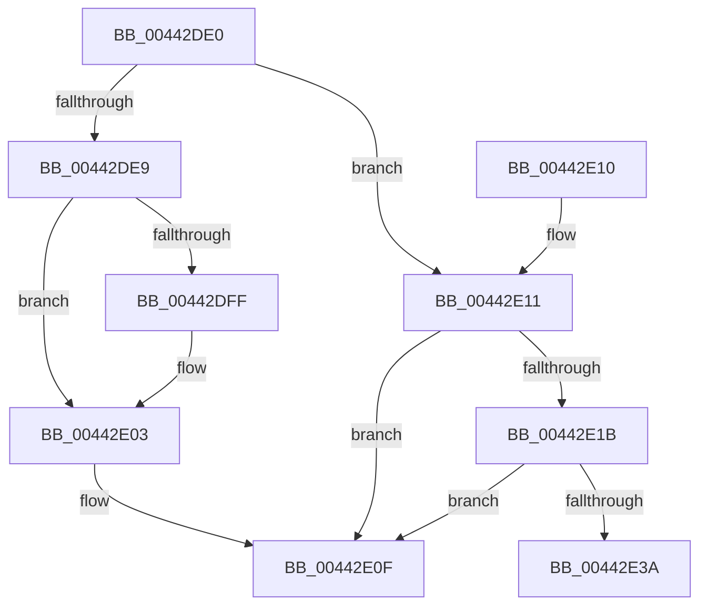

# MiInitializeGetPageChannels

- RVA: `0x00442DE0`–`0x00442E4A` (길이 `106` bytes)
- VA: `0x0000000140442DE0`
- 실행 섹션: `.text`
- PDB 이름 있음: `예`; PDB Function 태그: `예`
- unwind 정보 RVA: `0x000DB714`
- 디코드: `31`개 명령, `106/106` bytes 표시
- 미해석 바이트: `0` (있으면 어셈블리에 `.byte`로 보존)

> 이 문서는 커널 이미지의 기계어와 PDB 기호를 분석해 생성했습니다. 4번과 5번은 함수 원형과 자료형을 바이너리 사용 방식에서 추정한 C 해석이며 원본 소스 복구 결과는 아닙니다.

## 1. Dependencies

- 직접 호출 지점: **0**; 고유 호출 대상: **0**
- 직접 호출자로 확인된 함수: **1**
- RIP 상대 이미지 참조: **1**

### Outgoing calls
- 직접 디코드된 call 명령이 없습니다.

### Direct callers
- [MiGetHugeRange](../67/MiGetHugeRange_function_00675954.md) at `0x0067599B`
- [MiGetHugeRange](../67/MiGetHugeRange_function_00675954.md) at `0x006759C1`

### Static image references
- `0x00442DF1` → RVA `0x00FC5002` (`ALMOSTRO`; read)

## 2. Other-region calls and transfers

- 다른 실행 섹션으로 향하는 call: **0**
- call이 아닌 외부 분기/꼬리 이동: **1**
  - `0x00442E45` → `0x006EFB50` (`tail-transfer`)

## 3. Assembly (complete function range)

```asm
00442DE0  4C 8D 51 03                     lea r10, [rcx + 3]
00442DE4  48 85 D2                        test rdx, rdx
00442DE7  75 28                           jne 0x140442e11
00442DE9  33 C0                           xor eax, eax
00442DEB  89 01                           mov dword ptr [rcx], eax
00442DED  66 89 41 04                     mov word ptr [rcx + 4], ax
00442DF1  0F B6 05 0A 22 B8 00            movzx eax, byte ptr [rip + 0xb8220a]
00442DF8  41 88 02                        mov byte ptr [r10], al
00442DFB  3C 01                           cmp al, 1
00442DFD  77 04                           ja 0x140442e03
00442DFF  41 C6 02 01                     mov byte ptr [r10], 1
00442E03  41 C1 E8 08                     shr r8d, 8
00442E07  41 80 E0 01                     and r8b, 1
00442E0B  44 88 41 04                     mov byte ptr [rcx + 4], r8b
00442E0F  C3                              ret
00442E10  CC                              int3
00442E11  41 80 3A 01                     cmp byte ptr [r10], 1
00442E15  C6 41 02 00                     mov byte ptr [rcx + 2], 0
00442E19  76 F4                           jbe 0x140442e0f
00442E1B  0F B6 82 50 3B 00 00            movzx eax, byte ptr [rdx + 0x3b50]
00442E22  F6 D0                           not al
00442E24  24 01                           and al, 1
00442E26  88 41 05                        mov byte ptr [rcx + 5], al
00442E29  0F B7 82 81 3B 00 00            movzx eax, word ptr [rdx + 0x3b81]
00442E30  66 89 01                        mov word ptr [rcx], ax
00442E33  41 0F BA E1 0D                  bt r9d, 0xd
00442E38  73 D5                           jae 0x140442e0f
00442E3A  44 0F B6 41 04                  movzx r8d, byte ptr [rcx + 4]
00442E3F  4C 8D 49 04                     lea r9, [rcx + 4]
00442E43  32 C0                           xor al, al
00442E45  E9 06 CD 2A 00                  jmp 0x1406efb50
```

## 4. C-style interpretation (structured pseudocode)

```c
__int64 __fastcall MiInitializeGetPageChannels(__int64 a1, __int64 a2, int a3, int a4)
{
    __int64 result;

    if (a2 != 0) goto loc_00442E11;
    result = 0;
    *(unsigned int *)(a1) = 0;
    *(unsigned __int16 *)(a1 + 4) = 0;
    *(unsigned __int8 *)(a1 + 3) = (unsigned __int8)(*(unsigned __int8 *)(v_rip + 12067338));
    if (((unsigned __int8)(*(unsigned __int8 *)(v_rip + 12067338))) <= 1) {
        *(unsigned __int8 *)(a1 + 3) = 1;
    }
    a3 = (unsigned int)((a3) >> (8));
    a3 = (unsigned __int8)((a3) & (1));
    *(unsigned __int8 *)(a1 + 4) = (unsigned __int8)(a3);
loc_00442E0F:
    return *(unsigned __int8 *)(v_rip + 12067338);
loc_00442E11:
    *(unsigned __int8 *)(a1 + 2) = 0;
    if ((*(unsigned __int8 *)(a1 + 3)) <= 1) goto loc_00442E0F;
    result = (unsigned __int8)(~(*(unsigned __int8 *)(a2 + 15184)));
    result = (unsigned __int8)((result) & (1));
    *(unsigned __int8 *)(a1 + 5) = (unsigned __int8)(result);
    *(unsigned __int16 *)(a1) = (unsigned __int16)(*(unsigned __int16 *)(a2 + 15233));
    if (condition_is_above_or_equal) goto loc_00442E0F;
    result = 0;
}
```

## 5. (Beta) C Style

```c
int64_t MiInitializeGetPageChannels(void *Arg1, int64_t Arg2, int32_t Arg3, int32_t Arg4)
{
    uint8_t *arg1 = (uint8_t *)Arg1;

    int64_t result;

    if (Arg2 != 0) goto loc_00442E11;
    result = 0;
    *(uint32_t *)(arg1) = 0;
    *(uint16_t *)(arg1 + 0x4) = 0;
    *(uint8_t *)(arg1 + 0x3) = (uint8_t)(*(uint8_t *)(v_rip + 0xB8220A));
    if (((uint8_t)(*(uint8_t *)(v_rip + 0xB8220A))) <= 1) {
        *(uint8_t *)(arg1 + 0x3) = 1;
    }
    Arg3 = (uint32_t)((Arg3) >> (8));
    Arg3 = (uint8_t)((Arg3) & (1));
    *(uint8_t *)(arg1 + 0x4) = (uint8_t)(Arg3);
loc_00442E0F:
    return *(uint8_t *)(v_rip + 0xB8220A);
loc_00442E11:
    *(uint8_t *)(arg1 + 0x2) = 0;
    if ((*(uint8_t *)(arg1 + 0x3)) <= 1) goto loc_00442E0F;
    result = (uint8_t)(~(*(uint8_t *)(Arg2 + 0x3B50)));
    result = (uint8_t)((result) & (1));
    *(uint8_t *)(arg1 + 0x5) = (uint8_t)(result);
    *(uint16_t *)(arg1) = (uint16_t)(*(uint16_t *)(Arg2 + 0x3B81));
    if (condition_is_above_or_equal) goto loc_00442E0F;
    result = 0;
}
```

### 관측된 메모리 오프셋

구조체 형식이 확인되지 않은 접근은 인자 기준의 오프셋으로만 기록했습니다.

| 기준 인자 | 오프셋 표현 | 폭 (bit) | 접근 |
|---|---:|---:|---|
| `Arg1` | `+ 0x0` | `8` | `R` |
| `Arg1` | `+ 0x0` | `8` | `W` |
| `Arg1` | `+ 0x0` | `16` | `W` |
| `Arg1` | `+ 0x0` | `32` | `W` |
| `Arg1` | `+ 0x2` | `8` | `W` |
| `Arg1` | `+ 0x3` | `64` | `R` |
| `Arg1` | `+ 0x4` | `8` | `R` |
| `Arg1` | `+ 0x4` | `8` | `W` |
| `Arg1` | `+ 0x4` | `16` | `W` |
| `Arg1` | `+ 0x4` | `64` | `R` |
| `Arg1` | `+ 0x5` | `8` | `W` |

## 6. Execution-region graph

[열기: 2D/3D 그래프와 함수 탐색 컨트롤 패널](../../../control-panel.html?section=text&rva=0x00442DE0&view=graph)

- 2D 그래프는 위에서 아래로 흐르고, 3D 그래프는 빈 공간을 드래그해 회전합니다. Shift+드래그는 이동, 휠은 확대·축소, 함수 노드 선택은 대상 보고서 이동입니다.

### Static fallback


