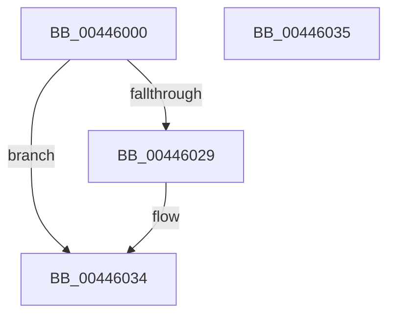

# MiInitializePageHeatList

- RVA: `0x00446000`–`0x00446036` (길이 `54` bytes)
- VA: `0x0000000140446000`
- 실행 섹션: `.text`
- PDB 이름 있음: `예`; PDB Function 태그: `아니요`
- unwind 정보 RVA: `0x000DB714`
- 디코드: `16`개 명령, `54/54` bytes 표시
- 미해석 바이트: `0` (있으면 어셈블리에 `.byte`로 보존)

> 이 문서는 커널 이미지의 기계어와 PDB 기호를 분석해 생성했습니다. 4번과 5번은 함수 원형과 자료형을 바이너리 사용 방식에서 추정한 C 해석이며 원본 소스 복구 결과는 아닙니다.

## 1. Dependencies

- 직접 호출 지점: **0**; 고유 호출 대상: **0**
- 직접 호출자로 확인된 함수: **8**
- RIP 상대 이미지 참조: **1**

### Outgoing calls
- 직접 디코드된 call 명령이 없습니다.

### Direct callers
- [MiBackgroundZeroLocalPages](../31/MiBackgroundZeroLocalPages_function_0031EF30.md) at `0x0031F818`
- [MiWalkEntireImage](../36/MiWalkEntireImage_function_00365D70.md) at `0x00366E2F`
- [MiMakeTransitionHeatBatch](../40/MiMakeTransitionHeatBatch_function_00409A94.md) at `0x00409C58`
- [MiChangePageHeatImmediate](MiChangePageHeatImmediate_function_00445F5C.md) at `0x00445FC3`
- [MiGetTransitionPageHeatList](../68/MiGetTransitionPageHeatList_function_0068BFF4.md) at `0x0068C01C`
- [MiZeroPageMakeHot](../69/MiZeroPageMakeHot_function_00696C08.md) at `0x00696CBF`
- [MmPrefetchPagesEx](../../page/93/MmPrefetchPagesEx_function_0093C9A0.md) at `0x0093CD1D`
- [sub_00B25214](../../page/B2/Unknown_function_00B25214.md) at `0x00B25222`

### Static image references
- `0x00446029` → RVA `0x00E2ECF8` (`.data`; read)

## 2. Other-region calls and transfers

- 다른 실행 섹션으로 향하는 call: **0**
- 별도 외부 분기/꼬리 이동을 확인하지 못했습니다.

## 3. Assembly (complete function range)

```asm
00446000  83 E2 01                        and edx, 1
00446003  42 8D 04 8D 00 00 00 00         lea eax, [r9*4]
0044600B  45 8B D0                        mov r10d, r8d
0044600E  0F 57 C0                        xorps xmm0, xmm0
00446011  41 83 E2 03                     and r10d, 3
00446015  44 0B D0                        or r10d, eax
00446018  45 03 D2                        add r10d, r10d
0044601B  44 0B D2                        or r10d, edx
0044601E  0F 11 01                        movups xmmword ptr [rcx], xmm0
00446021  44 89 11                        mov dword ptr [rcx], r10d
00446024  45 85 C0                        test r8d, r8d
00446027  74 0B                           je 0x140446034
00446029  48 8B 05 C8 8C 9E 00            mov rax, qword ptr [rip + 0x9e8cc8]
00446030  48 89 41 08                     mov qword ptr [rcx + 8], rax
00446034  C3                              ret
00446035  CC                              int3
```

## 4. C-style interpretation (structured pseudocode)

```c
__int64 __fastcall MiInitializePageHeatList(__int64 a1, int a2, int a3, __int64 a4)
{
    __int64 result;
    __int64 v_r10;

    a2 = (unsigned int)((a2) & (1));
    v_r10 = (unsigned int)(((unsigned int)(a3)) & (3));
    v_r10 = (unsigned int)((v_r10) | ((unsigned int)(a4 * 4)));
    v_r10 = (unsigned int)((v_r10) + ((unsigned int)(v_r10)));
    v_r10 = (unsigned int)((v_r10) | (a2));
    *(unsigned __int64 *)(a1) = v_xmm0;
    *(unsigned int *)(a1) = (unsigned int)(v_r10);
    result = a4 * 4;
    if (a3 != 0) {
        result = *(unsigned __int64 *)(v_rip + 10390728);
        *(unsigned __int64 *)(a1 + 8) = result;
    }
    return result;
}
```

## 5. (Beta) C Style

```c
int64_t MiInitializePageHeatList(void *Arg1, int32_t Arg2, int32_t Arg3, int64_t Arg4)
{
    uint8_t *arg1 = (uint8_t *)Arg1;

    int64_t result;
    int64_t local_r10;

    Arg2 = (uint32_t)((Arg2) & (1));
    local_r10 = (uint32_t)(((uint32_t)(Arg3)) & (3));
    local_r10 = (uint32_t)((local_r10) | ((uint32_t)(Arg4 * 4)));
    local_r10 = (uint32_t)((local_r10) + ((uint32_t)(local_r10)));
    local_r10 = (uint32_t)((local_r10) | (Arg2));
    *(uint64_t *)(arg1) = v_xmm0;
    *(uint32_t *)(arg1) = (uint32_t)(local_r10);
    result = Arg4 * 4;
    if (Arg3 != 0) {
        result = *(uint64_t *)(v_rip + 0x9E8CC8);
        *(uint64_t *)(arg1 + 0x8) = result;
    }
    return result;
}
```

### 관측된 메모리 오프셋

구조체 형식이 확인되지 않은 접근은 인자 기준의 오프셋으로만 기록했습니다.

| 기준 인자 | 오프셋 표현 | 폭 (bit) | 접근 |
|---|---:|---:|---|
| `Arg1` | `+ 0x0` | `32` | `W` |
| `Arg1` | `+ 0x0` | `128` | `R` |
| `Arg1` | `+ 0x8` | `64` | `W` |

## 6. Execution-region graph

[열기: 2D/3D 그래프와 함수 탐색 컨트롤 패널](../../../control-panel.html?section=text&rva=0x00446000&view=graph)

- 2D 그래프는 위에서 아래로 흐르고, 3D 그래프는 빈 공간을 드래그해 회전합니다. Shift+드래그는 이동, 휠은 확대·축소, 함수 노드 선택은 대상 보고서 이동입니다.

### Static fallback


