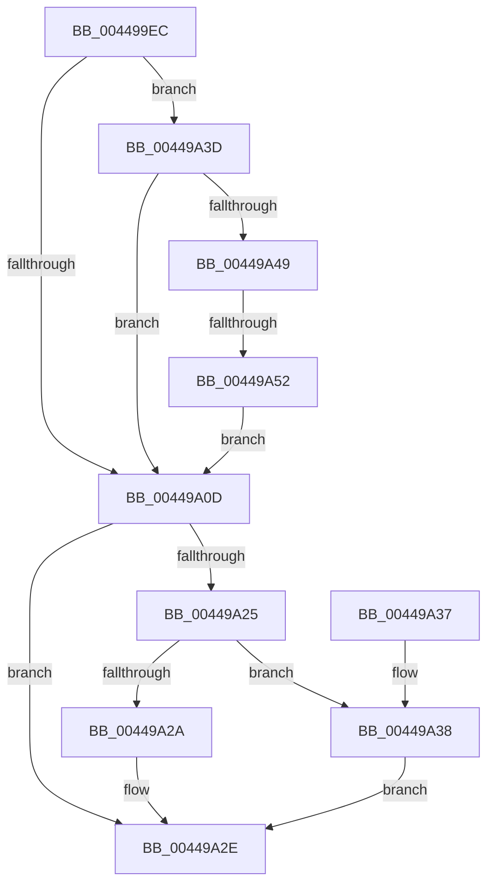

# MiInitializeTbFlushStamps

- RVA: `0x004499EC`–`0x00449A5A` (길이 `110` bytes)
- VA: `0x00000001404499EC`
- 실행 섹션: `.text`
- PDB 이름 있음: `예`; PDB Function 태그: `예`
- unwind 정보 RVA: `0x00092364`
- 디코드: `34`개 명령, `110/110` bytes 표시
- 미해석 바이트: `0` (있으면 어셈블리에 `.byte`로 보존)

> 이 문서는 커널 이미지의 기계어와 PDB 기호를 분석해 생성했습니다. 4번과 5번은 함수 원형과 자료형을 바이너리 사용 방식에서 추정한 C 해석이며 원본 소스 복구 결과는 아닙니다.

## 1. Dependencies

- 직접 호출 지점: **1**; 고유 호출 대상: **1**
- 직접 호출자로 확인된 함수: **4**
- RIP 상대 이미지 참조: **2**

### Outgoing calls
- `0x004499F5` → [MI_READ_PTE_LOCK_FREE](../28/MI_READ_PTE_LOCK_FREE_function_002828A0.md) (function, `0x002828A0`)

### Direct callers
- [MiDecommitAddToList](../24/MiDecommitAddToList_function_00242264.md) at `0x00242544`
- [MiReleasePtes](../24/MiReleasePtes_function_00247240.md) at `0x00247436`
- [sub_00293F76](../29/Unknown_function_00293F76.md) at `0x002942B0`
- [MiApplyLazyStampToAwePtes](../68/MiApplyLazyStampToAwePtes_function_006879C8.md) at `0x00687A08`

### Static image references
- `0x00449A02` → RVA `0x00FCF080` (`CACHEALI`; read)
- `0x00449A19` → RVA `0x00E2DC80` (`.data`; read)

## 2. Other-region calls and transfers

- 다른 실행 섹션으로 향하는 call: **0**
- call이 아닌 외부 분기/꼬리 이동: **1**
  - `0x00449A4C` → [sub_006F0B50](../6F/Unknown_function_006F0B50.md) (`tail-transfer`)

## 3. Assembly (complete function range)

```asm
004499EC  40 53                           push rbx
004499EE  48 83 EC 20                     sub rsp, 0x20
004499F2  48 8B D9                        mov rbx, rcx
004499F5  E8 A6 8E E3 FF                  call 0x1402828a0
004499FA  48 8B D0                        mov rdx, rax
004499FD  F0 83 0C 24 00                  lock or dword ptr [rsp], 0
00449A02  8B 0D 78 56 B8 00               mov ecx, dword ptr [rip + 0xb85678]
00449A08  48 85 C0                        test rax, rax
00449A0B  75 30                           jne 0x140449a3d
00449A0D  48 8B C1                        mov rax, rcx
00449A10  8B CA                           mov ecx, edx
00449A12  48 C1 E0 20                     shl rax, 0x20
00449A16  48 0B C1                        or rax, rcx
00449A19  48 8B 0D 60 42 9E 00            mov rcx, qword ptr [rip + 0x9e4260]
00449A20  48 85 C9                        test rcx, rcx
00449A23  74 09                           je 0x140449a2e
00449A25  48 85 C8                        test rax, rcx
00449A28  74 0E                           je 0x140449a38
00449A2A  48 83 C8 10                     or rax, 0x10
00449A2E  48 89 03                        mov qword ptr [rbx], rax
00449A31  48 83 C4 20                     add rsp, 0x20
00449A35  5B                              pop rbx
00449A36  C3                              ret
00449A37  CC                              int3
00449A38  48 0B C1                        or rax, rcx
00449A3B  EB F1                           jmp 0x140449a2e
00449A3D  48 8B 05 3C 42 9E 00            mov rax, qword ptr [rip + 0x9e423c]
00449A44  48 85 C0                        test rax, rax
00449A47  74 C4                           je 0x140449a0d
00449A49  F6 C2 10                        test dl, 0x10
00449A4C  0F 85 FE 70 2A 00               jne 0x1406f0b50
00449A52  48 F7 D0                        not rax
00449A55  48 23 D0                        and rdx, rax
00449A58  EB B3                           jmp 0x140449a0d
```

## 4. C-style interpretation (structured pseudocode)

```c
__int64 __fastcall MiInitializeTbFlushStamps(__int64 a1)
{
    __int64 result;
    __int64 v_rsp;
    unsigned int v_stack_m28;

    v_rsp = (v_rsp) - (32);
    result = MI_READ_PTE_LOCK_FREE(a1, a2, a3, a4);
    if (result != 0) goto loc_00449A3D;
loc_00449A0D:
    result = ((unsigned int)(*(unsigned int *)(v_rip + 12080760))) << (32);
    result = (result) | ((unsigned int)((unsigned int)(result)));
    if (*(unsigned __int64 *)(v_rip + 10371680) == 0) goto loc_00449A2E;
    if (((result) & (*(unsigned __int64 *)(v_rip + 10371680))) == 0) goto loc_00449A38;
    result = (result) | (16);
loc_00449A2E:
    *(unsigned __int64 *)(a1) = result;
    v_rsp = (v_rsp) + (32);
    return result;
loc_00449A38:
    result = (result) | (*(unsigned __int64 *)(v_rip + 10371680));
    goto loc_00449A2E;
loc_00449A3D:
    if (*(unsigned __int64 *)(v_rip + 10371644) == 0) goto loc_00449A0D;
    result = ~(*(unsigned __int64 *)(v_rip + 10371644));
    a2 = (result) & (result);
    goto loc_00449A0D;
}
```

## 5. (Beta) C Style

```c
int64_t MiInitializeTbFlushStamps(void *Arg1)
{
    uint8_t *arg1 = (uint8_t *)Arg1;

    int64_t result;
    int64_t local_rsp;
    uint32_t v_stack_m28;

    local_rsp = (local_rsp) - (32);
    result = MI_READ_PTE_LOCK_FREE(Arg1, a2, a3, a4);
    if (result != 0) goto loc_00449A3D;
loc_00449A0D:
    result = ((uint32_t)(*(uint32_t *)(v_rip + 0xB85678))) << (32);
    result = (result) | ((uint32_t)((uint32_t)(result)));
    if (*(uint64_t *)(v_rip + 0x9E4260) == 0) goto loc_00449A2E;
    if (((result) & (*(uint64_t *)(v_rip + 0x9E4260))) == 0) goto loc_00449A38;
    result = (result) | (16);
loc_00449A2E:
    *(uint64_t *)(arg1) = result;
    local_rsp = (local_rsp) + (32);
    return result;
loc_00449A38:
    result = (result) | (*(uint64_t *)(v_rip + 0x9E4260));
    goto loc_00449A2E;
loc_00449A3D:
    if (*(uint64_t *)(v_rip + 0x9E423C) == 0) goto loc_00449A0D;
    result = ~(*(uint64_t *)(v_rip + 0x9E423C));
    a2 = (result) & (result);
    goto loc_00449A0D;
}
```

### 관측된 메모리 오프셋

구조체 형식이 확인되지 않은 접근은 인자 기준의 오프셋으로만 기록했습니다.

| 기준 인자 | 오프셋 표현 | 폭 (bit) | 접근 |
|---|---:|---:|---|
| `Arg1` | `+ 0x0` | `64` | `W` |

## 6. Execution-region graph

[열기: 2D/3D 그래프와 함수 탐색 컨트롤 패널](../../../control-panel.html?section=text&rva=0x004499EC&view=graph)

- 2D 그래프는 위에서 아래로 흐르고, 3D 그래프는 빈 공간을 드래그해 회전합니다. Shift+드래그는 이동, 휠은 확대·축소, 함수 노드 선택은 대상 보고서 이동입니다.

### Static fallback


