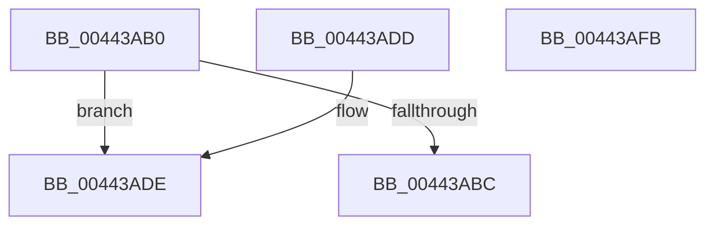

# MiInitializeUsedPtesCount

- RVA: `0x00443AB0`–`0x00443AFC` (길이 `76` bytes)
- VA: `0x0000000140443AB0`
- 실행 섹션: `.text`
- PDB 이름 있음: `예`; PDB Function 태그: `아니요`
- unwind 정보 RVA: `0x000DB714`
- 디코드: `23`개 명령, `76/76` bytes 표시
- 미해석 바이트: `0` (있으면 어셈블리에 `.byte`로 보존)

> 이 문서는 커널 이미지의 기계어와 PDB 기호를 분석해 생성했습니다. 4번과 5번은 함수 원형과 자료형을 바이너리 사용 방식에서 추정한 C 해석이며 원본 소스 복구 결과는 아닙니다.

## 1. Dependencies

- 직접 호출 지점: **0**; 고유 호출 대상: **0**
- 직접 호출자로 확인된 함수: **3**
- RIP 상대 이미지 참조: **0**

### Outgoing calls
- 직접 디코드된 call 명령이 없습니다.

### Direct callers
- [MiMakeOutswappedPageResident](../43/MiMakeOutswappedPageResident_function_00431AD0.md) at `0x00431FA6`
- [MiDemoteValidLargePageOneLevel](../68/MiDemoteValidLargePageOneLevel_function_0068A3F4.md) at `0x0068A785`
- [sub_006F15CE](../6F/Unknown_function_006F15CE.md) at `0x006F16C6`

### Static image references
- 디코드된 RIP-relative 메모리 참조가 없습니다.

## 2. Other-region calls and transfers

- 다른 실행 섹션으로 향하는 call: **0**
- 별도 외부 분기/꼬리 이동을 확인하지 못했습니다.

## 3. Assembly (complete function range)

```asm
00443AB0  8B 41 24                        mov eax, dword ptr [rcx + 0x24]
00443AB3  44 8B C2                        mov r8d, edx
00443AB6  0F BA E0 1A                     bt eax, 0x1a
00443ABA  73 22                           jae 0x140443ade
00443ABC  48 8B 01                        mov rax, qword ptr [rcx]
00443ABF  49 C1 E0 20                     shl r8, 0x20
00443AC3  49 8B D0                        mov rdx, r8
00443AC6  48 33 D0                        xor rdx, rax
00443AC9  48 B8 FF FF FF FF 00 FC FF FF   movabs rax, 0xfffffc00ffffffff
00443AD3  48 23 D0                        and rdx, rax
00443AD6  49 33 D0                        xor rdx, r8
00443AD9  48 89 11                        mov qword ptr [rcx], rdx
00443ADC  C3                              ret
00443ADD  CC                              int3
00443ADE  48 8B 41 10                     mov rax, qword ptr [rcx + 0x10]
00443AE2  49 C1 E0 10                     shl r8, 0x10
00443AE6  49 8B D0                        mov rdx, r8
00443AE9  48 33 D0                        xor rdx, rax
00443AEC  48 81 E2 FF FF 00 FC            and rdx, 0xfffffffffc00ffff
00443AF3  49 33 D0                        xor rdx, r8
00443AF6  48 89 51 10                     mov qword ptr [rcx + 0x10], rdx
00443AFA  C3                              ret
00443AFB  CC                              int3
```

## 4. C-style interpretation (structured pseudocode)

```c
__int64 __fastcall MiInitializeUsedPtesCount(__int64 a1, int a2)
{
    if (condition_is_above_or_equal) goto loc_00443ADE;
    a3 = ((unsigned int)(a2)) << (32);
    a2 = (a3) ^ (*(unsigned __int64 *)(a1));
    a2 = (a2) & (*(unsigned __int64 *)(a1));
    a2 = (a2) ^ (a3);
    *(unsigned __int64 *)(a1) = a2;
    return *(unsigned __int64 *)(a1);
loc_00443ADE:
    a3 = (a3) << (16);
    a2 = (a3) ^ (*(unsigned __int64 *)(a1 + 16));
    a2 = (a2) & (0xFFFFFFFFFC00FFFFULL);
    a2 = (a2) ^ (a3);
    *(unsigned __int64 *)(a1 + 16) = a2;
    return *(unsigned __int64 *)(a1 + 16);
}
```

## 5. (Beta) C Style

```c
int64_t MiInitializeUsedPtesCount(void *Arg1, int32_t Arg2)
{
    uint8_t *arg1 = (uint8_t *)Arg1;

    if (condition_is_above_or_equal) goto loc_00443ADE;
    a3 = ((uint32_t)(Arg2)) << (32);
    Arg2 = (a3) ^ (*(uint64_t *)(arg1));
    Arg2 = (Arg2) & (*(uint64_t *)(arg1));
    Arg2 = (Arg2) ^ (a3);
    *(uint64_t *)(arg1) = Arg2;
    return *(uint64_t *)(arg1);
loc_00443ADE:
    a3 = (a3) << (16);
    Arg2 = (a3) ^ (*(uint64_t *)(arg1 + 0x10));
    Arg2 = (Arg2) & (0xFFFFFFFFFC00FFFFULL);
    Arg2 = (Arg2) ^ (a3);
    *(uint64_t *)(arg1 + 0x10) = Arg2;
    return *(uint64_t *)(arg1 + 0x10);
}
```

### 관측된 메모리 오프셋

구조체 형식이 확인되지 않은 접근은 인자 기준의 오프셋으로만 기록했습니다.

| 기준 인자 | 오프셋 표현 | 폭 (bit) | 접근 |
|---|---:|---:|---|
| `Arg1` | `+ 0x0` | `64` | `R` |
| `Arg1` | `+ 0x0` | `64` | `W` |
| `Arg1` | `+ 0x10` | `64` | `R` |
| `Arg1` | `+ 0x10` | `64` | `W` |
| `Arg1` | `+ 0x24` | `32` | `R` |

## 6. Execution-region graph

[열기: 2D/3D 그래프와 함수 탐색 컨트롤 패널](../../../control-panel.html?section=text&rva=0x00443AB0&view=graph)

- 2D 그래프는 위에서 아래로 흐르고, 3D 그래프는 빈 공간을 드래그해 회전합니다. Shift+드래그는 이동, 휠은 확대·축소, 함수 노드 선택은 대상 보고서 이동입니다.

### Static fallback


