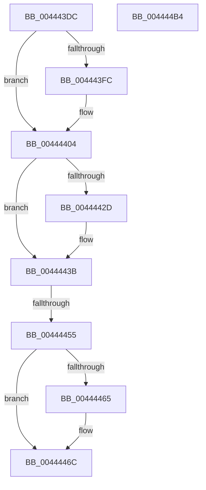

# MiInsertUnusedSegment

- RVA: `0x004443DC`–`0x004444B5` (길이 `217` bytes)
- VA: `0x00000001404443DC`
- 실행 섹션: `.text`
- PDB 이름 있음: `예`; PDB Function 태그: `예`
- unwind 정보 RVA: `0x00066400`
- 디코드: `57`개 명령, `217/217` bytes 표시
- 미해석 바이트: `0` (있으면 어셈블리에 `.byte`로 보존)

> 이 문서는 커널 이미지의 기계어와 PDB 기호를 분석해 생성했습니다. 4번과 5번은 함수 원형과 자료형을 바이너리 사용 방식에서 추정한 C 해석이며 원본 소스 복구 결과는 아닙니다.

## 1. Dependencies

- 직접 호출 지점: **5**; 고유 호출 대상: **5**
- 직접 호출자로 확인된 함수: **4**
- RIP 상대 이미지 참조: **2**

### Outgoing calls
- `0x004443FC` → [MiConvertStaticSubsections](MiConvertStaticSubsections_function_004445C8.md) (function, `0x004445C8`)
- `0x00444423` → [ExAcquireSpinLockExclusiveAtDpcLevel](../24/ExAcquireSpinLockExclusiveAtDpcLevel_function_00248E80.md) (function, `0x00248E80`)
- `0x00444433` → [MiReleaseControlAreaCharges](MiReleaseControlAreaCharges_function_004444BC.md) (function, `0x004444BC`)
- `0x0044447D` → [MiComputePagedPoolSegmentBytes](MiComputePagedPoolSegmentBytes_function_0044467C.md) (function, `0x0044467C`)
- `0x0044448F` → [ExReleaseSpinLockExclusiveFromDpcLevel](../24/ExReleaseSpinLockExclusiveFromDpcLevel_function_002497E0.md) (function, `0x002497E0`)

### Direct callers
- [MiCheckControlArea](../28/MiCheckControlArea_function_002861B0.md) at `0x00286319`
- [MiCleanSection](../46/MiCleanSection_function_00462E1C.md) at `0x00462F5E`
- [MiSetDeleteOnClose](../4D/MiSetDeleteOnClose_function_004DD8E8.md) at `0x004DD933`
- [MiMakeUnusedSegmentDeleteOnClose](../67/MiMakeUnusedSegmentDeleteOnClose_function_00678078.md) at `0x00678140`

### Static image references
- `0x00444408` → RVA `0x00E30088` (`.data`; read)
- `0x00444494` → RVA `0x00E2CD18` (`.data`; read/write)

## 2. Other-region calls and transfers

- 다른 실행 섹션으로 향하는 call: **0**
- call이 아닌 외부 분기/꼬리 이동: **1**
  - `0x0044444F` → [sub_006EFC5A](../6E/Unknown_function_006EFC5A.md) (`tail-transfer`)

## 3. Assembly (complete function range)

```asm
004443DC  48 89 5C 24 08                  mov qword ptr [rsp + 8], rbx
004443E1  48 89 6C 24 10                  mov qword ptr [rsp + 0x10], rbp
004443E6  48 89 74 24 18                  mov qword ptr [rsp + 0x18], rsi
004443EB  57                              push rdi
004443EC  48 83 EC 30                     sub rsp, 0x30
004443F0  8B 41 38                        mov eax, dword ptr [rcx + 0x38]
004443F3  33 F6                           xor esi, esi
004443F5  48 8B D9                        mov rbx, rcx
004443F8  A8 20                           test al, 0x20
004443FA  75 08                           jne 0x140444404
004443FC  E8 C7 01 00 00                  call 0x1404445c8
00444401  48 8B F0                        mov rsi, rax
00444404  0F B7 53 3C                     movzx edx, word ptr [rbx + 0x3c]
00444408  48 8B 0D 79 BC 9E 00            mov rcx, qword ptr [rip + 0x9ebc79]
0044440F  81 E2 FF 03 00 00               and edx, 0x3ff
00444415  48 8B 3C D1                     mov rdi, qword ptr [rcx + rdx*8]
00444419  48 8D AF C0 06 00 00            lea rbp, [rdi + 0x6c0]
00444420  48 8B CD                        mov rcx, rbp
00444423  E8 58 4A E0 FF                  call 0x140248e80
00444428  48 85 F6                        test rsi, rsi
0044442B  75 0E                           jne 0x14044443b
0044442D  8D 56 01                        lea edx, [rsi + 1]
00444430  48 8B CB                        mov rcx, rbx
00444433  E8 84 00 00 00                  call 0x1404444bc
00444438  48 8B F0                        mov rsi, rax
0044443B  8B 43 38                        mov eax, dword ptr [rbx + 0x38]
0044443E  8B C8                           mov ecx, eax
00444440  0F BA E9 1C                     bts ecx, 0x1c
00444444  89 4B 38                        mov dword ptr [rbx + 0x38], ecx
00444447  48 8D 4B 08                     lea rcx, [rbx + 8]
0044444B  0F BA E0 12                     bt eax, 0x12
0044444F  0F 82 05 B8 2A 00               jb 0x1406efc5a
00444455  48 8D 87 40 08 00 00            lea rax, [rdi + 0x840]
0044445C  48 8B 50 08                     mov rdx, qword ptr [rax + 8]
00444460  48 39 02                        cmp qword ptr [rdx], rax
00444463  74 07                           je 0x14044446c
00444465  B9 03 00 00 00                  mov ecx, 3
0044446A  CD 29                           int 0x29
0044446C  48 89 01                        mov qword ptr [rcx], rax
0044446F  48 89 51 08                     mov qword ptr [rcx + 8], rdx
00444473  48 89 0A                        mov qword ptr [rdx], rcx
00444476  48 89 48 08                     mov qword ptr [rax + 8], rcx
0044447A  48 8B CB                        mov rcx, rbx
0044447D  E8 FA 01 00 00                  call 0x14044467c
00444482  48 01 87 38 08 00 00            add qword ptr [rdi + 0x838], rax
00444489  48 8B CD                        mov rcx, rbp
0044448C  48 8B D8                        mov rbx, rax
0044448F  E8 4C 53 E0 FF                  call 0x1402497e0
00444494  F0 48 01 1D 7C 88 9E 00         lock add qword ptr [rip + 0x9e887c], rbx
0044449C  48 8B 5C 24 40                  mov rbx, qword ptr [rsp + 0x40]
004444A1  48 8B C6                        mov rax, rsi
004444A4  48 8B 74 24 50                  mov rsi, qword ptr [rsp + 0x50]
004444A9  48 8B 6C 24 48                  mov rbp, qword ptr [rsp + 0x48]
004444AE  48 83 C4 30                     add rsp, 0x30
004444B2  5F                              pop rdi
004444B3  C3                              ret
004444B4  CC                              int3
```

## 4. C-style interpretation (structured pseudocode)

```c
__int64 __fastcall MiInsertUnusedSegment(__int64 a1)
{
    __int64 result;
    __int64 v_rsi;
    __int64 v_rsp;
    unsigned __int64 v_stack_p10;
    unsigned __int64 v_stack_p18;
    unsigned __int64 v_stack_p8;

    v_stack_p8 = v_rbx;
    v_stack_p10 = v_rbp;
    v_stack_p18 = v_rsi;
    v_rsp = (v_rsp) - (48);
    v_rsi = 0;
    result = (unsigned int)(*(unsigned int *)(a1 + 56));
    if ((((unsigned __int8)((unsigned int)(*(unsigned int *)(a1 + 56)))) & (32)) == 0) {
        result = MiConvertStaticSubsections(a1, a2, a3, a4);
        v_rsi = result;
    }
    a2 = (unsigned int)((*(unsigned __int16 *)(a1 + 60)) & (0x3FFULL));
    result = ExAcquireSpinLockExclusiveAtDpcLevel(*(unsigned __int64 *)(*(unsigned __int64 *)(v_rip + 10402937) + a2 * 8) + 1728, a2, a3, a4);
    if (v_rsi == 0) {
        a2 = v_rsi + 1;
        a1 = a1;
        result = MiReleaseControlAreaCharges(a1, a2, a3, a4);
        v_rsi = result;
    }
    *(unsigned int *)(a1 + 56) = (unsigned int)((unsigned int)((unsigned int)((unsigned int)(*(unsigned int *)(a1 + 56)))));
    if ((*(unsigned __int64 *)(*(unsigned __int64 *)(*(unsigned __int64 *)(*(unsigned __int64 *)(v_rip + 10402937) + a2 * 8) + 2112 + 8))) != (*(unsigned __int64 *)(*(unsigned __int64 *)(v_rip + 10402937) + a2 * 8) + 2112)) {
        a1 = 3;
    }
    *(unsigned __int64 *)(a1) = *(unsigned __int64 *)(*(unsigned __int64 *)(v_rip + 10402937) + a2 * 8) + 2112;
    *(unsigned __int64 *)(a1 + 8) = *(unsigned __int64 *)(*(unsigned __int64 *)(*(unsigned __int64 *)(v_rip + 10402937) + a2 * 8) + 2112 + 8);
    *(unsigned __int64 *)(*(unsigned __int64 *)(*(unsigned __int64 *)(*(unsigned __int64 *)(v_rip + 10402937) + a2 * 8) + 2112 + 8)) = a1;
    *(unsigned __int64 *)(*(unsigned __int64 *)(*(unsigned __int64 *)(v_rip + 10402937) + a2 * 8) + 2112 + 8) = a1;
    result = MiComputePagedPoolSegmentBytes(a1, *(unsigned __int64 *)(*(unsigned __int64 *)(*(unsigned __int64 *)(v_rip + 10402937) + a2 * 8) + 2112 + 8), a3, a4);
    result = ExReleaseSpinLockExclusiveFromDpcLevel(*(unsigned __int64 *)(*(unsigned __int64 *)(v_rip + 10402937) + a2 * 8) + 1728, *(unsigned __int64 *)(*(unsigned __int64 *)(*(unsigned __int64 *)(v_rip + 10402937) + a2 * 8) + 2112 + 8), a3, a4);
    v_rsp = (v_rsp) + (48);
    return v_rsi;
}
```

## 5. (Beta) C Style

```c
int64_t MiInsertUnusedSegment(void *Arg1)
{
    uint8_t *arg1 = (uint8_t *)Arg1;

    int64_t result;
    int64_t local_rsi;
    int64_t local_rsp;
    uint64_t v_stack_p10;
    uint64_t v_stack_p18;
    uint64_t v_stack_p8;

    v_stack_p8 = local_rbx;
    v_stack_p10 = local_rbp;
    v_stack_p18 = local_rsi;
    local_rsp = (local_rsp) - (48);
    local_rsi = 0;
    result = (uint32_t)(*(uint32_t *)(arg1 + 0x38));
    if ((((uint8_t)((uint32_t)(*(uint32_t *)(arg1 + 0x38)))) & (32)) == 0) {
        result = MiConvertStaticSubsections(Arg1, a2, a3, a4);
        local_rsi = result;
    }
    a2 = (uint32_t)((*(uint16_t *)(arg1 + 0x3C)) & (0x3FFULL));
    result = ExAcquireSpinLockExclusiveAtDpcLevel(*(uint64_t *)(*(uint64_t *)(v_rip + 0x9EBC79) + a2 * 8) + 1728, a2, a3, a4);
    if (local_rsi == 0) {
        a2 = local_rsi + 1;
        Arg1 = Arg1;
        result = MiReleaseControlAreaCharges(Arg1, a2, a3, a4);
        local_rsi = result;
    }
    *(uint32_t *)(arg1 + 0x38) = (uint32_t)((uint32_t)((uint32_t)((uint32_t)(*(uint32_t *)(arg1 + 0x38)))));
    if ((*(uint64_t *)(*(uint64_t *)(*(uint64_t *)(*(uint64_t *)(v_rip + 0x9EBC79) + a2 * 8) + 0x840 + 0x8))) != (*(uint64_t *)(*(uint64_t *)(v_rip + 0x9EBC79) + a2 * 8) + 2112)) {
        Arg1 = 3;
    }
    *(uint64_t *)(arg1) = *(uint64_t *)(*(uint64_t *)(v_rip + 0x9EBC79) + a2 * 8) + 2112;
    *(uint64_t *)(arg1 + 0x8) = *(uint64_t *)(*(uint64_t *)(*(uint64_t *)(v_rip + 0x9EBC79) + a2 * 8) + 0x840 + 0x8);
    *(void **)(*(uint64_t *)(*(uint64_t *)(*(uint64_t *)(v_rip + 0x9EBC79) + a2 * 8) + 0x840 + 0x8)) = Arg1;
    *(void **)(*(uint64_t *)(*(uint64_t *)(v_rip + 0x9EBC79) + a2 * 8) + 0x840 + 0x8) = Arg1;
    result = MiComputePagedPoolSegmentBytes(Arg1, *(uint64_t *)(*(uint64_t *)(*(uint64_t *)(v_rip + 0x9EBC79) + a2 * 8) + 0x840 + 0x8), a3, a4);
    result = ExReleaseSpinLockExclusiveFromDpcLevel(*(uint64_t *)(*(uint64_t *)(v_rip + 0x9EBC79) + a2 * 8) + 1728, *(uint64_t *)(*(uint64_t *)(*(uint64_t *)(v_rip + 0x9EBC79) + a2 * 8) + 0x840 + 0x8), a3, a4);
    local_rsp = (local_rsp) + (48);
    return local_rsi;
}
```

### 관측된 메모리 오프셋

구조체 형식이 확인되지 않은 접근은 인자 기준의 오프셋으로만 기록했습니다.

| 기준 인자 | 오프셋 표현 | 폭 (bit) | 접근 |
|---|---:|---:|---|
| `Arg1` | `+ 0x8` | `64` | `R` |
| `Arg1` | `+ 0x38` | `32` | `R` |
| `Arg1` | `+ 0x38` | `32` | `W` |
| `Arg1` | `+ 0x3C` | `16` | `R` |

## 6. Execution-region graph

[열기: 2D/3D 그래프와 함수 탐색 컨트롤 패널](../../../control-panel.html?section=text&rva=0x004443DC&view=graph)

- 2D 그래프는 위에서 아래로 흐르고, 3D 그래프는 빈 공간을 드래그해 회전합니다. Shift+드래그는 이동, 휠은 확대·축소, 함수 노드 선택은 대상 보고서 이동입니다.

### Static fallback


