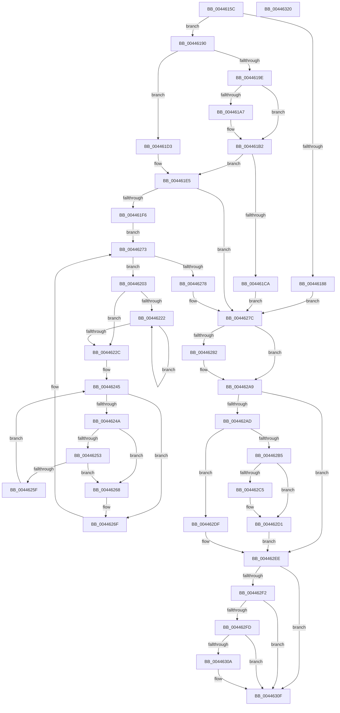

# MiIssuePageHeatList

- RVA: `0x0044615C`–`0x00446321` (길이 `453` bytes)
- VA: `0x000000014044615C`
- 실행 섹션: `.text`
- PDB 이름 있음: `예`; PDB Function 태그: `아니요`
- unwind 정보 RVA: `0x00099F10`
- 디코드: `129`개 명령, `453/453` bytes 표시
- 미해석 바이트: `0` (있으면 어셈블리에 `.byte`로 보존)

> 이 문서는 커널 이미지의 기계어와 PDB 기호를 분석해 생성했습니다. 4번과 5번은 함수 원형과 자료형을 바이너리 사용 방식에서 추정한 C 해석이며 원본 소스 복구 결과는 아닙니다.

## 1. Dependencies

- 직접 호출 지점: **8**; 고유 호출 대상: **8**
- 직접 호출자로 확인된 함수: **18**
- RIP 상대 이미지 참조: **4**

### Outgoing calls
- `0x004461BE` → [MiTryAcquirePushLockUnordered](../67/MiTryAcquirePushLockUnordered_function_0067B4CC.md) (function, `0x0067B4CC`)
- `0x004461E0` → [MiLockDynamicMemoryShared](../3B/MiLockDynamicMemoryShared_function_003B8AA8.md) (function, `0x003B8AA8`)
- `0x00446285` → [MiLogNotifyPageHeat](../68/MiLogNotifyPageHeat_function_0068C050.md) (function, `0x0068C050`)
- `0x004462A0` → [HvlNotifyPageHeat](../6A/HvlNotifyPageHeat_function_006A7E60.md) (function, `0x006A7E60`)
- `0x004462CC` → [ExfReleasePushLockShared](../26/ExfReleasePushLockShared_function_00263440.md) (function, `0x00263440`)
- `0x004462D8` → [KeAbPostRelease](../2E/KeAbPostRelease_function_002E1600.md) (function, `0x002E1600`)
- `0x004462E9` → [MiUnlockDynamicMemoryShared](../3B/MiUnlockDynamicMemoryShared_function_003B8A48.md) (function, `0x003B8A48`)
- `0x0044630A` → [KiCheckForKernelApcDelivery](../2E/KiCheckForKernelApcDelivery_function_002E2C80.md) (function, `0x002E2C80`)

### Direct callers
- [MiGetPerfectColorHeadPage](../28/MiGetPerfectColorHeadPage_function_00289CA8.md) at `0x00289FF0`
- [MmSetPfnListInfo](../31/MmSetPfnListInfo_function_0031D61C.md) at `0x0031D93A`
- [MmSetPfnListInfo](../31/MmSetPfnListInfo_function_0031D61C.md) at `0x0031D962`
- [MiGetLargePagesForChain](../31/MiGetLargePagesForChain_function_0031DF88.md) at `0x0031E1F8`
- [MiGetLargePage](../31/MiGetLargePage_function_0031E210.md) at `0x0031E592`
- [MmCopyToCachedPage](../34/MmCopyToCachedPage_function_00347B44.md) at `0x0034815D`
- [MiWalkEntireImage](../36/MiWalkEntireImage_function_00365D70.md) at `0x00366E89`
- [MiCoalesceFreeLargePages](../37/MiCoalesceFreeLargePages_function_0037A7B4.md) at `0x0037AB3B`
- [MiAllocateLargeZeroPages](../3B/MiAllocateLargeZeroPages_function_003B743C.md) at `0x003B76EA`
- [MiGetLargePageChain](../3B/MiGetLargePageChain_function_003B82D0.md) at `0x003B8432`
- [MiReplenishPageSlist](../3B/MiReplenishPageSlist_function_003BADE0.md) at `0x003BB4B2`
- [MiAddPageToHeatList](MiAddPageToHeatList_function_0044603C.md) at `0x00446051`
- [MiFlushZeroPageHeatBatch](../47/MiFlushZeroPageHeatBatch_function_0047445C.md) at `0x0047449C`
- [MiZeroPageMakeHot](../69/MiZeroPageMakeHot_function_00696C08.md) at `0x00696D37`
- [sub_006DA10C](../6D/Unknown_function_006DA10C.md) at `0x006DA10C`
- [sub_006DF29A](../6D/Unknown_function_006DF29A.md) at `0x006DF2EC`
- [sub_006E169E](../6E/Unknown_function_006E169E.md) at `0x006E16E8`
- [MmPrefetchPagesEx](../../page/93/MmPrefetchPagesEx_function_0093C9A0.md) at `0x0093CD38`
- [MiPfPrepareSequentialReadList](../../page/93/MiPfPrepareSequentialReadList_function_0093D8E8.md) at `0x0093E19B`

### Static image references
- `0x004461B7` → RVA `0x00E38DC0` (`.data`; read)
- `0x004461D6` → RVA `0x00E38D00` (`.data`; read)
- `0x004461E5` → RVA `0x00E2ECF8` (`.data`; read)
- `0x0044624A` → RVA `0x00E2DCE0` (`.data`; read)

## 2. Other-region calls and transfers

- 다른 실행 섹션으로 향하는 call: **0**
- 별도 외부 분기/꼬리 이동을 확인하지 못했습니다.

## 3. Assembly (complete function range)

```asm
0044615C  48 89 5C 24 18                  mov qword ptr [rsp + 0x18], rbx
00446161  55                              push rbp
00446162  56                              push rsi
00446163  57                              push rdi
00446164  41 56                           push r14
00446166  41 57                           push r15
00446168  48 83 EC 20                     sub rsp, 0x20
0044616C  8B 01                           mov eax, dword ptr [rcx]
0044616E  45 33 F6                        xor r14d, r14d
00446171  44 89 74 24 50                  mov dword ptr [rsp + 0x50], r14d
00446176  48 8B D9                        mov rbx, rcx
00446179  41 8B EE                        mov ebp, r14d
0044617C  41 8B FE                        mov edi, r14d
0044617F  45 8D 7E 01                     lea r15d, [r14 + 1]
00446183  83 E0 06                        and eax, 6
00446186  75 08                           jne 0x140446190
00446188  41 8B F6                        mov esi, r14d
0044618B  E9 EC 00 00 00                  jmp 0x14044627c
00446190  65 48 8B 3C 25 88 01 00 00      mov rdi, qword ptr gs:[0x188]
00446199  83 F8 04                        cmp eax, 4
0044619C  75 35                           jne 0x1404461d3
0044619E  44 0F 20 C0                     mov rax, cr8
004461A2  41 3A C7                        cmp al, r15b
004461A5  77 0B                           ja 0x1404461b2
004461A7  66 FF 8F E6 01 00 00            dec word ptr [rdi + 0x1e6]
004461AE  41 8B EF                        mov ebp, r15d
004461B1  90                              nop
004461B2  4C 8D 4C 24 50                  lea r9, [rsp + 0x50]
004461B7  48 8D 0D 02 2C 9F 00            lea rcx, [rip + 0x9f2c02]
004461BE  E8 09 53 23 00                  call 0x14067b4cc
004461C3  0F B6 F0                        movzx esi, al
004461C6  84 C0                           test al, al
004461C8  75 1B                           jne 0x1404461e5
004461CA  44 89 73 04                     mov dword ptr [rbx + 4], r14d
004461CE  E9 A9 00 00 00                  jmp 0x14044627c
004461D3  48 8B D7                        mov rdx, rdi
004461D6  48 8D 0D 23 2B 9F 00            lea rcx, [rip + 0x9f2b23]
004461DD  41 8B F7                        mov esi, r15d
004461E0  E8 C3 28 F7 FF                  call 0x1403b8aa8
004461E5  4C 8B 15 0C 8B 9E 00            mov r10, qword ptr [rip + 0x9e8b0c]
004461EC  4C 3B 53 08                     cmp r10, qword ptr [rbx + 8]
004461F0  0F 84 86 00 00 00               je 0x14044627c
004461F6  8B 43 04                        mov eax, dword ptr [rbx + 4]
004461F9  48 8D 4B 10                     lea rcx, [rbx + 0x10]
004461FD  4C 8D 0C C1                     lea r9, [rcx + rax*8]
00446201  EB 70                           jmp 0x140446273
00446203  4C 8B 01                        mov r8, qword ptr [rcx]
00446206  49 8B C0                        mov rax, r8
00446209  49 8B D0                        mov rdx, r8
0044620C  25 FF 03 00 00                  and eax, 0x3ff
00446211  48 C1 EA 0C                     shr rdx, 0xc
00446215  49 03 C7                        add rax, r15
00446218  49 C1 E8 0A                     shr r8, 0xa
0044621C  41 83 E0 03                     and r8d, 3
00446220  74 0A                           je 0x14044622c
00446222  48 C1 E0 09                     shl rax, 9
00446226  41 83 C0 FF                     add r8d, -1
0044622A  75 F6                           jne 0x140446222
0044622C  4C 8D 04 52                     lea r8, [rdx + rdx*2]
00446230  49 C1 E0 04                     shl r8, 4
00446234  4C 8D 1C 10                     lea r11, [rax + rdx]
00446238  48 B8 28 00 00 00 00 DE FF FF   movabs rax, 0xffffde0000000028
00446242  4C 03 C0                        add r8, rax
00446245  49 3B D3                        cmp rdx, r11
00446248  73 25                           jae 0x14044626f
0044624A  48 3B 15 8F 7A 9E 00            cmp rdx, qword ptr [rip + 0x9e7a8f]
00446251  77 15                           ja 0x140446268
00446253  49 8B 00                        mov rax, qword ptr [r8]
00446256  48 C1 E8 36                     shr rax, 0x36
0044625A  41 85 C7                        test r15d, eax
0044625D  74 09                           je 0x140446268
0044625F  49 03 D7                        add rdx, r15
00446262  49 83 C0 30                     add r8, 0x30
00446266  EB DD                           jmp 0x140446245
00446268  44 89 73 04                     mov dword ptr [rbx + 4], r14d
0044626C  49 8B C9                        mov rcx, r9
0044626F  48 83 C1 08                     add rcx, 8
00446273  49 3B C9                        cmp rcx, r9
00446276  72 8B                           jb 0x140446203
00446278  4C 89 53 08                     mov qword ptr [rbx + 8], r10
0044627C  44 39 73 04                     cmp dword ptr [rbx + 4], r14d
00446280  74 27                           je 0x1404462a9
00446282  48 8B CB                        mov rcx, rbx
00446285  E8 C6 5D 24 00                  call 0x14068c050
0044628A  4C 8D 4B 10                     lea r9, [rbx + 0x10]
0044628E  44 0F 20 C0                     mov rax, cr8
00446292  8B 0B                           mov ecx, dword ptr [rbx]
00446294  3C 02                           cmp al, 2
00446296  44 8B 43 04                     mov r8d, dword ptr [rbx + 4]
0044629A  0F 92 C2                        setb dl
0044629D  41 23 CF                        and ecx, r15d
004462A0  E8 BB 1B 26 00                  call 0x1406a7e60
004462A5  44 89 73 04                     mov dword ptr [rbx + 4], r14d
004462A9  85 F6                           test esi, esi
004462AB  74 41                           je 0x1404462ee
004462AD  8B 03                           mov eax, dword ptr [rbx]
004462AF  24 06                           and al, 6
004462B1  3C 04                           cmp al, 4
004462B3  75 2A                           jne 0x1404462df
004462B5  B8 11 00 00 00                  mov eax, 0x11
004462BA  F0 4C 0F B1 35 FD 2A 9F 00      lock cmpxchg qword ptr [rip + 0x9f2afd], r14
004462C3  74 0C                           je 0x1404462d1
004462C5  48 8D 0D F4 2A 9F 00            lea rcx, [rip + 0x9f2af4]
004462CC  E8 6F D1 E1 FF                  call 0x140263440
004462D1  48 8D 0D E8 2A 9F 00            lea rcx, [rip + 0x9f2ae8]
004462D8  E8 23 B3 E9 FF                  call 0x1402e1600
004462DD  EB 0F                           jmp 0x1404462ee
004462DF  48 8B D7                        mov rdx, rdi
004462E2  48 8D 0D 17 2A 9F 00            lea rcx, [rip + 0x9f2a17]
004462E9  E8 5A 27 F7 FF                  call 0x1403b8a48
004462EE  85 ED                           test ebp, ebp
004462F0  74 1D                           je 0x14044630f
004462F2  90                              nop
004462F3  66 44 01 BF E6 01 00 00         add word ptr [rdi + 0x1e6], r15w
004462FB  75 12                           jne 0x14044630f
004462FD  48 8D 87 98 00 00 00            lea rax, [rdi + 0x98]
00446304  90                              nop
00446305  48 39 00                        cmp qword ptr [rax], rax
00446308  74 05                           je 0x14044630f
0044630A  E8 71 C9 E9 FF                  call 0x1402e2c80
0044630F  48 8B 5C 24 60                  mov rbx, qword ptr [rsp + 0x60]
00446314  48 83 C4 20                     add rsp, 0x20
00446318  41 5F                           pop r15
0044631A  41 5E                           pop r14
0044631C  5F                              pop rdi
0044631D  5E                              pop rsi
0044631E  5D                              pop rbp
0044631F  C3                              ret
00446320  CC                              int3
```

## 4. C-style interpretation (structured pseudocode)

```c
__int64 __fastcall MiIssuePageHeatList(__int64 a1)
{
    __int64 result;
    __int64 v_r14;
    __int64 v_rbp;
    __int64 v_rsp;
    unsigned __int64 v_stack_p18;
    unsigned int v_stack_p8;

    v_stack_p18 = v_rbx;
    v_rsp = (v_rsp) - (32);
    v_r14 = 0;
    v_stack_p8 = 0;
    result = (unsigned int)(((unsigned int)(*(unsigned int *)(a1))) & (6));
    if (condition_is_not_equal) goto loc_00446190;
    goto loc_0044627C;
loc_00446190:
    if (((unsigned int)(result)) != 4) goto loc_004461D3;
    v_rbp = 0;
    if (((unsigned __int8)(v_cr8)) <= ((unsigned __int8)(v_r14 + 1))) {
        v_rbp = (unsigned int)(v_r14 + 1);
    }
    result = MiTryAcquirePushLockUnordered(v_rip + 10431490, a2, a3, v_stack_p8);
    if ((unsigned __int8)(result) != 0) goto loc_004461E5;
    *(unsigned int *)(a1 + 4) = 0;
    goto loc_0044627C;
loc_004461D3:
    result = MiLockDynamicMemoryShared(v_rip + 10431267, *(unsigned __int64 *)(gs_base + (0 + 392)), a3, v_stack_p8);
loc_004461E5:
    if ((*(unsigned __int64 *)(v_rip + 10390284)) == (*(unsigned __int64 *)(a1 + 8))) goto loc_0044627C;
    goto loc_00446273;
loc_00446203:
    result = (unsigned int)((*(unsigned __int64 *)(a1 + 16)) & (0x3FFULL));
    a2 = (*(unsigned __int64 *)(a1 + 16)) >> (12);
    result = (result) + (v_r14 + 1);
    a3 = (*(unsigned __int64 *)(a1 + 16)) >> (10);
    a3 = (unsigned int)((a3) & (3));
    if (condition_is_equal) goto loc_0044622C;
loc_00446222:
    result = (result) << (9);
    a3 = (unsigned int)((a3) + (-1));
    if (condition_is_not_equal) goto loc_00446222;
loc_0044622C:
    a3 = (a2 + a2 * 2) << (4);
    a3 = (a3) + (result);
loc_00446245:
    if (a2 >= (result + a2 * 1)) goto loc_0044626F;
    if (a2 > (*(unsigned __int64 *)(v_rip + 10386063))) goto loc_00446268;
    result = (*(unsigned __int64 *)(a3)) >> (54);
    if ((((unsigned int)(v_r14 + 1)) & ((unsigned int)(result))) == 0) goto loc_00446268;
    a2 = (a2) + (v_r14 + 1);
    a3 = (a3) + (48);
    goto loc_00446245;
loc_00446268:
    *(unsigned int *)(a1 + 4) = 0;
loc_0044626F:
    a1 = (a1 + 16 + (unsigned int)(*(unsigned int *)(a1 + 4)) * 8) + (8);
loc_00446273:
    if (a1 < (a1 + 16 + (unsigned int)(*(unsigned int *)(a1 + 4)) * 8)) goto loc_00446203;
    *(unsigned __int64 *)(a1 + 8) = *(unsigned __int64 *)(v_rip + 10390284);
loc_0044627C:
    if ((*(unsigned int *)(a1 + 4)) != 0) {
        a1 = a1;
        result = MiLogNotifyPageHeat(a1, a2, a3, a1 + 16 + (unsigned int)(*(unsigned int *)(a1 + 4)) * 8);
        a4 = a1 + 16;
        result = v_cr8;
        a1 = *(unsigned int *)(a1);
        a3 = *(unsigned int *)(a1 + 4);
        a2 = (((unsigned __int8)(result)) < 2) ? 1 : 0;
        a1 = (unsigned int)((a1) & ((unsigned int)(v_r14 + 1)));
        result = HvlNotifyPageHeat(a1, a2, a3, a4);
        *(unsigned int *)(a1 + 4) = 0;
    }
    if ((unsigned int)((unsigned int)((unsigned int)(v_r14 + 1))) == 0) goto loc_004462EE;
    result = (unsigned __int8)(((unsigned int)(*(unsigned int *)(a1))) & (6));
    if (((unsigned __int8)(result)) != 4) goto loc_004462DF;
    result = 17;
    if (((unsigned __int8)(result)) != 4) {
        a1 = v_rip + 10431220;
        result = ExfReleasePushLockShared(a1, a2, a3, a4);
    }
    result = KeAbPostRelease(v_rip + 10431208, a2, a3, a4);
    goto loc_004462EE;
loc_004462DF:
    result = MiUnlockDynamicMemoryShared(v_rip + 10430999, *(unsigned __int64 *)(gs_base + (0 + 392)), a3, a4);
loc_004462EE:
    if ((unsigned int)(v_rbp) == 0) goto loc_0044630F;
    if ((unsigned int)(v_rbp) != 0) goto loc_0044630F;
    result = *(unsigned __int64 *)(gs_base + (0 + 392)) + 152;
    if ((*(unsigned __int64 *)(*(unsigned __int64 *)(gs_base + (0 + 392)) + 152)) != (*(unsigned __int64 *)(gs_base + (0 + 392)) + 152)) {
        result = KiCheckForKernelApcDelivery(v_rip + 10430999, *(unsigned __int64 *)(gs_base + (0 + 392)), a3, a4);
    }
    v_rsp = (v_rsp) + (32);
    return result;
}
```

## 5. (Beta) C Style

```c
int64_t MiIssuePageHeatList(void *Arg1)
{
    uint8_t *arg1 = (uint8_t *)Arg1;

    int64_t result;
    int64_t local_r14;
    int64_t local_rbp;
    int64_t local_rsp;
    uint64_t v_stack_p18;
    uint32_t v_stack_p8;

    v_stack_p18 = local_rbx;
    local_rsp = (local_rsp) - (32);
    local_r14 = 0;
    v_stack_p8 = 0;
    result = (uint32_t)(((uint32_t)(*(uint32_t *)(arg1))) & (6));
    if (condition_is_not_equal) goto loc_00446190;
    goto loc_0044627C;
loc_00446190:
    if (((uint32_t)(result)) != 4) goto loc_004461D3;
    local_rbp = 0;
    if (((uint8_t)(v_cr8)) <= ((uint8_t)(local_r14 + 1))) {
        local_rbp = (uint32_t)(local_r14 + 1);
    }
    result = MiTryAcquirePushLockUnordered(v_rip + 10431490, a2, a3, v_stack_p8);
    if ((uint8_t)(result) != 0) goto loc_004461E5;
    *(uint32_t *)(arg1 + 0x4) = 0;
    goto loc_0044627C;
loc_004461D3:
    result = MiLockDynamicMemoryShared(v_rip + 10431267, *(uint64_t *)(gs_base + (0 + 0x188)), a3, v_stack_p8);
loc_004461E5:
    if ((*(uint64_t *)(v_rip + 0x9E8B0C)) == (*(uint64_t *)(arg1 + 0x8))) goto loc_0044627C;
    goto loc_00446273;
loc_00446203:
    result = (uint32_t)((*(uint64_t *)(arg1 + 0x10)) & (0x3FFULL));
    a2 = (*(uint64_t *)(arg1 + 0x10)) >> (12);
    result = (result) + (local_r14 + 1);
    a3 = (*(uint64_t *)(arg1 + 0x10)) >> (10);
    a3 = (uint32_t)((a3) & (3));
    if (condition_is_equal) goto loc_0044622C;
loc_00446222:
    result = (result) << (9);
    a3 = (uint32_t)((a3) + (-1));
    if (condition_is_not_equal) goto loc_00446222;
loc_0044622C:
    a3 = (a2 + a2 * 2) << (4);
    a3 = (a3) + (result);
loc_00446245:
    if (a2 >= (result + a2 * 1)) goto loc_0044626F;
    if (a2 > (*(uint64_t *)(v_rip + 0x9E7A8F))) goto loc_00446268;
    result = (*(uint64_t *)(a3)) >> (54);
    if ((((uint32_t)(local_r14 + 1)) & ((uint32_t)(result))) == 0) goto loc_00446268;
    a2 = (a2) + (local_r14 + 1);
    a3 = (a3) + (48);
    goto loc_00446245;
loc_00446268:
    *(uint32_t *)(arg1 + 0x4) = 0;
loc_0044626F:
    Arg1 = (Arg1 + 16 + (uint32_t)(*(uint32_t *)(arg1 + 0x4)) * 8) + (8);
loc_00446273:
    if (Arg1 < (Arg1 + 16 + (uint32_t)(*(uint32_t *)(arg1 + 0x4)) * 8)) goto loc_00446203;
    *(uint64_t *)(arg1 + 0x8) = *(uint64_t *)(v_rip + 0x9E8B0C);
loc_0044627C:
    if ((*(uint32_t *)(arg1 + 0x4)) != 0) {
        Arg1 = Arg1;
        result = MiLogNotifyPageHeat(Arg1, a2, a3, Arg1 + 16 + (uint32_t)(*(uint32_t *)(arg1 + 0x4)) * 8);
        a4 = Arg1 + 16;
        result = v_cr8;
        Arg1 = *(uint32_t *)(arg1);
        a3 = *(uint32_t *)(arg1 + 0x4);
        a2 = (((uint8_t)(result)) < 2) ? 1 : 0;
        Arg1 = (uint32_t)((Arg1) & ((uint32_t)(local_r14 + 1)));
        result = HvlNotifyPageHeat(Arg1, a2, a3, a4);
        *(uint32_t *)(arg1 + 0x4) = 0;
    }
    if ((uint32_t)((uint32_t)((uint32_t)(local_r14 + 1))) == 0) goto loc_004462EE;
    result = (uint8_t)(((uint32_t)(*(uint32_t *)(arg1))) & (6));
    if (((uint8_t)(result)) != 4) goto loc_004462DF;
    result = 17;
    if (((uint8_t)(result)) != 4) {
        Arg1 = v_rip + 10431220;
        result = ExfReleasePushLockShared(Arg1, a2, a3, a4);
    }
    result = KeAbPostRelease(v_rip + 10431208, a2, a3, a4);
    goto loc_004462EE;
loc_004462DF:
    result = MiUnlockDynamicMemoryShared(v_rip + 10430999, *(uint64_t *)(gs_base + (0 + 0x188)), a3, a4);
loc_004462EE:
    if ((uint32_t)(local_rbp) == 0) goto loc_0044630F;
    if ((uint32_t)(local_rbp) != 0) goto loc_0044630F;
    result = *(uint64_t *)(gs_base + (0 + 0x188)) + 152;
    if ((*(uint64_t *)(*(uint64_t *)(gs_base + (0 + 0x188)) + 0x98)) != (*(uint64_t *)(gs_base + (0 + 0x188)) + 152)) {
        result = KiCheckForKernelApcDelivery(v_rip + 10430999, *(uint64_t *)(gs_base + (0 + 0x188)), a3, a4);
    }
    local_rsp = (local_rsp) + (32);
    return result;
}
```

### 관측된 메모리 오프셋

구조체 형식이 확인되지 않은 접근은 인자 기준의 오프셋으로만 기록했습니다.

| 기준 인자 | 오프셋 표현 | 폭 (bit) | 접근 |
|---|---:|---:|---|
| `Arg1` | `+ 0x0` | `32` | `R` |
| `Arg1` | `+ 0x0 + rax*8` | `64` | `R` |
| `Arg1` | `+ 0x4` | `32` | `R` |
| `Arg1` | `+ 0x4` | `32` | `W` |
| `Arg1` | `+ 0x8` | `64` | `R` |
| `Arg1` | `+ 0x8` | `64` | `W` |
| `Arg1` | `+ 0x10` | `64` | `R` |

## 6. Execution-region graph

[열기: 2D/3D 그래프와 함수 탐색 컨트롤 패널](../../../control-panel.html?section=text&rva=0x0044615C&view=graph)

- 2D 그래프는 위에서 아래로 흐르고, 3D 그래프는 빈 공간을 드래그해 회전합니다. Shift+드래그는 이동, 휠은 확대·축소, 함수 노드 선택은 대상 보고서 이동입니다.

### Static fallback


