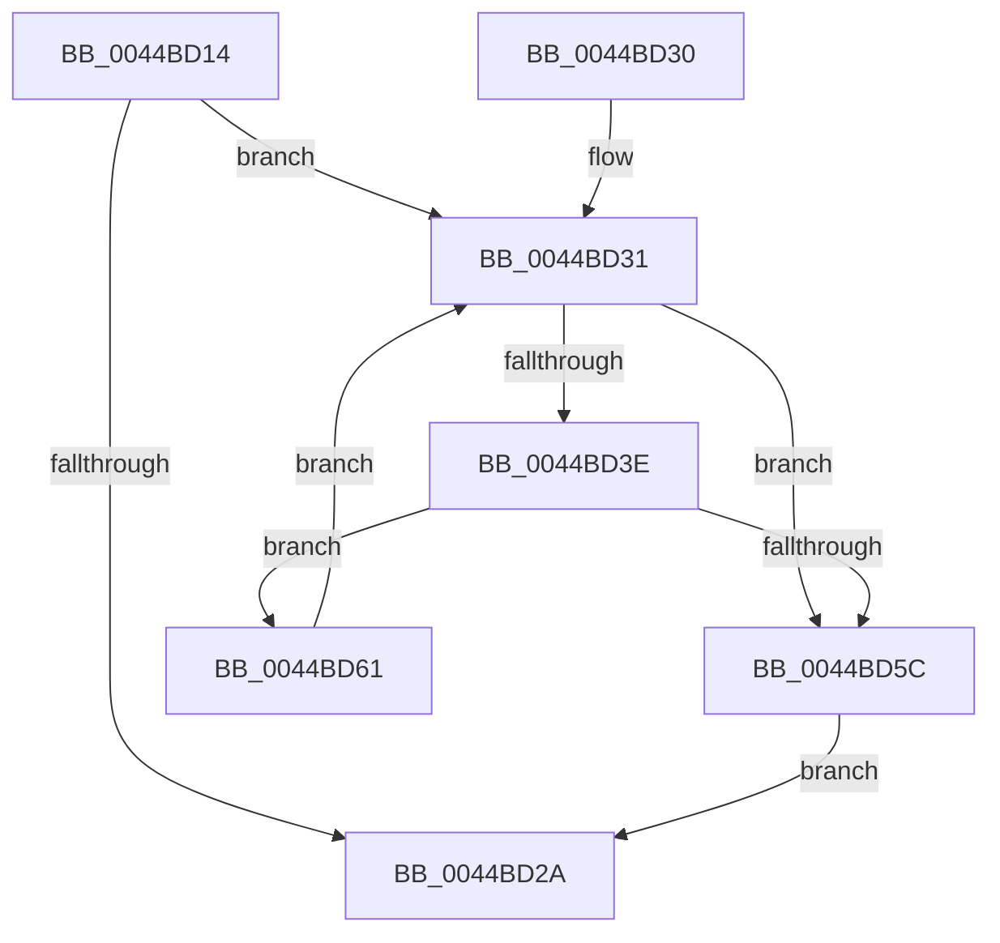

# MiLocateLowestConflictingVad

- RVA: `0x0044BD14`–`0x0044BD66` (길이 `82` bytes)
- VA: `0x000000014044BD14`
- 실행 섹션: `.text`
- PDB 이름 있음: `예`; PDB Function 태그: `아니요`
- unwind 정보 RVA: `0x00062B98`
- 디코드: `27`개 명령, `82/82` bytes 표시
- 미해석 바이트: `0` (있으면 어셈블리에 `.byte`로 보존)

> 이 문서는 커널 이미지의 기계어와 PDB 기호를 분석해 생성했습니다. 4번과 5번은 함수 원형과 자료형을 바이너리 사용 방식에서 추정한 C 해석이며 원본 소스 복구 결과는 아닙니다.

## 1. Dependencies

- 직접 호출 지점: **2**; 고유 호출 대상: **2**
- 직접 호출자로 확인된 함수: **2**
- RIP 상대 이미지 참조: **0**

### Outgoing calls
- `0x0044BD1D` → [MiCheckForConflictingVad](MiCheckForConflictingVad_function_0044BD6C.md) (function, `0x0044BD6C`)
- `0x0044BD34` → [MiGetPreviousVad](../29/MiGetPreviousVad_function_00297268.md) (function, `0x00297268`)

### Direct callers
- [MiExpandVadBitMap](../../page/88/MiExpandVadBitMap_function_00886574.md) at `0x00886618`
- [MiUpdateVadBits](../../page/A8/MiUpdateVadBits_function_00A8DAC8.md) at `0x00A8DAFD`

### Static image references
- 디코드된 RIP-relative 메모리 참조가 없습니다.

## 2. Other-region calls and transfers

- 다른 실행 섹션으로 향하는 call: **0**
- 별도 외부 분기/꼬리 이동을 확인하지 못했습니다.

## 3. Assembly (complete function range)

```asm
0044BD14  40 53                           push rbx
0044BD16  48 83 EC 20                     sub rsp, 0x20
0044BD1A  48 8B DA                        mov rbx, rdx
0044BD1D  E8 4A 00 00 00                  call 0x14044bd6c
0044BD22  4C 8B D8                        mov r11, rax
0044BD25  48 85 C0                        test rax, rax
0044BD28  75 07                           jne 0x14044bd31
0044BD2A  48 83 C4 20                     add rsp, 0x20
0044BD2E  5B                              pop rbx
0044BD2F  C3                              ret
0044BD30  CC                              int3
0044BD31  48 8B C8                        mov rcx, rax
0044BD34  E8 2F B5 E4 FF                  call 0x140297268
0044BD39  48 85 C0                        test rax, rax
0044BD3C  74 1E                           je 0x14044bd5c
0044BD3E  0F B6 50 21                     movzx edx, byte ptr [rax + 0x21]
0044BD42  8B 48 1C                        mov ecx, dword ptr [rax + 0x1c]
0044BD45  48 C1 E2 20                     shl rdx, 0x20
0044BD49  48 0B D1                        or rdx, rcx
0044BD4C  48 C1 E2 0C                     shl rdx, 0xc
0044BD50  48 81 CA FF 0F 00 00            or rdx, 0xfff
0044BD57  48 3B D3                        cmp rdx, rbx
0044BD5A  73 05                           jae 0x14044bd61
0044BD5C  49 8B C3                        mov rax, r11
0044BD5F  EB C9                           jmp 0x14044bd2a
0044BD61  4C 8B D8                        mov r11, rax
0044BD64  EB CB                           jmp 0x14044bd31
```

## 4. C-style interpretation (structured pseudocode)

```c
__int64 __fastcall MiLocateLowestConflictingVad(__int64 a1, __int64 a2)
{
    __int64 result;
    __int64 v_rsp;

    v_rsp = (v_rsp) - (32);
    result = MiCheckForConflictingVad(a1, a2, a3, a4);
    if (result != 0) goto loc_0044BD31;
loc_0044BD2A:
    v_rsp = (v_rsp) + (32);
    return result;
loc_0044BD31:
    result = MiGetPreviousVad(result, a2, a3, a4);
    if (result == 0) goto loc_0044BD5C;
    a2 = (*(unsigned __int8 *)(result + 33)) << (32);
    a2 = (a2) | ((unsigned int)(*(unsigned int *)(result + 28)));
    a2 = (a2) << (12);
    a2 = (a2) | (0xFFFULL);
    if (a2 >= a2) goto loc_0044BD61;
loc_0044BD5C:
    goto loc_0044BD2A;
loc_0044BD61:
    goto loc_0044BD31;
}
```

## 5. (Beta) C Style

```c
int64_t MiLocateLowestConflictingVad(int64_t Arg1, int64_t Arg2)
{
    int64_t result;
    int64_t local_rsp;

    local_rsp = (local_rsp) - (32);
    result = MiCheckForConflictingVad(Arg1, Arg2, a3, a4);
    if (result != 0) goto loc_0044BD31;
loc_0044BD2A:
    local_rsp = (local_rsp) + (32);
    return result;
loc_0044BD31:
    result = MiGetPreviousVad(result, Arg2, a3, a4);
    if (result == 0) goto loc_0044BD5C;
    Arg2 = (*(uint8_t *)(result + 0x21)) << (32);
    Arg2 = (Arg2) | ((uint32_t)(*(uint32_t *)(result + 0x1C)));
    Arg2 = (Arg2) << (12);
    Arg2 = (Arg2) | (0xFFFULL);
    if (Arg2 >= Arg2) goto loc_0044BD61;
loc_0044BD5C:
    goto loc_0044BD2A;
loc_0044BD61:
    goto loc_0044BD31;
}
```

## 6. Execution-region graph

[열기: 2D/3D 그래프와 함수 탐색 컨트롤 패널](../../../control-panel.html?section=text&rva=0x0044BD14&view=graph)

- 2D 그래프는 위에서 아래로 흐르고, 3D 그래프는 빈 공간을 드래그해 회전합니다. Shift+드래그는 이동, 휠은 확대·축소, 함수 노드 선택은 대상 보고서 이동입니다.

### Static fallback


