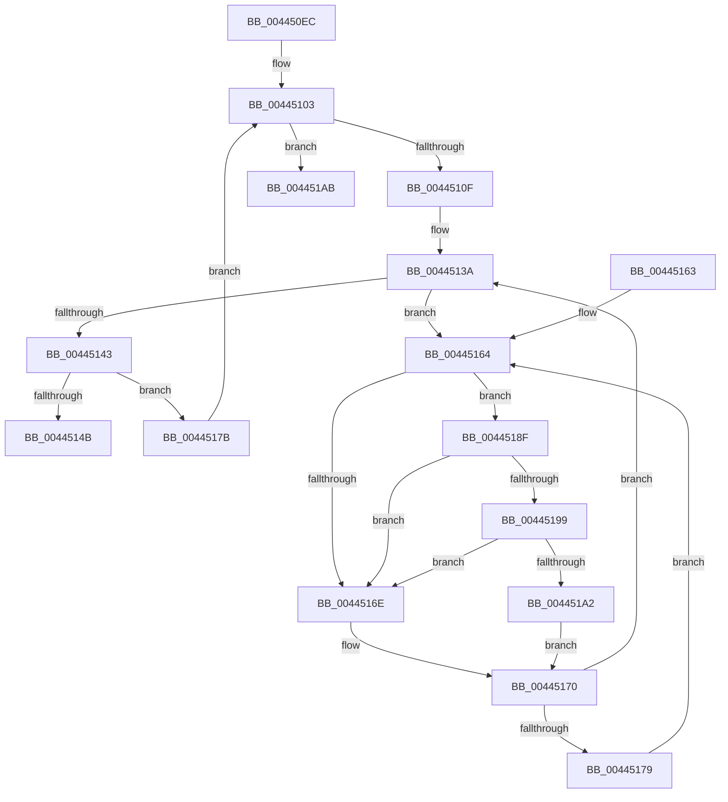

# MiLockNonPagedPoolPte

- RVA: `0x004450EC`–`0x004451E0` (길이 `244` bytes)
- VA: `0x00000001404450EC`
- 실행 섹션: `.text`
- PDB 이름 있음: `예`; PDB Function 태그: `아니요`
- unwind 정보 RVA: `0x000A57E8`
- 디코드: `63`개 명령, `244/244` bytes 표시
- 미해석 바이트: `0` (있으면 어셈블리에 `.byte`로 보존)

> 이 문서는 커널 이미지의 기계어와 PDB 기호를 분석해 생성했습니다. 4번과 5번은 함수 원형과 자료형을 바이너리 사용 방식에서 추정한 C 해석이며 원본 소스 복구 결과는 아닙니다.

## 1. Dependencies

- 직접 호출 지점: **3**; 고유 호출 대상: **3**
- 직접 호출자로 확인된 함수: **2**
- RIP 상대 이미지 참조: **2**

### Outgoing calls
- `0x00445199` → [KiCheckVpBackingLongSpinWaitHypercall](../30/KiCheckVpBackingLongSpinWaitHypercall_function_0030F490.md) (function, `0x0030F490`)
- `0x004451A4` → [HvlNotifyLongSpinWait](../30/HvlNotifyLongSpinWait_function_0030F460.md) (function, `0x0030F460`)
- `0x004451DA` → [KeBugCheckEx](../4F/KeBugCheckEx_function_004FD660.md) (function, `0x004FD660`)

### Direct callers
- [sub_0023C5C6](../23/Unknown_function_0023C5C6.md) at `0x0023C5F2`
- [MmProtectPool](../26/MmProtectPool_function_002697AC.md) at `0x00269ACC`
- [MmProtectPool](../26/MmProtectPool_function_002697AC.md) at `0x00269C04`

### Static image references
- `0x00445166` → RVA `0x00FC52AC` (`ALMOSTRO`; reference)
- `0x0044518F` → RVA `0x00FC6AB8` (`ALMOSTRO`; read)

## 2. Other-region calls and transfers

- 다른 실행 섹션으로 향하는 call: **0**
- 별도 외부 분기/꼬리 이동을 확인하지 못했습니다.

## 3. Assembly (complete function range)

```asm
004450EC  48 89 5C 24 08                  mov qword ptr [rsp + 8], rbx
004450F1  48 89 6C 24 10                  mov qword ptr [rsp + 0x10], rbp
004450F6  48 89 74 24 18                  mov qword ptr [rsp + 0x18], rsi
004450FB  57                              push rdi
004450FC  48 83 EC 30                     sub rsp, 0x30
00445100  48 8B F1                        mov rsi, rcx
00445103  48 8B 1E                        mov rbx, qword ptr [rsi]
00445106  F6 C3 01                        test bl, 1
00445109  0F 84 9C 00 00 00               je 0x1404451ab
0044510F  48 8B C3                        mov rax, rbx
00445112  48 B9 FF FF FF FF FF 00 00 00   movabs rcx, 0xffffffffff
0044511C  48 C1 E8 0C                     shr rax, 0xc
00445120  48 23 C1                        and rax, rcx
00445123  48 8D 3C 40                     lea rdi, [rax + rax*2]
00445127  48 C1 E7 04                     shl rdi, 4
0044512B  48 B8 00 00 00 00 00 DE FF FF   movabs rax, 0xffffde0000000000
00445135  48 03 F8                        add rdi, rax
00445138  33 ED                           xor ebp, ebp
0044513A  F0 48 0F BA 6F 18 3F            lock bts qword ptr [rdi + 0x18], 0x3f
00445141  72 21                           jb 0x140445164
00445143  48 8B 06                        mov rax, qword ptr [rsi]
00445146  48 3B D8                        cmp rbx, rax
00445149  75 30                           jne 0x14044517b
0044514B  48 8B 5C 24 40                  mov rbx, qword ptr [rsp + 0x40]
00445150  48 8B C7                        mov rax, rdi
00445153  48 8B 6C 24 48                  mov rbp, qword ptr [rsp + 0x48]
00445158  48 8B 74 24 50                  mov rsi, qword ptr [rsp + 0x50]
0044515D  48 83 C4 30                     add rsp, 0x30
00445161  5F                              pop rdi
00445162  C3                              ret
00445163  CC                              int3
00445164  FF C5                           inc ebp
00445166  85 2D 40 01 B8 00               test dword ptr [rip + 0xb80140], ebp
0044516C  74 21                           je 0x14044518f
0044516E  F3 90                           pause
00445170  48 8B 47 18                     mov rax, qword ptr [rdi + 0x18]
00445174  48 85 C0                        test rax, rax
00445177  79 C1                           jns 0x14044513a
00445179  EB E9                           jmp 0x140445164
0044517B  48 B8 FF FF FF FF FF FF FF 7F   movabs rax, 0x7fffffffffffffff
00445185  F0 48 21 47 18                  lock and qword ptr [rdi + 0x18], rax
0044518A  E9 74 FF FF FF                  jmp 0x140445103
0044518F  8B 05 23 19 B8 00               mov eax, dword ptr [rip + 0xb81923]
00445195  A8 40                           test al, 0x40
00445197  74 D5                           je 0x14044516e
00445199  E8 F2 A2 EC FF                  call 0x14030f490
0044519E  84 C0                           test al, al
004451A0  74 CC                           je 0x14044516e
004451A2  8B CD                           mov ecx, ebp
004451A4  E8 B7 A2 EC FF                  call 0x14030f460
004451A9  EB C5                           jmp 0x140445170
004451AB  4C 8B C6                        mov r8, rsi
004451AE  49 C1 E0 19                     shl r8, 0x19
004451B2  48 B8 00 00 00 00 80 F6 FF FF   movabs rax, 0xfffff68000000000
004451BC  48 83 64 24 20 00               and qword ptr [rsp + 0x20], 0
004451C2  4C 8B CE                        mov r9, rsi
004451C5  48 C1 E0 19                     shl rax, 0x19
004451C9  BA 07 53 00 00                  mov edx, 0x5307
004451CE  4C 2B C0                        sub r8, rax
004451D1  B9 1A 00 00 00                  mov ecx, 0x1a
004451D6  49 C1 F8 10                     sar r8, 0x10
004451DA  E8 81 84 0B 00                  call 0x1404fd660
004451DF  CC                              int3
```

## 4. C-style interpretation (structured pseudocode)

```c
__int64 __fastcall MiLockNonPagedPoolPte(__int64 a1)
{
    __int64 result;
    __int64 v_rbp;
    __int64 v_rdi;
    __int64 v_rsp;
    unsigned __int64 v_stack_p10;
    unsigned __int64 v_stack_p18;
    unsigned __int64 v_stack_p20;
    unsigned __int64 v_stack_p8;

    v_stack_p8 = v_rbx;
    v_stack_p10 = v_rbp;
    v_stack_p18 = v_rsi;
    v_rsp = (v_rsp) - (48);
loc_00445103:
    if ((((unsigned __int8)(*(unsigned __int64 *)(a1))) & (1)) == 0) goto loc_004451AB;
    result = (*(unsigned __int64 *)(a1)) >> (12);
    result = (result) & (a1);
    v_rdi = (result + result * 2) << (4);
    v_rdi = (v_rdi) + (result);
    v_rbp = 0;
loc_0044513A:
    if (condition_is_below) goto loc_00445164;
    if ((*(unsigned __int64 *)(a1)) != (*(unsigned __int64 *)(a1))) goto loc_0044517B;
    v_rsp = (v_rsp) + (48);
    return v_rdi;
loc_00445164:
    v_rbp = (unsigned int)((v_stack_p10) + 1);
    if (((*(unsigned int *)(v_rip + 12058944)) & ((unsigned int)(v_rbp))) == 0) goto loc_0044518F;
loc_0044516E:
loc_00445170:
    if (!sign_flag) goto loc_0044513A;
    goto loc_00445164;
loc_0044517B:
    goto loc_00445103;
loc_0044518F:
    if ((((unsigned __int8)((unsigned int)(*(unsigned int *)(v_rip + 12065059)))) & (64)) == 0) goto loc_0044516E;
    result = KiCheckVpBackingLongSpinWaitHypercall(a1, a2, a3, a4);
    if ((unsigned __int8)(result) == 0) goto loc_0044516E;
    result = HvlNotifyLongSpinWait((unsigned int)((unsigned int)(v_rbp)), a2, a3, a4);
    goto loc_00445170;
loc_004451AB:
    a3 = (v_stack_p18) << (25);
    result = (result) << (25);
    a3 = (a3) - (result);
    a3 = (a3) >> (16);
    result = KeBugCheckEx(26, (unsigned int)(0x5307ULL), a3, v_stack_p18);
    return result;
}
```

## 5. (Beta) C Style

```c
int64_t MiLockNonPagedPoolPte(void *Arg1)
{
    uint8_t *arg1 = (uint8_t *)Arg1;

    int64_t result;
    int64_t local_rbp;
    int64_t local_rdi;
    int64_t local_rsp;
    uint64_t v_stack_p10;
    uint64_t v_stack_p18;
    uint64_t v_stack_p20;
    uint64_t v_stack_p8;

    v_stack_p8 = local_rbx;
    v_stack_p10 = local_rbp;
    v_stack_p18 = local_rsi;
    local_rsp = (local_rsp) - (48);
loc_00445103:
    if ((((uint8_t)(*(uint64_t *)(arg1))) & (1)) == 0) goto loc_004451AB;
    result = (*(uint64_t *)(arg1)) >> (12);
    result = (result) & (Arg1);
    local_rdi = (result + result * 2) << (4);
    local_rdi = (local_rdi) + (result);
    local_rbp = 0;
loc_0044513A:
    if (condition_is_below) goto loc_00445164;
    if ((*(uint64_t *)(arg1)) != (*(uint64_t *)(arg1))) goto loc_0044517B;
    local_rsp = (local_rsp) + (48);
    return local_rdi;
loc_00445164:
    local_rbp = (uint32_t)((v_stack_p10) + 1);
    if (((*(uint32_t *)(v_rip + 0xB80140)) & ((uint32_t)(local_rbp))) == 0) goto loc_0044518F;
loc_0044516E:
loc_00445170:
    if (!sign_flag) goto loc_0044513A;
    goto loc_00445164;
loc_0044517B:
    goto loc_00445103;
loc_0044518F:
    if ((((uint8_t)((uint32_t)(*(uint32_t *)(v_rip + 0xB81923)))) & (64)) == 0) goto loc_0044516E;
    result = KiCheckVpBackingLongSpinWaitHypercall(Arg1, a2, a3, a4);
    if ((uint8_t)(result) == 0) goto loc_0044516E;
    result = HvlNotifyLongSpinWait((uint32_t)((uint32_t)(local_rbp)), a2, a3, a4);
    goto loc_00445170;
loc_004451AB:
    a3 = (v_stack_p18) << (25);
    result = (result) << (25);
    a3 = (a3) - (result);
    a3 = (a3) >> (16);
    result = KeBugCheckEx(26, (uint32_t)(0x5307ULL), a3, v_stack_p18);
    return result;
}
```

### 관측된 메모리 오프셋

구조체 형식이 확인되지 않은 접근은 인자 기준의 오프셋으로만 기록했습니다.

| 기준 인자 | 오프셋 표현 | 폭 (bit) | 접근 |
|---|---:|---:|---|
| `Arg1` | `+ 0x0` | `64` | `R` |

## 6. Execution-region graph

[열기: 2D/3D 그래프와 함수 탐색 컨트롤 패널](../../../control-panel.html?section=text&rva=0x004450EC&view=graph)

- 2D 그래프는 위에서 아래로 흐르고, 3D 그래프는 빈 공간을 드래그해 회전합니다. Shift+드래그는 이동, 휠은 확대·축소, 함수 노드 선택은 대상 보고서 이동입니다.

### Static fallback


