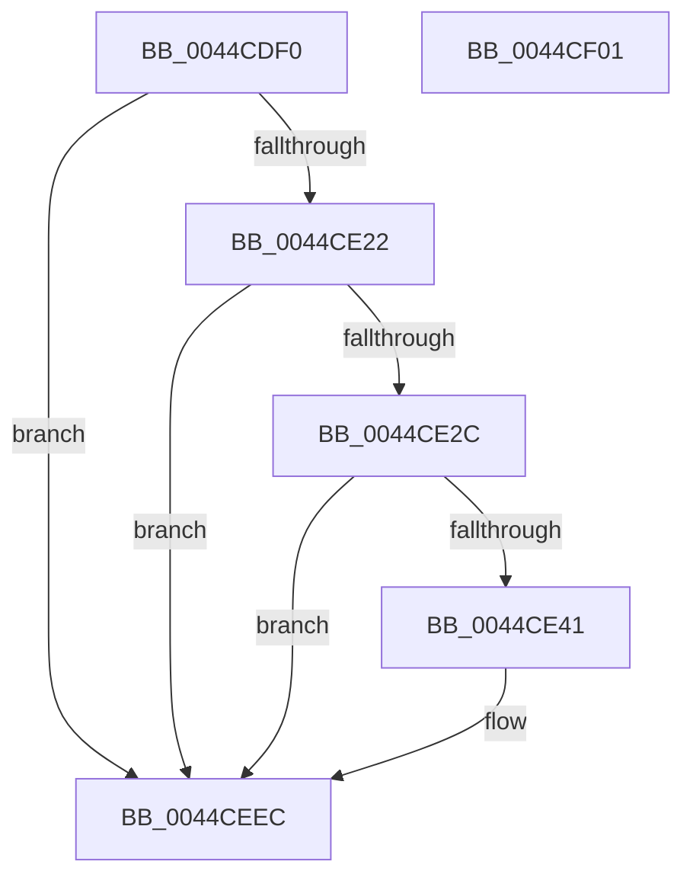

# MiLogSlabEntryDemote

- RVA: `0x0044CDF0`–`0x0044CF02` (길이 `274` bytes)
- VA: `0x000000014044CDF0`
- 실행 섹션: `.text`
- PDB 이름 있음: `예`; PDB Function 태그: `아니요`
- unwind 정보 RVA: `0x000A68C4`
- 디코드: `66`개 명령, `274/274` bytes 표시
- 미해석 바이트: `0` (있으면 어셈블리에 `.byte`로 보존)

> 이 문서는 커널 이미지의 기계어와 PDB 기호를 분석해 생성했습니다. 4번과 5번은 함수 원형과 자료형을 바이너리 사용 방식에서 추정한 C 해석이며 원본 소스 복구 결과는 아닙니다.

## 1. Dependencies

- 직접 호출 지점: **3**; 고유 호출 대상: **3**
- 직접 호출자로 확인된 함수: **1**
- RIP 상대 이미지 참조: **3**

### Outgoing calls
- `0x0044CE34` → [tlgKeywordOn](../42/tlgKeywordOn_function_0042EAA0.md) (function, `0x0042EAA0`)
- `0x0044CEE7` → [tlgWriteEx_EtwWriteEx](../4A/tlgWriteEx_EtwWriteEx_function_004AA348.md) (function, `0x004AA348`)
- `0x0044CEF3` → [_security_check_cookie](../6A/_security_check_cookie_function_006AC640.md) (function, `0x006AC640`)

### Direct callers
- [MiDemoteSlabEntry](MiDemoteSlabEntry_function_0044CB0C.md) at `0x0044CD21`

### Static image references
- `0x0044CDFE` → RVA `0x00E0A740` (`.data`; read)
- `0x0044CE0C` → RVA `0x00E37618` (`.data`; read)
- `0x0044CE84` → RVA `0x000598C6` (`.rdata`; read)

## 2. Other-region calls and transfers

- 다른 실행 섹션으로 향하는 call: **0**
- 별도 외부 분기/꼬리 이동을 확인하지 못했습니다.

## 3. Assembly (complete function range)

```asm
0044CDF0  40 55                           push rbp
0044CDF2  48 8D 6C 24 A9                  lea rbp, [rsp - 0x57]
0044CDF7  48 81 EC 00 01 00 00            sub rsp, 0x100
0044CDFE  48 8B 05 3B D9 9B 00            mov rax, qword ptr [rip + 0x9bd93b]
0044CE05  48 33 C4                        xor rax, rsp
0044CE08  48 89 45 47                     mov qword ptr [rbp + 0x47], rax
0044CE0C  4C 8B 05 05 A8 9E 00            mov r8, qword ptr [rip + 0x9ea805]
0044CE13  4C 8B CA                        mov r9, rdx
0044CE16  4C 8B D1                        mov r10, rcx
0044CE19  4D 85 C0                        test r8, r8
0044CE1C  0F 84 CA 00 00 00               je 0x14044ceec
0044CE22  41 83 38 05                     cmp dword ptr [r8], 5
0044CE26  0F 86 C0 00 00 00               jbe 0x14044ceec
0044CE2C  BA 00 04 00 00                  mov edx, 0x400
0044CE31  49 8B C8                        mov rcx, r8
0044CE34  E8 67 1C FE FF                  call 0x14042eaa0
0044CE39  84 C0                           test al, al
0044CE3B  0F 84 AB 00 00 00               je 0x14044ceec
0044CE41  49 8B 4A 38                     mov rcx, qword ptr [r10 + 0x38]
0044CE45  BA 01 00 00 00                  mov edx, 1
0044CE4A  8A 81 80 00 00 00               mov al, byte ptr [rcx + 0x80]
0044CE50  88 45 97                        mov byte ptr [rbp - 0x69], al
0044CE53  48 8D 45 97                     lea rax, [rbp - 0x69]
0044CE57  48 89 45 E7                     mov qword ptr [rbp - 0x19], rax
0044CE5B  48 89 55 EF                     mov qword ptr [rbp - 0x11], rdx
0044CE5F  8B 81 88 00 00 00               mov eax, dword ptr [rcx + 0x88]
0044CE65  8D 4A 07                        lea ecx, [rdx + 7]
0044CE68  C1 E8 04                        shr eax, 4
0044CE6B  83 E0 03                        and eax, 3
0044CE6E  4C 89 4D A7                     mov qword ptr [rbp - 0x59], r9
0044CE72  89 45 9B                        mov dword ptr [rbp - 0x65], eax
0044CE75  44 8B CA                        mov r9d, edx
0044CE78  48 8D 45 9B                     lea rax, [rbp - 0x65]
0044CE7C  48 89 4D 0F                     mov qword ptr [rbp + 0xf], rcx
0044CE80  48 89 45 F7                     mov qword ptr [rbp - 9], rax
0044CE84  48 8D 15 3B CA C0 FF            lea rdx, [rip - 0x3f35c5]
0044CE8B  41 8B 42 54                     mov eax, dword ptr [r10 + 0x54]
0044CE8F  48 89 45 9F                     mov qword ptr [rbp - 0x61], rax
0044CE93  48 8D 45 9F                     lea rax, [rbp - 0x61]
0044CE97  48 89 45 07                     mov qword ptr [rbp + 7], rax
0044CE9B  48 8D 45 A7                     lea rax, [rbp - 0x59]
0044CE9F  48 89 45 17                     mov qword ptr [rbp + 0x17], rax
0044CEA3  49 8B 42 28                     mov rax, qword ptr [r10 + 0x28]
0044CEA7  48 89 45 AF                     mov qword ptr [rbp - 0x51], rax
0044CEAB  48 8D 45 AF                     lea rax, [rbp - 0x51]
0044CEAF  48 89 45 27                     mov qword ptr [rbp + 0x27], rax
0044CEB3  49 8B 42 30                     mov rax, qword ptr [r10 + 0x30]
0044CEB7  48 89 45 B7                     mov qword ptr [rbp - 0x49], rax
0044CEBB  48 8D 45 B7                     lea rax, [rbp - 0x49]
0044CEBF  48 89 45 37                     mov qword ptr [rbp + 0x37], rax
0044CEC3  48 8D 45 C7                     lea rax, [rbp - 0x39]
0044CEC7  48 89 44 24 38                  mov qword ptr [rsp + 0x38], rax
0044CECC  89 4C 24 30                     mov dword ptr [rsp + 0x30], ecx
0044CED0  48 89 4D 1F                     mov qword ptr [rbp + 0x1f], rcx
0044CED4  48 89 4D 2F                     mov qword ptr [rbp + 0x2f], rcx
0044CED8  48 89 4D 3F                     mov qword ptr [rbp + 0x3f], rcx
0044CEDC  49 8B C8                        mov rcx, r8
0044CEDF  48 C7 45 FF 04 00 00 00         mov qword ptr [rbp - 1], 4
0044CEE7  E8 5C D4 05 00                  call 0x1404aa348
0044CEEC  48 8B 4D 47                     mov rcx, qword ptr [rbp + 0x47]
0044CEF0  48 33 CC                        xor rcx, rsp
0044CEF3  E8 48 F7 25 00                  call 0x1406ac640
0044CEF8  48 81 C4 00 01 00 00            add rsp, 0x100
0044CEFF  5D                              pop rbp
0044CF00  C3                              ret
0044CF01  CC                              int3
```

## 4. C-style interpretation (structured pseudocode)

```c
__int64 __fastcall MiLogSlabEntryDemote(__int64 a1, __int64 a2)
{
    __int64 result;
    __int64 v_rsp;
    unsigned __int64 v_stack_m18;
    unsigned __int64 v_stack_m20;
    unsigned __int64 v_stack_m28;
    unsigned __int64 v_stack_m30;
    unsigned __int64 v_stack_m38;
    unsigned __int64 v_stack_m40;
    unsigned __int64 v_stack_m48;
    unsigned __int64 v_stack_m50;
    unsigned __int64 v_stack_m58;
    unsigned __int64 v_stack_m5F;
    unsigned __int64 v_stack_m60;
    unsigned __int64 v_stack_m68;
    unsigned __int64 v_stack_m70;
    unsigned __int64 v_stack_m78;
    unsigned __int64 v_stack_m98;
    unsigned __int64 v_stack_mA8;
    unsigned __int64 v_stack_mB0;
    unsigned __int64 v_stack_mB8;
    unsigned __int64 v_stack_mC0;
    unsigned int v_stack_mC4;
    unsigned __int8 v_stack_mC8;
    unsigned __int64 v_stack_mD0;
    unsigned int v_stack_mD8;

    v_rsp = (v_rsp) - (256);
    result = (*(unsigned __int64 *)(v_rip + 10213691)) ^ (v_rsp);
    v_stack_m18 = result;
    if (*(unsigned __int64 *)(v_rip + 10397701) == 0) goto loc_0044CEEC;
    if ((*(unsigned int *)(*(unsigned __int64 *)(v_rip + 10397701))) <= 5) goto loc_0044CEEC;
    result = tlgKeywordOn(*(unsigned __int64 *)(v_rip + 10397701), (unsigned int)(0x400ULL), *(unsigned __int64 *)(v_rip + 10397701), a2);
    if ((unsigned __int8)(result) != 0) {
        a1 = *(unsigned __int64 *)(a1 + 56);
        a2 = 1;
        result = *(unsigned __int8 *)(a1 + 128);
        v_stack_mC8 = (unsigned __int8)(result);
        result = v_stack_mC8;
        v_stack_m78 = result;
        v_stack_m70 = a2;
        result = *(unsigned int *)(a1 + 136);
        a1 = a2 + 7;
        result = (unsigned int)((result) >> (4));
        result = (unsigned int)((result) & (3));
        v_stack_mB8 = a2;
        v_stack_mC4 = (unsigned int)(result);
        a4 = (unsigned int)(a2);
        result = v_stack_mC4;
        v_stack_m50 = a1;
        v_stack_m68 = result;
        a2 = v_rip - 4142533;
        result = *(unsigned int *)(a1 + 84);
        v_stack_mC0 = result;
        result = v_stack_mC0;
        v_stack_m58 = result;
        result = v_stack_mB8;
        v_stack_m48 = result;
        result = *(unsigned __int64 *)(a1 + 40);
        v_stack_mB0 = result;
        result = v_stack_mB0;
        v_stack_m38 = result;
        result = *(unsigned __int64 *)(a1 + 48);
        v_stack_mA8 = result;
        result = v_stack_mA8;
        v_stack_m28 = result;
        result = v_stack_m98;
        v_stack_mD0 = result;
        v_stack_mD8 = (unsigned int)(a1);
        v_stack_m40 = a1;
        v_stack_m30 = a1;
        v_stack_m20 = a1;
        a1 = *(unsigned __int64 *)(v_rip + 10397701);
        v_stack_m60 = 4;
        result = tlgWriteEx_EtwWriteEx(a1, a2, *(unsigned __int64 *)(v_rip + 10397701), a4);
    }
    a1 = (v_stack_m18) ^ (v_rsp);
    result = _security_check_cookie(a1, a2, *(unsigned __int64 *)(v_rip + 10397701), a4);
    v_rsp = (v_rsp) + (256);
    return result;
}
```

## 5. (Beta) C Style

```c
int64_t MiLogSlabEntryDemote(int64_t Arg1, int64_t Arg2)
{
    int64_t result;
    int64_t local_rsp;
    uint64_t v_stack_m18;
    uint64_t v_stack_m20;
    uint64_t v_stack_m28;
    uint64_t v_stack_m30;
    uint64_t v_stack_m38;
    uint64_t v_stack_m40;
    uint64_t v_stack_m48;
    uint64_t v_stack_m50;
    uint64_t v_stack_m58;
    uint64_t v_stack_m5F;
    uint64_t v_stack_m60;
    uint64_t v_stack_m68;
    uint64_t v_stack_m70;
    uint64_t v_stack_m78;
    uint64_t v_stack_m98;
    uint64_t v_stack_mA8;
    uint64_t v_stack_mB0;
    uint64_t v_stack_mB8;
    uint64_t v_stack_mC0;
    uint32_t v_stack_mC4;
    uint8_t v_stack_mC8;
    uint64_t v_stack_mD0;
    uint32_t v_stack_mD8;

    local_rsp = (local_rsp) - (256);
    result = (*(uint64_t *)(v_rip + 0x9BD93B)) ^ (local_rsp);
    v_stack_m18 = result;
    if (*(uint64_t *)(v_rip + 0x9EA805) == 0) goto loc_0044CEEC;
    if ((*(uint32_t *)(*(uint64_t *)(v_rip + 0x9EA805))) <= 5) goto loc_0044CEEC;
    result = tlgKeywordOn(*(uint64_t *)(v_rip + 0x9EA805), (uint32_t)(0x400ULL), *(uint64_t *)(v_rip + 0x9EA805), Arg2);
    if ((uint8_t)(result) != 0) {
        Arg1 = *(uint64_t *)(Arg1 + 0x38);
        Arg2 = 1;
        result = *(uint8_t *)(Arg1 + 0x80);
        v_stack_mC8 = (uint8_t)(result);
        result = v_stack_mC8;
        v_stack_m78 = result;
        v_stack_m70 = Arg2;
        result = *(uint32_t *)(Arg1 + 0x88);
        Arg1 = Arg2 + 7;
        result = (uint32_t)((result) >> (4));
        result = (uint32_t)((result) & (3));
        v_stack_mB8 = Arg2;
        v_stack_mC4 = (uint32_t)(result);
        a4 = (uint32_t)(Arg2);
        result = v_stack_mC4;
        v_stack_m50 = Arg1;
        v_stack_m68 = result;
        Arg2 = v_rip - 4142533;
        result = *(uint32_t *)(Arg1 + 0x54);
        v_stack_mC0 = result;
        result = v_stack_mC0;
        v_stack_m58 = result;
        result = v_stack_mB8;
        v_stack_m48 = result;
        result = *(uint64_t *)(Arg1 + 0x28);
        v_stack_mB0 = result;
        result = v_stack_mB0;
        v_stack_m38 = result;
        result = *(uint64_t *)(Arg1 + 0x30);
        v_stack_mA8 = result;
        result = v_stack_mA8;
        v_stack_m28 = result;
        result = v_stack_m98;
        v_stack_mD0 = result;
        v_stack_mD8 = (uint32_t)(Arg1);
        v_stack_m40 = Arg1;
        v_stack_m30 = Arg1;
        v_stack_m20 = Arg1;
        Arg1 = *(uint64_t *)(v_rip + 0x9EA805);
        v_stack_m60 = 4;
        result = tlgWriteEx_EtwWriteEx(Arg1, Arg2, *(uint64_t *)(v_rip + 0x9EA805), a4);
    }
    Arg1 = (v_stack_m18) ^ (local_rsp);
    result = _security_check_cookie(Arg1, Arg2, *(uint64_t *)(v_rip + 0x9EA805), a4);
    local_rsp = (local_rsp) + (256);
    return result;
}
```

## 6. Execution-region graph

[열기: 2D/3D 그래프와 함수 탐색 컨트롤 패널](../../../control-panel.html?section=text&rva=0x0044CDF0&view=graph)

- 2D 그래프는 위에서 아래로 흐르고, 3D 그래프는 빈 공간을 드래그해 회전합니다. Shift+드래그는 이동, 휠은 확대·축소, 함수 노드 선택은 대상 보고서 이동입니다.

### Static fallback


