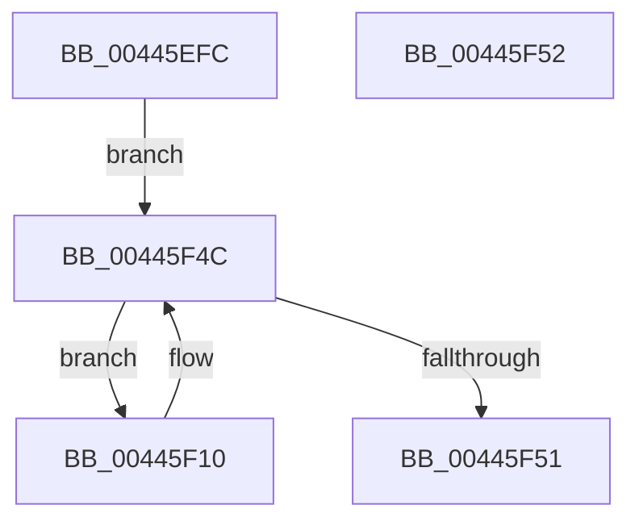

# MiMarkLockedChainAsProtected

- RVA: `0x00445EFC`–`0x00445F53` (길이 `87` bytes)
- VA: `0x0000000140445EFC`
- 실행 섹션: `.text`
- PDB 이름 있음: `예`; PDB Function 태그: `아니요`
- unwind 정보 RVA: `0x000DB714`
- 디코드: `22`개 명령, `87/87` bytes 표시
- 미해석 바이트: `0` (있으면 어셈블리에 `.byte`로 보존)

> 이 문서는 커널 이미지의 기계어와 PDB 기호를 분석해 생성했습니다. 4번과 5번은 함수 원형과 자료형을 바이너리 사용 방식에서 추정한 C 해석이며 원본 소스 복구 결과는 아닙니다.

## 1. Dependencies

- 직접 호출 지점: **0**; 고유 호출 대상: **0**
- 직접 호출자로 확인된 함수: **1**
- RIP 상대 이미지 참조: **0**

### Outgoing calls
- 직접 디코드된 call 명령이 없습니다.

### Direct callers
- [MiExclusiveInsertPfnChainInList](MiExclusiveInsertPfnChainInList_function_00445C48.md) at `0x00445D56`

### Static image references
- 디코드된 RIP-relative 메모리 참조가 없습니다.

## 2. Other-region calls and transfers

- 다른 실행 섹션으로 향하는 call: **0**
- 별도 외부 분기/꼬리 이동을 확인하지 못했습니다.

## 3. Assembly (complete function range)

```asm
00445EFC  89 54 24 10                     mov dword ptr [rsp + 0x10], edx
00445F00  49 B8 FF FF FF FF 3F 00 00 00   movabs r8, 0x3fffffffff
00445F0A  48 8B 51 10                     mov rdx, qword ptr [rcx + 0x10]
00445F0E  EB 3C                           jmp 0x140445f4c
00445F10  48 8D 0C 52                     lea rcx, [rdx + rdx*2]
00445F14  48 C1 E1 04                     shl rcx, 4
00445F18  48 B8 00 00 00 00 00 DE FF FF   movabs rax, 0xffffde0000000000
00445F22  48 03 C8                        add rcx, rax
00445F25  48 B8 FF FF FF FF FF 00 00 00   movabs rax, 0xffffffffff
00445F2F  48 8B 11                        mov rdx, qword ptr [rcx]
00445F32  48 23 D0                        and rdx, rax
00445F35  8B 41 20                        mov eax, dword ptr [rcx + 0x20]
00445F38  89 44 24 10                     mov dword ptr [rsp + 0x10], eax
00445F3C  C1 E8 18                        shr eax, 0x18
00445F3F  0C 08                           or al, 8
00445F41  88 44 24 13                     mov byte ptr [rsp + 0x13], al
00445F45  8B 44 24 10                     mov eax, dword ptr [rsp + 0x10]
00445F49  89 41 20                        mov dword ptr [rcx + 0x20], eax
00445F4C  49 3B D0                        cmp rdx, r8
00445F4F  75 BF                           jne 0x140445f10
00445F51  C3                              ret
00445F52  CC                              int3
```

## 4. C-style interpretation (structured pseudocode)

```c
__int64 __fastcall MiMarkLockedChainAsProtected(__int64 a1, int a2)
{
    __int64 result;
    unsigned int v_stack_p10;
    unsigned __int8 v_stack_p13;

    v_stack_p10 = a2;
    goto loc_00445F4C;
loc_00445F10:
    a1 = (*(unsigned __int64 *)(a1 + 16) + *(unsigned __int64 *)(a1 + 16) * 2) << (4);
    a1 = (a1) + (result);
    a2 = (*(unsigned __int64 *)(a1)) & (result);
    v_stack_p10 = (unsigned int)((unsigned int)(*(unsigned int *)(a1 + 32)));
    result = (unsigned int)(((unsigned int)(*(unsigned int *)(a1 + 32))) >> (24));
    result = (unsigned __int8)((result) | (8));
    v_stack_p13 = (unsigned __int8)(result);
    *(unsigned int *)(a1 + 32) = (unsigned int)((unsigned int)(v_stack_p10));
loc_00445F4C:
    if (a2 != a3) goto loc_00445F10;
    return (unsigned int)(v_stack_p10);
}
```

## 5. (Beta) C Style

```c
int64_t MiMarkLockedChainAsProtected(void *Arg1, int32_t Arg2)
{
    uint8_t *arg1 = (uint8_t *)Arg1;

    int64_t result;
    uint32_t v_stack_p10;
    uint8_t v_stack_p13;

    v_stack_p10 = Arg2;
    goto loc_00445F4C;
loc_00445F10:
    Arg1 = (*(uint64_t *)(arg1 + 0x10) + *(uint64_t *)(arg1 + 0x10) * 2) << (4);
    Arg1 = (Arg1) + (result);
    Arg2 = (*(uint64_t *)(arg1)) & (result);
    v_stack_p10 = (uint32_t)((uint32_t)(*(uint32_t *)(arg1 + 0x20)));
    result = (uint32_t)(((uint32_t)(*(uint32_t *)(arg1 + 0x20))) >> (24));
    result = (uint8_t)((result) | (8));
    v_stack_p13 = (uint8_t)(result);
    *(uint32_t *)(arg1 + 0x20) = (uint32_t)((uint32_t)(v_stack_p10));
loc_00445F4C:
    if (Arg2 != a3) goto loc_00445F10;
    return (uint32_t)(v_stack_p10);
}
```

### 관측된 메모리 오프셋

구조체 형식이 확인되지 않은 접근은 인자 기준의 오프셋으로만 기록했습니다.

| 기준 인자 | 오프셋 표현 | 폭 (bit) | 접근 |
|---|---:|---:|---|
| `Arg1` | `+ 0x10` | `64` | `R` |

## 6. Execution-region graph

[열기: 2D/3D 그래프와 함수 탐색 컨트롤 패널](../../../control-panel.html?section=text&rva=0x00445EFC&view=graph)

- 2D 그래프는 위에서 아래로 흐르고, 3D 그래프는 빈 공간을 드래그해 회전합니다. Shift+드래그는 이동, 휠은 확대·축소, 함수 노드 선택은 대상 보고서 이동입니다.

### Static fallback


