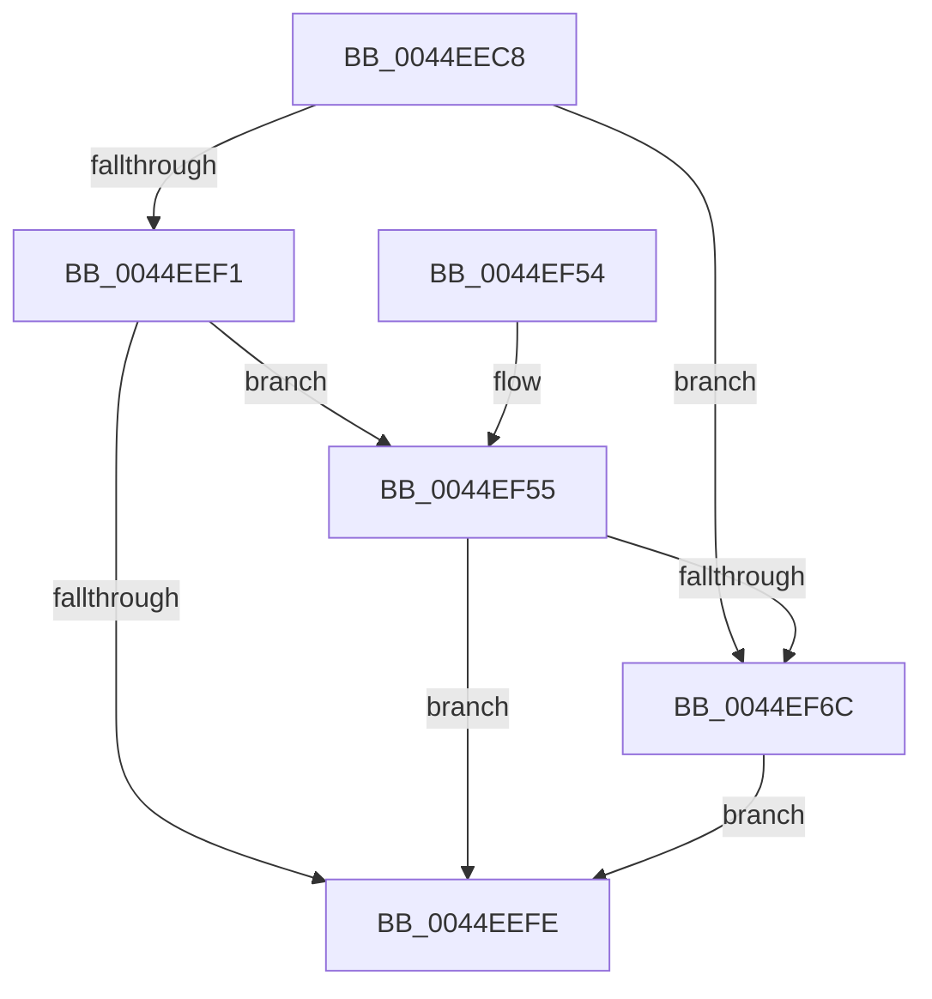

# MiQueryPfn

- RVA: `0x0044EEC8`–`0x0044EF77` (길이 `175` bytes)
- VA: `0x000000014044EEC8`
- 실행 섹션: `.text`
- PDB 이름 있음: `예`; PDB Function 태그: `아니요`
- unwind 정보 RVA: `0x00092364`
- 디코드: `48`개 명령, `175/175` bytes 표시
- 미해석 바이트: `0` (있으면 어셈블리에 `.byte`로 보존)

> 이 문서는 커널 이미지의 기계어와 PDB 기호를 분석해 생성했습니다. 4번과 5번은 함수 원형과 자료형을 바이너리 사용 방식에서 추정한 C 해석이며 원본 소스 복구 결과는 아닙니다.

## 1. Dependencies

- 직접 호출 지점: **1**; 고유 호출 대상: **1**
- 직접 호출자로 확인된 함수: **1**
- RIP 상대 이미지 참조: **0**

### Outgoing calls
- `0x0044EF01` → [MiGetPfnPriority](../32/MiGetPfnPriority_function_003226F0.md) (function, `0x003226F0`)

### Direct callers
- [MiGetWorkingSetInfoList](../2A/MiGetWorkingSetInfoList_function_002AF770.md) at `0x002B0106`
- [MiGetWorkingSetInfoList](../2A/MiGetWorkingSetInfoList_function_002AF770.md) at `0x002B0660`

### Static image references
- 디코드된 RIP-relative 메모리 참조가 없습니다.

## 2. Other-region calls and transfers

- 다른 실행 섹션으로 향하는 call: **0**
- 별도 외부 분기/꼬리 이동을 확인하지 못했습니다.

## 3. Assembly (complete function range)

```asm
0044EEC8  40 53                           push rbx
0044EECA  48 83 EC 20                     sub rsp, 0x20
0044EECE  4C 8D 1C 49                     lea r11, [rcx + rcx*2]
0044EED2  48 8B DA                        mov rbx, rdx
0044EED5  49 C1 E3 04                     shl r11, 4
0044EED9  48 B8 00 00 00 00 00 DE FF FF   movabs rax, 0xffffde0000000000
0044EEE3  4C 03 D8                        add r11, rax
0044EEE6  41 8B 43 20                     mov eax, dword ptr [r11 + 0x20]
0044EEEA  C1 E8 18                        shr eax, 0x18
0044EEED  A8 40                           test al, 0x40
0044EEEF  75 7B                           jne 0x14044ef6c
0044EEF1  41 8B 43 20                     mov eax, dword ptr [r11 + 0x20]
0044EEF5  C1 E8 10                        shr eax, 0x10
0044EEF8  24 07                           and al, 7
0044EEFA  3C 05                           cmp al, 5
0044EEFC  74 57                           je 0x14044ef55
0044EEFE  49 8B CB                        mov rcx, r11
0044EF01  E8 EA 37 ED FF                  call 0x1403226f0
0044EF06  33 C9                           xor ecx, ecx
0044EF08  44 8B D0                        mov r10d, eax
0044EF0B  49 C1 E2 18                     shl r10, 0x18
0044EF0F  41 B8 00 00 00 08               mov r8d, 0x8000000
0044EF15  49 8B D2                        mov rdx, r10
0044EF18  48 33 53 08                     xor rdx, qword ptr [rbx + 8]
0044EF1C  48 81 E2 FF FF FF F8            and rdx, 0xfffffffff8ffffff
0044EF23  49 33 D2                        xor rdx, r10
0044EF26  48 89 53 08                     mov qword ptr [rbx + 8], rdx
0044EF2A  41 8A 43 22                     mov al, byte ptr [r11 + 0x22]
0044EF2E  24 07                           and al, 7
0044EF30  3C 03                           cmp al, 3
0044EF32  41 0F 44 C8                     cmove ecx, r8d
0044EF36  48 81 E2 FF FF 7F F7            and rdx, 0xfffffffff77fffff
0044EF3D  48 0F BA F1 17                  btr rcx, 0x17
0044EF42  48 0B CA                        or rcx, rdx
0044EF45  48 0F BA E9 16                  bts rcx, 0x16
0044EF4A  48 89 4B 08                     mov qword ptr [rbx + 8], rcx
0044EF4E  48 83 C4 20                     add rsp, 0x20
0044EF52  5B                              pop rbx
0044EF53  C3                              ret
0044EF54  CC                              int3
0044EF55  49 8B 43 08                     mov rax, qword ptr [r11 + 8]
0044EF59  48 B9 00 00 00 00 00 00 00 80   movabs rcx, 0x8000000000000000
0044EF63  48 0B C1                        or rax, rcx
0044EF66  48 83 F8 FC                     cmp rax, -4
0044EF6A  75 92                           jne 0x14044eefe
0044EF6C  B8 00 00 00 80                  mov eax, 0x80000000
0044EF71  48 09 42 08                     or qword ptr [rdx + 8], rax
0044EF75  EB 87                           jmp 0x14044eefe
```

## 4. C-style interpretation (structured pseudocode)

```c
__int64 __fastcall MiQueryPfn(__int64 a1, __int64 a2)
{
    __int64 result;
    __int64 v_r10;
    __int64 v_r11;
    __int64 v_rsp;

    v_rsp = (v_rsp) - (32);
    v_r11 = (a1 + a1 * 2) << (4);
    v_r11 = (v_r11) + (result);
    result = (unsigned int)(((unsigned int)(*(unsigned int *)(v_r11 + 32))) >> (24));
    if ((((unsigned __int8)(result)) & (64)) != 0) goto loc_0044EF6C;
    result = (unsigned int)(((unsigned int)(*(unsigned int *)(v_r11 + 32))) >> (16));
    result = (unsigned __int8)((result) & (7));
    if (((unsigned __int8)(result)) == 5) goto loc_0044EF55;
loc_0044EEFE:
    result = MiGetPfnPriority(v_r11, a2, a3, a4);
    a1 = 0;
    v_r10 = ((unsigned int)((unsigned int)(result))) << (24);
    a2 = (v_r10) ^ (*(unsigned __int64 *)(a2 + 8));
    a2 = (a2) & (0xFFFFFFFFF8FFFFFFULL);
    a2 = (a2) ^ (v_r10);
    *(unsigned __int64 *)(a2 + 8) = a2;
    result = (unsigned __int8)((*(unsigned __int8 *)(v_r11 + 34)) & (7));
    if (((unsigned __int8)(result)) == 3) { a1 = (unsigned int)((unsigned int)(0x8000000ULL)); }
    a2 = (a2) & (0xFFFFFFFFF77FFFFFULL);
    a1 = (a1) | (a2);
    *(unsigned __int64 *)(a2 + 8) = a1;
    v_rsp = (v_rsp) + (32);
    return result;
loc_0044EF55:
    result = (*(unsigned __int64 *)(v_r11 + 8)) | (a1);
    if (result != -4) goto loc_0044EEFE;
loc_0044EF6C:
    goto loc_0044EEFE;
}
```

## 5. (Beta) C Style

```c
int64_t MiQueryPfn(void *Arg1, void *Arg2)
{
    uint8_t *arg1 = (uint8_t *)Arg1;
    uint8_t *arg2 = (uint8_t *)Arg2;

    int64_t result;
    int64_t local_r10;
    int64_t local_r11;
    int64_t local_rsp;

    local_rsp = (local_rsp) - (32);
    local_r11 = (Arg1 + Arg1 * 2) << (4);
    local_r11 = (local_r11) + (result);
    result = (uint32_t)(((uint32_t)(*(uint32_t *)(local_r11 + 0x20))) >> (24));
    if ((((uint8_t)(result)) & (64)) != 0) goto loc_0044EF6C;
    result = (uint32_t)(((uint32_t)(*(uint32_t *)(local_r11 + 0x20))) >> (16));
    result = (uint8_t)((result) & (7));
    if (((uint8_t)(result)) == 5) goto loc_0044EF55;
loc_0044EEFE:
    result = MiGetPfnPriority(local_r11, Arg2, a3, a4);
    Arg1 = 0;
    local_r10 = ((uint32_t)((uint32_t)(result))) << (24);
    Arg2 = (local_r10) ^ (*(uint64_t *)(arg2 + 0x8));
    Arg2 = (Arg2) & (0xFFFFFFFFF8FFFFFFULL);
    Arg2 = (Arg2) ^ (local_r10);
    *(void **)(arg2 + 0x8) = Arg2;
    result = (uint8_t)((*(uint8_t *)(local_r11 + 0x22)) & (7));
    if (((uint8_t)(result)) == 3) { Arg1 = (uint32_t)((uint32_t)(0x8000000ULL)); }
    Arg2 = (Arg2) & (0xFFFFFFFFF77FFFFFULL);
    Arg1 = (Arg1) | (Arg2);
    *(void **)(arg2 + 0x8) = Arg1;
    local_rsp = (local_rsp) + (32);
    return result;
loc_0044EF55:
    result = (*(uint64_t *)(local_r11 + 0x8)) | (Arg1);
    if (result != -4) goto loc_0044EEFE;
loc_0044EF6C:
    goto loc_0044EEFE;
}
```

### 관측된 메모리 오프셋

구조체 형식이 확인되지 않은 접근은 인자 기준의 오프셋으로만 기록했습니다.

| 기준 인자 | 오프셋 표현 | 폭 (bit) | 접근 |
|---|---:|---:|---|
| `Arg1` | `+ 0x0 + rcx*2` | `64` | `R` |
| `Arg2` | `+ 0x8` | `64` | `R` |
| `Arg2` | `+ 0x8` | `64` | `R/W` |
| `Arg2` | `+ 0x8` | `64` | `W` |

## 6. Execution-region graph

[열기: 2D/3D 그래프와 함수 탐색 컨트롤 패널](../../../control-panel.html?section=text&rva=0x0044EEC8&view=graph)

- 2D 그래프는 위에서 아래로 흐르고, 3D 그래프는 빈 공간을 드래그해 회전합니다. Shift+드래그는 이동, 휠은 확대·축소, 함수 노드 선택은 대상 보고서 이동입니다.

### Static fallback


