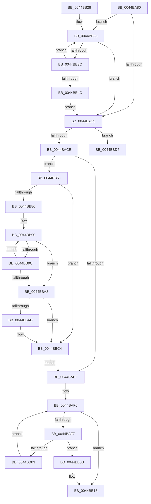

# MiReduceMdl

- RVA: `0x0044BA80`–`0x0044BBF9` (길이 `377` bytes)
- VA: `0x000000014044BA80`
- 실행 섹션: `.text`
- PDB 이름 있음: `예`; PDB Function 태그: `예`
- unwind 정보 RVA: `0x000A67B4`
- 디코드: `98`개 명령, `377/377` bytes 표시
- 미해석 바이트: `0` (있으면 어셈블리에 `.byte`로 보존)

> 이 문서는 커널 이미지의 기계어와 PDB 기호를 분석해 생성했습니다. 4번과 5번은 함수 원형과 자료형을 바이너리 사용 방식에서 추정한 C 해석이며 원본 소스 복구 결과는 아닙니다.

## 1. Dependencies

- 직접 호출 지점: **0**; 고유 호출 대상: **0**
- 직접 호출자로 확인된 함수: **2**
- RIP 상대 이미지 참조: **1**

### Outgoing calls
- 직접 디코드된 call 명령이 없습니다.

### Direct callers
- [MiPfPutPagesInTransition](../36/MiPfPutPagesInTransition_function_003640EC.md) at `0x0036482E`
- [MiResolvePageFileFault](../36/MiResolvePageFileFault_function_0036D968.md) at `0x0036EBF8`

### Static image references
- `0x0044BACE` → RVA `0x00E37438` (`.data`; read)

## 2. Other-region calls and transfers

- 다른 실행 섹션으로 향하는 call: **0**
- call이 아닌 외부 분기/꼬리 이동: **1**
  - `0x0044BBF4` → [sub_006F0DC8](../6F/Unknown_function_006F0DC8.md) (`tail-transfer`)

## 3. Assembly (complete function range)

```asm
0044BA80  48 89 5C 24 08                  mov qword ptr [rsp + 8], rbx
0044BA85  48 89 74 24 10                  mov qword ptr [rsp + 0x10], rsi
0044BA8A  48 89 7C 24 18                  mov qword ptr [rsp + 0x18], rdi
0044BA8F  8B 41 2C                        mov eax, dword ptr [rcx + 0x2c]
0044BA92  4C 8D 49 30                     lea r9, [rcx + 0x30]
0044BA96  03 41 20                        add eax, dword ptr [rcx + 0x20]
0044BA99  4C 8B D9                        mov r11, rcx
0044BA9C  44 8B 41 28                     mov r8d, dword ptr [rcx + 0x28]
0044BAA0  25 FF 0F 00 00                  and eax, 0xfff
0044BAA5  49 8B D9                        mov rbx, r9
0044BAA8  4D 8D 90 FF 0F 00 00            lea r10, [r8 + 0xfff]
0044BAAF  4C 03 D0                        add r10, rax
0044BAB2  33 C0                           xor eax, eax
0044BAB4  49 C1 EA 0C                     shr r10, 0xc
0044BAB8  8B F0                           mov esi, eax
0044BABA  8B F8                           mov edi, eax
0044BABC  49 8D 52 FF                     lea rdx, [r10 - 1]
0044BAC0  48 85 D2                        test rdx, rdx
0044BAC3  75 6B                           jne 0x14044bb30
0044BAC5  48 85 F6                        test rsi, rsi
0044BAC8  0F 85 08 01 00 00               jne 0x14044bbd6
0044BACE  48 8B 0D 63 B9 9E 00            mov rcx, qword ptr [rip + 0x9eb963]
0044BAD5  4B 8D 1C D3                     lea rbx, [r11 + r10*8]
0044BAD9  48 39 4B 28                     cmp qword ptr [rbx + 0x28], rcx
0044BADD  74 72                           je 0x14044bb51
0044BADF  B9 00 40 00 00                  mov ecx, 0x4000
0044BAE4  66 41 09 4B 0A                  or word ptr [r11 + 0xa], cx
0044BAE9  0F 1F 80 00 00 00 00            nop dword ptr [rax]
0044BAF0  8B C8                           mov ecx, eax
0044BAF2  49 3B CA                        cmp rcx, r10
0044BAF5  73 1E                           jae 0x14044bb15
0044BAF7  48 8B 0D 3A B9 9E 00            mov rcx, qword ptr [rip + 0x9eb93a]
0044BAFE  49 39 09                        cmp qword ptr [r9], rcx
0044BB01  74 08                           je 0x14044bb0b
0044BB03  FF C0                           inc eax
0044BB05  49 83 C1 08                     add r9, 8
0044BB09  EB E5                           jmp 0x14044baf0
0044BB0B  B8 FF BF FF FF                  mov eax, 0xffffbfff
0044BB10  66 41 21 43 0A                  and word ptr [r11 + 0xa], ax
0044BB15  48 8B 5C 24 08                  mov rbx, qword ptr [rsp + 8]
0044BB1A  48 8B C6                        mov rax, rsi
0044BB1D  48 8B 74 24 10                  mov rsi, qword ptr [rsp + 0x10]
0044BB22  48 8B 7C 24 18                  mov rdi, qword ptr [rsp + 0x18]
0044BB27  C3                              ret
0044BB28  CC                              int3
0044BB29  0F 1F 80 00 00 00 00            nop dword ptr [rax]
0044BB30  48 8B 0D 01 B9 9E 00            mov rcx, qword ptr [rip + 0x9eb901]
0044BB37  48 39 0B                        cmp qword ptr [rbx], rcx
0044BB3A  75 89                           jne 0x14044bac5
0044BB3C  FF C7                           inc edi
0044BB3E  48 FF C6                        inc rsi
0044BB41  8B CF                           mov ecx, edi
0044BB43  48 83 C3 08                     add rbx, 8
0044BB47  48 3B CA                        cmp rcx, rdx
0044BB4A  72 E4                           jb 0x14044bb30
0044BB4C  E9 74 FF FF FF                  jmp 0x14044bac5
0044BB51  45 8B 43 28                     mov r8d, dword ptr [r11 + 0x28]
0044BB55  41 8B D0                        mov edx, r8d
0044BB58  66 41 83 43 08 F8               add word ptr [r11 + 8], -8
0044BB5E  41 8D 88 00 F0 FF FF            lea ecx, [r8 - 0x1000]
0044BB65  41 81 E0 00 F0 FF FF            and r8d, 0xfffff000
0044BB6C  F7 C2 FF 0F 00 00               test edx, 0xfff
0044BB72  44 0F 44 C1                     cmove r8d, ecx
0044BB76  48 83 EB E0                     sub rbx, -0x20
0044BB7A  45 89 43 28                     mov dword ptr [r11 + 0x28], r8d
0044BB7E  4C 8B C0                        mov r8, rax
0044BB81  49 3B D9                        cmp rbx, r9
0044BB84  74 3E                           je 0x14044bbc4
0044BB86  66 66 0F 1F 84 00 00 00 00 00   nop word ptr [rax + rax]
0044BB90  48 8B 0D A1 B8 9E 00            mov rcx, qword ptr [rip + 0x9eb8a1]
0044BB97  48 39 0B                        cmp qword ptr [rbx], rcx
0044BB9A  75 0C                           jne 0x14044bba8
0044BB9C  49 FF C0                        inc r8
0044BB9F  48 83 EB 08                     sub rbx, 8
0044BBA3  49 3B D9                        cmp rbx, r9
0044BBA6  75 E8                           jne 0x14044bb90
0044BBA8  4D 85 C0                        test r8, r8
0044BBAB  74 17                           je 0x14044bbc4
0044BBAD  41 0F B7 C8                     movzx ecx, r8w
0044BBB1  41 8B D0                        mov edx, r8d
0044BBB4  66 C1 E1 03                     shl cx, 3
0044BBB8  66 41 29 4B 08                  sub word ptr [r11 + 8], cx
0044BBBD  C1 E2 0C                        shl edx, 0xc
0044BBC0  41 29 53 28                     sub dword ptr [r11 + 0x28], edx
0044BBC4  48 C7 C1 FF FF FF FF            mov rcx, 0xffffffffffffffff
0044BBCB  49 2B C8                        sub rcx, r8
0044BBCE  4C 03 D1                        add r10, rcx
0044BBD1  E9 09 FF FF FF                  jmp 0x14044badf
0044BBD6  0F B7 D6                        movzx edx, si
0044BBD9  8B CE                           mov ecx, esi
0044BBDB  66 C1 E2 03                     shl dx, 3
0044BBDF  66 41 29 53 08                  sub word ptr [r11 + 8], dx
0044BBE4  49 8B D1                        mov rdx, r9
0044BBE7  C1 E1 0C                        shl ecx, 0xc
0044BBEA  44 2B C1                        sub r8d, ecx
0044BBED  48 2B D3                        sub rdx, rbx
0044BBF0  45 89 43 28                     mov dword ptr [r11 + 0x28], r8d
0044BBF4  E9 CF 51 2A 00                  jmp 0x1406f0dc8
```

## 4. C-style interpretation (structured pseudocode)

```c
__int64 __fastcall MiReduceMdl(__int64 a1)
{
    __int64 result;
    __int64 v_r10;
    __int64 v_rbx;
    __int64 v_rdi;
    __int64 v_rsi;
    unsigned __int64 v_stack_p10;
    unsigned __int64 v_stack_p18;
    unsigned __int64 v_stack_p8;

    v_stack_p8 = v_rbx;
    v_stack_p10 = v_rsi;
    v_stack_p18 = v_rdi;
    result = (unsigned int)(((unsigned int)(*(unsigned int *)(a1 + 44))) + (*(unsigned int *)(a1 + 32)));
    result = (unsigned int)((result) & (0xFFFULL));
    v_r10 = ((unsigned int)(*(unsigned int *)(a1 + 40)) + 4095) + (result);
    result = 0;
    v_r10 = (v_r10) >> (12);
    if (v_r10 - 1 != 0) goto loc_0044BB30;
loc_0044BAC5:
    if (0 != 0) goto loc_0044BBD6;
    if ((*(unsigned __int64 *)(a1 + v_r10 * 8 + 40)) == (*(unsigned __int64 *)(v_rip + 10402147))) goto loc_0044BB51;
loc_0044BADF:
loc_0044BAF0:
    if (0 >= v_r10) goto loc_0044BB15;
    if ((*(unsigned __int64 *)(a1 + 48)) == (*(unsigned __int64 *)(v_rip + 10402106))) goto loc_0044BB0B;
    result = (unsigned int)((result) + 1);
    a4 = (a1 + 48) + (8);
    goto loc_0044BAF0;
loc_0044BB0B:
loc_0044BB15:
    return 0;
loc_0044BB30:
    if ((*(unsigned __int64 *)(v_stack_p8)) != (*(unsigned __int64 *)(v_rip + 10402049))) goto loc_0044BAC5;
    v_rdi = (unsigned int)((v_stack_p18) + 1);
    v_rsi = (v_stack_p10) + 1;
    v_rbx = (v_stack_p8) + (8);
    if (((unsigned int)((unsigned int)(v_rdi))) < (v_r10 - 1)) goto loc_0044BB30;
    goto loc_0044BAC5;
loc_0044BB51:
    a3 = (unsigned int)(((unsigned int)(*(unsigned int *)(a1 + 40))) & (0xFFFFF000ULL));
    if ((((unsigned int)((unsigned int)((unsigned int)((unsigned int)(*(unsigned int *)(a1 + 40)))))) & (0xFFFULL)) == 0) { a3 = (unsigned int)((unsigned int)(*(unsigned int *)(a1 + 40)) - 4096); }
    v_rbx = (v_rbx) - (-32);
    *(unsigned int *)(a1 + 40) = (unsigned int)(a3);
    if (v_rbx == a4) goto loc_0044BBC4;
loc_0044BB90:
    if ((*(unsigned __int64 *)(v_rbx)) != (*(unsigned __int64 *)(v_rip + 10401953))) goto loc_0044BBA8;
    a3 = (0) + 1;
    v_rbx = (v_rbx) - (8);
    if (v_rbx != a4) goto loc_0044BB90;
loc_0044BBA8:
    if (a3 != 0) {
        a1 = (unsigned __int16)(a3);
        a2 = (unsigned int)(a3);
        a1 = (unsigned __int16)((a1) << (3));
        a2 = (unsigned int)((a2) << (12));
    }
    a1 = (-1) - (a3);
    v_r10 = (v_r10) + (a1);
    goto loc_0044BADF;
loc_0044BBD6:
    a2 = (unsigned __int16)(((unsigned __int16)(v_rsi)) << (3));
    a1 = (unsigned int)(((unsigned int)((unsigned int)(v_rsi))) << (12));
    a3 = (unsigned int)((a3) - ((unsigned int)(a1)));
    a2 = (a4) - (v_rbx);
    *(unsigned int *)(a1 + 40) = (unsigned int)(a3);
}
```

## 5. (Beta) C Style

```c
int64_t MiReduceMdl(void *Arg1)
{
    uint8_t *arg1 = (uint8_t *)Arg1;

    int64_t result;
    int64_t local_r10;
    int64_t local_rbx;
    int64_t local_rdi;
    int64_t local_rsi;
    uint64_t v_stack_p10;
    uint64_t v_stack_p18;
    uint64_t v_stack_p8;

    v_stack_p8 = local_rbx;
    v_stack_p10 = local_rsi;
    v_stack_p18 = local_rdi;
    result = (uint32_t)(((uint32_t)(*(uint32_t *)(arg1 + 0x2C))) + (*(uint32_t *)(arg1 + 0x20)));
    result = (uint32_t)((result) & (0xFFFULL));
    local_r10 = ((uint32_t)(*(uint32_t *)(arg1 + 0x28)) + 4095) + (result);
    result = 0;
    local_r10 = (local_r10) >> (12);
    if (local_r10 - 1 != 0) goto loc_0044BB30;
loc_0044BAC5:
    if (0 != 0) goto loc_0044BBD6;
    if ((*(uint64_t *)(arg1 + local_r10 * 8 + 0x28)) == (*(uint64_t *)(v_rip + 0x9EB963))) goto loc_0044BB51;
loc_0044BADF:
loc_0044BAF0:
    if (0 >= local_r10) goto loc_0044BB15;
    if ((*(uint64_t *)(arg1 + 0x30)) == (*(uint64_t *)(v_rip + 0x9EB93A))) goto loc_0044BB0B;
    result = (uint32_t)((result) + 1);
    a4 = (Arg1 + 48) + (8);
    goto loc_0044BAF0;
loc_0044BB0B:
loc_0044BB15:
    return 0;
loc_0044BB30:
    if ((*(uint64_t *)(v_stack_p8)) != (*(uint64_t *)(v_rip + 0x9EB901))) goto loc_0044BAC5;
    local_rdi = (uint32_t)((v_stack_p18) + 1);
    local_rsi = (v_stack_p10) + 1;
    local_rbx = (v_stack_p8) + (8);
    if (((uint32_t)((uint32_t)(local_rdi))) < (local_r10 - 1)) goto loc_0044BB30;
    goto loc_0044BAC5;
loc_0044BB51:
    a3 = (uint32_t)(((uint32_t)(*(uint32_t *)(arg1 + 0x28))) & (0xFFFFF000ULL));
    if ((((uint32_t)((uint32_t)((uint32_t)((uint32_t)(*(uint32_t *)(arg1 + 0x28)))))) & (0xFFFULL)) == 0) { a3 = (uint32_t)((uint32_t)(*(uint32_t *)(arg1 + 0x28)) - 4096); }
    local_rbx = (local_rbx) - (-32);
    *(uint32_t *)(arg1 + 0x28) = (uint32_t)(a3);
    if (local_rbx == a4) goto loc_0044BBC4;
loc_0044BB90:
    if ((*(uint64_t *)(local_rbx)) != (*(uint64_t *)(v_rip + 0x9EB8A1))) goto loc_0044BBA8;
    a3 = (0) + 1;
    local_rbx = (local_rbx) - (8);
    if (local_rbx != a4) goto loc_0044BB90;
loc_0044BBA8:
    if (a3 != 0) {
        Arg1 = (uint16_t)(a3);
        a2 = (uint32_t)(a3);
        Arg1 = (uint16_t)((Arg1) << (3));
        a2 = (uint32_t)((a2) << (12));
    }
    Arg1 = (-1) - (a3);
    local_r10 = (local_r10) + (Arg1);
    goto loc_0044BADF;
loc_0044BBD6:
    a2 = (uint16_t)(((uint16_t)(local_rsi)) << (3));
    Arg1 = (uint32_t)(((uint32_t)((uint32_t)(local_rsi))) << (12));
    a3 = (uint32_t)((a3) - ((uint32_t)(Arg1)));
    a2 = (a4) - (local_rbx);
    *(uint32_t *)(arg1 + 0x28) = (uint32_t)(a3);
}
```

### 관측된 메모리 오프셋

구조체 형식이 확인되지 않은 접근은 인자 기준의 오프셋으로만 기록했습니다.

| 기준 인자 | 오프셋 표현 | 폭 (bit) | 접근 |
|---|---:|---:|---|
| `Arg1` | `+ 0x0` | `64` | `R` |
| `Arg1` | `+ 0x0 + r10*8` | `64` | `R` |
| `Arg1` | `+ 0x8` | `16` | `R/W` |
| `Arg1` | `+ 0xA` | `16` | `R/W` |
| `Arg1` | `+ 0x20` | `32` | `R` |
| `Arg1` | `+ 0x28` | `32` | `R` |
| `Arg1` | `+ 0x28` | `32` | `R/W` |
| `Arg1` | `+ 0x28` | `32` | `W` |
| `Arg1` | `+ 0x28` | `64` | `R` |
| `Arg1` | `+ 0x2C` | `32` | `R` |
| `Arg1` | `+ 0x30` | `64` | `R` |

## 6. Execution-region graph

[열기: 2D/3D 그래프와 함수 탐색 컨트롤 패널](../../../control-panel.html?section=text&rva=0x0044BA80&view=graph)

- 2D 그래프는 위에서 아래로 흐르고, 3D 그래프는 빈 공간을 드래그해 회전합니다. Shift+드래그는 이동, 휠은 확대·축소, 함수 노드 선택은 대상 보고서 이동입니다.

### Static fallback


