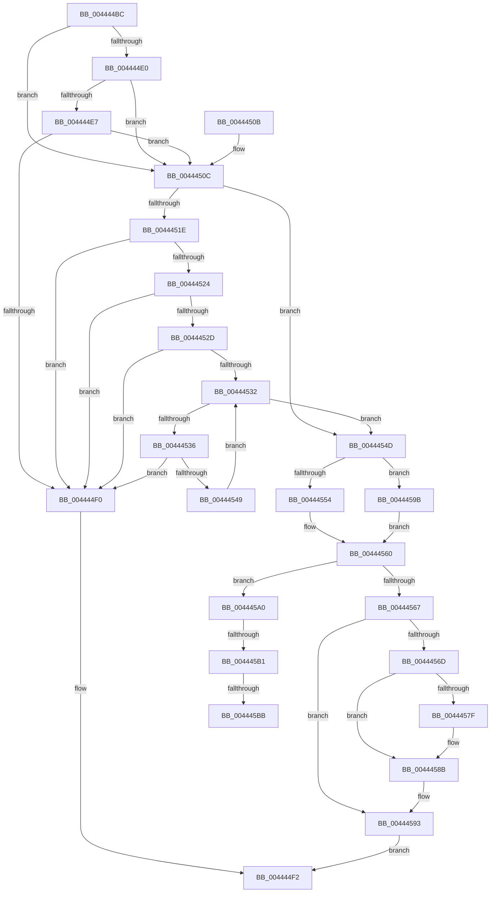

# MiReleaseControlAreaCharges

- RVA: `0x004444BC`–`0x004445C2` (길이 `262` bytes)
- VA: `0x00000001404444BC`
- 실행 섹션: `.text`
- PDB 이름 있음: `예`; PDB Function 태그: `예`
- unwind 정보 RVA: `0x000A56BC`
- 디코드: `79`개 명령, `262/262` bytes 표시
- 미해석 바이트: `0` (있으면 어셈블리에 `.byte`로 보존)

> 이 문서는 커널 이미지의 기계어와 PDB 기호를 분석해 생성했습니다. 4번과 5번은 함수 원형과 자료형을 바이너리 사용 방식에서 추정한 C 해석이며 원본 소스 복구 결과는 아닙니다.

## 1. Dependencies

- 직접 호출 지점: **3**; 고유 호출 대상: **3**
- 직접 호출자로 확인된 함수: **2**
- RIP 상대 이미지 참조: **3**

### Outgoing calls
- `0x00444558` → [ExAcquireSpinLockExclusive](../24/ExAcquireSpinLockExclusive_function_00248690.md) (function, `0x00248690`)
- `0x00444571` → [ExReleaseSpinLockExclusiveFromDpcLevel](../24/ExReleaseSpinLockExclusiveFromDpcLevel_function_002497E0.md) (function, `0x002497E0`)
- `0x00444586` → [KiLowerIrqlProcessIrqlFlags](../4F/KiLowerIrqlProcessIrqlFlags_function_004F5698.md) (function, `0x004F5698`)

### Direct callers
- [MiInsertUnusedSegment](MiInsertUnusedSegment_function_004443DC.md) at `0x00444433`
- [MiSegmentDelete](../../page/A1/MiSegmentDelete_function_00A1FBB4.md) at `0x00A1FC1E`

### Static image references
- `0x00444524` → RVA `0x00E2D808` (`.data`; read)
- `0x00444538` → RVA `0x00E2D7A0` (`.data`; read)
- `0x00444576` → RVA `0x00FC6D20` (`ALMOSTRO`; read)

## 2. Other-region calls and transfers

- 다른 실행 섹션으로 향하는 call: **0**
- call이 아닌 외부 분기/꼬리 이동: **3**
  - `0x004445AB` → [sub_006EFCBC](../6E/Unknown_function_006EFCBC.md) (`tail-transfer`)
  - `0x004445B5` → [sub_006EFCBC](../6E/Unknown_function_006EFCBC.md) (`tail-transfer`)
  - `0x004445BD` → [sub_006EFCBC](../6E/Unknown_function_006EFCBC.md) (`tail-transfer`)

## 3. Assembly (complete function range)

```asm
004444BC  48 89 5C 24 08                  mov qword ptr [rsp + 8], rbx
004444C1  48 89 6C 24 10                  mov qword ptr [rsp + 0x10], rbp
004444C6  48 89 74 24 18                  mov qword ptr [rsp + 0x18], rsi
004444CB  57                              push rdi
004444CC  41 56                           push r14
004444CE  41 57                           push r15
004444D0  48 83 EC 20                     sub rsp, 0x20
004444D4  48 8B D9                        mov rbx, rcx
004444D7  48 8B 49 40                     mov rcx, qword ptr [rcx + 0x40]
004444DB  48 85 C9                        test rcx, rcx
004444DE  75 2C                           jne 0x14044450c
004444E0  0F BA 63 38 0A                  bt dword ptr [rbx + 0x38], 0xa
004444E5  72 25                           jb 0x14044450c
004444E7  F7 43 5C 00 00 02 00            test dword ptr [rbx + 0x5c], 0x20000
004444EE  74 1C                           je 0x14044450c
004444F0  33 C0                           xor eax, eax
004444F2  48 8B 5C 24 40                  mov rbx, qword ptr [rsp + 0x40]
004444F7  48 8B 6C 24 48                  mov rbp, qword ptr [rsp + 0x48]
004444FC  48 8B 74 24 50                  mov rsi, qword ptr [rsp + 0x50]
00444501  48 83 C4 20                     add rsp, 0x20
00444505  41 5F                           pop r15
00444507  41 5E                           pop r14
00444509  5F                              pop rdi
0044450A  C3                              ret
0044450B  CC                              int3
0044450C  BF 38 00 00 00                  mov edi, 0x38
00444511  4C 8B FB                        mov r15, rbx
00444514  8B 04 1F                        mov eax, dword ptr [rdi + rbx]
00444517  8D 6F C9                        lea ebp, [rdi - 0x37]
0044451A  A8 20                           test al, 0x20
0044451C  75 2F                           jne 0x14044454d
0044451E  0F BA E0 0A                     bt eax, 0xa
00444522  72 CC                           jb 0x1404444f0
00444524  48 3B 1D DD 92 9E 00            cmp rbx, qword ptr [rip + 0x9e92dd]
0044452B  74 C3                           je 0x1404444f0
0044452D  48 85 C9                        test rcx, rcx
00444530  75 BE                           jne 0x1404444f0
00444532  3B CD                           cmp ecx, ebp
00444534  73 17                           jae 0x14044454d
00444536  8B C1                           mov eax, ecx
00444538  4C 8D 05 61 92 9E 00            lea r8, [rip + 0x9e9261]
0044453F  48 C1 E0 06                     shl rax, 6
00444543  4A 3B 1C 00                     cmp rbx, qword ptr [rax + r8]
00444547  74 A7                           je 0x1404444f0
00444549  03 CD                           add ecx, ebp
0044454B  EB E5                           jmp 0x140444532
0044454D  45 33 F6                        xor r14d, r14d
00444550  85 D2                           test edx, edx
00444552  75 47                           jne 0x14044459b
00444554  48 8D 4B 48                     lea rcx, [rbx + 0x48]
00444558  E8 33 41 E0 FF                  call 0x140248690
0044455D  40 8A F0                        mov sil, al
00444560  8A 43 3E                        mov al, byte ptr [rbx + 0x3e]
00444563  A8 02                           test al, 2
00444565  75 39                           jne 0x1404445a0
00444567  40 80 FE 11                     cmp sil, 0x11
0044456B  74 26                           je 0x140444593
0044456D  48 8D 4B 48                     lea rcx, [rbx + 0x48]
00444571  E8 6A 52 E0 FF                  call 0x1402497e0
00444576  83 3D A3 27 B8 00 00            cmp dword ptr [rip + 0xb827a3], 0
0044457D  74 0C                           je 0x14044458b
0044457F  44 0F 20 C1                     mov rcx, cr8
00444583  40 8A D6                        mov dl, sil
00444586  E8 0D 11 0B 00                  call 0x1404f5698
0044458B  40 0F B6 CE                     movzx ecx, sil
0044458F  44 0F 22 C1                     mov cr8, rcx
00444593  49 8B C6                        mov rax, r14
00444596  E9 57 FF FF FF                  jmp 0x1404444f2
0044459B  40 B6 11                        mov sil, 0x11
0044459E  EB C0                           jmp 0x140444560
004445A0  24 FD                           and al, 0xfd
004445A2  88 43 3E                        mov byte ptr [rbx + 0x3e], al
004445A5  42 8B 04 3F                     mov eax, dword ptr [rdi + r15]
004445A9  A8 20                           test al, 0x20
004445AB  0F 85 0B B7 2A 00               jne 0x1406efcbc
004445B1  4C 39 73 40                     cmp qword ptr [rbx + 0x40], r14
004445B5  0F 84 01 B7 2A 00               je 0x1406efcbc
004445BB  33 ED                           xor ebp, ebp
004445BD  E9 FA B6 2A 00                  jmp 0x1406efcbc
```

## 4. C-style interpretation (structured pseudocode)

```c
__int64 __fastcall MiReleaseControlAreaCharges(__int64 a1, int a2)
{
    __int64 result;
    __int64 v_r14;
    __int64 v_rbp;
    __int64 v_rsp;
    unsigned __int64 v_stack_p10;
    unsigned __int64 v_stack_p18;
    unsigned __int64 v_stack_p8;

    v_stack_p8 = v_rbx;
    v_stack_p10 = v_rbp;
    v_stack_p18 = v_rsi;
    v_rsp = (v_rsp) - (32);
    if (*(unsigned __int64 *)(a1 + 64) != 0) goto loc_0044450C;
    if (condition_is_below) goto loc_0044450C;
    if (((*(unsigned int *)(a1 + 92)) & (0x20000ULL)) == 0) goto loc_0044450C;
loc_004444F0:
    result = 0;
loc_004444F2:
    v_rsp = (v_rsp) + (32);
    return result;
loc_0044450C:
    if ((((unsigned __int8)((unsigned int)(*(unsigned int *)(56 + v_stack_p8 * 1)))) & (32)) != 0) goto loc_0044454D;
    if (condition_is_below) goto loc_004444F0;
    if (v_stack_p8 == (*(unsigned __int64 *)(v_rip + 10392285))) goto loc_004444F0;
    if (*(unsigned __int64 *)(a1 + 64) != 0) goto loc_004444F0;
loc_00444532:
    if (((unsigned int)(*(unsigned __int64 *)(a1 + 64))) >= ((unsigned int)(56 - 55))) goto loc_0044454D;
    result = ((unsigned int)((unsigned int)(*(unsigned __int64 *)(a1 + 64)))) << (6);
    if (v_stack_p8 == (*(unsigned __int64 *)(result + v_rip + 10392161 * 1))) goto loc_004444F0;
    a1 = (unsigned int)((*(unsigned __int64 *)(a1 + 64)) + ((unsigned int)(56 - 55)));
    goto loc_00444532;
loc_0044454D:
    v_r14 = 0;
    if (a2 != 0) goto loc_0044459B;
    result = ExAcquireSpinLockExclusive(v_stack_p8 + 72, a2, v_rip + 10392161, a4);
loc_00444560:
    if ((((unsigned __int8)(*(unsigned __int8 *)(v_stack_p8 + 62))) & (2)) != 0) goto loc_004445A0;
    if (((unsigned __int8)((unsigned __int8)(result))) == 17) goto loc_00444593;
    result = ExReleaseSpinLockExclusiveFromDpcLevel(v_stack_p8 + 72, a2, v_rip + 10392161, a4);
    if ((*(unsigned int *)(v_rip + 12068771)) != 0) {
        a1 = v_cr8;
        a2 = (unsigned __int8)((unsigned __int8)(result));
        result = KiLowerIrqlProcessIrqlFlags(a1, a2, v_rip + 10392161, a4);
    }
loc_00444593:
    goto loc_004444F2;
loc_0044459B:
    goto loc_00444560;
loc_004445A0:
    result = (unsigned __int8)((0) & (253));
    *(unsigned __int8 *)(v_stack_p8 + 62) = (unsigned __int8)(result);
    v_rbp = 0;
}
```

## 5. (Beta) C Style

```c
int64_t MiReleaseControlAreaCharges(void *Arg1, int32_t Arg2)
{
    uint8_t *arg1 = (uint8_t *)Arg1;

    int64_t result;
    int64_t local_r14;
    int64_t local_rbp;
    int64_t local_rsp;
    uint64_t v_stack_p10;
    uint64_t v_stack_p18;
    uint64_t v_stack_p8;

    v_stack_p8 = local_rbx;
    v_stack_p10 = local_rbp;
    v_stack_p18 = local_rsi;
    local_rsp = (local_rsp) - (32);
    if (*(uint64_t *)(arg1 + 0x40) != 0) goto loc_0044450C;
    if (condition_is_below) goto loc_0044450C;
    if (((*(uint32_t *)(arg1 + 0x5C)) & (0x20000ULL)) == 0) goto loc_0044450C;
loc_004444F0:
    result = 0;
loc_004444F2:
    local_rsp = (local_rsp) + (32);
    return result;
loc_0044450C:
    if ((((uint8_t)((uint32_t)(*(uint32_t *)(56 + v_stack_p8 * 1)))) & (32)) != 0) goto loc_0044454D;
    if (condition_is_below) goto loc_004444F0;
    if (v_stack_p8 == (*(uint64_t *)(v_rip + 0x9E92DD))) goto loc_004444F0;
    if (*(uint64_t *)(arg1 + 0x40) != 0) goto loc_004444F0;
loc_00444532:
    if (((uint32_t)(*(uint64_t *)(arg1 + 0x40))) >= ((uint32_t)(56 - 55))) goto loc_0044454D;
    result = ((uint32_t)((uint32_t)(*(uint64_t *)(arg1 + 0x40)))) << (6);
    if (v_stack_p8 == (*(uint64_t *)(result + v_rip + 0x9E9261 * 1))) goto loc_004444F0;
    Arg1 = (uint32_t)((*(uint64_t *)(arg1 + 0x40)) + ((uint32_t)(56 - 55)));
    goto loc_00444532;
loc_0044454D:
    local_r14 = 0;
    if (Arg2 != 0) goto loc_0044459B;
    result = ExAcquireSpinLockExclusive(v_stack_p8 + 72, Arg2, v_rip + 10392161, a4);
loc_00444560:
    if ((((uint8_t)(*(uint8_t *)(v_stack_p8 + 0x3E))) & (2)) != 0) goto loc_004445A0;
    if (((uint8_t)((uint8_t)(result))) == 17) goto loc_00444593;
    result = ExReleaseSpinLockExclusiveFromDpcLevel(v_stack_p8 + 72, Arg2, v_rip + 10392161, a4);
    if ((*(uint32_t *)(v_rip + 0xB827A3)) != 0) {
        Arg1 = v_cr8;
        Arg2 = (uint8_t)((uint8_t)(result));
        result = KiLowerIrqlProcessIrqlFlags(Arg1, Arg2, v_rip + 10392161, a4);
    }
loc_00444593:
    goto loc_004444F2;
loc_0044459B:
    goto loc_00444560;
loc_004445A0:
    result = (uint8_t)((0) & (253));
    *(uint8_t *)(v_stack_p8 + 0x3E) = (uint8_t)(result);
    local_rbp = 0;
}
```

### 관측된 메모리 오프셋

구조체 형식이 확인되지 않은 접근은 인자 기준의 오프셋으로만 기록했습니다.

| 기준 인자 | 오프셋 표현 | 폭 (bit) | 접근 |
|---|---:|---:|---|
| `Arg1` | `+ 0x38` | `32` | `R` |
| `Arg1` | `+ 0x40` | `64` | `R` |
| `Arg1` | `+ 0x5C` | `32` | `R` |

## 6. Execution-region graph

[열기: 2D/3D 그래프와 함수 탐색 컨트롤 패널](../../../control-panel.html?section=text&rva=0x004444BC&view=graph)

- 2D 그래프는 위에서 아래로 흐르고, 3D 그래프는 빈 공간을 드래그해 회전합니다. Shift+드래그는 이동, 휠은 확대·축소, 함수 노드 선택은 대상 보고서 이동입니다.

### Static fallback


