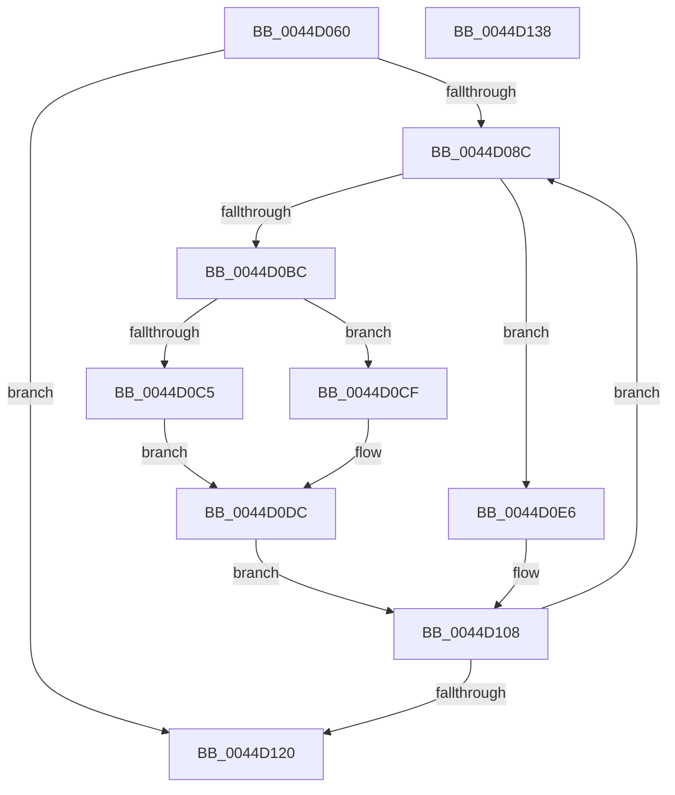

# MiRelinkTransitionSlabPages

- RVA: `0x0044D060`–`0x0044D139` (길이 `217` bytes)
- VA: `0x000000014044D060`
- 실행 섹션: `.text`
- PDB 이름 있음: `예`; PDB Function 태그: `아니요`
- unwind 정보 RVA: `0x0005C954`
- 디코드: `54`개 명령, `217/217` bytes 표시
- 미해석 바이트: `0` (있으면 어셈블리에 `.byte`로 보존)

> 이 문서는 커널 이미지의 기계어와 PDB 기호를 분석해 생성했습니다. 4번과 5번은 함수 원형과 자료형을 바이너리 사용 방식에서 추정한 C 해석이며 원본 소스 복구 결과는 아닙니다.

## 1. Dependencies

- 직접 호출 지점: **2**; 고유 호출 대상: **2**
- 직접 호출자로 확인된 함수: **2**
- RIP 상대 이미지 참조: **0**

### Outgoing calls
- `0x0044D0DF` → [MiInsertPageInList](../2B/MiInsertPageInList_function_002BA000.md) (function, `0x002BA000`)
- `0x0044D100` → [MiDiscardTransitionPteEx](../37/MiDiscardTransitionPteEx_function_00375954.md) (function, `0x00375954`)

### Direct callers
- [MiDemoteSlabEntry](MiDemoteSlabEntry_function_0044CB0C.md) at `0x0044CBBD`
- [MiDeleteSlabEntriesForIdentity](../68/MiDeleteSlabEntriesForIdentity_function_0068DE10.md) at `0x0068DF55`

### Static image references
- 디코드된 RIP-relative 메모리 참조가 없습니다.

## 2. Other-region calls and transfers

- 다른 실행 섹션으로 향하는 call: **0**
- 별도 외부 분기/꼬리 이동을 확인하지 못했습니다.

## 3. Assembly (complete function range)

```asm
0044D060  48 89 5C 24 08                  mov qword ptr [rsp + 8], rbx
0044D065  48 89 6C 24 10                  mov qword ptr [rsp + 0x10], rbp
0044D06A  48 89 74 24 18                  mov qword ptr [rsp + 0x18], rsi
0044D06F  57                              push rdi
0044D070  48 83 EC 20                     sub rsp, 0x20
0044D074  33 FF                           xor edi, edi
0044D076  48 BD FF FF FF FF 3F 00 00 00   movabs rbp, 0x3fffffffff
0044D080  48 8B F1                        mov rsi, rcx
0044D083  48 3B CD                        cmp rcx, rbp
0044D086  0F 84 94 00 00 00               je 0x14044d120
0044D08C  48 8D 1C 76                     lea rbx, [rsi + rsi*2]
0044D090  48 C1 E3 04                     shl rbx, 4
0044D094  48 B8 00 00 00 00 00 DE FF FF   movabs rax, 0xffffde0000000000
0044D09E  48 03 D8                        add rbx, rax
0044D0A1  48 B8 FF FF FF FF FF 00 00 00   movabs rax, 0xffffffffff
0044D0AB  48 8B 33                        mov rsi, qword ptr [rbx]
0044D0AE  48 23 F0                        and rsi, rax
0044D0B1  48 8B 43 18                     mov rax, qword ptr [rbx + 0x18]
0044D0B5  48 0F BA E0 3E                  bt rax, 0x3e
0044D0BA  72 2A                           jb 0x14044d0e6
0044D0BC  8A 43 22                        mov al, byte ptr [rbx + 0x22]
0044D0BF  24 07                           and al, 7
0044D0C1  3C 02                           cmp al, 2
0044D0C3  75 0A                           jne 0x14044d0cf
0044D0C5  BA 04 00 00 00                  mov edx, 4
0044D0CA  48 FF C7                        inc rdi
0044D0CD  EB 0D                           jmp 0x14044d0dc
0044D0CF  BA 10 00 00 00                  mov edx, 0x10
0044D0D4  3C 03                           cmp al, 3
0044D0D6  8D 4A F8                        lea ecx, [rdx - 8]
0044D0D9  0F 44 D1                        cmove edx, ecx
0044D0DC  48 8B CB                        mov rcx, rbx
0044D0DF  E8 1C CF E6 FF                  call 0x1402ba000
0044D0E4  EB 22                           jmp 0x14044d108
0044D0E6  48 8B 43 18                     mov rax, qword ptr [rbx + 0x18]
0044D0EA  48 B9 FF FF FF FF FF FF FF BF   movabs rcx, 0xbfffffffffffffff
0044D0F4  48 23 C1                        and rax, rcx
0044D0F7  33 D2                           xor edx, edx
0044D0F9  48 8B CB                        mov rcx, rbx
0044D0FC  48 89 43 18                     mov qword ptr [rbx + 0x18], rax
0044D100  E8 4F 88 F2 FF                  call 0x140375954
0044D105  48 FF C7                        inc rdi
0044D108  48 B8 FF FF FF FF FF FF FF 7F   movabs rax, 0x7fffffffffffffff
0044D112  F0 48 21 43 18                  lock and qword ptr [rbx + 0x18], rax
0044D117  48 3B F5                        cmp rsi, rbp
0044D11A  0F 85 6C FF FF FF               jne 0x14044d08c
0044D120  48 8B 5C 24 30                  mov rbx, qword ptr [rsp + 0x30]
0044D125  48 8B C7                        mov rax, rdi
0044D128  48 8B 6C 24 38                  mov rbp, qword ptr [rsp + 0x38]
0044D12D  48 8B 74 24 40                  mov rsi, qword ptr [rsp + 0x40]
0044D132  48 83 C4 20                     add rsp, 0x20
0044D136  5F                              pop rdi
0044D137  C3                              ret
0044D138  CC                              int3
```

## 4. C-style interpretation (structured pseudocode)

```c
__int64 __fastcall MiRelinkTransitionSlabPages(__int64 a1)
{
    __int64 result;
    __int64 v_rbx;
    __int64 v_rdi;
    __int64 v_rsi;
    __int64 v_rsp;
    unsigned __int64 v_stack_p10;
    unsigned __int64 v_stack_p18;
    unsigned __int64 v_stack_p8;

    v_stack_p8 = v_rbx;
    v_stack_p10 = v_rbp;
    v_stack_p18 = v_rsi;
    v_rsp = (v_rsp) - (32);
    v_rdi = 0;
    if (a1 == v_rbp) goto loc_0044D120;
loc_0044D08C:
    v_rbx = (a1 + a1 * 2) << (4);
    v_rbx = (v_rbx) + (result);
    v_rsi = (*(unsigned __int64 *)(v_rbx)) & (result);
    if (condition_is_below) goto loc_0044D0E6;
    result = (unsigned __int8)((*(unsigned __int8 *)(v_rbx + 34)) & (7));
    if (((unsigned __int8)(result)) != 2) goto loc_0044D0CF;
    v_rdi = (v_rdi) + 1;
    goto loc_0044D0DC;
loc_0044D0CF:
    a2 = 16;
    if (((unsigned __int8)(result)) == 3) { a2 = (unsigned int)(16 - 8); }
loc_0044D0DC:
    result = MiInsertPageInList(v_rbx, a2, a3, a4);
    goto loc_0044D108;
loc_0044D0E6:
    result = (*(unsigned __int64 *)(v_rbx + 24)) & (v_rbx);
    a2 = 0;
    *(unsigned __int64 *)(v_rbx + 24) = result;
    result = MiDiscardTransitionPteEx(v_rbx, a2, a3, a4);
    v_rdi = (v_rdi) + 1;
loc_0044D108:
    if (v_rsi != v_rbp) goto loc_0044D08C;
loc_0044D120:
    v_rsp = (v_rsp) + (32);
    return v_rdi;
}
```

## 5. (Beta) C Style

```c
int64_t MiRelinkTransitionSlabPages(int64_t Arg1)
{
    int64_t result;
    int64_t local_rbx;
    int64_t local_rdi;
    int64_t local_rsi;
    int64_t local_rsp;
    uint64_t v_stack_p10;
    uint64_t v_stack_p18;
    uint64_t v_stack_p8;

    v_stack_p8 = local_rbx;
    v_stack_p10 = local_rbp;
    v_stack_p18 = local_rsi;
    local_rsp = (local_rsp) - (32);
    local_rdi = 0;
    if (Arg1 == local_rbp) goto loc_0044D120;
loc_0044D08C:
    local_rbx = (Arg1 + Arg1 * 2) << (4);
    local_rbx = (local_rbx) + (result);
    local_rsi = (*(uint64_t *)(local_rbx)) & (result);
    if (condition_is_below) goto loc_0044D0E6;
    result = (uint8_t)((*(uint8_t *)(local_rbx + 0x22)) & (7));
    if (((uint8_t)(result)) != 2) goto loc_0044D0CF;
    local_rdi = (local_rdi) + 1;
    goto loc_0044D0DC;
loc_0044D0CF:
    a2 = 16;
    if (((uint8_t)(result)) == 3) { a2 = (uint32_t)(16 - 8); }
loc_0044D0DC:
    result = MiInsertPageInList(local_rbx, a2, a3, a4);
    goto loc_0044D108;
loc_0044D0E6:
    result = (*(uint64_t *)(local_rbx + 0x18)) & (local_rbx);
    a2 = 0;
    *(uint64_t *)(local_rbx + 0x18) = result;
    result = MiDiscardTransitionPteEx(local_rbx, a2, a3, a4);
    local_rdi = (local_rdi) + 1;
loc_0044D108:
    if (local_rsi != local_rbp) goto loc_0044D08C;
loc_0044D120:
    local_rsp = (local_rsp) + (32);
    return local_rdi;
}
```

## 6. Execution-region graph

[열기: 2D/3D 그래프와 함수 탐색 컨트롤 패널](../../../control-panel.html?section=text&rva=0x0044D060&view=graph)

- 2D 그래프는 위에서 아래로 흐르고, 3D 그래프는 빈 공간을 드래그해 회전합니다. Shift+드래그는 이동, 휠은 확대·축소, 함수 노드 선택은 대상 보고서 이동입니다.

### Static fallback


