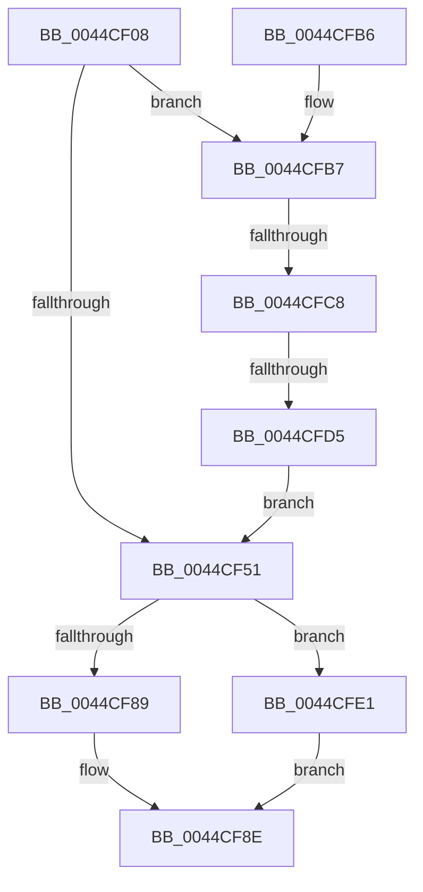

# MiRemoveSlabEntry

- RVA: `0x0044CF08`–`0x0044CFF3` (길이 `235` bytes)
- VA: `0x000000014044CF08`
- 실행 섹션: `.text`
- PDB 이름 있음: `예`; PDB Function 태그: `예`
- unwind 정보 RVA: `0x000A68DC`
- 디코드: `62`개 명령, `235/235` bytes 표시
- 미해석 바이트: `0` (있으면 어셈블리에 `.byte`로 보존)

> 이 문서는 커널 이미지의 기계어와 PDB 기호를 분석해 생성했습니다. 4번과 5번은 함수 원형과 자료형을 바이너리 사용 방식에서 추정한 C 해석이며 원본 소스 복구 결과는 아닙니다.

## 1. Dependencies

- 직접 호출 지점: **3**; 고유 호출 대상: **3**
- 직접 호출자로 확인된 함수: **5**
- RIP 상대 이미지 참조: **1**

### Outgoing calls
- `0x0044CF43` → [RtlRbRemoveNode](../2E/RtlRbRemoveNode_function_002E4C10.md) (function, `0x002E4C10`)
- `0x0044CF57` → [MiClearHintSlabEntry](MiClearHintSlabEntry_function_0044CFFC.md) (function, `0x0044CFFC`)
- `0x0044CF7A` → [MiUpdateSlabTypeAvailablePages](../37/MiUpdateSlabTypeAvailablePages_function_00378DC0.md) (function, `0x00378DC0`)

### Direct callers
- [MiFreeSlabEntries](../2D/MiFreeSlabEntries_function_002DAFC0.md) at `0x002DB14F`
- [MiDemoteSlabEntry](MiDemoteSlabEntry_function_0044CB0C.md) at `0x0044CB5C`
- [MiDeleteSlabEntriesForIdentity](../68/MiDeleteSlabEntriesForIdentity_function_0068DE10.md) at `0x0068DF6D`
- [MiEstablishDefragSlabEntries](../68/MiEstablishDefragSlabEntries_function_0068E0EC.md) at `0x0068E212`
- [MmUpdateSlabRangeType](../../init/C6/MmUpdateSlabRangeType_function_00C6A10C.md) at `0x00C6A21F`

### Static image references
- `0x0044CF22` → RVA `0x00011C60` (`.rdata`; read)

## 2. Other-region calls and transfers

- 다른 실행 섹션으로 향하는 call: **0**
- call이 아닌 외부 분기/꼬리 이동: **2**
  - `0x0044CFC2` → [sub_006F0EA0](../6F/Unknown_function_006F0EA0.md) (`tail-transfer`)
  - `0x0044CFCF` → [sub_006F0EA0](../6F/Unknown_function_006F0EA0.md) (`tail-transfer`)

## 3. Assembly (complete function range)

```asm
0044CF08  48 89 5C 24 08                  mov qword ptr [rsp + 8], rbx
0044CF0D  48 89 6C 24 10                  mov qword ptr [rsp + 0x10], rbp
0044CF12  48 89 74 24 18                  mov qword ptr [rsp + 0x18], rsi
0044CF17  57                              push rdi
0044CF18  48 83 EC 20                     sub rsp, 0x20
0044CF1C  8B 82 88 00 00 00               mov eax, dword ptr [rdx + 0x88]
0044CF22  48 8D 2D 37 4D BC FF            lea rbp, [rip - 0x43b2c9]
0044CF29  48 C1 E8 04                     shr rax, 4
0044CF2D  48 8B DA                        mov rbx, rdx
0044CF30  83 E0 03                        and eax, 3
0044CF33  48 8B F1                        mov rsi, rcx
0044CF36  49 8B D0                        mov rdx, r8
0044CF39  48 8B CB                        mov rcx, rbx
0044CF3C  49 8B F8                        mov rdi, r8
0044CF3F  8B 6C C5 00                     mov ebp, dword ptr [rbp + rax*8]
0044CF43  E8 C8 7C E9 FF                  call 0x1402e4c10
0044CF48  83 BB 80 00 00 00 08            cmp dword ptr [rbx + 0x80], 8
0044CF4F  74 66                           je 0x14044cfb7
0044CF51  48 8B D7                        mov rdx, rdi
0044CF54  48 8B CB                        mov rcx, rbx
0044CF57  E8 A0 00 00 00                  call 0x14044cffc
0044CF5C  48 8B 43 60                     mov rax, qword ptr [rbx + 0x60]
0044CF60  8B 4F 54                        mov ecx, dword ptr [rdi + 0x54]
0044CF63  48 2B C1                        sub rax, rcx
0044CF66  48 8B CE                        mov rcx, rsi
0044CF69  48 89 43 60                     mov qword ptr [rbx + 0x60], rax
0044CF6D  44 8B 47 54                     mov r8d, dword ptr [rdi + 0x54]
0044CF71  8B 93 80 00 00 00               mov edx, dword ptr [rbx + 0x80]
0044CF77  49 F7 D8                        neg r8
0044CF7A  E8 41 BE F2 FF                  call 0x140378dc0
0044CF7F  8B 47 5C                        mov eax, dword ptr [rdi + 0x5c]
0044CF82  48 8B CD                        mov rcx, rbp
0044CF85  A8 02                           test al, 2
0044CF87  75 58                           jne 0x14044cfe1
0044CF89  B8 D8 4C 00 00                  mov eax, 0x4cd8
0044CF8E  48 F7 D9                        neg rcx
0044CF91  F0 48 01 0C 30                  lock add qword ptr [rax + rsi], rcx
0044CF96  48 8B 43 78                     mov rax, qword ptr [rbx + 0x78]
0044CF9A  48 8B 6C 24 38                  mov rbp, qword ptr [rsp + 0x38]
0044CF9F  48 FF C8                        dec rax
0044CFA2  48 8B 74 24 40                  mov rsi, qword ptr [rsp + 0x40]
0044CFA7  48 89 43 78                     mov qword ptr [rbx + 0x78], rax
0044CFAB  48 8B 5C 24 30                  mov rbx, qword ptr [rsp + 0x30]
0044CFB0  48 83 C4 20                     add rsp, 0x20
0044CFB4  5F                              pop rdi
0044CFB5  C3                              ret
0044CFB6  CC                              int3
0044CFB7  48 8D 47 18                     lea rax, [rdi + 0x18]
0044CFBB  48 8B 10                        mov rdx, qword ptr [rax]
0044CFBE  48 39 42 08                     cmp qword ptr [rdx + 8], rax
0044CFC2  0F 85 D8 3E 2A 00               jne 0x1406f0ea0
0044CFC8  48 8B 48 08                     mov rcx, qword ptr [rax + 8]
0044CFCC  48 39 01                        cmp qword ptr [rcx], rax
0044CFCF  0F 85 CB 3E 2A 00               jne 0x1406f0ea0
0044CFD5  48 89 11                        mov qword ptr [rcx], rdx
0044CFD8  48 89 4A 08                     mov qword ptr [rdx + 8], rcx
0044CFDC  E9 70 FF FF FF                  jmp 0x14044cf51
0044CFE1  48 8B 43 70                     mov rax, qword ptr [rbx + 0x70]
0044CFE5  48 2B C1                        sub rax, rcx
0044CFE8  48 89 43 70                     mov qword ptr [rbx + 0x70], rax
0044CFEC  B8 D0 4C 00 00                  mov eax, 0x4cd0
0044CFF1  EB 9B                           jmp 0x14044cf8e
```

## 4. C-style interpretation (structured pseudocode)

```c
__int64 __fastcall MiRemoveSlabEntry(__int64 a1, __int64 a2, __int64 a3)
{
    __int64 result;
    __int64 v_rsp;
    unsigned __int64 v_stack_p10;
    unsigned __int64 v_stack_p18;
    unsigned __int64 v_stack_p8;

    v_stack_p8 = v_rbx;
    v_stack_p10 = v_rbp;
    v_stack_p18 = v_rsi;
    v_rsp = (v_rsp) - (32);
    result = ((unsigned int)(*(unsigned int *)(a2 + 136))) >> (4);
    result = (unsigned int)((result) & (3));
    result = RtlRbRemoveNode(a2, a3, a3, a4);
    if ((*(unsigned int *)(a2 + 128)) == 8) goto loc_0044CFB7;
loc_0044CF51:
    result = MiClearHintSlabEntry(a2, a3, a3, a4);
    result = (*(unsigned __int64 *)(a2 + 96)) - ((unsigned int)(*(unsigned int *)(a3 + 84)));
    *(unsigned __int64 *)(a2 + 96) = result;
    a3 = -((unsigned int)(*(unsigned int *)(a3 + 84)));
    result = MiUpdateSlabTypeAvailablePages(a1, (unsigned int)(*(unsigned int *)(a2 + 128)), a3, a4);
    if ((((unsigned __int8)((unsigned int)(*(unsigned int *)(a3 + 92)))) & (2)) != 0) goto loc_0044CFE1;
loc_0044CF8E:
    a1 = -((unsigned int)(*(unsigned int *)(v_rip - 4436681 + result * 8)));
    result = (*(unsigned __int64 *)(a2 + 120)) - 1;
    *(unsigned __int64 *)(a2 + 120) = result;
    v_rsp = (v_rsp) + (32);
    return result;
loc_0044CFB7:
    *(unsigned __int64 *)(*(unsigned __int64 *)(a3 + 24 + 8)) = *(unsigned __int64 *)(a3 + 24);
    *(unsigned __int64 *)(*(unsigned __int64 *)(a3 + 24) + 8) = *(unsigned __int64 *)(a3 + 24 + 8);
    goto loc_0044CF51;
loc_0044CFE1:
    result = (*(unsigned __int64 *)(v_stack_p8 + 112)) - (*(unsigned __int64 *)(a3 + 24 + 8));
    *(unsigned __int64 *)(v_stack_p8 + 112) = result;
    goto loc_0044CF8E;
}
```

## 5. (Beta) C Style

```c
int64_t MiRemoveSlabEntry(int64_t Arg1, void *Arg2, void *Arg3)
{
    uint8_t *arg2 = (uint8_t *)Arg2;
    uint8_t *arg3 = (uint8_t *)Arg3;

    int64_t result;
    int64_t local_rsp;
    uint64_t v_stack_p10;
    uint64_t v_stack_p18;
    uint64_t v_stack_p8;

    v_stack_p8 = local_rbx;
    v_stack_p10 = local_rbp;
    v_stack_p18 = local_rsi;
    local_rsp = (local_rsp) - (32);
    result = ((uint32_t)(*(uint32_t *)(arg2 + 0x88))) >> (4);
    result = (uint32_t)((result) & (3));
    result = RtlRbRemoveNode(Arg2, Arg3, Arg3, a4);
    if ((*(uint32_t *)(arg2 + 0x80)) == 8) goto loc_0044CFB7;
loc_0044CF51:
    result = MiClearHintSlabEntry(Arg2, Arg3, Arg3, a4);
    result = (*(uint64_t *)(arg2 + 0x60)) - ((uint32_t)(*(uint32_t *)(arg3 + 0x54)));
    *(uint64_t *)(arg2 + 0x60) = result;
    Arg3 = -((uint32_t)(*(uint32_t *)(arg3 + 0x54)));
    result = MiUpdateSlabTypeAvailablePages(Arg1, (uint32_t)(*(uint32_t *)(arg2 + 0x80)), Arg3, a4);
    if ((((uint8_t)((uint32_t)(*(uint32_t *)(arg3 + 0x5C)))) & (2)) != 0) goto loc_0044CFE1;
loc_0044CF8E:
    Arg1 = -((uint32_t)(*(uint32_t *)(v_rip - 0x43B2C9 + result * 8)));
    result = (*(uint64_t *)(arg2 + 0x78)) - 1;
    *(uint64_t *)(arg2 + 0x78) = result;
    local_rsp = (local_rsp) + (32);
    return result;
loc_0044CFB7:
    *(uint64_t *)(*(uint64_t *)(arg3 + 0x18 + 0x8)) = *(uint64_t *)(arg3 + 0x18);
    *(uint64_t *)(*(uint64_t *)(arg3 + 0x18) + 0x8) = *(uint64_t *)(arg3 + 0x18 + 0x8);
    goto loc_0044CF51;
loc_0044CFE1:
    result = (*(uint64_t *)(v_stack_p8 + 0x70)) - (*(uint64_t *)(arg3 + 0x18 + 0x8));
    *(uint64_t *)(v_stack_p8 + 0x70) = result;
    goto loc_0044CF8E;
}
```

### 관측된 메모리 오프셋

구조체 형식이 확인되지 않은 접근은 인자 기준의 오프셋으로만 기록했습니다.

| 기준 인자 | 오프셋 표현 | 폭 (bit) | 접근 |
|---|---:|---:|---|
| `Arg2` | `+ 0x60` | `64` | `R` |
| `Arg2` | `+ 0x60` | `64` | `W` |
| `Arg2` | `+ 0x70` | `64` | `R` |
| `Arg2` | `+ 0x70` | `64` | `W` |
| `Arg2` | `+ 0x78` | `64` | `R` |
| `Arg2` | `+ 0x78` | `64` | `W` |
| `Arg2` | `+ 0x80` | `32` | `R` |
| `Arg2` | `+ 0x88` | `32` | `R` |
| `Arg3` | `+ 0x0` | `64` | `R` |
| `Arg3` | `+ 0x8` | `64` | `R` |
| `Arg3` | `+ 0x18` | `64` | `R` |
| `Arg3` | `+ 0x54` | `32` | `R` |
| `Arg3` | `+ 0x5C` | `32` | `R` |

## 6. Execution-region graph

[열기: 2D/3D 그래프와 함수 탐색 컨트롤 패널](../../../control-panel.html?section=text&rva=0x0044CF08&view=graph)

- 2D 그래프는 위에서 아래로 흐르고, 3D 그래프는 빈 공간을 드래그해 회전합니다. Shift+드래그는 이동, 휠은 확대·축소, 함수 노드 선택은 대상 보고서 이동입니다.

### Static fallback


