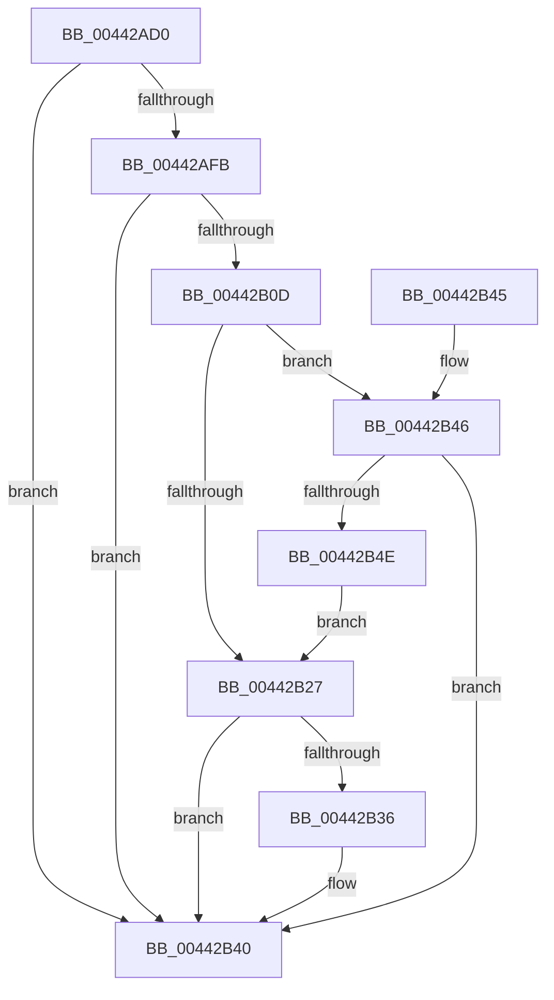

# MiRequestIoPageMdlCacheRelease

- RVA: `0x00442AD0`–`0x00442B50` (길이 `128` bytes)
- VA: `0x0000000140442AD0`
- 실행 섹션: `.text`
- PDB 이름 있음: `예`; PDB Function 태그: `아니요`
- unwind 정보 RVA: `0x0005F758`
- 디코드: `33`개 명령, `128/128` bytes 표시
- 미해석 바이트: `0` (있으면 어셈블리에 `.byte`로 보존)

> 이 문서는 커널 이미지의 기계어와 PDB 기호를 분석해 생성했습니다. 4번과 5번은 함수 원형과 자료형을 바이너리 사용 방식에서 추정한 C 해석이며 원본 소스 복구 결과는 아닙니다.

## 1. Dependencies

- 직접 호출 지점: **1**; 고유 호출 대상: **1**
- 직접 호출자로 확인된 함수: **2**
- RIP 상대 이미지 참조: **0**

### Outgoing calls
- `0x00442B3B` → [IoTryReleasePages](IoTryReleasePages_function_00442B58.md) (function, `0x00442B58`)

### Direct callers
- [MiPfnsWorthTrying](../31/MiPfnsWorthTrying_function_0031B0C0.md) at `0x0031B6DE`
- [MiPfnsWorthTrying](../31/MiPfnsWorthTrying_function_0031B0C0.md) at `0x0031BAA0`
- [MiActivePageClaimCandidate](../31/MiActivePageClaimCandidate_function_0031BB00.md) at `0x0031C09C`

### Static image references
- 디코드된 RIP-relative 메모리 참조가 없습니다.

## 2. Other-region calls and transfers

- 다른 실행 섹션으로 향하는 call: **0**
- 별도 외부 분기/꼬리 이동을 확인하지 못했습니다.

## 3. Assembly (complete function range)

```asm
00442AD0  48 83 EC 28                     sub rsp, 0x28
00442AD4  48 8D 04 49                     lea rax, [rcx + rcx*2]
00442AD8  48 03 C0                        add rax, rax
00442ADB  48 BA 08 00 00 00 00 DE FF FF   movabs rdx, 0xffffde0000000008
00442AE5  48 8B 14 C2                     mov rdx, qword ptr [rdx + rax*8]
00442AE9  49 B9 00 00 00 00 80 F6 FF FF   movabs r9, 0xfffff68000000000
00442AF3  49 8B C1                        mov rax, r9
00442AF6  48 3B D0                        cmp rdx, rax
00442AF9  72 45                           jb 0x140442b40
00442AFB  49 B8 FF FF FF FF FF F6 FF FF   movabs r8, 0xfffff6ffffffffff
00442B05  49 8B C0                        mov rax, r8
00442B08  48 3B D0                        cmp rdx, rax
00442B0B  77 33                           ja 0x140442b40
00442B0D  48 C1 E2 19                     shl rdx, 0x19
00442B11  49 8B C1                        mov rax, r9
00442B14  48 C1 E0 19                     shl rax, 0x19
00442B18  48 2B D0                        sub rdx, rax
00442B1B  48 C1 FA 10                     sar rdx, 0x10
00442B1F  49 8B C1                        mov rax, r9
00442B22  48 3B D0                        cmp rdx, rax
00442B25  73 1F                           jae 0x140442b46
00442B27  48 B8 FF FF FE FF FF 7F 00 00   movabs rax, 0x7ffffffeffff
00442B31  48 3B D0                        cmp rdx, rax
00442B34  77 0A                           ja 0x140442b40
00442B36  BA 01 00 00 00                  mov edx, 1
00442B3B  E8 18 00 00 00                  call 0x140442b58
00442B40  48 83 C4 28                     add rsp, 0x28
00442B44  C3                              ret
00442B45  CC                              int3
00442B46  49 8B C0                        mov rax, r8
00442B49  48 3B D0                        cmp rdx, rax
00442B4C  76 F2                           jbe 0x140442b40
00442B4E  EB D7                           jmp 0x140442b27
```

## 4. C-style interpretation (structured pseudocode)

```c
__int64 __fastcall MiRequestIoPageMdlCacheRelease(__int64 a1)
{
    __int64 result;
    __int64 v_rsp;

    v_rsp = (v_rsp) - (40);
    result = (a1 + a1 * 2) + (a1 + a1 * 2);
    if ((*(unsigned __int64 *)(a2 + result * 8)) < a4) goto loc_00442B40;
    if ((*(unsigned __int64 *)(a2 + result * 8)) > a3) goto loc_00442B40;
    a2 = (*(unsigned __int64 *)(a2 + result * 8)) << (25);
    result = (a4) << (25);
    a2 = (a2) - (result);
    a2 = (a2) >> (16);
    if (a2 >= a4) goto loc_00442B46;
loc_00442B27:
    result = a4;
    if (a2 <= a4) {
        a2 = 1;
        result = IoTryReleasePages(a1, a2, a3, a4);
    }
    v_rsp = (v_rsp) + (40);
    return result;
loc_00442B46:
    if (a2 <= a3) goto loc_00442B40;
    goto loc_00442B27;
}
```

## 5. (Beta) C Style

```c
int64_t MiRequestIoPageMdlCacheRelease(void *Arg1)
{
    uint8_t *arg1 = (uint8_t *)Arg1;

    int64_t result;
    int64_t local_rsp;

    local_rsp = (local_rsp) - (40);
    result = (Arg1 + Arg1 * 2) + (Arg1 + Arg1 * 2);
    if ((*(uint64_t *)(a2 + result * 8)) < a4) goto loc_00442B40;
    if ((*(uint64_t *)(a2 + result * 8)) > a3) goto loc_00442B40;
    a2 = (*(uint64_t *)(a2 + result * 8)) << (25);
    result = (a4) << (25);
    a2 = (a2) - (result);
    a2 = (a2) >> (16);
    if (a2 >= a4) goto loc_00442B46;
loc_00442B27:
    result = a4;
    if (a2 <= a4) {
        a2 = 1;
        result = IoTryReleasePages(Arg1, a2, a3, a4);
    }
    local_rsp = (local_rsp) + (40);
    return result;
loc_00442B46:
    if (a2 <= a3) goto loc_00442B40;
    goto loc_00442B27;
}
```

### 관측된 메모리 오프셋

구조체 형식이 확인되지 않은 접근은 인자 기준의 오프셋으로만 기록했습니다.

| 기준 인자 | 오프셋 표현 | 폭 (bit) | 접근 |
|---|---:|---:|---|
| `Arg1` | `+ 0x0 + rcx*2` | `64` | `R` |

## 6. Execution-region graph

[열기: 2D/3D 그래프와 함수 탐색 컨트롤 패널](../../../control-panel.html?section=text&rva=0x00442AD0&view=graph)

- 2D 그래프는 위에서 아래로 흐르고, 3D 그래프는 빈 공간을 드래그해 회전합니다. Shift+드래그는 이동, 휠은 확대·축소, 함수 노드 선택은 대상 보고서 이동입니다.

### Static fallback


