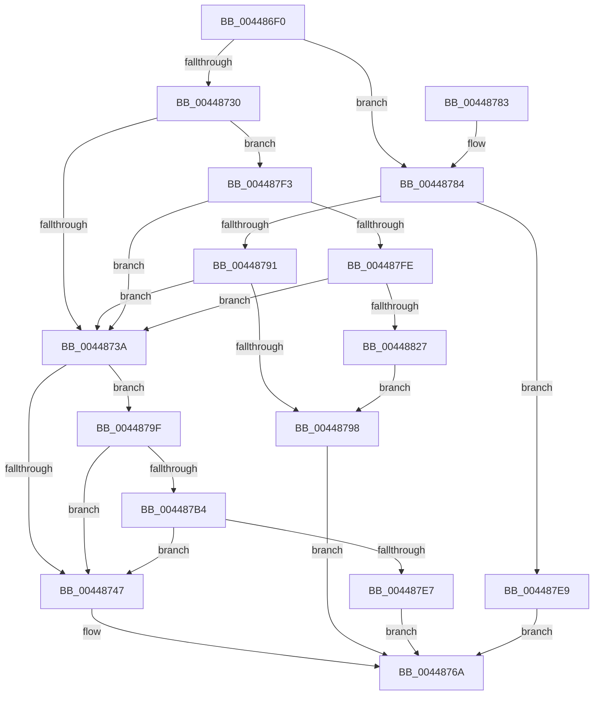

# MiResetVirtualMemory

- RVA: `0x004486F0`–`0x0044882C` (길이 `316` bytes)
- VA: `0x00000001404486F0`
- 실행 섹션: `.text`
- PDB 이름 있음: `예`; PDB Function 태그: `아니요`
- unwind 정보 RVA: `0x000A6164`
- 디코드: `77`개 명령, `316/316` bytes 표시
- 미해석 바이트: `0` (있으면 어셈블리에 `.byte`로 보존)

> 이 문서는 커널 이미지의 기계어와 PDB 기호를 분석해 생성했습니다. 4번과 5번은 함수 원형과 자료형을 바이너리 사용 방식에서 추정한 C 해석이며 원본 소스 복구 결과는 아닙니다.

## 1. Dependencies

- 직접 호출 지점: **3**; 고유 호출 대상: **3**
- 직접 호출자로 확인된 함수: **1**
- RIP 상대 이미지 참조: **0**

### Outgoing calls
- `0x00448758` → [MiWalkVaRange](../24/MiWalkVaRange_function_00243BF0.md) (function, `0x00243BF0`)
- `0x004487DA` → [MiAllowProtectionChange](MiAllowProtectionChange_function_00448834.md) (function, `0x00448834`)
- `0x0044881A` → [MiCheckSecuredVad](../../page/88/MiCheckSecuredVad_function_00881FB4.md) (function, `0x00881FB4`)

### Direct callers
- [MiAllocateVirtualMemory](../../page/88/MiAllocateVirtualMemory_function_00883B40.md) at `0x00883EF5`

### Static image references
- 디코드된 RIP-relative 메모리 참조가 없습니다.

## 2. Other-region calls and transfers

- 다른 실행 섹션으로 향하는 call: **1**
  - `0x0044881A` → [MiCheckSecuredVad](../../page/88/MiCheckSecuredVad_function_00881FB4.md) (`.text` → `PAGE`)
- 별도 외부 분기/꼬리 이동을 확인하지 못했습니다.

## 3. Assembly (complete function range)

```asm
004486F0  48 89 5C 24 08                  mov qword ptr [rsp + 8], rbx
004486F5  48 89 6C 24 10                  mov qword ptr [rsp + 0x10], rbp
004486FA  48 89 74 24 18                  mov qword ptr [rsp + 0x18], rsi
004486FF  57                              push rdi
00448700  41 56                           push r14
00448702  41 57                           push r15
00448704  48 83 EC 30                     sub rsp, 0x30
00448708  45 8B 51 30                     mov r10d, dword ptr [r9 + 0x30]
0044870C  33 DB                           xor ebx, ebx
0044870E  81 7C 24 70 00 00 08 00         cmp dword ptr [rsp + 0x70], 0x80000
00448716  44 8B FB                        mov r15d, ebx
00448719  49 8B F9                        mov rdi, r9
0044871C  49 8B E8                        mov rbp, r8
0044871F  41 0F 95 C7                     setne r15b
00448723  48 8B F2                        mov rsi, rdx
00448726  4C 8B F1                        mov r14, rcx
00448729  41 0F BA E2 15                  bt r10d, 0x15
0044872E  73 54                           jae 0x140448784
00448730  41 F6 C2 08                     test r10b, 8
00448734  0F 85 B9 00 00 00               jne 0x1404487f3
0044873A  41 F7 86 50 07 00 00 00 01 00 00  test dword ptr [r14 + 0x750], 0x100
00448745  75 58                           jne 0x14044879f
00448747  45 8B CF                        mov r9d, r15d
0044874A  48 89 5C 24 20                  mov qword ptr [rsp + 0x20], rbx
0044874F  4C 8B C7                        mov r8, rdi
00448752  48 8B D5                        mov rdx, rbp
00448755  48 8B CE                        mov rcx, rsi
00448758  E8 93 B4 DF FF                  call 0x140243bf0
0044875D  81 7C 24 70 00 00 08 00         cmp dword ptr [rsp + 0x70], 0x80000
00448765  0F 45 D8                        cmovne ebx, eax
00448768  8B C3                           mov eax, ebx
0044876A  48 8B 5C 24 50                  mov rbx, qword ptr [rsp + 0x50]
0044876F  48 8B 6C 24 58                  mov rbp, qword ptr [rsp + 0x58]
00448774  48 8B 74 24 60                  mov rsi, qword ptr [rsp + 0x60]
00448779  48 83 C4 30                     add rsp, 0x30
0044877D  41 5F                           pop r15
0044877F  41 5E                           pop r14
00448781  5F                              pop rdi
00448782  C3                              ret
00448783  CC                              int3
00448784  49 8B 41 48                     mov rax, qword ptr [r9 + 0x48]
00448788  48 8B 08                        mov rcx, qword ptr [rax]
0044878B  48 39 59 40                     cmp qword ptr [rcx + 0x40], rbx
0044878F  75 58                           jne 0x1404487e9
00448791  41 0F BA E2 09                  bt r10d, 9
00448796  72 A2                           jb 0x14044873a
00448798  B8 4E 00 00 C0                  mov eax, 0xc000004e
0044879D  EB CB                           jmp 0x14044876a
0044879F  65 48 8B 04 25 88 01 00 00      mov rax, qword ptr gs:[0x188]
004487A8  F7 80 A0 05 00 00 00 00 04 00   test dword ptr [rax + 0x5a0], 0x40000
004487B2  75 93                           jne 0x140448747
004487B4  65 48 8B 04 25 88 01 00 00      mov rax, qword ptr gs:[0x188]
004487BD  41 B9 04 00 00 00               mov r9d, 4
004487C3  48 89 6C 24 28                  mov qword ptr [rsp + 0x28], rbp
004487C8  4C 8B C7                        mov r8, rdi
004487CB  49 8B D6                        mov rdx, r14
004487CE  48 89 74 24 20                  mov qword ptr [rsp + 0x20], rsi
004487D3  48 8B 88 B8 00 00 00            mov rcx, qword ptr [rax + 0xb8]
004487DA  E8 55 00 00 00                  call 0x140448834
004487DF  85 C0                           test eax, eax
004487E1  0F 89 60 FF FF FF               jns 0x140448747
004487E7  EB 81                           jmp 0x14044876a
004487E9  B8 43 02 00 C0                  mov eax, 0xc0000243
004487EE  E9 77 FF FF FF                  jmp 0x14044876a
004487F3  41 0F BA E2 09                  bt r10d, 9
004487F8  0F 82 3C FF FF FF               jb 0x14044873a
004487FE  8A 44 24 78                     mov al, byte ptr [rsp + 0x78]
00448802  4C 2B C6                        sub r8, rsi
00448805  49 FF C0                        inc r8
00448808  48 89 5C 24 28                  mov qword ptr [rsp + 0x28], rbx
0044880D  41 B9 04 00 00 00               mov r9d, 4
00448813  88 44 24 20                     mov byte ptr [rsp + 0x20], al
00448817  48 8B CF                        mov rcx, rdi
0044881A  E8 95 97 43 00                  call 0x140881fb4
0044881F  85 C0                           test eax, eax
00448821  0F 89 13 FF FF FF               jns 0x14044873a
00448827  E9 6C FF FF FF                  jmp 0x140448798
```

## 4. C-style interpretation (structured pseudocode)

```c
__int64 __fastcall MiResetVirtualMemory(__int64 a1, __int64 a2, __int64 a3, __int64 a4, unsigned int a5, unsigned __int8 a6)
{
    __int64 result;
    __int64 v_r15;
    __int64 v_rbx;
    __int64 v_rsp;
    unsigned __int64 v_stack_m28;
    unsigned __int64 v_stack_p10;
    unsigned __int64 v_stack_p18;
    unsigned __int64 v_stack_p20;
    unsigned __int64 v_stack_p28;
    unsigned __int64 v_stack_p8;

    v_stack_p8 = v_rbx;
    v_stack_p10 = v_rbp;
    v_stack_p18 = v_rsi;
    v_rsp = (v_rsp) - (48);
    v_rbx = 0;
    v_r15 = (a5 != 0x80000ULL) ? 1 : 0;
    if (a5 >= 0x80000ULL) goto loc_00448784;
    if ((((unsigned __int8)((unsigned int)(*(unsigned int *)(a4 + 48)))) & (8)) != 0) goto loc_004487F3;
loc_0044873A:
    if (((*(unsigned int *)(a1 + 1872)) & (256)) != 0) goto loc_0044879F;
loc_00448747:
    v_stack_m28 = 0;
    result = MiWalkVaRange(a2, a3, a4, (unsigned int)((unsigned int)(v_r15)));
    if (a5 != 0x80000ULL) { v_rbx = (unsigned int)(result); }
loc_0044876A:
    v_rsp = (v_rsp) + (48);
    return (unsigned int)((unsigned int)(v_rbx));
loc_00448784:
    if ((*(unsigned __int64 *)(*(unsigned __int64 *)(*(unsigned __int64 *)((unsigned int)((unsigned int)(v_r15)) + 72)) + 64)) != v_stack_p8) goto loc_004487E9;
    if ((*(unsigned __int64 *)(*(unsigned __int64 *)(*(unsigned __int64 *)((unsigned int)((unsigned int)(v_r15)) + 72)) + 64)) < v_stack_p8) goto loc_0044873A;
loc_00448798:
    goto loc_0044876A;
loc_0044879F:
    if (((*(unsigned int *)(*(unsigned __int64 *)(gs_base + (0 + 392)) + 1440)) & (0x40000ULL)) != 0) goto loc_00448747;
    v_stack_p28 = v_stack_p10;
    v_stack_p20 = v_stack_p18;
    result = MiAllowProtectionChange(*(unsigned __int64 *)(*(unsigned __int64 *)(gs_base + (0 + 392)) + 184), a1, a4, 4);
    if (!sign_flag) goto loc_00448747;
    goto loc_0044876A;
loc_004487E9:
    goto loc_0044876A;
loc_004487F3:
    if (condition_is_below) goto loc_0044873A;
    a3 = (a4) - (v_stack_p18);
    a3 = (a3) + 1;
    v_stack_p28 = v_stack_p8;
    v_stack_p20 = a6;
    result = MiCheckSecuredVad(a4, a1, a3, 4);
    if (!sign_flag) goto loc_0044873A;
    goto loc_00448798;
}
```

## 5. (Beta) C Style

```c
int64_t MiResetVirtualMemory(void *Arg1, int64_t Arg2, int64_t Arg3, void *Arg4, uint32_t Arg5, uint8_t Arg6)
{
    uint8_t *arg1 = (uint8_t *)Arg1;
    uint8_t *arg4 = (uint8_t *)Arg4;

    int64_t result;
    int64_t local_r15;
    int64_t local_rbx;
    int64_t local_rsp;
    uint64_t v_stack_m28;
    uint64_t v_stack_p10;
    uint64_t v_stack_p18;
    uint64_t v_stack_p20;
    uint64_t v_stack_p28;
    uint64_t v_stack_p8;

    v_stack_p8 = local_rbx;
    v_stack_p10 = local_rbp;
    v_stack_p18 = local_rsi;
    local_rsp = (local_rsp) - (48);
    local_rbx = 0;
    local_r15 = (Arg5 != 0x80000ULL) ? 1 : 0;
    if (Arg5 >= 0x80000ULL) goto loc_00448784;
    if ((((uint8_t)((uint32_t)(*(uint32_t *)(arg4 + 0x30)))) & (8)) != 0) goto loc_004487F3;
loc_0044873A:
    if (((*(uint32_t *)(arg1 + 0x750)) & (256)) != 0) goto loc_0044879F;
loc_00448747:
    v_stack_m28 = 0;
    result = MiWalkVaRange(Arg2, Arg3, Arg4, (uint32_t)((uint32_t)(local_r15)));
    if (Arg5 != 0x80000ULL) { local_rbx = (uint32_t)(result); }
loc_0044876A:
    local_rsp = (local_rsp) + (48);
    return (uint32_t)((uint32_t)(local_rbx));
loc_00448784:
    if ((*(uint64_t *)(*(uint64_t *)(*(uint64_t *)((uint32_t)((uint32_t)(local_r15)) + 0x48)) + 0x40)) != v_stack_p8) goto loc_004487E9;
    if ((*(uint64_t *)(*(uint64_t *)(*(uint64_t *)((uint32_t)((uint32_t)(local_r15)) + 0x48)) + 0x40)) < v_stack_p8) goto loc_0044873A;
loc_00448798:
    goto loc_0044876A;
loc_0044879F:
    if (((*(uint32_t *)(*(uint64_t *)(gs_base + (0 + 0x188)) + 0x5A0)) & (0x40000ULL)) != 0) goto loc_00448747;
    v_stack_p28 = v_stack_p10;
    v_stack_p20 = v_stack_p18;
    result = MiAllowProtectionChange(*(uint64_t *)(*(uint64_t *)(gs_base + (0 + 0x188)) + 0xB8), Arg1, Arg4, 4);
    if (!sign_flag) goto loc_00448747;
    goto loc_0044876A;
loc_004487E9:
    goto loc_0044876A;
loc_004487F3:
    if (condition_is_below) goto loc_0044873A;
    Arg3 = (Arg4) - (v_stack_p18);
    Arg3 = (Arg3) + 1;
    v_stack_p28 = v_stack_p8;
    v_stack_p20 = Arg6;
    result = MiCheckSecuredVad(Arg4, Arg1, Arg3, 4);
    if (!sign_flag) goto loc_0044873A;
    goto loc_00448798;
}
```

### 관측된 메모리 오프셋

구조체 형식이 확인되지 않은 접근은 인자 기준의 오프셋으로만 기록했습니다.

| 기준 인자 | 오프셋 표현 | 폭 (bit) | 접근 |
|---|---:|---:|---|
| `Arg1` | `+ 0x750` | `32` | `R` |
| `Arg4` | `+ 0x30` | `32` | `R` |
| `Arg4` | `+ 0x48` | `64` | `R` |

## 6. Execution-region graph

[열기: 2D/3D 그래프와 함수 탐색 컨트롤 패널](../../../control-panel.html?section=text&rva=0x004486F0&view=graph)

- 2D 그래프는 위에서 아래로 흐르고, 3D 그래프는 빈 공간을 드래그해 회전합니다. Shift+드래그는 이동, 휠은 확대·축소, 함수 노드 선택은 대상 보고서 이동입니다.

### Static fallback


