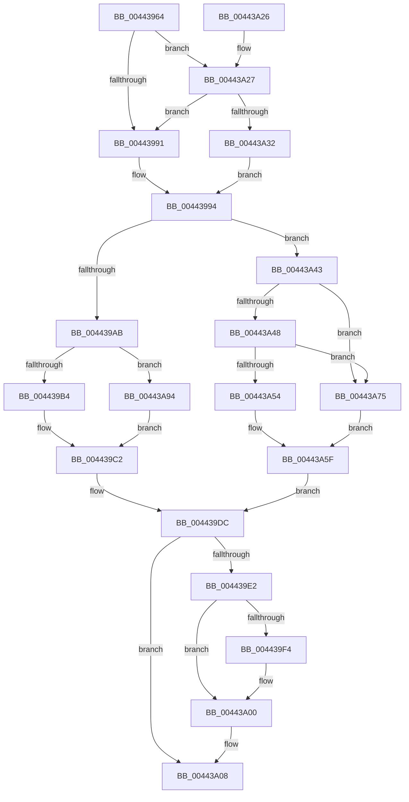

# MiStartingOffsetNeedLock

- RVA: `0x00443964`–`0x00443A9B` (길이 `311` bytes)
- VA: `0x0000000140443964`
- 실행 섹션: `.text`
- PDB 이름 있음: `예`; PDB Function 태그: `아니요`
- unwind 정보 RVA: `0x0009D70C`
- 디코드: `84`개 명령, `311/311` bytes 표시
- 미해석 바이트: `0` (있으면 어셈블리에 `.byte`로 보존)

> 이 문서는 커널 이미지의 기계어와 PDB 기호를 분석해 생성했습니다. 4번과 5번은 함수 원형과 자료형을 바이너리 사용 방식에서 추정한 C 해석이며 원본 소스 복구 결과는 아닙니다.

## 1. Dependencies

- 직접 호출 지점: **4**; 고유 호출 대상: **4**
- 직접 호출자로 확인된 함수: **1**
- RIP 상대 이미지 참조: **1**

### Outgoing calls
- `0x004439E6` → [ExReleaseSpinLockSharedFromDpcLevel](../24/ExReleaseSpinLockSharedFromDpcLevel_function_0024A590.md) (function, `0x0024A590`)
- `0x004439FB` → [KiLowerIrqlProcessIrqlFlags](../4F/KiLowerIrqlProcessIrqlFlags_function_004F5698.md) (function, `0x004F5698`)
- `0x00443A36` → [ExAcquireSpinLockShared](../24/ExAcquireSpinLockShared_function_0024DCE0.md) (function, `0x0024DCE0`)
- `0x00443A7E` → [MiGetSharedProtos](../34/MiGetSharedProtos_function_00348D58.md) (function, `0x00348D58`)

### Direct callers
- [MiPfPrepareReadList](../../page/93/MiPfPrepareReadList_function_0093CD5C.md) at `0x0093D054`

### Static image references
- `0x004439EB` → RVA `0x00FC6D20` (`ALMOSTRO`; read)

## 2. Other-region calls and transfers

- 다른 실행 섹션으로 향하는 call: **0**
- 별도 외부 분기/꼬리 이동을 확인하지 못했습니다.

## 3. Assembly (complete function range)

```asm
00443964  48 8B C4                        mov rax, rsp
00443967  48 89 58 08                     mov qword ptr [rax + 8], rbx
0044396B  48 89 68 10                     mov qword ptr [rax + 0x10], rbp
0044396F  48 89 70 18                     mov qword ptr [rax + 0x18], rsi
00443973  48 89 78 20                     mov qword ptr [rax + 0x20], rdi
00443977  41 56                           push r14
00443979  48 83 EC 20                     sub rsp, 0x20
0044397D  48 8B 29                        mov rbp, qword ptr [rcx]
00443980  44 8B F2                        mov r14d, edx
00443983  48 8B F9                        mov rdi, rcx
00443986  8B 45 38                        mov eax, dword ptr [rbp + 0x38]
00443989  A8 20                           test al, 0x20
0044398B  0F 84 96 00 00 00               je 0x140443a27
00443991  40 B6 11                        mov sil, 0x11
00443994  4C 8B 0F                        mov r9, qword ptr [rdi]
00443997  48 8B 5F 08                     mov rbx, qword ptr [rdi + 8]
0044399B  41 8B 41 38                     mov eax, dword ptr [r9 + 0x38]
0044399F  48 8B 57 08                     mov rdx, qword ptr [rdi + 8]
004439A3  A8 20                           test al, 0x20
004439A5  0F 85 98 00 00 00               jne 0x140443a43
004439AB  48 85 D2                        test rdx, rdx
004439AE  0F 84 E0 00 00 00               je 0x140443a94
004439B4  48 8B CB                        mov rcx, rbx
004439B7  48 2B CA                        sub rcx, rdx
004439BA  48 C1 F9 03                     sar rcx, 3
004439BE  48 C1 E1 0C                     shl rcx, 0xc
004439C2  8B 5F 20                        mov ebx, dword ptr [rdi + 0x20]
004439C5  8B 47 24                        mov eax, dword ptr [rdi + 0x24]
004439C8  81 E3 C0 FF 00 00               and ebx, 0xffc0
004439CE  48 C1 E3 1A                     shl rbx, 0x1a
004439D2  48 0B D8                        or rbx, rax
004439D5  48 C1 E3 0C                     shl rbx, 0xc
004439D9  48 03 D9                        add rbx, rcx
004439DC  40 80 FE 11                     cmp sil, 0x11
004439E0  74 26                           je 0x140443a08
004439E2  48 8D 4D 48                     lea rcx, [rbp + 0x48]
004439E6  E8 A5 6B E0 FF                  call 0x14024a590
004439EB  83 3D 2E 33 B8 00 00            cmp dword ptr [rip + 0xb8332e], 0
004439F2  74 0C                           je 0x140443a00
004439F4  44 0F 20 C1                     mov rcx, cr8
004439F8  40 8A D6                        mov dl, sil
004439FB  E8 98 1C 0B 00                  call 0x1404f5698
00443A00  40 0F B6 CE                     movzx ecx, sil
00443A04  44 0F 22 C1                     mov cr8, rcx
00443A08  48 8B 6C 24 38                  mov rbp, qword ptr [rsp + 0x38]
00443A0D  48 8B C3                        mov rax, rbx
00443A10  48 8B 5C 24 30                  mov rbx, qword ptr [rsp + 0x30]
00443A15  48 8B 74 24 40                  mov rsi, qword ptr [rsp + 0x40]
00443A1A  48 8B 7C 24 48                  mov rdi, qword ptr [rsp + 0x48]
00443A1F  48 83 C4 20                     add rsp, 0x20
00443A23  41 5E                           pop r14
00443A25  C3                              ret
00443A26  CC                              int3
00443A27  48 83 7D 40 00                  cmp qword ptr [rbp + 0x40], 0
00443A2C  0F 84 5F FF FF FF               je 0x140443991
00443A32  48 8D 4D 48                     lea rcx, [rbp + 0x48]
00443A36  E8 A5 A2 E0 FF                  call 0x14024dce0
00443A3B  40 8A F0                        mov sil, al
00443A3E  E9 51 FF FF FF                  jmp 0x140443994
00443A43  48 3B DA                        cmp rbx, rdx
00443A46  72 2D                           jb 0x140443a75
00443A48  8B 47 2C                        mov eax, dword ptr [rdi + 0x2c]
00443A4B  48 8D 0C C2                     lea rcx, [rdx + rax*8]
00443A4F  48 3B D9                        cmp rbx, rcx
00443A52  73 21                           jae 0x140443a75
00443A54  48 C1 E2 09                     shl rdx, 9
00443A58  48 C1 E3 09                     shl rbx, 9
00443A5C  48 2B DA                        sub rbx, rdx
00443A5F  8B 47 24                        mov eax, dword ptr [rdi + 0x24]
00443A62  48 81 E3 00 F0 FF FF            and rbx, 0xfffffffffffff000
00443A69  48 C1 E0 09                     shl rax, 9
00443A6D  48 03 D8                        add rbx, rax
00443A70  E9 67 FF FF FF                  jmp 0x1404439dc
00443A75  4C 8B C7                        mov r8, rdi
00443A78  41 8B D6                        mov edx, r14d
00443A7B  49 8B C9                        mov rcx, r9
00443A7E  E8 D5 52 F0 FF                  call 0x140348d58
00443A83  48 C1 E3 09                     shl rbx, 9
00443A87  48 8B 48 48                     mov rcx, qword ptr [rax + 0x48]
00443A8B  48 C1 E1 09                     shl rcx, 9
00443A8F  48 2B D9                        sub rbx, rcx
00443A92  EB CB                           jmp 0x140443a5f
00443A94  33 C9                           xor ecx, ecx
00443A96  E9 27 FF FF FF                  jmp 0x1404439c2
```

## 4. C-style interpretation (structured pseudocode)

```c
__int64 __fastcall MiStartingOffsetNeedLock(__int64 a1, int a2)
{
    __int64 result;
    __int64 v_rbx;
    __int64 v_rsp;
    unsigned __int64 v_stack_p10;
    unsigned __int64 v_stack_p18;
    unsigned __int64 v_stack_p20;
    unsigned __int64 v_stack_p8;

    *(unsigned __int64 *)(v_rsp + 8) = v_rbx;
    *(unsigned __int64 *)(v_rsp + 16) = v_rbp;
    *(unsigned __int64 *)(v_rsp + 24) = v_rsi;
    *(unsigned __int64 *)(v_rsp + 32) = v_rdi;
    v_rsp = (v_rsp) - (32);
    if ((((unsigned __int8)((unsigned int)(*(unsigned int *)(*(unsigned __int64 *)(a1) + 56)))) & (32)) == 0) goto loc_00443A27;
loc_00443991:
loc_00443994:
    if ((((unsigned __int8)((unsigned int)(*(unsigned int *)(*(unsigned __int64 *)(a1) + 56)))) & (32)) != 0) goto loc_00443A43;
    if (*(unsigned __int64 *)(a1 + 8) == 0) goto loc_00443A94;
    a1 = (*(unsigned __int64 *)(a1 + 8)) - (*(unsigned __int64 *)(a1 + 8));
    a1 = (a1) >> (3);
    a1 = (a1) << (12);
loc_004439C2:
    v_rbx = (unsigned int)(((unsigned int)(*(unsigned int *)(a1 + 32))) & (0xFFC0ULL));
    v_rbx = (v_rbx) << (26);
    v_rbx = (v_rbx) | ((unsigned int)(*(unsigned int *)(a1 + 36)));
    v_rbx = (v_rbx) << (12);
    v_rbx = (v_rbx) + (a1);
loc_004439DC:
    if (17 == 17) goto loc_00443A08;
    result = ExReleaseSpinLockSharedFromDpcLevel(*(unsigned __int64 *)(a1) + 72, *(unsigned __int64 *)(a1 + 8), a3, *(unsigned __int64 *)(a1));
    if ((*(unsigned int *)(v_rip + 12071726)) != 0) {
        a1 = v_cr8;
        a2 = 17;
        result = KiLowerIrqlProcessIrqlFlags(a1, a2, a3, *(unsigned __int64 *)(a1));
    }
loc_00443A08:
    v_rsp = (v_rsp) + (32);
    return v_rbx;
loc_00443A27:
    if ((*(unsigned __int64 *)(v_stack_p10 + 64)) == 0) goto loc_00443991;
    result = ExAcquireSpinLockShared(v_stack_p10 + 72, a2, a3, *(unsigned __int64 *)(a1));
    goto loc_00443994;
loc_00443A43:
    if (v_stack_p8 < a2) goto loc_00443A75;
    if (v_stack_p8 >= (a2 + (unsigned int)(*(unsigned int *)(v_stack_p20 + 44)) * 8)) goto loc_00443A75;
    a2 = (a2) << (9);
    v_rbx = (v_stack_p8) << (9);
    v_rbx = (v_rbx) - (a2);
loc_00443A5F:
    v_rbx = (v_rbx) & (0xFFFFFFFFFFFFF000ULL);
    result = ((unsigned int)(*(unsigned int *)(v_stack_p20 + 36))) << (9);
    v_rbx = (v_rbx) + (result);
    goto loc_004439DC;
loc_00443A75:
    result = MiGetSharedProtos(*(unsigned __int64 *)(a1), (unsigned int)((unsigned int)((unsigned int)(a2))), v_stack_p20, *(unsigned __int64 *)(a1));
    v_rbx = (v_rbx) << (9);
    a1 = (*(unsigned __int64 *)(result + 72)) << (9);
    v_rbx = (v_rbx) - (a1);
    goto loc_00443A5F;
loc_00443A94:
    a1 = 0;
    goto loc_004439C2;
}
```

## 5. (Beta) C Style

```c
int64_t MiStartingOffsetNeedLock(void *Arg1, int32_t Arg2)
{
    uint8_t *arg1 = (uint8_t *)Arg1;

    int64_t result;
    int64_t local_rbx;
    int64_t local_rsp;
    uint64_t v_stack_p10;
    uint64_t v_stack_p18;
    uint64_t v_stack_p20;
    uint64_t v_stack_p8;

    *(uint64_t *)(local_rsp + 0x8) = local_rbx;
    *(uint64_t *)(local_rsp + 0x10) = local_rbp;
    *(uint64_t *)(local_rsp + 0x18) = local_rsi;
    *(uint64_t *)(local_rsp + 0x20) = local_rdi;
    local_rsp = (local_rsp) - (32);
    if ((((uint8_t)((uint32_t)(*(uint32_t *)(*(uint64_t *)(arg1) + 0x38)))) & (32)) == 0) goto loc_00443A27;
loc_00443991:
loc_00443994:
    if ((((uint8_t)((uint32_t)(*(uint32_t *)(*(uint64_t *)(arg1) + 0x38)))) & (32)) != 0) goto loc_00443A43;
    if (*(uint64_t *)(arg1 + 0x8) == 0) goto loc_00443A94;
    Arg1 = (*(uint64_t *)(arg1 + 0x8)) - (*(uint64_t *)(arg1 + 0x8));
    Arg1 = (Arg1) >> (3);
    Arg1 = (Arg1) << (12);
loc_004439C2:
    local_rbx = (uint32_t)(((uint32_t)(*(uint32_t *)(arg1 + 0x20))) & (0xFFC0ULL));
    local_rbx = (local_rbx) << (26);
    local_rbx = (local_rbx) | ((uint32_t)(*(uint32_t *)(arg1 + 0x24)));
    local_rbx = (local_rbx) << (12);
    local_rbx = (local_rbx) + (Arg1);
loc_004439DC:
    if (17 == 17) goto loc_00443A08;
    result = ExReleaseSpinLockSharedFromDpcLevel(*(uint64_t *)(arg1) + 72, *(uint64_t *)(arg1 + 0x8), a3, *(uint64_t *)(arg1));
    if ((*(uint32_t *)(v_rip + 0xB8332E)) != 0) {
        Arg1 = v_cr8;
        Arg2 = 17;
        result = KiLowerIrqlProcessIrqlFlags(Arg1, Arg2, a3, *(uint64_t *)(arg1));
    }
loc_00443A08:
    local_rsp = (local_rsp) + (32);
    return local_rbx;
loc_00443A27:
    if ((*(uint64_t *)(v_stack_p10 + 0x40)) == 0) goto loc_00443991;
    result = ExAcquireSpinLockShared(v_stack_p10 + 72, Arg2, a3, *(uint64_t *)(arg1));
    goto loc_00443994;
loc_00443A43:
    if (v_stack_p8 < Arg2) goto loc_00443A75;
    if (v_stack_p8 >= (Arg2 + (uint32_t)(*(uint32_t *)(v_stack_p20 + 0x2C)) * 8)) goto loc_00443A75;
    Arg2 = (Arg2) << (9);
    local_rbx = (v_stack_p8) << (9);
    local_rbx = (local_rbx) - (Arg2);
loc_00443A5F:
    local_rbx = (local_rbx) & (0xFFFFFFFFFFFFF000ULL);
    result = ((uint32_t)(*(uint32_t *)(v_stack_p20 + 0x24))) << (9);
    local_rbx = (local_rbx) + (result);
    goto loc_004439DC;
loc_00443A75:
    result = MiGetSharedProtos(*(uint64_t *)(arg1), (uint32_t)((uint32_t)((uint32_t)(Arg2))), v_stack_p20, *(uint64_t *)(arg1));
    local_rbx = (local_rbx) << (9);
    Arg1 = (*(uint64_t *)(result + 0x48)) << (9);
    local_rbx = (local_rbx) - (Arg1);
    goto loc_00443A5F;
loc_00443A94:
    Arg1 = 0;
    goto loc_004439C2;
}
```

### 관측된 메모리 오프셋

구조체 형식이 확인되지 않은 접근은 인자 기준의 오프셋으로만 기록했습니다.

| 기준 인자 | 오프셋 표현 | 폭 (bit) | 접근 |
|---|---:|---:|---|
| `Arg1` | `+ 0x0` | `64` | `R` |
| `Arg1` | `+ 0x8` | `64` | `R` |
| `Arg1` | `+ 0x20` | `32` | `R` |
| `Arg1` | `+ 0x24` | `32` | `R` |
| `Arg1` | `+ 0x2C` | `32` | `R` |

## 6. Execution-region graph

[열기: 2D/3D 그래프와 함수 탐색 컨트롤 패널](../../../control-panel.html?section=text&rva=0x00443964&view=graph)

- 2D 그래프는 위에서 아래로 흐르고, 3D 그래프는 빈 공간을 드래그해 회전합니다. Shift+드래그는 이동, 휠은 확대·축소, 함수 노드 선택은 대상 보고서 이동입니다.

### Static fallback


