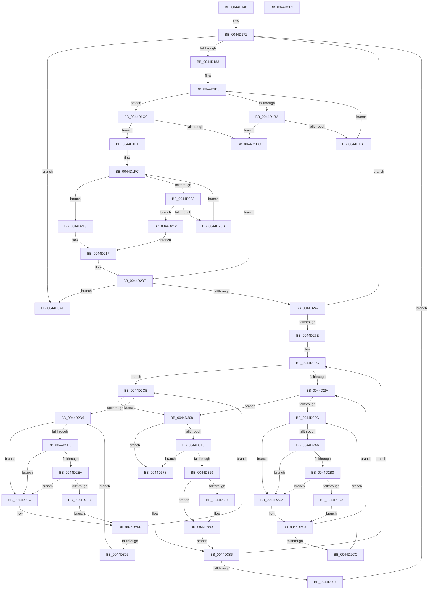

# MiUnlinkTransitionSlabPages

- RVA: `0x0044D140`–`0x0044D3BA` (길이 `634` bytes)
- VA: `0x000000014044D140`
- 실행 섹션: `.text`
- PDB 이름 있음: `예`; PDB Function 태그: `아니요`
- unwind 정보 RVA: `0x000A6904`
- 디코드: `187`개 명령, `634/634` bytes 표시
- 미해석 바이트: `0` (있으면 어셈블리에 `.byte`로 보존)

> 이 문서는 커널 이미지의 기계어와 PDB 기호를 분석해 생성했습니다. 4번과 5번은 함수 원형과 자료형을 바이너리 사용 방식에서 추정한 C 해석이며 원본 소스 복구 결과는 아닙니다.

## 1. Dependencies

- 직접 호출 지점: **5**; 고유 호출 대상: **3**
- 직접 호출자로 확인된 함수: **2**
- RIP 상대 이미지 참조: **2**

### Outgoing calls
- `0x0044D2B0` → [KiCheckVpBackingLongSpinWaitHypercall](../30/KiCheckVpBackingLongSpinWaitHypercall_function_0030F490.md) (function, `0x0030F490`)
- `0x0044D2BB` → [HvlNotifyLongSpinWait](../30/HvlNotifyLongSpinWait_function_0030F460.md) (function, `0x0030F460`)
- `0x0044D2EA` → [KiCheckVpBackingLongSpinWaitHypercall](../30/KiCheckVpBackingLongSpinWaitHypercall_function_0030F490.md) (function, `0x0030F490`)
- `0x0044D2F5` → [HvlNotifyLongSpinWait](../30/HvlNotifyLongSpinWait_function_0030F460.md) (function, `0x0030F460`)
- `0x0044D31E` → [MiUnlinkPageFromListEx](../28/MiUnlinkPageFromListEx_function_00287590.md) (function, `0x00287590`)

### Direct callers
- [MiDemoteSlabEntry](MiDemoteSlabEntry_function_0044CB0C.md) at `0x0044CB6C`
- [MiDeleteSlabEntriesForIdentity](../68/MiDeleteSlabEntriesForIdentity_function_0068DE10.md) at `0x0068DF3C`

### Static image references
- `0x0044D29E` → RVA `0x00FC52AC` (`ALMOSTRO`; reference)
- `0x0044D2A6` → RVA `0x00FC6AB8` (`ALMOSTRO`; read)

## 2. Other-region calls and transfers

- 다른 실행 섹션으로 향하는 call: **0**
- 별도 외부 분기/꼬리 이동을 확인하지 못했습니다.

## 3. Assembly (complete function range)

```asm
0044D140  48 89 5C 24 18                  mov qword ptr [rsp + 0x18], rbx
0044D145  48 89 54 24 10                  mov qword ptr [rsp + 0x10], rdx
0044D14A  48 89 4C 24 08                  mov qword ptr [rsp + 8], rcx
0044D14F  55                              push rbp
0044D150  56                              push rsi
0044D151  57                              push rdi
0044D152  41 54                           push r12
0044D154  41 55                           push r13
0044D156  41 56                           push r14
0044D158  41 57                           push r15
0044D15A  48 83 EC 20                     sub rsp, 0x20
0044D15E  45 33 E4                        xor r12d, r12d
0044D161  4C 8B EA                        mov r13, rdx
0044D164  45 8B F4                        mov r14d, r12d
0044D167  49 BF FF FF FF FF 3F 00 00 00   movabs r15, 0x3fffffffff
0044D171  45 8B 5D 40                     mov r11d, dword ptr [r13 + 0x40]
0044D175  44 89 64 24 60                  mov dword ptr [rsp + 0x60], r12d
0044D17A  45 3B DE                        cmp r11d, r14d
0044D17D  0F 86 1E 02 00 00               jbe 0x14044d3a1
0044D183  49 8B 7D 48                     mov rdi, qword ptr [r13 + 0x48]
0044D187  41 8D 53 FF                     lea edx, [r11 - 1]
0044D18B  48 C1 EA 05                     shr rdx, 5
0044D18F  45 8B D4                        mov r10d, r12d
0044D192  41 8B C6                        mov eax, r14d
0044D195  41 83 E6 1F                     and r14d, 0x1f
0044D199  48 C1 E8 05                     shr rax, 5
0044D19D  41 8A CE                        mov cl, r14b
0044D1A0  48 8D 1C 97                     lea rbx, [rdi + rdx*4]
0044D1A4  4C 8D 04 87                     lea r8, [rdi + rax*4]
0044D1A8  83 C8 FF                        or eax, 0xffffffff
0044D1AB  41 8B 10                        mov edx, dword ptr [r8]
0044D1AE  D3 E0                           shl eax, cl
0044D1B0  23 D0                           and edx, eax
0044D1B2  49 8D 40 04                     lea rax, [r8 + 4]
0044D1B6  85 D2                           test edx, edx
0044D1B8  75 12                           jne 0x14044d1cc
0044D1BA  48 3B C3                        cmp rax, rbx
0044D1BD  77 2D                           ja 0x14044d1ec
0044D1BF  49 83 C0 04                     add r8, 4
0044D1C3  48 83 C0 04                     add rax, 4
0044D1C7  41 8B 10                        mov edx, dword ptr [r8]
0044D1CA  EB EA                           jmp 0x14044d1b6
0044D1CC  8B C2                           mov eax, edx
0044D1CE  4D 8B C8                        mov r9, r8
0044D1D1  4C 2B CF                        sub r9, rdi
0044D1D4  48 0F BC C8                     bsf rcx, rax
0044D1D8  49 C1 F9 02                     sar r9, 2
0044D1DC  41 C1 E1 05                     shl r9d, 5
0044D1E0  44 03 C9                        add r9d, ecx
0044D1E3  89 4C 24 60                     mov dword ptr [rsp + 0x60], ecx
0044D1E7  45 3B CB                        cmp r9d, r11d
0044D1EA  76 05                           jbe 0x14044d1f1
0044D1EC  45 8B CB                        mov r9d, r11d
0044D1EF  EB 4D                           jmp 0x14044d23e
0044D1F1  B8 01 00 00 00                  mov eax, 1
0044D1F6  D3 E0                           shl eax, cl
0044D1F8  FF C8                           dec eax
0044D1FA  0B D0                           or edx, eax
0044D1FC  F7 D2                           not edx
0044D1FE  85 D2                           test edx, edx
0044D200  75 17                           jne 0x14044d219
0044D202  49 8D 40 04                     lea rax, [r8 + 4]
0044D206  48 3B C3                        cmp rax, rbx
0044D209  77 07                           ja 0x14044d212
0044D20B  8B 10                           mov edx, dword ptr [rax]
0044D20D  4C 8B C0                        mov r8, rax
0044D210  EB EA                           jmp 0x14044d1fc
0044D212  B8 20 00 00 00                  mov eax, 0x20
0044D217  EB 06                           jmp 0x14044d21f
0044D219  8B C2                           mov eax, edx
0044D21B  48 0F BC C0                     bsf rax, rax
0044D21F  4C 2B C7                        sub r8, rdi
0044D222  89 44 24 60                     mov dword ptr [rsp + 0x60], eax
0044D226  4D 8B D0                        mov r10, r8
0044D229  49 C1 FA 02                     sar r10, 2
0044D22D  41 C1 E2 05                     shl r10d, 5
0044D231  44 03 D0                        add r10d, eax
0044D234  45 3B D3                        cmp r10d, r11d
0044D237  45 0F 47 D3                     cmova r10d, r11d
0044D23B  45 2B D1                        sub r10d, r9d
0044D23E  45 85 D2                        test r10d, r10d
0044D241  0F 84 5A 01 00 00               je 0x14044d3a1
0044D247  41 8B C1                        mov eax, r9d
0044D24A  47 8D 34 0A                     lea r14d, [r10 + r9]
0044D24E  49 03 45 28                     add rax, qword ptr [r13 + 0x28]
0044D252  48 8D 3C 40                     lea rdi, [rax + rax*2]
0044D256  48 C1 E7 04                     shl rdi, 4
0044D25A  48 B8 00 00 00 00 00 DE FF FF   movabs rax, 0xffffde0000000000
0044D264  48 03 F8                        add rdi, rax
0044D267  41 8B C2                        mov eax, r10d
0044D26A  48 8D 2C 40                     lea rbp, [rax + rax*2]
0044D26E  48 C1 E5 04                     shl rbp, 4
0044D272  48 03 EF                        add rbp, rdi
0044D275  48 3B FD                        cmp rdi, rbp
0044D278  0F 83 F3 FE FF FF               jae 0x14044d171
0044D27E  48 8D 5F 18                     lea rbx, [rdi + 0x18]
0044D282  49 BD FF FF FF FF 3F 00 00 00   movabs r13, 0x3fffffffff
0044D28C  41 8B F4                        mov esi, r12d
0044D28F  4D 3B FD                        cmp r15, r13
0044D292  75 3A                           jne 0x14044d2ce
0044D294  F0 48 0F BA 2B 3F               lock bts qword ptr [rbx], 0x3f
0044D29A  73 6C                           jae 0x14044d308
0044D29C  FF C6                           inc esi
0044D29E  85 35 08 80 B7 00               test dword ptr [rip + 0xb78008], esi
0044D2A4  75 1C                           jne 0x14044d2c2
0044D2A6  8B 05 0C 98 B7 00               mov eax, dword ptr [rip + 0xb7980c]
0044D2AC  A8 40                           test al, 0x40
0044D2AE  74 12                           je 0x14044d2c2
0044D2B0  E8 DB 21 EC FF                  call 0x14030f490
0044D2B5  84 C0                           test al, al
0044D2B7  74 09                           je 0x14044d2c2
0044D2B9  8B CE                           mov ecx, esi
0044D2BB  E8 A0 21 EC FF                  call 0x14030f460
0044D2C0  EB 02                           jmp 0x14044d2c4
0044D2C2  F3 90                           pause
0044D2C4  48 8B 03                        mov rax, qword ptr [rbx]
0044D2C7  48 85 C0                        test rax, rax
0044D2CA  79 C8                           jns 0x14044d294
0044D2CC  EB CE                           jmp 0x14044d29c
0044D2CE  F0 48 0F BA 2B 3F               lock bts qword ptr [rbx], 0x3f
0044D2D4  73 32                           jae 0x14044d308
0044D2D6  FF C6                           inc esi
0044D2D8  85 35 CE 7F B7 00               test dword ptr [rip + 0xb77fce], esi
0044D2DE  75 1C                           jne 0x14044d2fc
0044D2E0  8B 05 D2 97 B7 00               mov eax, dword ptr [rip + 0xb797d2]
0044D2E6  A8 40                           test al, 0x40
0044D2E8  74 12                           je 0x14044d2fc
0044D2EA  E8 A1 21 EC FF                  call 0x14030f490
0044D2EF  84 C0                           test al, al
0044D2F1  74 09                           je 0x14044d2fc
0044D2F3  8B CE                           mov ecx, esi
0044D2F5  E8 66 21 EC FF                  call 0x14030f460
0044D2FA  EB 02                           jmp 0x14044d2fe
0044D2FC  F3 90                           pause
0044D2FE  48 8B 03                        mov rax, qword ptr [rbx]
0044D301  48 85 C0                        test rax, rax
0044D304  79 C8                           jns 0x14044d2ce
0044D306  EB CE                           jmp 0x14044d2d6
0044D308  8B 43 08                        mov eax, dword ptr [rbx + 8]
0044D30B  66 85 C0                        test ax, ax
0044D30E  75 68                           jne 0x14044d378
0044D310  8A 43 0A                        mov al, byte ptr [rbx + 0xa]
0044D313  24 07                           and al, 7
0044D315  3C 04                           cmp al, 4
0044D317  77 5F                           ja 0x14044d378
0044D319  33 D2                           xor edx, edx
0044D31B  48 8B CF                        mov rcx, rdi
0044D31E  E8 6D A2 E3 FF                  call 0x140287590
0044D323  A8 01                           test al, 1
0044D325  74 13                           je 0x14044d33a
0044D327  48 8B 03                        mov rax, qword ptr [rbx]
0044D32A  48 B9 00 00 00 00 00 00 00 40   movabs rcx, 0x4000000000000000
0044D334  48 0B C1                        or rax, rcx
0044D337  48 89 03                        mov qword ptr [rbx], rax
0044D33A  48 8B 07                        mov rax, qword ptr [rdi]
0044D33D  48 B9 00 00 00 00 00 FF FF FF   movabs rcx, 0xffffff0000000000
0044D347  49 33 C7                        xor rax, r15
0044D34A  48 23 C1                        and rax, rcx
0044D34D  49 33 C7                        xor rax, r15
0044D350  48 89 07                        mov qword ptr [rdi], rax
0044D353  48 B8 22 00 00 00 00 DE FF FF   movabs rax, 0xffffde0000000022
0044D35D  4C 8D 7B 0A                     lea r15, [rbx + 0xa]
0044D361  4C 2B F8                        sub r15, rax
0044D364  48 B8 AB AA AA AA AA AA AA AA   movabs rax, 0xaaaaaaaaaaaaaaab
0044D36E  49 C1 FF 04                     sar r15, 4
0044D372  4C 0F AF F8                     imul r15, rax
0044D376  EB 0E                           jmp 0x14044d386
0044D378  48 B8 FF FF FF FF FF FF FF 7F   movabs rax, 0x7fffffffffffffff
0044D382  F0 48 21 03                     lock and qword ptr [rbx], rax
0044D386  48 83 C7 30                     add rdi, 0x30
0044D38A  48 83 C3 30                     add rbx, 0x30
0044D38E  48 3B FD                        cmp rdi, rbp
0044D391  0F 82 F5 FE FF FF               jb 0x14044d28c
0044D397  4C 8B 6C 24 68                  mov r13, qword ptr [rsp + 0x68]
0044D39C  E9 D0 FD FF FF                  jmp 0x14044d171
0044D3A1  48 8B 5C 24 70                  mov rbx, qword ptr [rsp + 0x70]
0044D3A6  49 8B C7                        mov rax, r15
0044D3A9  48 83 C4 20                     add rsp, 0x20
0044D3AD  41 5F                           pop r15
0044D3AF  41 5E                           pop r14
0044D3B1  41 5D                           pop r13
0044D3B3  41 5C                           pop r12
0044D3B5  5F                              pop rdi
0044D3B6  5E                              pop rsi
0044D3B7  5D                              pop rbp
0044D3B8  C3                              ret
0044D3B9  CC                              int3
```

## 4. C-style interpretation (structured pseudocode)

```c
__int64 __fastcall MiUnlinkTransitionSlabPages(__int64 a1, __int64 a2)
{
    __int64 result;
    __int64 v_r10;
    __int64 v_r12;
    __int64 v_r14;
    __int64 v_r15;
    __int64 v_rbp;
    __int64 v_rbx;
    __int64 v_rdi;
    __int64 v_rsi;
    __int64 v_rsp;
    unsigned __int64 v_stack_p10;
    unsigned __int64 v_stack_p18;
    unsigned __int64 v_stack_p8;

    v_stack_p18 = v_rbx;
    v_stack_p10 = a2;
    v_stack_p8 = a1;
    v_rsp = (v_rsp) - (32);
    v_r12 = 0;
loc_0044D171:
    v_stack_p8 = 0;
    if (((unsigned int)((unsigned int)(*(unsigned int *)(a2 + 64)))) <= 0) goto loc_0044D3A1;
    a2 = ((unsigned int)(*(unsigned int *)(a2 + 64)) - 1) >> (5);
    v_r14 = (unsigned int)((0) & (31));
    result = (0) >> (5);
    result = (unsigned int)((result) | (0xFFFFFFFFULL));
    result = (unsigned int)((result) << ((unsigned __int8)((unsigned __int8)(v_r14))));
    a2 = (unsigned int)(((unsigned int)(*(unsigned int *)(*(unsigned __int64 *)(a2 + 72) + result * 4))) & ((unsigned int)(result)));
loc_0044D1B6:
    if ((unsigned int)(a2) != 0) goto loc_0044D1CC;
    if ((*(unsigned __int64 *)(a2 + 72) + result * 4 + 4) > (*(unsigned __int64 *)(a2 + 72) + a2 * 4)) goto loc_0044D1EC;
    a3 = (*(unsigned __int64 *)(a2 + 72) + result * 4) + (4);
    result = (*(unsigned __int64 *)(a2 + 72) + result * 4 + 4) + (4);
    goto loc_0044D1B6;
loc_0044D1CC:
    a4 = (a3) - (*(unsigned __int64 *)(a2 + 72));
    a4 = (a4) >> (2);
    a4 = (unsigned int)((a4) << (5));
    a4 = (unsigned int)((a4) + ((unsigned int)((unsigned __int8)(v_r14))));
    v_stack_p8 = (unsigned int)((unsigned __int8)(v_r14));
    if (((unsigned int)(a4)) <= ((unsigned int)((unsigned int)(*(unsigned int *)(a2 + 64))))) goto loc_0044D1F1;
loc_0044D1EC:
    goto loc_0044D23E;
loc_0044D1F1:
    result = (unsigned int)((1) << ((unsigned __int8)((unsigned __int8)(v_r14))));
    result = (unsigned int)((result) - 1);
    a2 = (unsigned int)(((unsigned int)(*(unsigned int *)(a3))) | ((unsigned int)(result)));
loc_0044D1FC:
    a2 = (unsigned int)(~(a2));
    if ((unsigned int)(a2) != 0) goto loc_0044D219;
    if ((a3 + 4) > (*(unsigned __int64 *)(a2 + 72) + a2 * 4)) goto loc_0044D212;
    goto loc_0044D1FC;
loc_0044D212:
    goto loc_0044D21F;
loc_0044D219:
loc_0044D21F:
    a3 = (a3 + 4) - (*(unsigned __int64 *)(a2 + 72));
    v_stack_p8 = (unsigned int)((unsigned int)((unsigned int)((unsigned int)(*(unsigned int *)(a3 + 4)))));
    v_r10 = (a3) >> (2);
    v_r10 = (unsigned int)((v_r10) << (5));
    v_r10 = (unsigned int)((v_r10) + ((unsigned int)((unsigned int)((unsigned int)((unsigned int)(*(unsigned int *)(a3 + 4)))))));
    if (((unsigned int)(v_r10)) > ((unsigned int)((unsigned int)(*(unsigned int *)(a2 + 64))))) { v_r10 = (unsigned int)((unsigned int)(*(unsigned int *)(a2 + 64))); }
    v_r10 = (unsigned int)((v_r10) - ((unsigned int)((unsigned int)((unsigned int)((unsigned int)(*(unsigned int *)(a2 + 64)))))));
loc_0044D23E:
    if ((unsigned int)(v_r10) == 0) goto loc_0044D3A1;
    result = ((unsigned int)((unsigned int)((unsigned int)((unsigned int)((unsigned int)(*(unsigned int *)(a2 + 64))))))) + (*(unsigned __int64 *)(a2 + 40));
    v_rdi = (result + result * 2) << (4);
    v_rdi = (v_rdi) + (result);
    v_rbp = ((unsigned int)((unsigned int)(v_r10)) + (unsigned int)((unsigned int)(v_r10)) * 2) << (4);
    v_rbp = (v_rbp) + (v_rdi);
    if (v_rdi >= v_rbp) goto loc_0044D171;
loc_0044D28C:
    if (v_r15 != a2) goto loc_0044D2CE;
loc_0044D294:
    if (v_r15 >= a2) goto loc_0044D308;
loc_0044D29C:
    v_rsi = (unsigned int)((0) + 1);
    if (((*(unsigned int *)(v_rip + 12025864)) & ((unsigned int)(v_rsi))) != 0) goto loc_0044D2C2;
    if ((((unsigned __int8)((unsigned int)(*(unsigned int *)(v_rip + 12032012)))) & (64)) == 0) goto loc_0044D2C2;
    result = KiCheckVpBackingLongSpinWaitHypercall((unsigned __int8)(v_r14), (unsigned int)(*(unsigned int *)(a3 + 4)), a3, (unsigned int)((unsigned int)((unsigned int)(*(unsigned int *)(a2 + 64)))));
    if ((unsigned __int8)(result) == 0) goto loc_0044D2C2;
    result = HvlNotifyLongSpinWait((unsigned int)((unsigned int)(v_rsi)), (unsigned int)(*(unsigned int *)(a3 + 4)), a3, (unsigned int)((unsigned int)((unsigned int)(*(unsigned int *)(a2 + 64)))));
    goto loc_0044D2C4;
loc_0044D2C2:
loc_0044D2C4:
    if (!sign_flag) goto loc_0044D294;
    goto loc_0044D29C;
loc_0044D2CE:
    if (condition_is_above_or_equal) goto loc_0044D308;
loc_0044D2D6:
    v_rsi = (unsigned int)((v_rsi) + 1);
    if (((*(unsigned int *)(v_rip + 12025806)) & ((unsigned int)(v_rsi))) != 0) goto loc_0044D2FC;
    if ((((unsigned __int8)((unsigned int)(*(unsigned int *)(v_rip + 12031954)))) & (64)) == 0) goto loc_0044D2FC;
    result = KiCheckVpBackingLongSpinWaitHypercall((unsigned int)((unsigned int)(v_rsi)), (unsigned int)(*(unsigned int *)(a3 + 4)), a3, (unsigned int)((unsigned int)((unsigned int)(*(unsigned int *)(a2 + 64)))));
    if ((unsigned __int8)(result) == 0) goto loc_0044D2FC;
    result = HvlNotifyLongSpinWait((unsigned int)((unsigned int)(v_rsi)), (unsigned int)(*(unsigned int *)(a3 + 4)), a3, (unsigned int)((unsigned int)((unsigned int)(*(unsigned int *)(a2 + 64)))));
    goto loc_0044D2FE;
loc_0044D2FC:
loc_0044D2FE:
    if (!sign_flag) goto loc_0044D2CE;
    goto loc_0044D2D6;
loc_0044D308:
    if ((unsigned __int16)((unsigned int)(*(unsigned int *)(v_rdi + 24 + 8))) != 0) goto loc_0044D378;
    result = (unsigned __int8)((*(unsigned __int8 *)(v_rdi + 24 + 10)) & (7));
    if (((unsigned __int8)(result)) > 4) goto loc_0044D378;
    a2 = 0;
    result = MiUnlinkPageFromListEx(v_rdi, a2, a3, (unsigned int)((unsigned int)((unsigned int)(*(unsigned int *)(a2 + 64)))));
    if ((((unsigned __int8)(result)) & (1)) != 0) {
        result = *(unsigned __int64 *)(v_rdi + 24);
        result = (result) | (v_rdi);
        *(unsigned __int64 *)(v_rdi + 24) = result;
    }
    result = (*(unsigned __int64 *)(v_rdi)) ^ (v_r15);
    result = (result) & (v_rdi);
    result = (result) ^ (v_r15);
    *(unsigned __int64 *)(v_rdi) = result;
    v_r15 = (v_rdi + 24 + 10) - (result);
    v_r15 = (v_r15) >> (4);
    v_r15 = (v_r15) * (result);
    goto loc_0044D386;
loc_0044D378:
loc_0044D386:
    v_rdi = (v_rdi) + (48);
    v_rbx = (v_rdi + 24) + (48);
    if (v_rdi < v_rbp) goto loc_0044D28C;
    goto loc_0044D171;
loc_0044D3A1:
    v_rsp = (v_rsp) + (32);
    return v_r15;
}
```

## 5. (Beta) C Style

```c
int64_t MiUnlinkTransitionSlabPages(int64_t Arg1, int64_t Arg2)
{
    int64_t result;
    int64_t local_r10;
    int64_t local_r12;
    int64_t local_r14;
    int64_t local_r15;
    int64_t local_rbp;
    int64_t local_rbx;
    int64_t local_rdi;
    int64_t local_rsi;
    int64_t local_rsp;
    uint64_t v_stack_p10;
    uint64_t v_stack_p18;
    uint64_t v_stack_p8;

    v_stack_p18 = local_rbx;
    v_stack_p10 = Arg2;
    v_stack_p8 = Arg1;
    local_rsp = (local_rsp) - (32);
    local_r12 = 0;
loc_0044D171:
    v_stack_p8 = 0;
    if (((uint32_t)((uint32_t)(*(uint32_t *)(Arg2 + 0x40)))) <= 0) goto loc_0044D3A1;
    Arg2 = ((uint32_t)(*(uint32_t *)(Arg2 + 0x40)) - 1) >> (5);
    local_r14 = (uint32_t)((0) & (31));
    result = (0) >> (5);
    result = (uint32_t)((result) | (0xFFFFFFFFULL));
    result = (uint32_t)((result) << ((uint8_t)((uint8_t)(local_r14))));
    Arg2 = (uint32_t)(((uint32_t)(*(uint32_t *)(*(uint64_t *)(Arg2 + 0x48) + result * 4))) & ((uint32_t)(result)));
loc_0044D1B6:
    if ((uint32_t)(Arg2) != 0) goto loc_0044D1CC;
    if ((*(uint64_t *)(Arg2 + 0x48) + result * 4 + 4) > (*(uint64_t *)(Arg2 + 0x48) + Arg2 * 4)) goto loc_0044D1EC;
    a3 = (*(uint64_t *)(Arg2 + 0x48) + result * 4) + (4);
    result = (*(uint64_t *)(Arg2 + 0x48) + result * 4 + 4) + (4);
    goto loc_0044D1B6;
loc_0044D1CC:
    a4 = (a3) - (*(uint64_t *)(Arg2 + 0x48));
    a4 = (a4) >> (2);
    a4 = (uint32_t)((a4) << (5));
    a4 = (uint32_t)((a4) + ((uint32_t)((uint8_t)(local_r14))));
    v_stack_p8 = (uint32_t)((uint8_t)(local_r14));
    if (((uint32_t)(a4)) <= ((uint32_t)((uint32_t)(*(uint32_t *)(Arg2 + 0x40))))) goto loc_0044D1F1;
loc_0044D1EC:
    goto loc_0044D23E;
loc_0044D1F1:
    result = (uint32_t)((1) << ((uint8_t)((uint8_t)(local_r14))));
    result = (uint32_t)((result) - 1);
    Arg2 = (uint32_t)(((uint32_t)(*(uint32_t *)(a3))) | ((uint32_t)(result)));
loc_0044D1FC:
    Arg2 = (uint32_t)(~(Arg2));
    if ((uint32_t)(Arg2) != 0) goto loc_0044D219;
    if ((a3 + 4) > (*(uint64_t *)(Arg2 + 0x48) + Arg2 * 4)) goto loc_0044D212;
    goto loc_0044D1FC;
loc_0044D212:
    goto loc_0044D21F;
loc_0044D219:
loc_0044D21F:
    a3 = (a3 + 4) - (*(uint64_t *)(Arg2 + 0x48));
    v_stack_p8 = (uint32_t)((uint32_t)((uint32_t)((uint32_t)(*(uint32_t *)(a3 + 0x4)))));
    local_r10 = (a3) >> (2);
    local_r10 = (uint32_t)((local_r10) << (5));
    local_r10 = (uint32_t)((local_r10) + ((uint32_t)((uint32_t)((uint32_t)((uint32_t)(*(uint32_t *)(a3 + 0x4)))))));
    if (((uint32_t)(local_r10)) > ((uint32_t)((uint32_t)(*(uint32_t *)(Arg2 + 0x40))))) { local_r10 = (uint32_t)((uint32_t)(*(uint32_t *)(Arg2 + 0x40))); }
    local_r10 = (uint32_t)((local_r10) - ((uint32_t)((uint32_t)((uint32_t)((uint32_t)(*(uint32_t *)(Arg2 + 0x40)))))));
loc_0044D23E:
    if ((uint32_t)(local_r10) == 0) goto loc_0044D3A1;
    result = ((uint32_t)((uint32_t)((uint32_t)((uint32_t)((uint32_t)(*(uint32_t *)(Arg2 + 0x40))))))) + (*(uint64_t *)(Arg2 + 0x28));
    local_rdi = (result + result * 2) << (4);
    local_rdi = (local_rdi) + (result);
    local_rbp = ((uint32_t)((uint32_t)(local_r10)) + (uint32_t)((uint32_t)(local_r10)) * 2) << (4);
    local_rbp = (local_rbp) + (local_rdi);
    if (local_rdi >= local_rbp) goto loc_0044D171;
loc_0044D28C:
    if (local_r15 != Arg2) goto loc_0044D2CE;
loc_0044D294:
    if (local_r15 >= Arg2) goto loc_0044D308;
loc_0044D29C:
    local_rsi = (uint32_t)((0) + 1);
    if (((*(uint32_t *)(v_rip + 0xB78008)) & ((uint32_t)(local_rsi))) != 0) goto loc_0044D2C2;
    if ((((uint8_t)((uint32_t)(*(uint32_t *)(v_rip + 0xB7980C)))) & (64)) == 0) goto loc_0044D2C2;
    result = KiCheckVpBackingLongSpinWaitHypercall((uint8_t)(local_r14), (uint32_t)(*(uint32_t *)(a3 + 0x4)), a3, (uint32_t)((uint32_t)((uint32_t)(*(uint32_t *)(Arg2 + 0x40)))));
    if ((uint8_t)(result) == 0) goto loc_0044D2C2;
    result = HvlNotifyLongSpinWait((uint32_t)((uint32_t)(local_rsi)), (uint32_t)(*(uint32_t *)(a3 + 0x4)), a3, (uint32_t)((uint32_t)((uint32_t)(*(uint32_t *)(Arg2 + 0x40)))));
    goto loc_0044D2C4;
loc_0044D2C2:
loc_0044D2C4:
    if (!sign_flag) goto loc_0044D294;
    goto loc_0044D29C;
loc_0044D2CE:
    if (condition_is_above_or_equal) goto loc_0044D308;
loc_0044D2D6:
    local_rsi = (uint32_t)((local_rsi) + 1);
    if (((*(uint32_t *)(v_rip + 0xB77FCE)) & ((uint32_t)(local_rsi))) != 0) goto loc_0044D2FC;
    if ((((uint8_t)((uint32_t)(*(uint32_t *)(v_rip + 0xB797D2)))) & (64)) == 0) goto loc_0044D2FC;
    result = KiCheckVpBackingLongSpinWaitHypercall((uint32_t)((uint32_t)(local_rsi)), (uint32_t)(*(uint32_t *)(a3 + 0x4)), a3, (uint32_t)((uint32_t)((uint32_t)(*(uint32_t *)(Arg2 + 0x40)))));
    if ((uint8_t)(result) == 0) goto loc_0044D2FC;
    result = HvlNotifyLongSpinWait((uint32_t)((uint32_t)(local_rsi)), (uint32_t)(*(uint32_t *)(a3 + 0x4)), a3, (uint32_t)((uint32_t)((uint32_t)(*(uint32_t *)(Arg2 + 0x40)))));
    goto loc_0044D2FE;
loc_0044D2FC:
loc_0044D2FE:
    if (!sign_flag) goto loc_0044D2CE;
    goto loc_0044D2D6;
loc_0044D308:
    if ((uint16_t)((uint32_t)(*(uint32_t *)(local_rdi + 0x18 + 0x8))) != 0) goto loc_0044D378;
    result = (uint8_t)((*(uint8_t *)(local_rdi + 0x18 + 0xA)) & (7));
    if (((uint8_t)(result)) > 4) goto loc_0044D378;
    Arg2 = 0;
    result = MiUnlinkPageFromListEx(local_rdi, Arg2, a3, (uint32_t)((uint32_t)((uint32_t)(*(uint32_t *)(Arg2 + 0x40)))));
    if ((((uint8_t)(result)) & (1)) != 0) {
        result = *(uint64_t *)(local_rdi + 0x18);
        result = (result) | (local_rdi);
        *(uint64_t *)(local_rdi + 0x18) = result;
    }
    result = (*(uint64_t *)(local_rdi)) ^ (local_r15);
    result = (result) & (local_rdi);
    result = (result) ^ (local_r15);
    *(uint64_t *)(local_rdi) = result;
    local_r15 = (local_rdi + 24 + 10) - (result);
    local_r15 = (local_r15) >> (4);
    local_r15 = (local_r15) * (result);
    goto loc_0044D386;
loc_0044D378:
loc_0044D386:
    local_rdi = (local_rdi) + (48);
    local_rbx = (local_rdi + 24) + (48);
    if (local_rdi < local_rbp) goto loc_0044D28C;
    goto loc_0044D171;
loc_0044D3A1:
    local_rsp = (local_rsp) + (32);
    return local_r15;
}
```

## 6. Execution-region graph

[열기: 2D/3D 그래프와 함수 탐색 컨트롤 패널](../../../control-panel.html?section=text&rva=0x0044D140&view=graph)

- 2D 그래프는 위에서 아래로 흐르고, 3D 그래프는 빈 공간을 드래그해 회전합니다. Shift+드래그는 이동, 휠은 확대·축소, 함수 노드 선택은 대상 보고서 이동입니다.

### Static fallback


