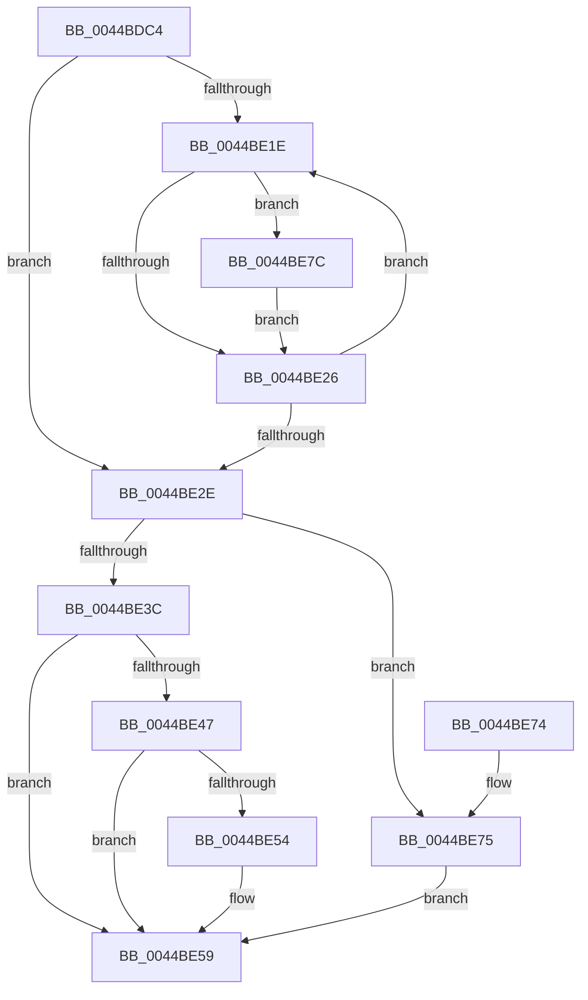

# MiUnlockControlAreaSectionExtend

- RVA: `0x0044BDC4`–`0x0044BE8A` (길이 `198` bytes)
- VA: `0x000000014044BDC4`
- 실행 섹션: `.text`
- PDB 이름 있음: `예`; PDB Function 태그: `아니요`
- unwind 정보 RVA: `0x000A67D8`
- 디코드: `56`개 명령, `198/198` bytes 표시
- 미해석 바이트: `0` (있으면 어셈블리에 `.byte`로 보존)

> 이 문서는 커널 이미지의 기계어와 PDB 기호를 분석해 생성했습니다. 4번과 5번은 함수 원형과 자료형을 바이너리 사용 방식에서 추정한 C 해석이며 원본 소스 복구 결과는 아닙니다.

## 1. Dependencies

- 직접 호출 지점: **7**; 고유 호출 대상: **7**
- 직접 호출자로 확인된 함수: **1**
- RIP 상대 이미지 참조: **0**

### Outgoing calls
- `0x0044BDE6` → [KeAbPostRelease](../2E/KeAbPostRelease_function_002E1600.md) (function, `0x002E1600`)
- `0x0044BDF2` → [ExAcquireSpinLockExclusive](../24/ExAcquireSpinLockExclusive_function_00248690.md) (function, `0x00248690`)
- `0x0044BE00` → [MiBuildWakeList](MiBuildWakeList_function_0044BE90.md) (function, `0x0044BE90`)
- `0x0044BE0E` → [MiReleaseSpinLockExclusive](../24/MiReleaseSpinLockExclusive_function_002482C0.md) (function, `0x002482C0`)
- `0x0044BE54` → [KiCheckForKernelApcDelivery](../2E/KiCheckForKernelApcDelivery_function_002E2C80.md) (function, `0x002E2C80`)
- `0x0044BE75` → [KeLeaveCriticalRegionThread](../25/KeLeaveCriticalRegionThread_function_0025EFF0.md) (function, `0x0025EFF0`)
- `0x0044BE83` → [KeSignalGate](../2C/KeSignalGate_function_002C748C.md) (function, `0x002C748C`)

### Direct callers
- [MmExtendSection](../../page/98/MmExtendSection_function_00982C38.md) at `0x00982D63`
- [MmExtendSection](../../page/98/MmExtendSection_function_00982C38.md) at `0x00982DCE`
- [MmExtendSection](../../page/98/MmExtendSection_function_00982C38.md) at `0x00982E26`
- [MmExtendSection](../../page/98/MmExtendSection_function_00982C38.md) at `0x00982F5E`
- [MmExtendSection](../../page/98/MmExtendSection_function_00982C38.md) at `0x00982F75`

### Static image references
- 디코드된 RIP-relative 메모리 참조가 없습니다.

## 2. Other-region calls and transfers

- 다른 실행 섹션으로 향하는 call: **0**
- 별도 외부 분기/꼬리 이동을 확인하지 못했습니다.

## 3. Assembly (complete function range)

```asm
0044BDC4  48 8B C4                        mov rax, rsp
0044BDC7  48 89 58 08                     mov qword ptr [rax + 8], rbx
0044BDCB  48 89 68 10                     mov qword ptr [rax + 0x10], rbp
0044BDCF  48 89 70 18                     mov qword ptr [rax + 0x18], rsi
0044BDD3  48 89 78 20                     mov qword ptr [rax + 0x20], rdi
0044BDD7  41 56                           push r14
0044BDD9  48 83 EC 20                     sub rsp, 0x20
0044BDDD  8B 6A 08                        mov ebp, dword ptr [rdx + 8]
0044BDE0  48 8B F2                        mov rsi, rdx
0044BDE3  48 8B F9                        mov rdi, rcx
0044BDE6  E8 15 58 E9 FF                  call 0x1402e1600
0044BDEB  48 8D 5F 48                     lea rbx, [rdi + 0x48]
0044BDEF  48 8B CB                        mov rcx, rbx
0044BDF2  E8 99 C8 DF FF                  call 0x140248690
0044BDF7  8B 56 08                        mov edx, dword ptr [rsi + 8]
0044BDFA  48 8B CF                        mov rcx, rdi
0044BDFD  44 8A D8                        mov r11b, al
0044BE00  E8 8B 00 00 00                  call 0x14044be90
0044BE05  41 8A D3                        mov dl, r11b
0044BE08  48 8B CB                        mov rcx, rbx
0044BE0B  48 8B F8                        mov rdi, rax
0044BE0E  E8 AD C4 DF FF                  call 0x1402482c0
0044BE13  41 BE 01 00 00 00               mov r14d, 1
0044BE19  48 85 FF                        test rdi, rdi
0044BE1C  74 10                           je 0x14044be2e
0044BE1E  48 8B 1F                        mov rbx, qword ptr [rdi]
0044BE21  48 3B FE                        cmp rdi, rsi
0044BE24  75 56                           jne 0x14044be7c
0044BE26  48 8B FB                        mov rdi, rbx
0044BE29  48 85 DB                        test rbx, rbx
0044BE2C  75 F0                           jne 0x14044be1e
0044BE2E  65 48 8B 0C 25 88 01 00 00      mov rcx, qword ptr gs:[0x188]
0044BE37  83 FD 10                        cmp ebp, 0x10
0044BE3A  75 39                           jne 0x14044be75
0044BE3C  90                              nop
0044BE3D  66 44 01 B1 E6 01 00 00         add word ptr [rcx + 0x1e6], r14w
0044BE45  75 12                           jne 0x14044be59
0044BE47  48 8D 81 98 00 00 00            lea rax, [rcx + 0x98]
0044BE4E  90                              nop
0044BE4F  48 39 00                        cmp qword ptr [rax], rax
0044BE52  74 05                           je 0x14044be59
0044BE54  E8 27 6E E9 FF                  call 0x1402e2c80
0044BE59  48 8B 5C 24 30                  mov rbx, qword ptr [rsp + 0x30]
0044BE5E  48 8B 6C 24 38                  mov rbp, qword ptr [rsp + 0x38]
0044BE63  48 8B 74 24 40                  mov rsi, qword ptr [rsp + 0x40]
0044BE68  48 8B 7C 24 48                  mov rdi, qword ptr [rsp + 0x48]
0044BE6D  48 83 C4 20                     add rsp, 0x20
0044BE71  41 5E                           pop r14
0044BE73  C3                              ret
0044BE74  CC                              int3
0044BE75  E8 76 31 E1 FF                  call 0x14025eff0
0044BE7A  EB DD                           jmp 0x14044be59
0044BE7C  48 8D 4F 10                     lea rcx, [rdi + 0x10]
0044BE80  41 8B D6                        mov edx, r14d
0044BE83  E8 04 B6 E7 FF                  call 0x1402c748c
0044BE88  EB 9C                           jmp 0x14044be26
```

## 4. C-style interpretation (structured pseudocode)

```c
__int64 __fastcall MiUnlockControlAreaSectionExtend(__int64 a1, __int64 a2)
{
    __int64 result;
    __int64 v_rsp;
    unsigned __int64 v_stack_p10;
    unsigned __int64 v_stack_p18;
    unsigned __int64 v_stack_p20;
    unsigned __int64 v_stack_p8;

    *(unsigned __int64 *)(v_rsp + 8) = v_rbx;
    *(unsigned __int64 *)(v_rsp + 16) = v_rbp;
    *(unsigned __int64 *)(v_rsp + 24) = v_rsi;
    *(unsigned __int64 *)(v_rsp + 32) = v_rdi;
    v_rsp = (v_rsp) - (32);
    result = KeAbPostRelease(a1, a2, a3, a4);
    result = ExAcquireSpinLockExclusive(a1 + 72, a2, a3, a4);
    result = MiBuildWakeList(a1, (unsigned int)(*(unsigned int *)(a2 + 8)), a3, a4);
    result = MiReleaseSpinLockExclusive(a1 + 72, (unsigned __int8)((unsigned __int8)(result)), a3, a4);
    if (result == 0) goto loc_0044BE2E;
loc_0044BE1E:
    if (result != a2) goto loc_0044BE7C;
loc_0044BE26:
    if (*(unsigned __int64 *)(result) != 0) goto loc_0044BE1E;
loc_0044BE2E:
    if (((unsigned int)((unsigned int)(*(unsigned int *)(a2 + 8)))) != 16) goto loc_0044BE75;
    if (((unsigned int)((unsigned int)(*(unsigned int *)(a2 + 8)))) != 16) goto loc_0044BE59;
    result = *(unsigned __int64 *)(gs_base + (0 + 392)) + 152;
    if ((*(unsigned __int64 *)(*(unsigned __int64 *)(gs_base + (0 + 392)) + 152)) != (*(unsigned __int64 *)(gs_base + (0 + 392)) + 152)) {
        result = KiCheckForKernelApcDelivery(*(unsigned __int64 *)(gs_base + (0 + 392)), (unsigned __int8)((unsigned __int8)(result)), a3, a4);
    }
    v_rsp = (v_rsp) + (32);
    return result;
loc_0044BE75:
    result = KeLeaveCriticalRegionThread(*(unsigned __int64 *)(gs_base + (0 + 392)), (unsigned __int8)((unsigned __int8)(result)), a3, a4);
    goto loc_0044BE59;
loc_0044BE7C:
    result = KeSignalGate(v_stack_p20 + 16, 1, a3, a4);
    goto loc_0044BE26;
}
```

## 5. (Beta) C Style

```c
int64_t MiUnlockControlAreaSectionExtend(void *Arg1, void *Arg2)
{
    uint8_t *arg1 = (uint8_t *)Arg1;
    uint8_t *arg2 = (uint8_t *)Arg2;

    int64_t result;
    int64_t local_rsp;
    uint64_t v_stack_p10;
    uint64_t v_stack_p18;
    uint64_t v_stack_p20;
    uint64_t v_stack_p8;

    *(uint64_t *)(local_rsp + 0x8) = local_rbx;
    *(uint64_t *)(local_rsp + 0x10) = local_rbp;
    *(uint64_t *)(local_rsp + 0x18) = local_rsi;
    *(uint64_t *)(local_rsp + 0x20) = local_rdi;
    local_rsp = (local_rsp) - (32);
    result = KeAbPostRelease(Arg1, Arg2, a3, a4);
    result = ExAcquireSpinLockExclusive(Arg1 + 72, Arg2, a3, a4);
    result = MiBuildWakeList(Arg1, (uint32_t)(*(uint32_t *)(arg2 + 0x8)), a3, a4);
    result = MiReleaseSpinLockExclusive(Arg1 + 72, (uint8_t)((uint8_t)(result)), a3, a4);
    if (result == 0) goto loc_0044BE2E;
loc_0044BE1E:
    if (result != Arg2) goto loc_0044BE7C;
loc_0044BE26:
    if (*(uint64_t *)(result) != 0) goto loc_0044BE1E;
loc_0044BE2E:
    if (((uint32_t)((uint32_t)(*(uint32_t *)(arg2 + 0x8)))) != 16) goto loc_0044BE75;
    if (((uint32_t)((uint32_t)(*(uint32_t *)(arg2 + 0x8)))) != 16) goto loc_0044BE59;
    result = *(uint64_t *)(gs_base + (0 + 0x188)) + 152;
    if ((*(uint64_t *)(*(uint64_t *)(gs_base + (0 + 0x188)) + 0x98)) != (*(uint64_t *)(gs_base + (0 + 0x188)) + 152)) {
        result = KiCheckForKernelApcDelivery(*(uint64_t *)(gs_base + (0 + 0x188)), (uint8_t)((uint8_t)(result)), a3, a4);
    }
    local_rsp = (local_rsp) + (32);
    return result;
loc_0044BE75:
    result = KeLeaveCriticalRegionThread(*(uint64_t *)(gs_base + (0 + 0x188)), (uint8_t)((uint8_t)(result)), a3, a4);
    goto loc_0044BE59;
loc_0044BE7C:
    result = KeSignalGate(v_stack_p20 + 16, 1, a3, a4);
    goto loc_0044BE26;
}
```

### 관측된 메모리 오프셋

구조체 형식이 확인되지 않은 접근은 인자 기준의 오프셋으로만 기록했습니다.

| 기준 인자 | 오프셋 표현 | 폭 (bit) | 접근 |
|---|---:|---:|---|
| `Arg1` | `+ 0x48` | `64` | `R` |
| `Arg2` | `+ 0x8` | `32` | `R` |

## 6. Execution-region graph

[열기: 2D/3D 그래프와 함수 탐색 컨트롤 패널](../../../control-panel.html?section=text&rva=0x0044BDC4&view=graph)

- 2D 그래프는 위에서 아래로 흐르고, 3D 그래프는 빈 공간을 드래그해 회전합니다. Shift+드래그는 이동, 휠은 확대·축소, 함수 노드 선택은 대상 보고서 이동입니다.

### Static fallback


