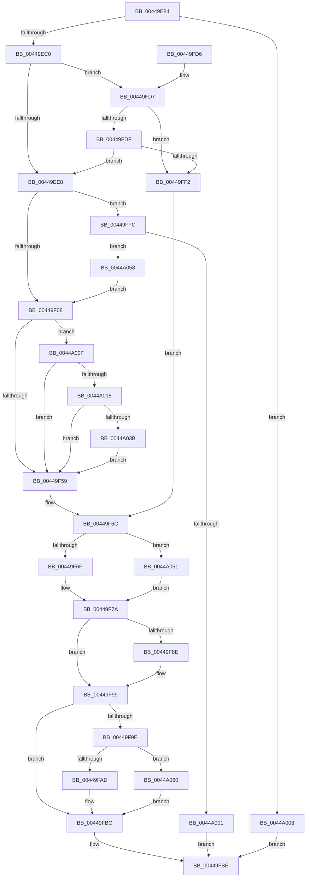

# MiUpdateImagePfnImportRelocations

- RVA: `0x00449E84`–`0x0044A07C` (길이 `504` bytes)
- VA: `0x0000000140449E84`
- 실행 섹션: `.text`
- PDB 이름 있음: `예`; PDB Function 태그: `아니요`
- unwind 정보 RVA: `0x000A63F8`
- 디코드: `123`개 명령, `504/504` bytes 표시
- 미해석 바이트: `0` (있으면 어셈블리에 `.byte`로 보존)

> 이 문서는 커널 이미지의 기계어와 PDB 기호를 분석해 생성했습니다. 4번과 5번은 함수 원형과 자료형을 바이너리 사용 방식에서 추정한 C 해석이며 원본 소스 복구 결과는 아닙니다.

## 1. Dependencies

- 직접 호출 지점: **10**; 고유 호출 대상: **10**
- 직접 호출자로 확인된 함수: **2**
- RIP 상대 이미지 참조: **3**

### Outgoing calls
- `0x00449EB3` → [MiDoesPageRequireImportLinkingFixups](MiDoesPageRequireImportLinkingFixups_function_0044A084.md) (function, `0x0044A084`)
- `0x00449EF7` → [MiReservePtes](../31/MiReservePtes_function_00318D20.md) (function, `0x00318D20`)
- `0x00449F2F` → [MiMakeProtectionPfnCompatible](../22/MiMakeProtectionPfnCompatible_function_00229CD0.md) (function, `0x00229CD0`)
- `0x00449F42` → [MiMakeValidPte](../2C/MiMakeValidPte_function_002C5590.md) (function, `0x002C5590`)
- `0x00449F75` → [MI_LOCK_RELOCATIONS_SHARED](MI_LOCK_RELOCATIONS_SHARED_function_0044A848.md) (function, `0x0044A848`)
- `0x00449F84` → [MiUpdateRetpolineImportFixups](MiUpdateRetpolineImportFixups_function_0044A0D0.md) (function, `0x0044A0D0`)
- `0x00449F94` → [MI_UNLOCK_RELOCATIONS_SHARED](MI_UNLOCK_RELOCATIONS_SHARED_function_0044A7EC.md) (function, `0x0044A7EC`)
- `0x00449FB7` → [MiReleasePtes](../24/MiReleasePtes_function_00247240.md) (function, `0x00247240`)
- `0x0044A047` → [MiCheckLinearProtectedPteAccessedBit](../29/MiCheckLinearProtectedPteAccessedBit_function_00292D80.md) (function, `0x00292D80`)
- `0x0044A072` → [MiFlushSingleTbEntry](../28/MiFlushSingleTbEntry_function_0028E730.md) (function, `0x0028E730`)

### Direct callers
- [MiWalkEntireImage](../36/MiWalkEntireImage_function_00365D70.md) at `0x00366B70`
- [MiUpdateImportRelocationsOnDriverPrivatePages](MiUpdateImportRelocationsOnDriverPrivatePages_function_00449BCC.md) at `0x00449D0A`

### Static image references
- `0x00449EED` → RVA `0x00E37668` (`.data`; read)
- `0x00449F47` → RVA `0x00FC6A88` (`ALMOSTRO`; read)
- `0x0044A060` → RVA `0x00010880` (`.rdata`; read)

## 2. Other-region calls and transfers

- 다른 실행 섹션으로 향하는 call: **0**
- 별도 외부 분기/꼬리 이동을 확인하지 못했습니다.

## 3. Assembly (complete function range)

```asm
00449E84  48 89 5C 24 10                  mov qword ptr [rsp + 0x10], rbx
00449E89  48 89 74 24 18                  mov qword ptr [rsp + 0x18], rsi
00449E8E  57                              push rdi
00449E8F  41 54                           push r12
00449E91  41 55                           push r13
00449E93  41 56                           push r14
00449E95  41 57                           push r15
00449E97  48 83 EC 20                     sub rsp, 0x20
00449E9B  48 8B 49 60                     mov rcx, qword ptr [rcx + 0x60]
00449E9F  48 8B F2                        mov rsi, rdx
00449EA2  48 83 E1 F8                     and rcx, 0xfffffffffffffff8
00449EA6  41 8B D0                        mov edx, r8d
00449EA9  4D 8B F9                        mov r15, r9
00449EAC  45 8B E8                        mov r13d, r8d
00449EAF  4C 8B 71 20                     mov r14, qword ptr [rcx + 0x20]
00449EB3  E8 CC 01 00 00                  call 0x14044a084
00449EB8  85 C0                           test eax, eax
00449EBA  0F 84 48 01 00 00               je 0x14044a008
00449EC0  4B 8D 1C 7F                     lea rbx, [r15 + r15*2]
00449EC4  48 C1 E3 04                     shl rbx, 4
00449EC8  48 B8 00 00 00 00 00 DE FF FF   movabs rax, 0xffffde0000000000
00449ED2  48 03 D8                        add rbx, rax
00449ED5  48 B8 00 00 00 00 80 F6 FF FF   movabs rax, 0xfffff68000000000
00449EDF  48 85 F6                        test rsi, rsi
00449EE2  0F 85 EF 00 00 00               jne 0x140449fd7
00449EE8  BA 01 00 00 00                  mov edx, 1
00449EED  48 8D 0D 74 D7 9E 00            lea rcx, [rip + 0x9ed774]
00449EF4  4C 8B E6                        mov r12, rsi
00449EF7  E8 24 EE EC FF                  call 0x140318d20
00449EFC  48 8B F8                        mov rdi, rax
00449EFF  48 85 C0                        test rax, rax
00449F02  0F 84 F4 00 00 00               je 0x140449ffc
00449F08  48 8B F7                        mov rsi, rdi
00449F0B  48 B8 00 00 00 00 80 F6 FF FF   movabs rax, 0xfffff68000000000
00449F15  48 C1 E6 19                     shl rsi, 0x19
00449F19  48 8B C0                        mov rax, rax
00449F1C  48 C1 E0 19                     shl rax, 0x19
00449F20  48 8B D3                        mov rdx, rbx
00449F23  48 2B F0                        sub rsi, rax
00449F26  B9 04 00 00 00                  mov ecx, 4
00449F2B  48 C1 FE 10                     sar rsi, 0x10
00449F2F  E8 9C FD DD FF                  call 0x140229cd0
00449F34  0D 00 00 00 A0                  or eax, 0xa0000000
00449F39  49 8B D7                        mov rdx, r15
00449F3C  44 8B C0                        mov r8d, eax
00449F3F  48 8B CF                        mov rcx, rdi
00449F42  E8 49 B6 E7 FF                  call 0x1402c5590
00449F47  48 0F BA 25 38 CB B7 00 24      bt qword ptr [rip + 0xb7cb38], 0x24
00449F50  48 8B D8                        mov rbx, rax
00449F53  0F 82 B6 00 00 00               jb 0x14044a00f
00449F59  48 89 1F                        mov qword ptr [rdi], rbx
00449F5C  65 48 8B 1C 25 88 01 00 00      mov rbx, qword ptr gs:[0x188]
00449F65  49 39 5E 08                     cmp qword ptr [r14 + 8], rbx
00449F69  0F 84 E2 00 00 00               je 0x14044a051
00449F6F  49 8B D6                        mov rdx, r14
00449F72  48 8B CB                        mov rcx, rbx
00449F75  E8 CE 08 00 00                  call 0x14044a848
00449F7A  49 8B 56 58                     mov rdx, qword ptr [r14 + 0x58]
00449F7E  45 8B C5                        mov r8d, r13d
00449F81  48 8B CE                        mov rcx, rsi
00449F84  E8 47 01 00 00                  call 0x14044a0d0
00449F89  48 85 DB                        test rbx, rbx
00449F8C  74 0B                           je 0x140449f99
00449F8E  49 8B D6                        mov rdx, r14
00449F91  48 8B CB                        mov rcx, rbx
00449F94  E8 53 08 00 00                  call 0x14044a7ec
00449F99  48 85 FF                        test rdi, rdi
00449F9C  74 1E                           je 0x140449fbc
00449F9E  41 B8 01 00 00 00               mov r8d, 1
00449FA4  49 3B FC                        cmp rdi, r12
00449FA7  0F 84 B3 00 00 00               je 0x14044a060
00449FAD  48 8B D7                        mov rdx, rdi
00449FB0  48 8D 0D B1 D6 9E 00            lea rcx, [rip + 0x9ed6b1]
00449FB7  E8 84 D2 DF FF                  call 0x140247240
00449FBC  33 C0                           xor eax, eax
00449FBE  48 8B 5C 24 58                  mov rbx, qword ptr [rsp + 0x58]
00449FC3  48 8B 74 24 60                  mov rsi, qword ptr [rsp + 0x60]
00449FC8  48 83 C4 20                     add rsp, 0x20
00449FCC  41 5F                           pop r15
00449FCE  41 5E                           pop r14
00449FD0  41 5D                           pop r13
00449FD2  41 5C                           pop r12
00449FD4  5F                              pop rdi
00449FD5  C3                              ret
00449FD6  CC                              int3
00449FD7  48 8B C0                        mov rax, rax
00449FDA  48 3B F0                        cmp rsi, rax
00449FDD  72 13                           jb 0x140449ff2
00449FDF  48 B8 FF FF FF FF FF F6 FF FF   movabs rax, 0xfffff6ffffffffff
00449FE9  48 3B F0                        cmp rsi, rax
00449FEC  0F 86 F6 FE FF FF               jbe 0x140449ee8
00449FF2  33 FF                           xor edi, edi
00449FF4  45 33 E4                        xor r12d, r12d
00449FF7  E9 60 FF FF FF                  jmp 0x140449f5c
00449FFC  48 85 F6                        test rsi, rsi
00449FFF  75 57                           jne 0x14044a058
0044A001  B8 9A 00 00 C0                  mov eax, 0xc000009a
0044A006  EB B6                           jmp 0x140449fbe
0044A008  B8 01 00 00 00                  mov eax, 1
0044A00D  EB AF                           jmp 0x140449fbe
0044A00F  F6 C3 20                        test bl, 0x20
0044A012  0F 85 41 FF FF FF               jne 0x140449f59
0044A018  48 B8 00 00 00 00 80 F6 FF FF   movabs rax, 0xfffff68000000000
0044A022  48 8B C0                        mov rax, rax
0044A025  48 B9 00 00 00 00 40 00 00 00   movabs rcx, 0x4000000000
0044A02F  48 03 C1                        add rax, rcx
0044A032  48 3B F8                        cmp rdi, rax
0044A035  0F 82 1E FF FF FF               jb 0x140449f59
0044A03B  41 B8 80 00 00 00               mov r8d, 0x80
0044A041  48 8B D3                        mov rdx, rbx
0044A044  48 8B CF                        mov rcx, rdi
0044A047  E8 34 8D E4 FF                  call 0x140292d80
0044A04C  E9 08 FF FF FF                  jmp 0x140449f59
0044A051  33 DB                           xor ebx, ebx
0044A053  E9 22 FF FF FF                  jmp 0x140449f7a
0044A058  48 8B FE                        mov rdi, rsi
0044A05B  E9 A8 FE FF FF                  jmp 0x140449f08
0044A060  48 8B 05 19 68 BC FF            mov rax, qword ptr [rip - 0x4397e7]
0044A067  BA 02 00 00 00                  mov edx, 2
0044A06C  48 8B CE                        mov rcx, rsi
0044A06F  48 89 07                        mov qword ptr [rdi], rax
0044A072  E8 B9 46 E4 FF                  call 0x14028e730
0044A077  E9 40 FF FF FF                  jmp 0x140449fbc
```

## 4. C-style interpretation (structured pseudocode)

```c
__int64 __fastcall MiUpdateImagePfnImportRelocations(__int64 a1, __int64 a2, int a3, __int64 a4)
{
    __int64 result;
    __int64 v_r12;
    __int64 v_rbx;
    __int64 v_rdi;
    __int64 v_rsi;
    __int64 v_rsp;
    unsigned __int64 v_stack_p10;
    unsigned __int64 v_stack_p18;

    v_stack_p10 = v_rbx;
    v_stack_p18 = v_rsi;
    v_rsp = (v_rsp) - (32);
    a1 = (*(unsigned __int64 *)(a1 + 96)) & (-8);
    result = MiDoesPageRequireImportLinkingFixups(a1, (unsigned int)(a3), a3, a4);
    if ((unsigned int)(result) == 0) goto loc_0044A008;
    v_rbx = (a4 + a4 * 2) << (4);
    v_rbx = (v_rbx) + (result);
    if (a2 != 0) goto loc_00449FD7;
loc_00449EE8:
    result = MiReservePtes(v_rip + 10409844, 1, a3, a4);
    if (result == 0) goto loc_00449FFC;
loc_00449F08:
    v_rsi = (result) << (25);
    result = (result) << (25);
    v_rsi = (v_rsi) - (result);
    v_rsi = (v_rsi) >> (16);
    result = MiMakeProtectionPfnCompatible(4, v_rbx, a3, a4);
    result = (unsigned int)((result) | (0xA0000000ULL));
    result = MiMakeValidPte(result, a4, (unsigned int)((unsigned int)(result)), a4);
    if (condition_is_below) goto loc_0044A00F;
loc_00449F59:
    *(unsigned __int64 *)(result) = result;
loc_00449F5C:
    if ((*(unsigned __int64 *)(*(unsigned __int64 *)(a1 + 32) + 8)) == (*(unsigned __int64 *)(gs_base + (0 + 392)))) goto loc_0044A051;
    result = MI_LOCK_RELOCATIONS_SHARED(*(unsigned __int64 *)(gs_base + (0 + 392)), *(unsigned __int64 *)(a1 + 32), (unsigned int)((unsigned int)(result)), a4);
loc_00449F7A:
    result = MiUpdateRetpolineImportFixups(v_rsi, *(unsigned __int64 *)(*(unsigned __int64 *)(a1 + 32) + 88), (unsigned int)((unsigned int)((unsigned int)(a3))), a4);
    if (*(unsigned __int64 *)(gs_base + (0 + 392)) != 0) {
        a2 = *(unsigned __int64 *)(a1 + 32);
        a1 = *(unsigned __int64 *)(gs_base + (0 + 392));
        result = MI_UNLOCK_RELOCATIONS_SHARED(a1, a2, (unsigned int)((unsigned int)((unsigned int)(a3))), a4);
    }
    if (result == 0) goto loc_00449FBC;
    if (result == a2) goto loc_0044A060;
    result = MiReleasePtes(v_rip + 10409649, result, 1, a4);
loc_00449FBC:
    result = 0;
loc_00449FBE:
    v_rsp = (v_rsp) + (32);
    return result;
loc_00449FD7:
    if (v_stack_p18 < 0) goto loc_00449FF2;
    if (v_stack_p18 <= 0) goto loc_00449EE8;
loc_00449FF2:
    v_rdi = 0;
    v_r12 = 0;
    goto loc_00449F5C;
loc_00449FFC:
    if (v_stack_p18 != 0) goto loc_0044A058;
    goto loc_00449FBE;
loc_0044A008:
    goto loc_00449FBE;
loc_0044A00F:
    if ((((unsigned __int8)(v_stack_p10)) & (32)) != 0) goto loc_00449F59;
    result = (1) + (v_rip + 10409649);
    if (0 < result) goto loc_00449F59;
    result = MiCheckLinearProtectedPteAccessedBit(0, v_stack_p10, 128, a4);
    goto loc_00449F59;
loc_0044A051:
    v_rbx = 0;
    goto loc_00449F7A;
loc_0044A058:
    goto loc_00449F08;
loc_0044A060:
    *(unsigned __int64 *)(v_stack_p18) = *(unsigned __int64 *)(v_rip - 4429799);
    result = MiFlushSingleTbEntry(v_stack_p18, 2, 128, a4);
    goto loc_00449FBC;
}
```

## 5. (Beta) C Style

```c
int64_t MiUpdateImagePfnImportRelocations(void *Arg1, int64_t Arg2, int32_t Arg3, void *Arg4)
{
    uint8_t *arg1 = (uint8_t *)Arg1;
    uint8_t *arg4 = (uint8_t *)Arg4;

    int64_t result;
    int64_t local_r12;
    int64_t local_rbx;
    int64_t local_rdi;
    int64_t local_rsi;
    int64_t local_rsp;
    uint64_t v_stack_p10;
    uint64_t v_stack_p18;

    v_stack_p10 = local_rbx;
    v_stack_p18 = local_rsi;
    local_rsp = (local_rsp) - (32);
    Arg1 = (*(uint64_t *)(arg1 + 0x60)) & (-8);
    result = MiDoesPageRequireImportLinkingFixups(Arg1, (uint32_t)(Arg3), Arg3, Arg4);
    if ((uint32_t)(result) == 0) goto loc_0044A008;
    local_rbx = (Arg4 + Arg4 * 2) << (4);
    local_rbx = (local_rbx) + (result);
    if (Arg2 != 0) goto loc_00449FD7;
loc_00449EE8:
    result = MiReservePtes(v_rip + 10409844, 1, Arg3, Arg4);
    if (result == 0) goto loc_00449FFC;
loc_00449F08:
    local_rsi = (result) << (25);
    result = (result) << (25);
    local_rsi = (local_rsi) - (result);
    local_rsi = (local_rsi) >> (16);
    result = MiMakeProtectionPfnCompatible(4, local_rbx, Arg3, Arg4);
    result = (uint32_t)((result) | (0xA0000000ULL));
    result = MiMakeValidPte(result, Arg4, (uint32_t)((uint32_t)(result)), Arg4);
    if (condition_is_below) goto loc_0044A00F;
loc_00449F59:
    *(uint64_t *)(result) = result;
loc_00449F5C:
    if ((*(uint64_t *)(*(uint64_t *)(arg1 + 0x20) + 0x8)) == (*(uint64_t *)(gs_base + (0 + 0x188)))) goto loc_0044A051;
    result = MI_LOCK_RELOCATIONS_SHARED(*(uint64_t *)(gs_base + (0 + 0x188)), *(uint64_t *)(arg1 + 0x20), (uint32_t)((uint32_t)(result)), Arg4);
loc_00449F7A:
    result = MiUpdateRetpolineImportFixups(local_rsi, *(uint64_t *)(*(uint64_t *)(arg1 + 0x20) + 0x58), (uint32_t)((uint32_t)((uint32_t)(Arg3))), Arg4);
    if (*(uint64_t *)(gs_base + (0 + 0x188)) != 0) {
        Arg2 = *(uint64_t *)(arg1 + 0x20);
        Arg1 = *(uint64_t *)(gs_base + (0 + 0x188));
        result = MI_UNLOCK_RELOCATIONS_SHARED(Arg1, Arg2, (uint32_t)((uint32_t)((uint32_t)(Arg3))), Arg4);
    }
    if (result == 0) goto loc_00449FBC;
    if (result == Arg2) goto loc_0044A060;
    result = MiReleasePtes(v_rip + 10409649, result, 1, Arg4);
loc_00449FBC:
    result = 0;
loc_00449FBE:
    local_rsp = (local_rsp) + (32);
    return result;
loc_00449FD7:
    if (v_stack_p18 < 0) goto loc_00449FF2;
    if (v_stack_p18 <= 0) goto loc_00449EE8;
loc_00449FF2:
    local_rdi = 0;
    local_r12 = 0;
    goto loc_00449F5C;
loc_00449FFC:
    if (v_stack_p18 != 0) goto loc_0044A058;
    goto loc_00449FBE;
loc_0044A008:
    goto loc_00449FBE;
loc_0044A00F:
    if ((((uint8_t)(v_stack_p10)) & (32)) != 0) goto loc_00449F59;
    result = (1) + (v_rip + 10409649);
    if (0 < result) goto loc_00449F59;
    result = MiCheckLinearProtectedPteAccessedBit(0, v_stack_p10, 128, Arg4);
    goto loc_00449F59;
loc_0044A051:
    local_rbx = 0;
    goto loc_00449F7A;
loc_0044A058:
    goto loc_00449F08;
loc_0044A060:
    *(uint64_t *)(v_stack_p18) = *(uint64_t *)(v_rip - 0x4397E7);
    result = MiFlushSingleTbEntry(v_stack_p18, 2, 128, Arg4);
    goto loc_00449FBC;
}
```

### 관측된 메모리 오프셋

구조체 형식이 확인되지 않은 접근은 인자 기준의 오프셋으로만 기록했습니다.

| 기준 인자 | 오프셋 표현 | 폭 (bit) | 접근 |
|---|---:|---:|---|
| `Arg1` | `+ 0x60` | `64` | `R` |
| `Arg4` | `+ 0x0 + r15*2` | `64` | `R` |

## 6. Execution-region graph

[열기: 2D/3D 그래프와 함수 탐색 컨트롤 패널](../../../control-panel.html?section=text&rva=0x00449E84&view=graph)

- 2D 그래프는 위에서 아래로 흐르고, 3D 그래프는 빈 공간을 드래그해 회전합니다. Shift+드래그는 이동, 휠은 확대·축소, 함수 노드 선택은 대상 보고서 이동입니다.

### Static fallback


