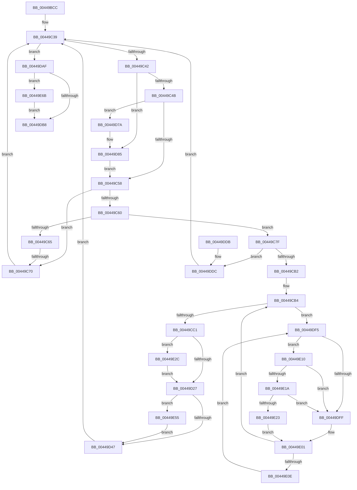

# MiUpdateImportRelocationsOnDriverPrivatePages

- RVA: `0x00449BCC`–`0x00449E7B` (길이 `687` bytes)
- VA: `0x0000000140449BCC`
- 실행 섹션: `.text`
- PDB 이름 있음: `예`; PDB Function 태그: `예`
- unwind 정보 RVA: `0x000A63CC`
- 디코드: `167`개 명령, `687/687` bytes 표시
- 미해석 바이트: `0` (있으면 어셈블리에 `.byte`로 보존)

> 이 문서는 커널 이미지의 기계어와 PDB 기호를 분석해 생성했습니다. 4번과 5번은 함수 원형과 자료형을 바이너리 사용 방식에서 추정한 C 해석이며 원본 소스 복구 결과는 아닙니다.

## 1. Dependencies

- 직접 호출 지점: **16**; 고유 호출 대상: **13**
- 직접 호출자로 확인된 함수: **1**
- RIP 상대 이미지 참조: **4**

### Outgoing calls
- `0x00449C2E` → [MiLockWorkingSetShared](../27/MiLockWorkingSetShared_function_0027CBF0.md) (function, `0x0027CBF0`)
- `0x00449CC4` → [MiReferenceDriverPage](../37/MiReferenceDriverPage_function_003701B4.md) (function, `0x003701B4`)
- `0x00449CE2` → [MiUnlockPageTable](../21/MiUnlockPageTable_function_00216EC0.md) (function, `0x00216EC0`)
- `0x00449CF3` → [MiUnlockWorkingSetShared](../27/MiUnlockWorkingSetShared_function_0027D690.md) (function, `0x0027D690`)
- `0x00449D0A` → [MiUpdateImagePfnImportRelocations](MiUpdateImagePfnImportRelocations_function_00449E84.md) (function, `0x00449E84`)
- `0x00449D14` → [MiLockPageInline](../31/MiLockPageInline_function_0031A340.md) (function, `0x0031A340`)
- `0x00449D2A` → [MiRemoveLockedPageChargeAndDecRef](../24/MiRemoveLockedPageChargeAndDecRef_function_002459D0.md) (function, `0x002459D0`)
- `0x00449D51` → [MiLockWorkingSetSharedAtDpc](../23/MiLockWorkingSetSharedAtDpc_function_00239574.md) (function, `0x00239574`)
- `0x00449D80` → [MiUnlockPageTable](../21/MiUnlockPageTable_function_00216EC0.md) (function, `0x00216EC0`)
- `0x00449DA5` → [MiLockNestedPageTable](../23/MiLockNestedPageTable_function_0023E890.md) (function, `0x0023E890`)
- `0x00449DBE` → [MiUnlockWorkingSetShared](../27/MiUnlockWorkingSetShared_function_0027D690.md) (function, `0x0027D690`)
- `0x00449E1A` → [KiCheckVpBackingLongSpinWaitHypercall](../30/KiCheckVpBackingLongSpinWaitHypercall_function_0030F490.md) (function, `0x0030F490`)
- `0x00449E25` → [HvlNotifyLongSpinWait](../30/HvlNotifyLongSpinWait_function_0030F460.md) (function, `0x0030F460`)
- `0x00449E2F` → [MiCaptureDirtyBitToPfn](../37/MiCaptureDirtyBitToPfn_function_00370DD0.md) (function, `0x00370DD0`)
- `0x00449E61` → [MiReleasePageFileInfo](../28/MiReleasePageFileInfo_function_00283FD0.md) (function, `0x00283FD0`)
- `0x00449E71` → [MiUnlockPageTable](../21/MiUnlockPageTable_function_00216EC0.md) (function, `0x00216EC0`)

### Direct callers
- [MiApplyImportOptimizationToRuntimeDriver](../../page/A9/MiApplyImportOptimizationToRuntimeDriver_function_00A9F93C.md) at `0x00A9FAA4`

### Static image references
- `0x00449C14` → RVA `0x00E37E40` (`.data`; read)
- `0x00449DF7` → RVA `0x00FC52AC` (`ALMOSTRO`; reference)
- `0x00449E10` → RVA `0x00FC6AB8` (`ALMOSTRO`; read)
- `0x00449E3B` → RVA `0x00E30088` (`.data`; read)

## 2. Other-region calls and transfers

- 다른 실행 섹션으로 향하는 call: **0**
- call이 아닌 외부 분기/꼬리 이동: **1**
  - `0x00449C6A` → [sub_006F0B5A](../6F/Unknown_function_006F0B5A.md) (`tail-transfer`)

## 3. Assembly (complete function range)

```asm
00449BCC  48 89 5C 24 20                  mov qword ptr [rsp + 0x20], rbx
00449BD1  4C 89 44 24 18                  mov qword ptr [rsp + 0x18], r8
00449BD6  48 89 54 24 10                  mov qword ptr [rsp + 0x10], rdx
00449BDB  55                              push rbp
00449BDC  56                              push rsi
00449BDD  57                              push rdi
00449BDE  41 54                           push r12
00449BE0  41 55                           push r13
00449BE2  41 56                           push r14
00449BE4  41 57                           push r15
00449BE6  48 83 EC 30                     sub rsp, 0x30
00449BEA  48 8B 71 30                     mov rsi, qword ptr [rcx + 0x30]
00449BEE  48 B8 F8 FF FF FF 7F 00 00 00   movabs rax, 0x7ffffffff8
00449BF8  48 C1 EE 09                     shr rsi, 9
00449BFC  4D 8B E0                        mov r12, r8
00449BFF  48 23 F0                        and rsi, rax
00449C02  48 BF 00 00 00 00 80 F6 FF FF   movabs rdi, 0xfffff68000000000
00449C0C  33 ED                           xor ebp, ebp
00449C0E  48 8B C7                        mov rax, rdi
00449C11  48 03 F0                        add rsi, rax
00449C14  4C 8D 35 25 E2 9E 00            lea r14, [rip + 0x9ee225]
00449C1B  8B 41 40                        mov eax, dword ptr [rcx + 0x40]
00449C1E  49 8B CE                        mov rcx, r14
00449C21  48 C1 E8 0C                     shr rax, 0xc
00449C25  48 8D 1C C6                     lea rbx, [rsi + rax*8]
00449C29  48 89 5C 24 70                  mov qword ptr [rsp + 0x70], rbx
00449C2E  E8 BD 2F E3 FF                  call 0x14027cbf0
00449C33  44 8A E8                        mov r13b, al
00449C36  45 33 FF                        xor r15d, r15d
00449C39  48 3B F3                        cmp rsi, rbx
00449C3C  0F 83 6D 01 00 00               jae 0x140449daf
00449C42  48 85 ED                        test rbp, rbp
00449C45  0F 84 3A 01 00 00               je 0x140449d85
00449C4B  48 F7 C6 FF 0F 00 00            test rsi, 0xfff
00449C52  0F 84 22 01 00 00               je 0x140449d7a
00449C58  48 8B 1E                        mov rbx, qword ptr [rsi]
00449C5B  48 85 DB                        test rbx, rbx
00449C5E  74 10                           je 0x140449c70
00449C60  F6 C3 01                        test bl, 1
00449C63  75 1A                           jne 0x140449c7f
00449C65  48 0F BA E3 0A                  bt rbx, 0xa
00449C6A  0F 83 EA 6E 2A 00               jae 0x1406f0b5a
00449C70  48 8B 5C 24 70                  mov rbx, qword ptr [rsp + 0x70]
00449C75  48 83 C6 08                     add rsi, 8
00449C79  49 83 C7 08                     add r15, 8
00449C7D  EB BA                           jmp 0x140449c39
00449C7F  48 C1 EB 0C                     shr rbx, 0xc
00449C83  48 B8 FF FF FF FF FF 00 00 00   movabs rax, 0xffffffffff
00449C8D  48 23 D8                        and rbx, rax
00449C90  4C 8D 34 5B                     lea r14, [rbx + rbx*2]
00449C94  49 C1 E6 04                     shl r14, 4
00449C98  48 B8 00 00 00 00 00 DE FF FF   movabs rax, 0xffffde0000000000
00449CA2  4C 03 F0                        add r14, rax
00449CA5  49 8B 46 28                     mov rax, qword ptr [r14 + 0x28]
00449CA9  48 85 C0                        test rax, rax
00449CAC  0F 88 2A 01 00 00               js 0x140449ddc
00449CB2  33 FF                           xor edi, edi
00449CB4  F0 49 0F BA 6E 18 3F            lock bts qword ptr [r14 + 0x18], 0x3f
00449CBB  0F 82 34 01 00 00               jb 0x140449df5
00449CC1  49 8B CE                        mov rcx, r14
00449CC4  E8 EB 64 F2 FF                  call 0x1403701b4
00449CC9  48 B8 FF FF FF FF FF FF FF 7F   movabs rax, 0x7fffffffffffffff
00449CD3  F0 49 21 46 18                  lock and qword ptr [r14 + 0x18], rax
00449CD8  48 8B D5                        mov rdx, rbp
00449CDB  48 8D 0D 5E E1 9E 00            lea rcx, [rip + 0x9ee15e]
00449CE2  E8 D9 D1 DC FF                  call 0x140216ec0
00449CE7  41 8A D5                        mov dl, r13b
00449CEA  48 8D 0D 4F E1 9E 00            lea rcx, [rip + 0x9ee14f]
00449CF1  33 ED                           xor ebp, ebp
00449CF3  E8 98 39 E3 FF                  call 0x14027d690
00449CF8  48 8B 4C 24 78                  mov rcx, qword ptr [rsp + 0x78]
00449CFD  4D 8B C7                        mov r8, r15
00449D00  49 C1 F8 03                     sar r8, 3
00449D04  4C 8B CB                        mov r9, rbx
00449D07  49 8B D4                        mov rdx, r12
00449D0A  E8 75 01 00 00                  call 0x140449e84
00449D0F  49 8B CE                        mov rcx, r14
00449D12  8B F8                           mov edi, eax
00449D14  E8 27 06 ED FF                  call 0x14031a340
00449D19  33 DB                           xor ebx, ebx
00449D1B  45 33 E4                        xor r12d, r12d
00449D1E  83 FF 01                        cmp edi, 1
00449D21  0F 85 05 01 00 00               jne 0x140449e2c
00449D27  49 8B CE                        mov rcx, r14
00449D2A  E8 A1 BC DF FF                  call 0x1402459d0
00449D2F  48 B8 FF FF FF FF FF FF FF 7F   movabs rax, 0x7fffffffffffffff
00449D39  F0 49 21 46 18                  lock and qword ptr [r14 + 0x18], rax
00449D3E  48 85 DB                        test rbx, rbx
00449D41  0F 85 0E 01 00 00               jne 0x140449e55
00449D47  4C 8D 35 F2 E0 9E 00            lea r14, [rip + 0x9ee0f2]
00449D4E  49 8B CE                        mov rcx, r14
00449D51  E8 1E F8 DE FF                  call 0x140239574
00449D56  4C 8B A4 24 80 00 00 00         mov r12, qword ptr [rsp + 0x80]
00449D5E  48 83 C6 08                     add rsi, 8
00449D62  49 83 C7 08                     add r15, 8
00449D66  48 8B 5C 24 70                  mov rbx, qword ptr [rsp + 0x70]
00449D6B  48 BF 00 00 00 00 80 F6 FF FF   movabs rdi, 0xfffff68000000000
00449D75  E9 BF FE FF FF                  jmp 0x140449c39
00449D7A  48 8B D5                        mov rdx, rbp
00449D7D  49 8B CE                        mov rcx, r14
00449D80  E8 3B D1 DC FF                  call 0x140216ec0
00449D85  48 8B EE                        mov rbp, rsi
00449D88  48 B8 F8 FF FF FF 7F 00 00 00   movabs rax, 0x7ffffffff8
00449D92  48 C1 ED 09                     shr rbp, 9
00449D96  48 23 E8                        and rbp, rax
00449D99  48 8B C7                        mov rax, rdi
00449D9C  48 03 E8                        add rbp, rax
00449D9F  49 8B CE                        mov rcx, r14
00449DA2  48 8B D5                        mov rdx, rbp
00449DA5  E8 E6 4A DF FF                  call 0x14023e890
00449DAA  E9 A9 FE FF FF                  jmp 0x140449c58
00449DAF  48 85 ED                        test rbp, rbp
00449DB2  0F 85 B3 00 00 00               jne 0x140449e6b
00449DB8  41 8A D5                        mov dl, r13b
00449DBB  49 8B CE                        mov rcx, r14
00449DBE  E8 CD 38 E3 FF                  call 0x14027d690
00449DC3  48 8B 9C 24 88 00 00 00         mov rbx, qword ptr [rsp + 0x88]
00449DCB  48 83 C4 30                     add rsp, 0x30
00449DCF  41 5F                           pop r15
00449DD1  41 5E                           pop r14
00449DD3  41 5D                           pop r13
00449DD5  41 5C                           pop r12
00449DD7  5F                              pop rdi
00449DD8  5E                              pop rsi
00449DD9  5D                              pop rbp
00449DDA  C3                              ret
00449DDB  CC                              int3
00449DDC  48 8B 5C 24 70                  mov rbx, qword ptr [rsp + 0x70]
00449DE1  4C 8D 35 58 E0 9E 00            lea r14, [rip + 0x9ee058]
00449DE8  48 83 C6 08                     add rsi, 8
00449DEC  49 83 C7 08                     add r15, 8
00449DF0  E9 44 FE FF FF                  jmp 0x140449c39
00449DF5  FF C7                           inc edi
00449DF7  85 3D AF B4 B7 00               test dword ptr [rip + 0xb7b4af], edi
00449DFD  74 11                           je 0x140449e10
00449DFF  F3 90                           pause
00449E01  49 8B 46 18                     mov rax, qword ptr [r14 + 0x18]
00449E05  48 85 C0                        test rax, rax
00449E08  0F 89 A6 FE FF FF               jns 0x140449cb4
00449E0E  EB E5                           jmp 0x140449df5
00449E10  8B 05 A2 CC B7 00               mov eax, dword ptr [rip + 0xb7cca2]
00449E16  A8 40                           test al, 0x40
00449E18  74 E5                           je 0x140449dff
00449E1A  E8 71 56 EC FF                  call 0x14030f490
00449E1F  84 C0                           test al, al
00449E21  74 DC                           je 0x140449dff
00449E23  8B CF                           mov ecx, edi
00449E25  E8 36 56 EC FF                  call 0x14030f460
00449E2A  EB D5                           jmp 0x140449e01
00449E2C  49 8B CE                        mov rcx, r14
00449E2F  E8 9C 6F F2 FF                  call 0x140370dd0
00449E34  49 8B 4E 28                     mov rcx, qword ptr [r14 + 0x28]
00449E38  48 8B D8                        mov rbx, rax
00449E3B  48 8B 05 46 62 9E 00            mov rax, qword ptr [rip + 0x9e6246]
00449E42  48 C1 E9 2B                     shr rcx, 0x2b
00449E46  81 E1 FF 03 00 00               and ecx, 0x3ff
00449E4C  4C 8B 24 C8                     mov r12, qword ptr [rax + rcx*8]
00449E50  E9 D2 FE FF FF                  jmp 0x140449d27
00449E55  41 B8 01 00 00 00               mov r8d, 1
00449E5B  48 8B D3                        mov rdx, rbx
00449E5E  49 8B CC                        mov rcx, r12
00449E61  E8 6A A1 E3 FF                  call 0x140283fd0
00449E66  E9 DC FE FF FF                  jmp 0x140449d47
00449E6B  48 8B D5                        mov rdx, rbp
00449E6E  49 8B CE                        mov rcx, r14
00449E71  E8 4A D0 DC FF                  call 0x140216ec0
00449E76  E9 3D FF FF FF                  jmp 0x140449db8
```

## 4. C-style interpretation (structured pseudocode)

```c
__int64 __fastcall MiUpdateImportRelocationsOnDriverPrivatePages(__int64 a1, __int64 a2, __int64 a3)
{
    __int64 result;
    __int64 v_r12;
    __int64 v_r14;
    __int64 v_r15;
    __int64 v_rbp;
    __int64 v_rbx;
    __int64 v_rdi;
    __int64 v_rsi;
    __int64 v_rsp;
    unsigned __int64 v_stack_p10;
    unsigned __int64 v_stack_p18;
    unsigned __int64 v_stack_p20;
    unsigned __int64 v_stack_p70;
    unsigned __int64 v_stack_p8;

    v_stack_p20 = v_rbx;
    v_stack_p18 = a3;
    v_stack_p10 = a2;
    v_rsp = (v_rsp) - (48);
    v_rsi = (*(unsigned __int64 *)(a1 + 48)) >> (9);
    v_rsi = (v_rsi) & (result);
    v_rbp = 0;
    v_rsi = (v_rsi) + (v_rdi);
    result = ((unsigned int)(*(unsigned int *)(a1 + 64))) >> (12);
    v_stack_p8 = v_rsi + result * 8;
    result = MiLockWorkingSetShared(v_rip + 10412581, a2, a3, a4);
    v_r15 = 0;
loc_00449C39:
    if (v_rsi >= (v_rsi + result * 8)) goto loc_00449DAF;
    if (0 == 0) goto loc_00449D85;
    if (((v_rsi) & (0xFFFULL)) == 0) goto loc_00449D7A;
loc_00449C58:
    if (*(unsigned __int64 *)(v_rsi) == 0) goto loc_00449C70;
    if ((((unsigned __int8)(*(unsigned __int64 *)(v_rsi))) & (1)) != 0) goto loc_00449C7F;
loc_00449C70:
    v_rsi = (v_rsi) + (8);
    v_r15 = (v_r15) + (8);
    goto loc_00449C39;
loc_00449C7F:
    v_rbx = (v_stack_p8) >> (12);
    v_rbx = (v_rbx) & (result);
    v_r14 = (v_rbx + v_rbx * 2) << (4);
    v_r14 = (v_r14) + (result);
    if (sign_flag) goto loc_00449DDC;
    v_rdi = 0;
loc_00449CB4:
    if (condition_is_below) goto loc_00449DF5;
    result = MiReferenceDriverPage(v_r14, a2, a3, a4);
    result = MiUnlockPageTable(v_rip + 10412382, 0, a3, a4);
    v_rbp = 0;
    result = MiUnlockWorkingSetShared(v_rip + 10412367, (unsigned __int8)((unsigned __int8)(result)), a3, a4);
    a3 = (v_r15) >> (3);
    result = MiUpdateImagePfnImportRelocations(v_stack_p10, a3, a3, v_rbx);
    result = MiLockPageInline(v_r14, a3, a3, v_rbx);
    v_rbx = 0;
    v_r12 = 0;
    if (((unsigned int)((unsigned int)((unsigned int)(result)))) != 1) goto loc_00449E2C;
loc_00449D27:
    result = MiRemoveLockedPageChargeAndDecRef(v_r14, a3, a3, v_rbx);
    if (0 != 0) goto loc_00449E55;
loc_00449D47:
    result = MiLockWorkingSetSharedAtDpc(v_rip + 10412274, a3, a3, v_rbx);
    v_rsi = (v_rsi) + (8);
    v_r15 = (v_r15) + (8);
    goto loc_00449C39;
loc_00449D7A:
    result = MiUnlockPageTable(v_rip + 10412274, 0, a3, v_rbx);
loc_00449D85:
    v_rbp = (v_rsi) >> (9);
    v_rbp = (v_rbp) & (result);
    v_rbp = (v_rbp) + ((unsigned int)((unsigned int)(result)));
    result = MiLockNestedPageTable(v_rip + 10412274, v_rbp, a3, v_rbx);
    goto loc_00449C58;
loc_00449DAF:
    if (v_rbp != 0) goto loc_00449E6B;
loc_00449DB8:
    result = MiUnlockWorkingSetShared(v_rip + 10412274, (unsigned __int8)((unsigned __int8)(result)), a3, v_rbx);
    v_rsp = (v_rsp) + (48);
    return result;
loc_00449DDC:
    v_rsi = (v_rsi) + (8);
    v_r15 = (v_r15) + (8);
    goto loc_00449C39;
loc_00449DF5:
    v_rdi = (unsigned int)(((unsigned int)((unsigned int)(result))) + 1);
    if (((*(unsigned int *)(v_rip + 12039343)) & ((unsigned int)(v_rdi))) == 0) goto loc_00449E10;
loc_00449DFF:
loc_00449E01:
    if (!sign_flag) goto loc_00449CB4;
    goto loc_00449DF5;
loc_00449E10:
    if ((((unsigned __int8)((unsigned int)(*(unsigned int *)(v_rip + 12045474)))) & (64)) == 0) goto loc_00449DFF;
    result = KiCheckVpBackingLongSpinWaitHypercall(v_rip + 10412274, (unsigned __int8)((unsigned __int8)(result)), a3, v_rbx);
    if ((unsigned __int8)(result) == 0) goto loc_00449DFF;
    result = HvlNotifyLongSpinWait((unsigned int)((unsigned int)(v_rdi)), (unsigned __int8)((unsigned __int8)(result)), a3, v_rbx);
    goto loc_00449E01;
loc_00449E2C:
    result = MiCaptureDirtyBitToPfn(v_rip + 10412120, (unsigned __int8)((unsigned __int8)(result)), a3, v_rbx);
    a1 = (*(unsigned __int64 *)(v_rip + 10412120 + 40)) >> (43);
    a1 = (unsigned int)((a1) & (0x3FFULL));
    goto loc_00449D27;
loc_00449E55:
    result = MiReleasePageFileInfo(*(unsigned __int64 *)(*(unsigned __int64 *)(v_rip + 10379846) + a1 * 8), result, 1, v_rbx);
    goto loc_00449D47;
loc_00449E6B:
    result = MiUnlockPageTable(v_rip + 10412120, v_rbp, 1, v_rbx);
    goto loc_00449DB8;
}
```

## 5. (Beta) C Style

```c
int64_t MiUpdateImportRelocationsOnDriverPrivatePages(void *Arg1, int64_t Arg2, int64_t Arg3)
{
    uint8_t *arg1 = (uint8_t *)Arg1;

    int64_t result;
    int64_t local_r12;
    int64_t local_r14;
    int64_t local_r15;
    int64_t local_rbp;
    int64_t local_rbx;
    int64_t local_rdi;
    int64_t local_rsi;
    int64_t local_rsp;
    uint64_t v_stack_p10;
    uint64_t v_stack_p18;
    uint64_t v_stack_p20;
    uint64_t v_stack_p70;
    uint64_t v_stack_p8;

    v_stack_p20 = local_rbx;
    v_stack_p18 = Arg3;
    v_stack_p10 = Arg2;
    local_rsp = (local_rsp) - (48);
    local_rsi = (*(uint64_t *)(arg1 + 0x30)) >> (9);
    local_rsi = (local_rsi) & (result);
    local_rbp = 0;
    local_rsi = (local_rsi) + (local_rdi);
    result = ((uint32_t)(*(uint32_t *)(arg1 + 0x40))) >> (12);
    v_stack_p8 = local_rsi + result * 8;
    result = MiLockWorkingSetShared(v_rip + 10412581, Arg2, Arg3, a4);
    local_r15 = 0;
loc_00449C39:
    if (local_rsi >= (local_rsi + result * 8)) goto loc_00449DAF;
    if (0 == 0) goto loc_00449D85;
    if (((local_rsi) & (0xFFFULL)) == 0) goto loc_00449D7A;
loc_00449C58:
    if (*(uint64_t *)(local_rsi) == 0) goto loc_00449C70;
    if ((((uint8_t)(*(uint64_t *)(local_rsi))) & (1)) != 0) goto loc_00449C7F;
loc_00449C70:
    local_rsi = (local_rsi) + (8);
    local_r15 = (local_r15) + (8);
    goto loc_00449C39;
loc_00449C7F:
    local_rbx = (v_stack_p8) >> (12);
    local_rbx = (local_rbx) & (result);
    local_r14 = (local_rbx + local_rbx * 2) << (4);
    local_r14 = (local_r14) + (result);
    if (sign_flag) goto loc_00449DDC;
    local_rdi = 0;
loc_00449CB4:
    if (condition_is_below) goto loc_00449DF5;
    result = MiReferenceDriverPage(local_r14, Arg2, Arg3, a4);
    result = MiUnlockPageTable(v_rip + 10412382, 0, Arg3, a4);
    local_rbp = 0;
    result = MiUnlockWorkingSetShared(v_rip + 10412367, (uint8_t)((uint8_t)(result)), Arg3, a4);
    Arg3 = (local_r15) >> (3);
    result = MiUpdateImagePfnImportRelocations(v_stack_p10, Arg3, Arg3, local_rbx);
    result = MiLockPageInline(local_r14, Arg3, Arg3, local_rbx);
    local_rbx = 0;
    local_r12 = 0;
    if (((uint32_t)((uint32_t)((uint32_t)(result)))) != 1) goto loc_00449E2C;
loc_00449D27:
    result = MiRemoveLockedPageChargeAndDecRef(local_r14, Arg3, Arg3, local_rbx);
    if (0 != 0) goto loc_00449E55;
loc_00449D47:
    result = MiLockWorkingSetSharedAtDpc(v_rip + 10412274, Arg3, Arg3, local_rbx);
    local_rsi = (local_rsi) + (8);
    local_r15 = (local_r15) + (8);
    goto loc_00449C39;
loc_00449D7A:
    result = MiUnlockPageTable(v_rip + 10412274, 0, Arg3, local_rbx);
loc_00449D85:
    local_rbp = (local_rsi) >> (9);
    local_rbp = (local_rbp) & (result);
    local_rbp = (local_rbp) + ((uint32_t)((uint32_t)(result)));
    result = MiLockNestedPageTable(v_rip + 10412274, local_rbp, Arg3, local_rbx);
    goto loc_00449C58;
loc_00449DAF:
    if (local_rbp != 0) goto loc_00449E6B;
loc_00449DB8:
    result = MiUnlockWorkingSetShared(v_rip + 10412274, (uint8_t)((uint8_t)(result)), Arg3, local_rbx);
    local_rsp = (local_rsp) + (48);
    return result;
loc_00449DDC:
    local_rsi = (local_rsi) + (8);
    local_r15 = (local_r15) + (8);
    goto loc_00449C39;
loc_00449DF5:
    local_rdi = (uint32_t)(((uint32_t)((uint32_t)(result))) + 1);
    if (((*(uint32_t *)(v_rip + 0xB7B4AF)) & ((uint32_t)(local_rdi))) == 0) goto loc_00449E10;
loc_00449DFF:
loc_00449E01:
    if (!sign_flag) goto loc_00449CB4;
    goto loc_00449DF5;
loc_00449E10:
    if ((((uint8_t)((uint32_t)(*(uint32_t *)(v_rip + 0xB7CCA2)))) & (64)) == 0) goto loc_00449DFF;
    result = KiCheckVpBackingLongSpinWaitHypercall(v_rip + 10412274, (uint8_t)((uint8_t)(result)), Arg3, local_rbx);
    if ((uint8_t)(result) == 0) goto loc_00449DFF;
    result = HvlNotifyLongSpinWait((uint32_t)((uint32_t)(local_rdi)), (uint8_t)((uint8_t)(result)), Arg3, local_rbx);
    goto loc_00449E01;
loc_00449E2C:
    result = MiCaptureDirtyBitToPfn(v_rip + 10412120, (uint8_t)((uint8_t)(result)), Arg3, local_rbx);
    Arg1 = (*(uint64_t *)(v_rip + 0x9EE058 + 0x28)) >> (43);
    Arg1 = (uint32_t)((Arg1) & (0x3FFULL));
    goto loc_00449D27;
loc_00449E55:
    result = MiReleasePageFileInfo(*(uint64_t *)(*(uint64_t *)(v_rip + 0x9E6246) + arg1 * 8), result, 1, local_rbx);
    goto loc_00449D47;
loc_00449E6B:
    result = MiUnlockPageTable(v_rip + 10412120, local_rbp, 1, local_rbx);
    goto loc_00449DB8;
}
```

### 관측된 메모리 오프셋

구조체 형식이 확인되지 않은 접근은 인자 기준의 오프셋으로만 기록했습니다.

| 기준 인자 | 오프셋 표현 | 폭 (bit) | 접근 |
|---|---:|---:|---|
| `Arg1` | `+ 0x30` | `64` | `R` |
| `Arg1` | `+ 0x40` | `32` | `R` |

## 6. Execution-region graph

[열기: 2D/3D 그래프와 함수 탐색 컨트롤 패널](../../../control-panel.html?section=text&rva=0x00449BCC&view=graph)

- 2D 그래프는 위에서 아래로 흐르고, 3D 그래프는 빈 공간을 드래그해 회전합니다. Shift+드래그는 이동, 휠은 확대·축소, 함수 노드 선택은 대상 보고서 이동입니다.

### Static fallback


