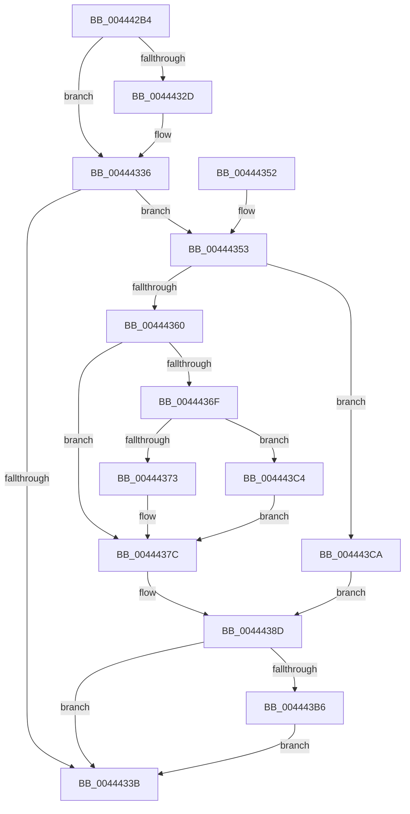

# MiUpdatePfnBackingStore

- RVA: `0x004442B4`–`0x004443D4` (길이 `288` bytes)
- VA: `0x00000001404442B4`
- 실행 섹션: `.text`
- PDB 이름 있음: `예`; PDB Function 태그: `아니요`
- unwind 정보 RVA: `0x000A5694`
- 디코드: `82`개 명령, `288/288` bytes 표시
- 미해석 바이트: `0` (있으면 어셈블리에 `.byte`로 보존)

> 이 문서는 커널 이미지의 기계어와 PDB 기호를 분석해 생성했습니다. 4번과 5번은 함수 원형과 자료형을 바이너리 사용 방식에서 추정한 C 해석이며 원본 소스 복구 결과는 아닙니다.

## 1. Dependencies

- 직접 호출 지점: **3**; 고유 호출 대상: **3**
- 직접 호출자로 확인된 함수: **2**
- RIP 상대 이미지 참조: **1**

### Outgoing calls
- `0x004442ED` → [MI_READ_PTE_LOCK_FREE](../28/MI_READ_PTE_LOCK_FREE_function_002828A0.md) (function, `0x002828A0`)
- `0x00444388` → [MiSwizzleInvalidPte](../28/MiSwizzleInvalidPte_function_0028F5E0.md) (function, `0x0028F5E0`)
- `0x004443CD` → [MiMakePageFilePte](../38/MiMakePageFilePte_function_003823C8.md) (function, `0x003823C8`)

### Direct callers
- [MiStoreWriteModifiedPages](../2B/MiStoreWriteModifiedPages_function_002B46C4.md) at `0x002B4DA8`
- [MiGatherPagefilePages](../37/MiGatherPagefilePages_function_00372B08.md) at `0x00372F73`

### Static image references
- `0x00444360` → RVA `0x00E2DC80` (`.data`; read)

## 2. Other-region calls and transfers

- 다른 실행 섹션으로 향하는 call: **0**
- 별도 외부 분기/꼬리 이동을 확인하지 못했습니다.

## 3. Assembly (complete function range)

```asm
004442B4  4C 8B DC                        mov r11, rsp
004442B7  49 89 5B 10                     mov qword ptr [r11 + 0x10], rbx
004442BB  49 89 6B 18                     mov qword ptr [r11 + 0x18], rbp
004442BF  56                              push rsi
004442C0  57                              push rdi
004442C1  41 56                           push r14
004442C3  48 83 EC 20                     sub rsp, 0x20
004442C7  48 8B 59 10                     mov rbx, qword ptr [rcx + 0x10]
004442CB  48 8B E9                        mov rbp, rcx
004442CE  48 8B C3                        mov rax, rbx
004442D1  41 8B F0                        mov esi, r8d
004442D4  48 D1 E8                        shr rax, 1
004442D7  49 8D 4B 08                     lea rcx, [r11 + 8]
004442DB  83 E0 01                        and eax, 1
004442DE  49 89 5B 08                     mov qword ptr [r11 + 8], rbx
004442E2  48 8B FA                        mov rdi, rdx
004442E5  44 8D 34 45 01 00 00 00         lea r14d, [rax*2 + 1]
004442ED  E8 AE E5 E3 FF                  call 0x1402828a0
004442F2  4C 8B C0                        mov r8, rax
004442F5  41 81 E0 00 04 00 00            and r8d, 0x400
004442FC  49 F7 D8                        neg r8
004442FF  48 1B C9                        sbb rcx, rcx
00444302  48 81 E1 08 F8 FF FF            and rcx, 0xfffffffffffff808
00444309  48 83 C1 F7                     add rcx, -9
0044430D  48 23 C8                        and rcx, rax
00444310  41 F6 C6 04                     test r14b, 4
00444314  48 89 4C 24 40                  mov qword ptr [rsp + 0x40], rcx
00444319  48 8B 54 24 40                  mov rdx, qword ptr [rsp + 0x40]
0044431E  0F 94 C1                        sete cl
00444321  48 0F BA E3 0A                  bt rbx, 0xa
00444326  0F 93 C0                        setae al
00444329  84 C8                           test al, cl
0044432B  74 09                           je 0x140444336
0044432D  48 83 E2 F9                     and rdx, 0xfffffffffffffff9
00444331  48 89 54 24 40                  mov qword ptr [rsp + 0x40], rdx
00444336  48 85 FF                        test rdi, rdi
00444339  75 18                           jne 0x140444353
0044433B  48 8B 5C 24 48                  mov rbx, qword ptr [rsp + 0x48]
00444340  48 89 55 10                     mov qword ptr [rbp + 0x10], rdx
00444344  48 8B 6C 24 50                  mov rbp, qword ptr [rsp + 0x50]
00444349  48 83 C4 20                     add rsp, 0x20
0044434D  41 5E                           pop r14
0044434F  5F                              pop rdi
00444350  5E                              pop rsi
00444351  C3                              ret
00444352  CC                              int3
00444353  44 0F B7 8F AC 00 00 00         movzx r9d, word ptr [rdi + 0xac]
0044435B  48 85 D2                        test rdx, rdx
0044435E  74 6A                           je 0x1404443ca
00444360  48 8B 0D 19 99 9E 00            mov rcx, qword ptr [rip + 0x9e9919]
00444367  48 8B C2                        mov rax, rdx
0044436A  48 85 C9                        test rcx, rcx
0044436D  74 0D                           je 0x14044437c
0044436F  A8 10                           test al, 0x10
00444371  75 51                           jne 0x1404443c4
00444373  48 8B D1                        mov rdx, rcx
00444376  48 F7 D2                        not rdx
00444379  48 23 D0                        and rdx, rax
0044437C  8B C2                           mov eax, edx
0044437E  48 8B CE                        mov rcx, rsi
00444381  48 C1 E1 20                     shl rcx, 0x20
00444385  48 0B C8                        or rcx, rax
00444388  E8 53 B2 E4 FF                  call 0x14028f5e0
0044438D  4C 8B C0                        mov r8, rax
00444390  49 8B C1                        mov rax, r9
00444393  48 C1 E0 0C                     shl rax, 0xc
00444397  48 8B D0                        mov rdx, rax
0044439A  49 33 D0                        xor rdx, r8
0044439D  48 81 E2 FF 0F FF FF            and rdx, 0xffffffffffff0fff
004443A4  48 33 D0                        xor rdx, rax
004443A7  48 83 CA 04                     or rdx, 4
004443AB  48 89 54 24 40                  mov qword ptr [rsp + 0x40], rdx
004443B0  41 F6 C6 02                     test r14b, 2
004443B4  74 85                           je 0x14044433b
004443B6  48 83 CA 02                     or rdx, 2
004443BA  48 89 54 24 40                  mov qword ptr [rsp + 0x40], rdx
004443BF  E9 77 FF FF FF                  jmp 0x14044433b
004443C4  48 83 E2 EF                     and rdx, 0xffffffffffffffef
004443C8  EB B2                           jmp 0x14044437c
004443CA  48 8B CE                        mov rcx, rsi
004443CD  E8 F6 DF F3 FF                  call 0x1403823c8
004443D2  EB B9                           jmp 0x14044438d
```

## 4. C-style interpretation (structured pseudocode)

```c
__int64 __fastcall MiUpdatePfnBackingStore(__int64 a1, __int64 a2, int a3)
{
    __int64 result;
    __int64 v_rsp;
    unsigned __int64 v_stack_p10;
    unsigned __int64 v_stack_p18;
    unsigned __int64 v_stack_p40;
    unsigned __int64 v_stack_p8;

    *(unsigned __int64 *)(v_rsp + 16) = v_rbx;
    *(unsigned __int64 *)(v_rsp + 24) = v_rbp;
    v_rsp = (v_rsp) - (32);
    result = (*(unsigned __int64 *)(a1 + 16)) >> (1);
    result = (unsigned int)((result) & (1));
    *(unsigned __int64 *)(v_rsp + 8) = *(unsigned __int64 *)(a1 + 16);
    result = MI_READ_PTE_LOCK_FREE(v_rsp + 8, a2, a3, a4);
    a3 = (unsigned int)((result) & (0x400ULL));
    a3 = -(a3);
    a1 = (v_rsp + 8) & (0xFFFFFFFFFFFFF808ULL);
    a1 = (a1) + (-9);
    a1 = (a1) & (result);
    v_stack_p8 = a1;
    a1 = ((((unsigned __int8)(result * 2 + 1)) & (4)) == 0) ? 1 : 0;
    result = (condition_is_above_or_equal) ? 1 : 0;
    if ((((unsigned __int8)(result)) & ((unsigned __int8)(a1))) != 0) {
        a2 = (v_stack_p8) & (-7);
        v_stack_p8 = a2;
    }
    if (a2 != 0) goto loc_00444353;
loc_0044433B:
    *(unsigned __int64 *)(a1 + 16) = a2;
    v_rsp = (v_rsp) + (32);
    return result;
loc_00444353:
    if (a2 == 0) goto loc_004443CA;
    if (*(unsigned __int64 *)(v_rip + 10393881) == 0) goto loc_0044437C;
    if ((((unsigned __int8)(a2)) & (16)) != 0) goto loc_004443C4;
    a2 = ~(*(unsigned __int64 *)(v_rip + 10393881));
    a2 = (a2) & (a2);
loc_0044437C:
    a1 = ((unsigned int)(a3)) << (32);
    a1 = (a1) | ((unsigned int)((unsigned int)(a2)));
    result = MiSwizzleInvalidPte(a1, a2, a3, *(unsigned __int16 *)(a2 + 172));
loc_0044438D:
    result = (*(unsigned __int16 *)(a2 + 172)) << (12);
    a2 = (result) ^ (result);
    a2 = (a2) & (0xFFFFFFFFFFFF0FFFULL);
    a2 = (a2) ^ (result);
    a2 = (a2) | (4);
    v_stack_p40 = a2;
    if ((((unsigned __int8)(result * 2 + 1)) & (2)) == 0) goto loc_0044433B;
    a2 = (a2) | (2);
    v_stack_p40 = a2;
    goto loc_0044433B;
loc_004443C4:
    a2 = (a2) & (-17);
    goto loc_0044437C;
loc_004443CA:
    result = MiMakePageFilePte((unsigned int)(a3), a2, result, *(unsigned __int16 *)(a2 + 172));
    goto loc_0044438D;
}
```

## 5. (Beta) C Style

```c
int64_t MiUpdatePfnBackingStore(void *Arg1, int64_t Arg2, int32_t Arg3)
{
    uint8_t *arg1 = (uint8_t *)Arg1;

    int64_t result;
    int64_t local_rsp;
    uint64_t v_stack_p10;
    uint64_t v_stack_p18;
    uint64_t v_stack_p40;
    uint64_t v_stack_p8;

    *(uint64_t *)(local_rsp + 0x10) = local_rbx;
    *(uint64_t *)(local_rsp + 0x18) = local_rbp;
    local_rsp = (local_rsp) - (32);
    result = (*(uint64_t *)(arg1 + 0x10)) >> (1);
    result = (uint32_t)((result) & (1));
    *(uint64_t *)(local_rsp + 0x8) = *(uint64_t *)(arg1 + 0x10);
    result = MI_READ_PTE_LOCK_FREE(local_rsp + 8, Arg2, Arg3, a4);
    Arg3 = (uint32_t)((result) & (0x400ULL));
    Arg3 = -(Arg3);
    Arg1 = (local_rsp + 8) & (0xFFFFFFFFFFFFF808ULL);
    Arg1 = (Arg1) + (-9);
    Arg1 = (Arg1) & (result);
    v_stack_p8 = Arg1;
    Arg1 = ((((uint8_t)(result * 2 + 1)) & (4)) == 0) ? 1 : 0;
    result = (condition_is_above_or_equal) ? 1 : 0;
    if ((((uint8_t)(result)) & ((uint8_t)(Arg1))) != 0) {
        Arg2 = (v_stack_p8) & (-7);
        v_stack_p8 = Arg2;
    }
    if (Arg2 != 0) goto loc_00444353;
loc_0044433B:
    *(uint64_t *)(arg1 + 0x10) = Arg2;
    local_rsp = (local_rsp) + (32);
    return result;
loc_00444353:
    if (Arg2 == 0) goto loc_004443CA;
    if (*(uint64_t *)(v_rip + 0x9E9919) == 0) goto loc_0044437C;
    if ((((uint8_t)(Arg2)) & (16)) != 0) goto loc_004443C4;
    Arg2 = ~(*(uint64_t *)(v_rip + 0x9E9919));
    Arg2 = (Arg2) & (Arg2);
loc_0044437C:
    Arg1 = ((uint32_t)(Arg3)) << (32);
    Arg1 = (Arg1) | ((uint32_t)((uint32_t)(Arg2)));
    result = MiSwizzleInvalidPte(Arg1, Arg2, Arg3, *(uint16_t *)(Arg2 + 0xAC));
loc_0044438D:
    result = (*(uint16_t *)(Arg2 + 0xAC)) << (12);
    Arg2 = (result) ^ (result);
    Arg2 = (Arg2) & (0xFFFFFFFFFFFF0FFFULL);
    Arg2 = (Arg2) ^ (result);
    Arg2 = (Arg2) | (4);
    v_stack_p40 = Arg2;
    if ((((uint8_t)(result * 2 + 1)) & (2)) == 0) goto loc_0044433B;
    Arg2 = (Arg2) | (2);
    v_stack_p40 = Arg2;
    goto loc_0044433B;
loc_004443C4:
    Arg2 = (Arg2) & (-17);
    goto loc_0044437C;
loc_004443CA:
    result = MiMakePageFilePte((uint32_t)(Arg3), Arg2, result, *(uint16_t *)(Arg2 + 0xAC));
    goto loc_0044438D;
}
```

### 관측된 메모리 오프셋

구조체 형식이 확인되지 않은 접근은 인자 기준의 오프셋으로만 기록했습니다.

| 기준 인자 | 오프셋 표현 | 폭 (bit) | 접근 |
|---|---:|---:|---|
| `Arg1` | `+ 0x10` | `64` | `R` |
| `Arg1` | `+ 0x10` | `64` | `W` |

## 6. Execution-region graph

[열기: 2D/3D 그래프와 함수 탐색 컨트롤 패널](../../../control-panel.html?section=text&rva=0x004442B4&view=graph)

- 2D 그래프는 위에서 아래로 흐르고, 3D 그래프는 빈 공간을 드래그해 회전합니다. Shift+드래그는 이동, 휠은 확대·축소, 함수 노드 선택은 대상 보고서 이동입니다.

### Static fallback


