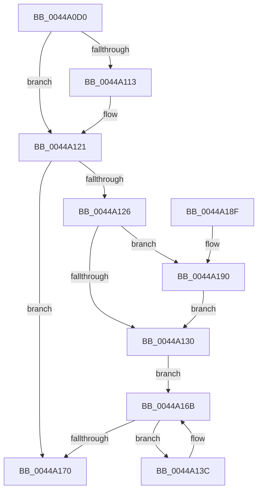

# MiUpdateRetpolineImportFixups

- RVA: `0x0044A0D0`–`0x0044A1C3` (길이 `243` bytes)
- VA: `0x000000014044A0D0`
- 실행 섹션: `.text`
- PDB 이름 있음: `예`; PDB Function 태그: `아니요`
- unwind 정보 RVA: `0x000A6414`
- 디코드: `68`개 명령, `243/243` bytes 표시
- 미해석 바이트: `0` (있으면 어셈블리에 `.byte`로 보존)

> 이 문서는 커널 이미지의 기계어와 PDB 기호를 분석해 생성했습니다. 4번과 5번은 함수 원형과 자료형을 바이너리 사용 방식에서 추정한 C 해석이며 원본 소스 복구 결과는 아닙니다.

## 1. Dependencies

- 직접 호출 지점: **2**; 고유 호출 대상: **1**
- 직접 호출자로 확인된 함수: **1**
- RIP 상대 이미지 참조: **2**

### Outgoing calls
- `0x0044A162` → [RtlApplyImportRelocationToPage](RtlApplyImportRelocationToPage_function_0044A3C0.md) (function, `0x0044A3C0`)
- `0x0044A1B9` → [RtlApplyImportRelocationToPage](RtlApplyImportRelocationToPage_function_0044A3C0.md) (function, `0x0044A3C0`)

### Direct callers
- [MiUpdateImagePfnImportRelocations](MiUpdateImagePfnImportRelocations_function_00449E84.md) at `0x00449F84`

### Static image references
- `0x0044A0ED` → RVA `0x00FC6B48` (`ALMOSTRO`; read)
- `0x0044A13C` → RVA `0x00E2D830` (`.data`; read)

## 2. Other-region calls and transfers

- 다른 실행 섹션으로 향하는 call: **0**
- 별도 외부 분기/꼬리 이동을 확인하지 못했습니다.

## 3. Assembly (complete function range)

```asm
0044A0D0  48 8B C4                        mov rax, rsp
0044A0D3  48 89 58 08                     mov qword ptr [rax + 8], rbx
0044A0D7  48 89 68 10                     mov qword ptr [rax + 0x10], rbp
0044A0DB  48 89 70 18                     mov qword ptr [rax + 0x18], rsi
0044A0DF  48 89 78 20                     mov qword ptr [rax + 0x20], rdi
0044A0E3  41 54                           push r12
0044A0E5  41 56                           push r14
0044A0E7  41 57                           push r15
0044A0E9  48 83 EC 40                     sub rsp, 0x40
0044A0ED  48 8B 05 54 CA B7 00            mov rax, qword ptr [rip + 0xb7ca54]
0044A0F4  4C 8B F2                        mov r14, rdx
0044A0F7  41 8B D8                        mov ebx, r8d
0044A0FA  45 33 FF                        xor r15d, r15d
0044A0FD  48 0F BA E0 29                  bt rax, 0x29
0044A102  BA 01 00 00 00                  mov edx, 1
0044A107  4C 8B E1                        mov r12, rcx
0044A10A  8B EA                           mov ebp, edx
0044A10C  49 8B 74 DE 40                  mov rsi, qword ptr [r14 + rbx*8 + 0x40]
0044A111  72 0E                           jb 0x14044a121
0044A113  49 8B 46 10                     mov rax, qword ptr [r14 + 0x10]
0044A117  44 8B FA                        mov r15d, edx
0044A11A  48 F7 D8                        neg rax
0044A11D  1B C9                           sbb ecx, ecx
0044A11F  23 E9                           and ebp, ecx
0044A121  48 85 F6                        test rsi, rsi
0044A124  74 4A                           je 0x14044a170
0044A126  C1 E3 0C                        shl ebx, 0xc
0044A129  66 83 7E 06 03                  cmp word ptr [rsi + 6], 3
0044A12E  74 60                           je 0x14044a190
0044A130  48 8D 7E 0C                     lea rdi, [rsi + 0xc]
0044A134  0F B7 36                        movzx esi, word ptr [rsi]
0044A137  48 03 F7                        add rsi, rdi
0044A13A  EB 2F                           jmp 0x14044a16b
0044A13C  4C 8B 0D ED 36 9E 00            mov r9, qword ptr [rip + 0x9e36ed]
0044A143  4D 8B C6                        mov r8, r14
0044A146  44 89 7C 24 38                  mov dword ptr [rsp + 0x38], r15d
0044A14B  49 83 C1 04                     add r9, 4
0044A14F  83 64 24 30 00                  and dword ptr [rsp + 0x30], 0
0044A154  8B D3                           mov edx, ebx
0044A156  89 6C 24 28                     mov dword ptr [rsp + 0x28], ebp
0044A15A  49 8B CC                        mov rcx, r12
0044A15D  48 89 7C 24 20                  mov qword ptr [rsp + 0x20], rdi
0044A162  E8 59 02 00 00                  call 0x14044a3c0
0044A167  48 83 C7 04                     add rdi, 4
0044A16B  48 3B FE                        cmp rdi, rsi
0044A16E  72 CC                           jb 0x14044a13c
0044A170  48 8B 5C 24 60                  mov rbx, qword ptr [rsp + 0x60]
0044A175  48 8B 6C 24 68                  mov rbp, qword ptr [rsp + 0x68]
0044A17A  48 8B 74 24 70                  mov rsi, qword ptr [rsp + 0x70]
0044A17F  48 8B 7C 24 78                  mov rdi, qword ptr [rsp + 0x78]
0044A184  48 83 C4 40                     add rsp, 0x40
0044A188  41 5F                           pop r15
0044A18A  41 5E                           pop r14
0044A18C  41 5C                           pop r12
0044A18E  C3                              ret
0044A18F  CC                              int3
0044A190  4C 8B 0D 99 36 9E 00            mov r9, qword ptr [rip + 0x9e3699]
0044A197  48 8D 46 08                     lea rax, [rsi + 8]
0044A19B  44 89 7C 24 38                  mov dword ptr [rsp + 0x38], r15d
0044A1A0  49 83 C1 04                     add r9, 4
0044A1A4  89 54 24 30                     mov dword ptr [rsp + 0x30], edx
0044A1A8  4D 8B C6                        mov r8, r14
0044A1AB  89 6C 24 28                     mov dword ptr [rsp + 0x28], ebp
0044A1AF  8B D3                           mov edx, ebx
0044A1B1  49 8B CC                        mov rcx, r12
0044A1B4  48 89 44 24 20                  mov qword ptr [rsp + 0x20], rax
0044A1B9  E8 02 02 00 00                  call 0x14044a3c0
0044A1BE  E9 6D FF FF FF                  jmp 0x14044a130
```

## 4. C-style interpretation (structured pseudocode)

```c
__int64 __fastcall MiUpdateRetpolineImportFixups(__int64 a1, __int64 a2, int a3)
{
    __int64 result;
    __int64 v_r15;
    __int64 v_rbp;
    __int64 v_rbx;
    __int64 v_rdi;
    __int64 v_rsi;
    __int64 v_rsp;
    unsigned int v_stack_m20;
    unsigned int v_stack_m28;
    unsigned int v_stack_m30;
    unsigned __int64 v_stack_m38;
    unsigned __int64 v_stack_p10;
    unsigned __int64 v_stack_p18;
    unsigned __int64 v_stack_p20;
    unsigned int v_stack_p28;
    unsigned int v_stack_p30;
    unsigned int v_stack_p38;
    unsigned __int64 v_stack_p8;

    *(unsigned __int64 *)(v_rsp + 8) = v_rbx;
    *(unsigned __int64 *)(v_rsp + 16) = v_rbp;
    *(unsigned __int64 *)(v_rsp + 24) = v_rsi;
    *(unsigned __int64 *)(v_rsp + 32) = v_rdi;
    v_rsp = (v_rsp) - (64);
    v_r15 = 0;
    result = *(unsigned __int64 *)(v_rip + 12044884);
    v_rbp = 1;
    if (!(condition_is_below)) {
        result = *(unsigned __int64 *)(a2 + 16);
        v_r15 = 1;
        result = -(result);
        v_rbp = (unsigned int)((1) & ((unsigned int)(a1)));
    }
    if (*(unsigned __int64 *)(a2 + (unsigned int)(a3) * 8 + 64) == 0) goto loc_0044A170;
    v_rbx = (unsigned int)(((unsigned int)(a3)) << (12));
    if ((*(unsigned __int16 *)(*(unsigned __int64 *)(a2 + (unsigned int)(a3) * 8 + 64) + 6)) == 3) goto loc_0044A190;
loc_0044A130:
    v_rsi = (*(unsigned __int16 *)(*(unsigned __int64 *)(a2 + (unsigned int)(a3) * 8 + 64))) + (*(unsigned __int64 *)(a2 + (unsigned int)(a3) * 8 + 64) + 12);
    goto loc_0044A16B;
loc_0044A13C:
    v_stack_m20 = (unsigned int)(v_r15);
    a4 = (*(unsigned __int64 *)(v_rip + 10368749)) + (4);
    v_stack_m30 = (unsigned int)(v_rbp);
    v_stack_m38 = *(unsigned __int64 *)(a2 + (unsigned int)(a3) * 8 + 64) + 12;
    result = RtlApplyImportRelocationToPage(a1, (unsigned int)((unsigned int)(v_rbx)), a2, a4);
    v_rdi = (*(unsigned __int64 *)(a2 + (unsigned int)(a3) * 8 + 64) + 12) + (4);
loc_0044A16B:
    if (v_rdi < v_rsi) goto loc_0044A13C;
loc_0044A170:
    v_rsp = (v_rsp) + (64);
    return result;
loc_0044A190:
    v_stack_p38 = (unsigned int)(v_r15);
    a4 = (*(unsigned __int64 *)(v_rip + 10368665)) + (4);
    v_stack_p30 = (unsigned int)((unsigned int)((unsigned int)(v_rbx)));
    v_stack_p28 = (unsigned int)(v_stack_p10);
    v_stack_p20 = v_stack_p18 + 8;
    result = RtlApplyImportRelocationToPage(a1, (unsigned int)((unsigned int)(v_stack_p8)), a2, a4);
    goto loc_0044A130;
}
```

## 5. (Beta) C Style

```c
int64_t MiUpdateRetpolineImportFixups(int64_t Arg1, void *Arg2, int32_t Arg3)
{
    uint8_t *arg2 = (uint8_t *)Arg2;

    int64_t result;
    int64_t local_r15;
    int64_t local_rbp;
    int64_t local_rbx;
    int64_t local_rdi;
    int64_t local_rsi;
    int64_t local_rsp;
    uint32_t v_stack_m20;
    uint32_t v_stack_m28;
    uint32_t v_stack_m30;
    uint64_t v_stack_m38;
    uint64_t v_stack_p10;
    uint64_t v_stack_p18;
    uint64_t v_stack_p20;
    uint32_t v_stack_p28;
    uint32_t v_stack_p30;
    uint32_t v_stack_p38;
    uint64_t v_stack_p8;

    *(uint64_t *)(local_rsp + 0x8) = local_rbx;
    *(uint64_t *)(local_rsp + 0x10) = local_rbp;
    *(uint64_t *)(local_rsp + 0x18) = local_rsi;
    *(uint64_t *)(local_rsp + 0x20) = local_rdi;
    local_rsp = (local_rsp) - (64);
    local_r15 = 0;
    result = *(uint64_t *)(v_rip + 0xB7CA54);
    local_rbp = 1;
    if (!(condition_is_below)) {
        result = *(uint64_t *)(arg2 + 0x10);
        local_r15 = 1;
        result = -(result);
        local_rbp = (uint32_t)((1) & ((uint32_t)(Arg1)));
    }
    if (*(uint64_t *)(arg2 + (uint32_t)(Arg3) * 8 + 0x40) == 0) goto loc_0044A170;
    local_rbx = (uint32_t)(((uint32_t)(Arg3)) << (12));
    if ((*(uint16_t *)(*(uint64_t *)(arg2 + (uint32_t)(Arg3) * 8 + 0x40) + 0x6)) == 3) goto loc_0044A190;
loc_0044A130:
    local_rsi = (*(uint16_t *)(*(uint64_t *)(arg2 + (uint32_t)(Arg3) * 8 + 0x40))) + (*(uint64_t *)(arg2 + (uint32_t)(Arg3) * 8 + 0x40) + 12);
    goto loc_0044A16B;
loc_0044A13C:
    v_stack_m20 = (uint32_t)(local_r15);
    a4 = (*(uint64_t *)(v_rip + 0x9E36ED)) + (4);
    v_stack_m30 = (uint32_t)(local_rbp);
    v_stack_m38 = *(uint64_t *)(arg2 + (uint32_t)(Arg3) * 8 + 0x40) + 12;
    result = RtlApplyImportRelocationToPage(Arg1, (uint32_t)((uint32_t)(local_rbx)), Arg2, a4);
    local_rdi = (*(uint64_t *)(arg2 + (uint32_t)(Arg3) * 8 + 0x40) + 12) + (4);
loc_0044A16B:
    if (local_rdi < local_rsi) goto loc_0044A13C;
loc_0044A170:
    local_rsp = (local_rsp) + (64);
    return result;
loc_0044A190:
    v_stack_p38 = (uint32_t)(local_r15);
    a4 = (*(uint64_t *)(v_rip + 0x9E3699)) + (4);
    v_stack_p30 = (uint32_t)((uint32_t)((uint32_t)(local_rbx)));
    v_stack_p28 = (uint32_t)(v_stack_p10);
    v_stack_p20 = v_stack_p18 + 8;
    result = RtlApplyImportRelocationToPage(Arg1, (uint32_t)((uint32_t)(v_stack_p8)), Arg2, a4);
    goto loc_0044A130;
}
```

### 관측된 메모리 오프셋

구조체 형식이 확인되지 않은 접근은 인자 기준의 오프셋으로만 기록했습니다.

| 기준 인자 | 오프셋 표현 | 폭 (bit) | 접근 |
|---|---:|---:|---|
| `Arg2` | `+ 0x10` | `64` | `R` |
| `Arg2` | `+ 0x40 + rbx*8` | `64` | `R` |

## 6. Execution-region graph

[열기: 2D/3D 그래프와 함수 탐색 컨트롤 패널](../../../control-panel.html?section=text&rva=0x0044A0D0&view=graph)

- 2D 그래프는 위에서 아래로 흐르고, 3D 그래프는 빈 공간을 드래그해 회전합니다. Shift+드래그는 이동, 휠은 확대·축소, 함수 노드 선택은 대상 보고서 이동입니다.

### Static fallback


