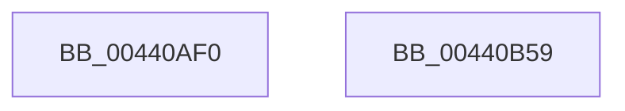

# NtAccessCheckByType

- RVA: `0x00440AF0`–`0x00440B5A` (길이 `106` bytes)
- VA: `0x0000000140440AF0`
- 실행 섹션: `.text`
- PDB 이름 있음: `예`; PDB Function 태그: `아니요`
- unwind 정보 RVA: `0x0007A034`
- 디코드: `21`개 명령, `106/106` bytes 표시
- 미해석 바이트: `0` (있으면 어셈블리에 `.byte`로 보존)

> 이 문서는 커널 이미지의 기계어와 PDB 기호를 분석해 생성했습니다. 4번과 5번은 함수 원형과 자료형을 바이너리 사용 방식에서 추정한 C 해석이며 원본 소스 복구 결과는 아닙니다.

## 1. Dependencies

- 직접 호출 지점: **1**; 고유 호출 대상: **1**
- 직접 호출자로 확인된 함수: **0**
- RIP 상대 이미지 참조: **0**

### Outgoing calls
- `0x00440B4F` → [SeAccessCheckByType](SeAccessCheckByType_function_00440BC8.md) (function, `0x00440BC8`)

### Direct callers
- 이 함수 시작 RVA로 연결되는 직접 call은 확인되지 않았습니다. 간접 호출은 완전히 역산할 수 없습니다.

### Static image references
- 디코드된 RIP-relative 메모리 참조가 없습니다.

## 2. Other-region calls and transfers

- 다른 실행 섹션으로 향하는 call: **0**
- 별도 외부 분기/꼬리 이동을 확인하지 못했습니다.

## 3. Assembly (complete function range)

```asm
00440AF0  4C 8B DC                        mov r11, rsp
00440AF3  48 83 EC 68                     sub rsp, 0x68
00440AF7  48 8B 84 24 C0 00 00 00         mov rax, qword ptr [rsp + 0xc0]
00440AFF  C6 44 24 58 00                  mov byte ptr [rsp + 0x58], 0
00440B04  49 89 43 E8                     mov qword ptr [r11 - 0x18], rax
00440B08  48 8B 84 24 B8 00 00 00         mov rax, qword ptr [rsp + 0xb8]
00440B10  49 89 43 E0                     mov qword ptr [r11 - 0x20], rax
00440B14  48 8B 84 24 B0 00 00 00         mov rax, qword ptr [rsp + 0xb0]
00440B1C  49 89 43 D8                     mov qword ptr [r11 - 0x28], rax
00440B20  48 8B 84 24 A8 00 00 00         mov rax, qword ptr [rsp + 0xa8]
00440B28  49 89 43 D0                     mov qword ptr [r11 - 0x30], rax
00440B2C  48 8B 84 24 A0 00 00 00         mov rax, qword ptr [rsp + 0xa0]
00440B34  49 89 43 C8                     mov qword ptr [r11 - 0x38], rax
00440B38  8B 84 24 98 00 00 00            mov eax, dword ptr [rsp + 0x98]
00440B3F  89 44 24 28                     mov dword ptr [rsp + 0x28], eax
00440B43  48 8B 84 24 90 00 00 00         mov rax, qword ptr [rsp + 0x90]
00440B4B  49 89 43 B8                     mov qword ptr [r11 - 0x48], rax
00440B4F  E8 74 00 00 00                  call 0x140440bc8
00440B54  48 83 C4 68                     add rsp, 0x68
00440B58  C3                              ret
00440B59  CC                              int3
```

## 4. C-style interpretation (structured pseudocode)

```c
__int64 __fastcall NtAccessCheckByType(__int64 a1, __int64 a2, __int64 a3, __int64 a4, __int64 a5, unsigned int a6, __int64 a7, __int64 a8, __int64 a9, __int64 a10, __int64 a11)
{
    __int64 result;
    __int64 v_rsp;
    unsigned __int8 v_stack_m10;
    unsigned int v_stack_m40;

    v_rsp = (v_rsp) - (104);
    v_stack_m10 = 0;
    *(unsigned __int64 *)(v_rsp - 24) = a11;
    *(unsigned __int64 *)(v_rsp - 32) = a10;
    *(unsigned __int64 *)(v_rsp - 40) = a9;
    *(unsigned __int64 *)(v_rsp - 48) = a8;
    *(unsigned __int64 *)(v_rsp - 56) = a7;
    v_stack_m40 = (unsigned int)((unsigned int)(a6));
    *(unsigned __int64 *)(v_rsp - 72) = a5;
    result = SeAccessCheckByType(a1, a2, a3, a4);
    v_rsp = (v_rsp) + (104);
    return result;
}
```

## 5. (Beta) C Style

```c
int64_t NtAccessCheckByType(int64_t Arg1, int64_t Arg2, int64_t Arg3, int64_t Arg4, int64_t Arg5, uint32_t Arg6, int64_t Arg7, int64_t Arg8, int64_t Arg9, int64_t Arg10, int64_t Arg11)
{
    int64_t result;
    int64_t local_rsp;
    uint8_t v_stack_m10;
    uint32_t v_stack_m40;

    local_rsp = (local_rsp) - (104);
    v_stack_m10 = 0;
    *(uint64_t *)(local_rsp - 0x18) = Arg11;
    *(uint64_t *)(local_rsp - 0x20) = Arg10;
    *(uint64_t *)(local_rsp - 0x28) = Arg9;
    *(uint64_t *)(local_rsp - 0x30) = Arg8;
    *(uint64_t *)(local_rsp - 0x38) = Arg7;
    v_stack_m40 = (uint32_t)((uint32_t)(Arg6));
    *(uint64_t *)(local_rsp - 0x48) = Arg5;
    result = SeAccessCheckByType(Arg1, Arg2, Arg3, Arg4);
    local_rsp = (local_rsp) + (104);
    return result;
}
```

## 6. Execution-region graph

[열기: 2D/3D 그래프와 함수 탐색 컨트롤 패널](../../../control-panel.html?section=text&rva=0x00440AF0&view=graph)

- 2D 그래프는 위에서 아래로 흐르고, 3D 그래프는 빈 공간을 드래그해 회전합니다. Shift+드래그는 이동, 휠은 확대·축소, 함수 노드 선택은 대상 보고서 이동입니다.

### Static fallback


